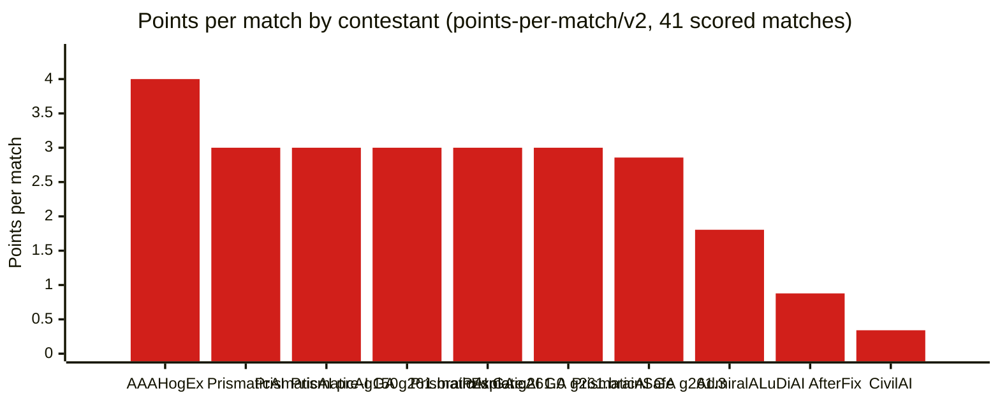
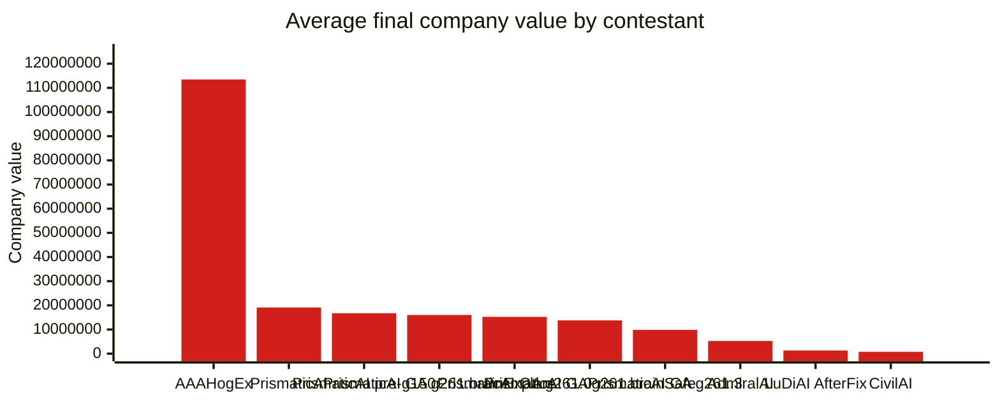
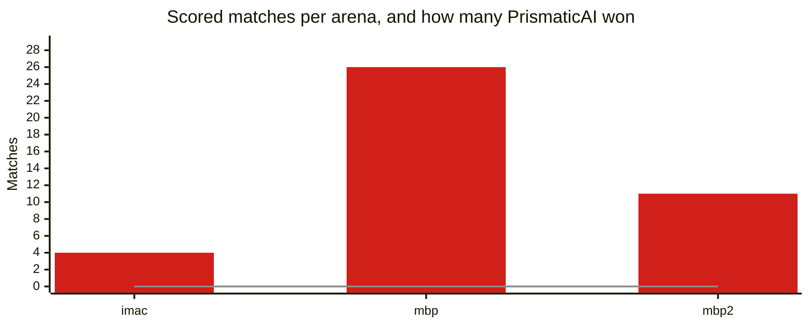

# battle-20261121T103138-67f19f14

Derived from `battle-20261121T103138-67f19f14.json` by `tools/research/ai-battle/battle.py report`; do not edit.

- Edition `67f19f146a4dd3ca`: PrismaticAI and referee at `52f631b115782334f422f741a79ecabce78e58c4`, base set `opengfx-8.0.tar`
- 20-year free-for-all from 1960, map 256x256 temperate, breakdowns 1
- 41 scored match(es) on `imac` (20261119-master-gdf1e05e7d8), `mbp` (20261120-master-m17653b726e), `mbp2` (20261119-master-gdf1e05e7d8)
- Replays: 0 of 1 identical to their original on another arena

| # | Contestant | Played | Wins | Points | Points/match | Avg rank | Avg final value | Squirrel errors | Matches with anomalies |
|---|---|---|---|---|---|---|---|---|---|
| 1 | AAAHogEx | 41 | 41 | 164 | 4.0 | 1.0 | 113.5 M | 0 | 0 |
| 2 | PrismaticAI | 6 | 0 | 18 | 3.0 | 2.0 | 19.1 M | 0 | 0 |
| 3 | PrismaticAI pre-g150 | 8 | 0 | 24 | 3.0 | 2.0 | 16.7 M | 0 | 2 |
| 4 | PrismaticAI GA g261.brainExplore | 6 | 0 | 18 | 3.0 | 2.0 | 16.0 M | 0 | 1 |
| 5 | PrismaticAI GA g261.0 | 7 | 0 | 21 | 3.0 | 2.0 | 15.2 M | 0 | 3 |
| 6 | PrismaticAI GA g261.brainSafe | 7 | 0 | 21 | 3.0 | 2.0 | 13.8 M | 0 | 1 |
| 7 | PrismaticAI GA g261.3 | 7 | 0 | 20 | 2.857 | 2.14 | 9.9 M | 0 | 0 |
| 8 | AdmiralAI | 41 | 0 | 74 | 1.805 | 3.2 | 5.3 M | 0 | 0 |
| 9 | LuDiAI AfterFix | 41 | 0 | 36 | 0.878 | 4.12 | 1.3 M | 0 | 5 |
| 10 | CivilAI | 41 | 0 | 14 | 0.341 | 4.66 | 771.6 k | 0 | 4 |

```mermaid
---
config:
  xyChart:
    width: 900
    height: 360
  themeVariables:
    xyChart:
      plotColorPalette: "#d11f1a, #8a8a8a, #0b0b0b, #ece4d6"
---
xychart-beta
    title "Final company value per scored match: winner vs best PrismaticAI"
    x-axis ["m-0001", "m-0002", "m-0003", "m-0004", "m-0005", "m-0006", "m-0007", "m-0008", "m-0009", "m-0010", "m-0011", "m-0012", "m-0013", "m-0014", "m-0015", "m-0017", "m-0018", "m-0019", "m-0020", "m-0021", "m-0022", "m-0023", "m-0028", "m-0036", "m-0037", "m-0038", "m-0039", "m-0040", "m-0041", "m-0042", "m-0043", "m-0044", "m-0045", "m-0047", "m-0049", "m-0050", "m-0051", "m-0052", "m-0053", "m-0054", "m-0055"]
    %% series: Winner | Best PrismaticAI
    %% links: battle-20261121T103138-67f19f14.md?col=Match&filter=m-0001 | battle-20261121T103138-67f19f14.md?col=Match&filter=m-0002 | battle-20261121T103138-67f19f14.md?col=Match&filter=m-0003 | battle-20261121T103138-67f19f14.md?col=Match&filter=m-0004 | battle-20261121T103138-67f19f14.md?col=Match&filter=m-0005 | battle-20261121T103138-67f19f14.md?col=Match&filter=m-0006 | battle-20261121T103138-67f19f14.md?col=Match&filter=m-0007 | battle-20261121T103138-67f19f14.md?col=Match&filter=m-0008 | battle-20261121T103138-67f19f14.md?col=Match&filter=m-0009 | battle-20261121T103138-67f19f14.md?col=Match&filter=m-0010 | battle-20261121T103138-67f19f14.md?col=Match&filter=m-0011 | battle-20261121T103138-67f19f14.md?col=Match&filter=m-0012 | battle-20261121T103138-67f19f14.md?col=Match&filter=m-0013 | battle-20261121T103138-67f19f14.md?col=Match&filter=m-0014 | battle-20261121T103138-67f19f14.md?col=Match&filter=m-0015 | battle-20261121T103138-67f19f14.md?col=Match&filter=m-0017 | battle-20261121T103138-67f19f14.md?col=Match&filter=m-0018 | battle-20261121T103138-67f19f14.md?col=Match&filter=m-0019 | battle-20261121T103138-67f19f14.md?col=Match&filter=m-0020 | battle-20261121T103138-67f19f14.md?col=Match&filter=m-0021 | battle-20261121T103138-67f19f14.md?col=Match&filter=m-0022 | battle-20261121T103138-67f19f14.md?col=Match&filter=m-0023 | battle-20261121T103138-67f19f14.md?col=Match&filter=m-0028 | battle-20261121T103138-67f19f14.md?col=Match&filter=m-0036 | battle-20261121T103138-67f19f14.md?col=Match&filter=m-0037 | battle-20261121T103138-67f19f14.md?col=Match&filter=m-0038 | battle-20261121T103138-67f19f14.md?col=Match&filter=m-0039 | battle-20261121T103138-67f19f14.md?col=Match&filter=m-0040 | battle-20261121T103138-67f19f14.md?col=Match&filter=m-0041 | battle-20261121T103138-67f19f14.md?col=Match&filter=m-0042 | battle-20261121T103138-67f19f14.md?col=Match&filter=m-0043 | battle-20261121T103138-67f19f14.md?col=Match&filter=m-0044 | battle-20261121T103138-67f19f14.md?col=Match&filter=m-0045 | battle-20261121T103138-67f19f14.md?col=Match&filter=m-0047 | battle-20261121T103138-67f19f14.md?col=Match&filter=m-0049 | battle-20261121T103138-67f19f14.md?col=Match&filter=m-0050 | battle-20261121T103138-67f19f14.md?col=Match&filter=m-0051 | battle-20261121T103138-67f19f14.md?col=Match&filter=m-0052 | battle-20261121T103138-67f19f14.md?col=Match&filter=m-0053 | battle-20261121T103138-67f19f14.md?col=Match&filter=m-0054 | battle-20261121T103138-67f19f14.md?col=Match&filter=m-0055
    y-axis "Company value" 0 --> 186000000
    bar [109191358, 116819808, 111207816, 109453567, 99896464, 147992930, 152411854, 132702141, 104547253, 168708065, 134129669, 98078064, 112010571, 111045072, 93097181, 105185078, 75833232, 89790975, 97698037, 93541072, 97756916, 109666554, 111131134, 113277528, 114413210, 104748539, 112438105, 102697060, 118975824, 112903165, 146577762, 119621800, 129306126, 114227202, 98688034, 131661326, 118398809, 115133793, 127000884, 97454315, 93273090]
    line [10085184, 5197891, 9905670, 9589425, 7063954, 24209652, 17985805, 20150085, 17526603, 17743908, 13786075, 23062060, 14196880, 18450863, 11868345, 5221921, 15979573, 18068530, 16581506, 13705869, 15328833, 9150763, 12120356, 16563626, 14270561, 17356420, 14708586, 20436491, 12484624, 16377722, 17313282, 13185450, 12653459, 9731383, 21753850, 15710004, 16066872, 20823730, 11528374, 18423034, 20201976]
```

<!-- battle-charts:begin -->
<!-- derived from battle-20261121T103138-67f19f14.json by `battle.py render`; `battle.py check` fails when it is stale -->

<!-- battle-charts:end -->

| Seed | Original | Replay | Arenas | Identical |
|---|---|---|---|---|
| 1300690772 | m-0010 | m-0048 | imac / mbp | NO |

| Match | Arena | Seed | Winner | Value | Last | Anomalies |
|---|---|---|---|---|---|---|
| m-0001 | mbp | 561309134 | AAAHogEx | 109.2 M | LuDiAI AfterFix | - |
| m-0002 | mbp | 561309134 | AAAHogEx | 116.8 M | CivilAI | CivilAI: no_vehicles |
| m-0003 | mbp | 561309134 | AAAHogEx | 111.2 M | CivilAI | - |
| m-0004 | mbp | 561309134 | AAAHogEx | 109.5 M | CivilAI | - |
| m-0005 | mbp | 561309134 | AAAHogEx | 99.9 M | CivilAI | - |
| m-0006 | mbp | 1300690772 | AAAHogEx | 148.0 M | CivilAI | LuDiAI AfterFix: fleet_drop:45->26 |
| m-0007 | mbp | 1300690772 | AAAHogEx | 152.4 M | AdmiralAI | PrismaticAI pre-g150: fleet_drop:78->53 |
| m-0008 | mbp | 1300690772 | AAAHogEx | 132.7 M | LuDiAI AfterFix | - |
| m-0009 | mbp | 1300690772 | AAAHogEx | 104.5 M | CivilAI | - |
| m-0010 | imac | 1300690772 | AAAHogEx | 168.7 M | AdmiralAI | - |
| m-0011 | imac | 1300690772 | AAAHogEx | 134.1 M | LuDiAI AfterFix | LuDiAI AfterFix: fleet_drop:95->63 |
| m-0012 | imac | 169247364 | AAAHogEx | 98.1 M | LuDiAI AfterFix | - |
| m-0013 | mbp2 | 169247364 | AAAHogEx | 112.0 M | CivilAI | - |
| m-0014 | mbp2 | 169247364 | AAAHogEx | 111.0 M | LuDiAI AfterFix | PrismaticAI GA g261.0: fleet_drop:76->43 |
| m-0015 | mbp2 | 169247364 | AAAHogEx | 93.1 M | CivilAI | - |
| m-0017 | mbp2 | 169247364 | AAAHogEx | 105.2 M | CivilAI | - |
| m-0018 | mbp2 | 587745613 | AAAHogEx | 75.8 M | CivilAI | - |
| m-0019 | mbp2 | 587745613 | AAAHogEx | 89.8 M | CivilAI | PrismaticAI pre-g150: fleet_drop:67->36; LuDiAI AfterFix: fleet_drop:129->86 |
| m-0020 | mbp2 | 587745613 | AAAHogEx | 97.7 M | CivilAI | PrismaticAI GA g261.0: fleet_drop:93->52 |
| m-0021 | mbp2 | 587745613 | AAAHogEx | 93.5 M | CivilAI | - |
| m-0022 | mbp2 | 587745613 | AAAHogEx | 97.8 M | CivilAI | - |
| m-0023 | mbp2 | 587745613 | AAAHogEx | 109.7 M | CivilAI | LuDiAI AfterFix: fleet_drop:50->30 |
| m-0028 | mbp2 | 4962436 | AAAHogEx | 111.1 M | LuDiAI AfterFix | - |
| m-0036 | mbp | 1012122401 | AAAHogEx | 113.3 M | CivilAI | - |
| m-0037 | mbp | 1012122401 | AAAHogEx | 114.4 M | CivilAI | CivilAI: fleet_drop:44->22 |
| m-0038 | mbp | 1012122401 | AAAHogEx | 104.7 M | CivilAI | - |
| m-0039 | mbp | 1012122401 | AAAHogEx | 112.4 M | CivilAI | PrismaticAI GA g261.brainSafe: fleet_drop:71->48 |
| m-0040 | mbp | 1012122401 | AAAHogEx | 102.7 M | CivilAI | PrismaticAI GA g261.brainExplore: fleet_drop:82->54 |
| m-0041 | mbp | 1012122401 | AAAHogEx | 119.0 M | LuDiAI AfterFix | - |
| m-0042 | mbp | 1089394428 | AAAHogEx | 112.9 M | CivilAI | - |
| m-0043 | mbp | 1089394428 | AAAHogEx | 146.6 M | CivilAI | - |
| m-0044 | mbp | 1089394428 | AAAHogEx | 119.6 M | CivilAI | - |
| m-0045 | mbp | 1089394428 | AAAHogEx | 129.3 M | LuDiAI AfterFix | - |
| m-0047 | imac | 1089394428 | AAAHogEx | 114.2 M | LuDiAI AfterFix | LuDiAI AfterFix: fleet_drop:32->21 |
| m-0048 (replay) | mbp | 1300690772 | AAAHogEx | 168.8 M | AdmiralAI | - |
| m-0049 | mbp | 264290495 | AAAHogEx | 98.7 M | CivilAI | CivilAI: fleet_drop:64->12 |
| m-0050 | mbp | 264290495 | AAAHogEx | 131.7 M | CivilAI | PrismaticAI GA g261.0: fleet_drop:90->60 |
| m-0051 | mbp | 264290495 | AAAHogEx | 118.4 M | CivilAI | - |
| m-0052 | mbp | 264290495 | AAAHogEx | 115.1 M | CivilAI | - |
| m-0053 | mbp | 264290495 | AAAHogEx | 127.0 M | CivilAI | CivilAI: fleet_drop:33->15 |
| m-0054 | mbp | 1556303646 | AAAHogEx | 97.5 M | CivilAI | - |
| m-0055 | mbp | 1556303646 | AAAHogEx | 93.3 M | CivilAI | - |
