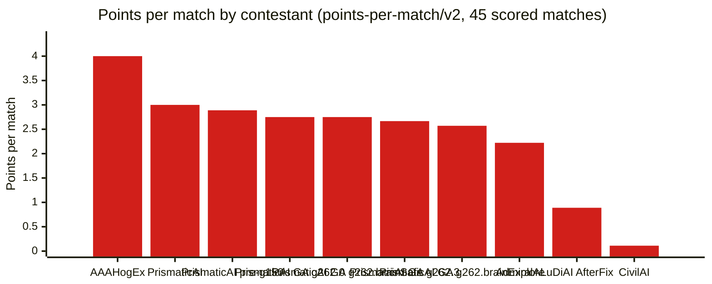
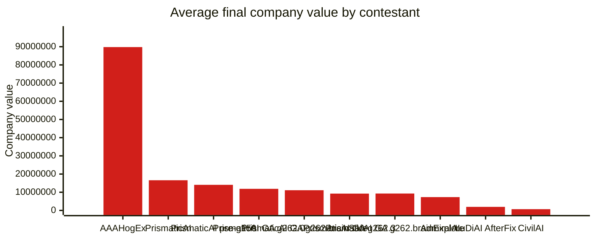
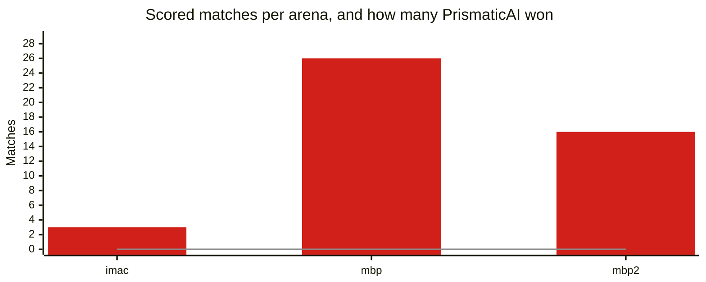

# battle-20261121T104506-62e8980e

Derived from `battle-20261121T104506-62e8980e.json` by `tools/research/ai-battle/battle.py report`; do not edit.

- Edition `62e8980e6c55c9c8`: PrismaticAI and referee at `52f631b115782334f422f741a79ecabce78e58c4`, base set `opengfx-8.0.tar`
- 20-year free-for-all from 1960, map 256x256 temperate, breakdowns 1
- 45 scored match(es) on `imac` (20261119-master-gdf1e05e7d8), `mbp` (20261120-master-m17653b726e), `mbp2` (20261119-master-gdf1e05e7d8)
- Replays: 0 of 1 identical to their original on another arena

| # | Contestant | Played | Wins | Points | Points/match | Avg rank | Avg final value | Squirrel errors | Matches with anomalies |
|---|---|---|---|---|---|---|---|---|---|
| 1 | AAAHogEx | 45 | 45 | 180 | 4.0 | 1.0 | 89.8 M | 0 | 0 |
| 2 | PrismaticAI | 7 | 0 | 21 | 3.0 | 2.0 | 16.6 M | 0 | 0 |
| 3 | PrismaticAI pre-g150 | 9 | 0 | 26 | 2.889 | 2.11 | 14.1 M | 0 | 4 |
| 4 | PrismaticAI GA g262.0 | 8 | 0 | 22 | 2.75 | 2.25 | 11.9 M | 0 | 0 |
| 5 | PrismaticAI GA g262.brainSafe | 8 | 0 | 22 | 2.75 | 2.25 | 11.1 M | 0 | 2 |
| 6 | PrismaticAI GA g262.3 | 6 | 0 | 16 | 2.667 | 2.33 | 9.3 M | 0 | 1 |
| 7 | PrismaticAI GA g262.brainExplore | 7 | 0 | 18 | 2.571 | 2.43 | 9.3 M | 0 | 1 |
| 8 | AdmiralAI | 45 | 0 | 100 | 2.222 | 2.78 | 7.3 M | 0 | 2 |
| 9 | LuDiAI AfterFix | 45 | 0 | 40 | 0.889 | 4.11 | 2.0 M | 0 | 0 |
| 10 | CivilAI | 45 | 0 | 5 | 0.111 | 4.89 | 692.6 k | 0 | 8 |

```mermaid
---
config:
  xyChart:
    width: 900
    height: 360
  themeVariables:
    xyChart:
      plotColorPalette: "#d11f1a, #8a8a8a, #0b0b0b, #ece4d6"
---
xychart-beta
    title "Final company value per scored match: winner vs best PrismaticAI"
    x-axis ["m-0001", "m-0002", "m-0003", "m-0004", "m-0005", "m-0006", "m-0007", "m-0008", "m-0009", "m-0010", "m-0011", "m-0012", "m-0013", "m-0014", "m-0015", "m-0016", "m-0017", "m-0018", "m-0019", "m-0020", "m-0021", "m-0022", "m-0023", "m-0024", "m-0025", "m-0026", "m-0027", "m-0028", "m-0036", "m-0037", "m-0038", "m-0039", "m-0040", "m-0041", "m-0042", "m-0043", "m-0044", "m-0045", "m-0047", "m-0049", "m-0050", "m-0051", "m-0052", "m-0054", "m-0055"]
    %% series: Winner | Best PrismaticAI
    %% links: battle-20261121T104506-62e8980e.md?col=Match&filter=m-0001 | battle-20261121T104506-62e8980e.md?col=Match&filter=m-0002 | battle-20261121T104506-62e8980e.md?col=Match&filter=m-0003 | battle-20261121T104506-62e8980e.md?col=Match&filter=m-0004 | battle-20261121T104506-62e8980e.md?col=Match&filter=m-0005 | battle-20261121T104506-62e8980e.md?col=Match&filter=m-0006 | battle-20261121T104506-62e8980e.md?col=Match&filter=m-0007 | battle-20261121T104506-62e8980e.md?col=Match&filter=m-0008 | battle-20261121T104506-62e8980e.md?col=Match&filter=m-0009 | battle-20261121T104506-62e8980e.md?col=Match&filter=m-0010 | battle-20261121T104506-62e8980e.md?col=Match&filter=m-0011 | battle-20261121T104506-62e8980e.md?col=Match&filter=m-0012 | battle-20261121T104506-62e8980e.md?col=Match&filter=m-0013 | battle-20261121T104506-62e8980e.md?col=Match&filter=m-0014 | battle-20261121T104506-62e8980e.md?col=Match&filter=m-0015 | battle-20261121T104506-62e8980e.md?col=Match&filter=m-0016 | battle-20261121T104506-62e8980e.md?col=Match&filter=m-0017 | battle-20261121T104506-62e8980e.md?col=Match&filter=m-0018 | battle-20261121T104506-62e8980e.md?col=Match&filter=m-0019 | battle-20261121T104506-62e8980e.md?col=Match&filter=m-0020 | battle-20261121T104506-62e8980e.md?col=Match&filter=m-0021 | battle-20261121T104506-62e8980e.md?col=Match&filter=m-0022 | battle-20261121T104506-62e8980e.md?col=Match&filter=m-0023 | battle-20261121T104506-62e8980e.md?col=Match&filter=m-0024 | battle-20261121T104506-62e8980e.md?col=Match&filter=m-0025 | battle-20261121T104506-62e8980e.md?col=Match&filter=m-0026 | battle-20261121T104506-62e8980e.md?col=Match&filter=m-0027 | battle-20261121T104506-62e8980e.md?col=Match&filter=m-0028 | battle-20261121T104506-62e8980e.md?col=Match&filter=m-0036 | battle-20261121T104506-62e8980e.md?col=Match&filter=m-0037 | battle-20261121T104506-62e8980e.md?col=Match&filter=m-0038 | battle-20261121T104506-62e8980e.md?col=Match&filter=m-0039 | battle-20261121T104506-62e8980e.md?col=Match&filter=m-0040 | battle-20261121T104506-62e8980e.md?col=Match&filter=m-0041 | battle-20261121T104506-62e8980e.md?col=Match&filter=m-0042 | battle-20261121T104506-62e8980e.md?col=Match&filter=m-0043 | battle-20261121T104506-62e8980e.md?col=Match&filter=m-0044 | battle-20261121T104506-62e8980e.md?col=Match&filter=m-0045 | battle-20261121T104506-62e8980e.md?col=Match&filter=m-0047 | battle-20261121T104506-62e8980e.md?col=Match&filter=m-0049 | battle-20261121T104506-62e8980e.md?col=Match&filter=m-0050 | battle-20261121T104506-62e8980e.md?col=Match&filter=m-0051 | battle-20261121T104506-62e8980e.md?col=Match&filter=m-0052 | battle-20261121T104506-62e8980e.md?col=Match&filter=m-0054 | battle-20261121T104506-62e8980e.md?col=Match&filter=m-0055
    y-axis "Company value" 0 --> 157000000
    bar [101982596, 89246556, 75772743, 95776793, 99099700, 63455051, 63370069, 57765660, 45701734, 64972193, 42238557, 71187075, 57821317, 56699526, 47325948, 55390069, 55857283, 110747151, 94466594, 113787921, 100788758, 118610900, 137153065, 87067499, 89524451, 99147336, 102171911, 86322494, 115004410, 112411499, 106512067, 100517341, 93354071, 122642087, 85575240, 101925514, 75129678, 75888104, 80143513, 104262914, 88234982, 86278530, 125793339, 142528467, 141277121]
    line [9000511, 5391542, 5592521, 7353742, 2961025, 12483514, 11854727, 4914436, 9548435, 6827154, 7499962, 11279397, 11714562, 10373924, 8955938, 7535885, 6623479, 22046857, 19654104, 20937937, 19510259, 15140252, 13683118, 20518583, 23448518, 10475182, 8197343, 6827158, 13802178, 11129742, 13299911, 17592309, 15107941, 11858411, 16618629, 11042324, 19753112, 11996481, 12897514, 9694384, 9867054, 7491245, 6275893, 19387280, 19172514]
```

<!-- battle-charts:begin -->
<!-- derived from battle-20261121T104506-62e8980e.json by `battle.py render`; `battle.py check` fails when it is stale -->

<!-- battle-charts:end -->

| Seed | Original | Replay | Arenas | Identical |
|---|---|---|---|---|
| 1316006545 | m-0011 | m-0048 | imac / mbp | NO |

| Match | Arena | Seed | Winner | Value | Last | Anomalies |
|---|---|---|---|---|---|---|
| m-0001 | mbp | 733727873 | AAAHogEx | 102.0 M | CivilAI | CivilAI: fleet_drop:56->32 |
| m-0002 | mbp | 733727873 | AAAHogEx | 89.2 M | CivilAI | CivilAI: fleet_drop:46->21 |
| m-0003 | mbp | 733727873 | AAAHogEx | 75.8 M | CivilAI | PrismaticAI GA g262.brainSafe: fleet_drop:48->25 |
| m-0004 | mbp | 733727873 | AAAHogEx | 95.8 M | CivilAI | - |
| m-0005 | mbp | 733727873 | AAAHogEx | 99.1 M | CivilAI | - |
| m-0006 | mbp | 1316006545 | AAAHogEx | 63.5 M | CivilAI | - |
| m-0007 | mbp | 1316006545 | AAAHogEx | 63.4 M | CivilAI | PrismaticAI pre-g150: fleet_drop:70->47 |
| m-0008 | mbp | 1316006545 | AAAHogEx | 57.8 M | CivilAI | - |
| m-0009 | mbp | 1316006545 | AAAHogEx | 45.7 M | CivilAI | - |
| m-0010 | imac | 1316006545 | AAAHogEx | 65.0 M | CivilAI | CivilAI: fleet_drop:92->43 |
| m-0011 | imac | 1316006545 | AAAHogEx | 42.2 M | CivilAI | PrismaticAI GA g262.3: fleet_drop:39->27 |
| m-0012 | imac | 882462865 | AAAHogEx | 71.2 M | CivilAI | - |
| m-0013 | mbp2 | 882462865 | AAAHogEx | 57.8 M | CivilAI | - |
| m-0014 | mbp2 | 882462865 | AAAHogEx | 56.7 M | CivilAI | - |
| m-0015 | mbp2 | 882462865 | AAAHogEx | 47.3 M | CivilAI | - |
| m-0016 | mbp2 | 882462865 | AAAHogEx | 55.4 M | LuDiAI AfterFix | - |
| m-0017 | mbp2 | 882462865 | AAAHogEx | 55.9 M | CivilAI | CivilAI: fleet_drop:105->64 |
| m-0018 | mbp2 | 1241038200 | AAAHogEx | 110.7 M | CivilAI | - |
| m-0019 | mbp2 | 1241038200 | AAAHogEx | 94.5 M | CivilAI | PrismaticAI pre-g150: fleet_drop:114->53 |
| m-0020 | mbp2 | 1241038200 | AAAHogEx | 113.8 M | CivilAI | - |
| m-0021 | mbp2 | 1241038200 | AAAHogEx | 100.8 M | CivilAI | AdmiralAI: fleet_drop:209->138 |
| m-0022 | mbp2 | 1241038200 | AAAHogEx | 118.6 M | LuDiAI AfterFix | - |
| m-0023 | mbp2 | 1241038200 | AAAHogEx | 137.2 M | LuDiAI AfterFix | - |
| m-0024 | mbp2 | 709749112 | AAAHogEx | 87.1 M | CivilAI | - |
| m-0025 | mbp2 | 709749112 | AAAHogEx | 89.5 M | CivilAI | PrismaticAI pre-g150: fleet_drop:74->50; AdmiralAI: fleet_drop:283->193 |
| m-0026 | mbp2 | 709749112 | AAAHogEx | 99.1 M | CivilAI | - |
| m-0027 | mbp2 | 709749112 | AAAHogEx | 102.2 M | CivilAI | - |
| m-0028 | mbp2 | 709749112 | AAAHogEx | 86.3 M | CivilAI | PrismaticAI GA g262.brainExplore: fleet_drop:39->26 |
| m-0036 | mbp | 1268825189 | AAAHogEx | 115.0 M | CivilAI | - |
| m-0037 | mbp | 1268825189 | AAAHogEx | 112.4 M | CivilAI | - |
| m-0038 | mbp | 1268825189 | AAAHogEx | 106.5 M | CivilAI | - |
| m-0039 | mbp | 1268825189 | AAAHogEx | 100.5 M | CivilAI | - |
| m-0040 | mbp | 1268825189 | AAAHogEx | 93.4 M | CivilAI | - |
| m-0041 | mbp | 1268825189 | AAAHogEx | 122.6 M | CivilAI | - |
| m-0042 | mbp | 1248340578 | AAAHogEx | 85.6 M | CivilAI | - |
| m-0043 | mbp | 1248340578 | AAAHogEx | 101.9 M | LuDiAI AfterFix | PrismaticAI pre-g150: fleet_drop:87->55 |
| m-0044 | mbp | 1248340578 | AAAHogEx | 75.1 M | CivilAI | CivilAI: fleet_drop:28->14 |
| m-0045 | mbp | 1248340578 | AAAHogEx | 75.9 M | CivilAI | - |
| m-0047 | mbp | 1248340578 | AAAHogEx | 80.1 M | CivilAI | CivilAI: fleet_drop:32->21 |
| m-0048 (replay) | mbp | 1316006545 | AAAHogEx | 43.4 M | CivilAI | PrismaticAI GA g262.3: fleet_drop:39->26; LuDiAI AfterFix: fleet_drop:138->95 |
| m-0049 | mbp | 1735617130 | AAAHogEx | 104.3 M | CivilAI | CivilAI: fleet_drop:41->22 |
| m-0050 | mbp | 1735617130 | AAAHogEx | 88.2 M | CivilAI | - |
| m-0051 | mbp | 1735617130 | AAAHogEx | 86.3 M | CivilAI | PrismaticAI GA g262.brainSafe: fleet_drop:40->24; CivilAI: fleet_drop:13->9 |
| m-0052 | mbp | 1735617130 | AAAHogEx | 125.8 M | LuDiAI AfterFix | - |
| m-0054 | mbp | 703025821 | AAAHogEx | 142.5 M | CivilAI | - |
| m-0055 | mbp | 703025821 | AAAHogEx | 141.3 M | CivilAI | - |
