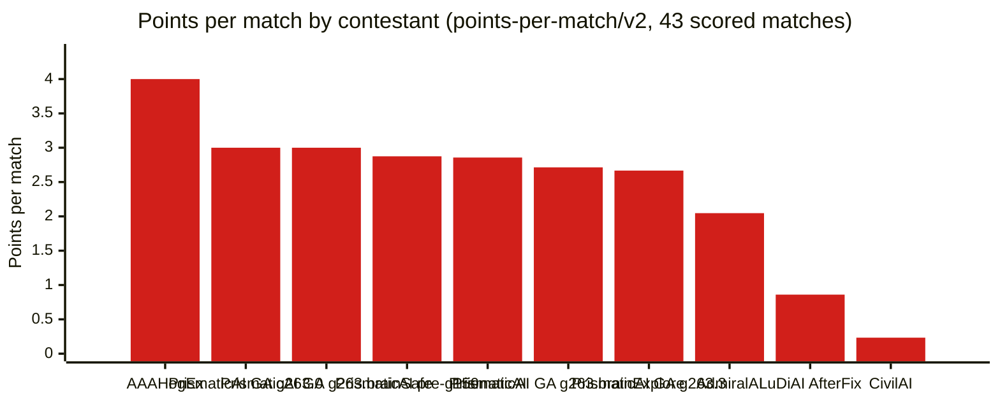
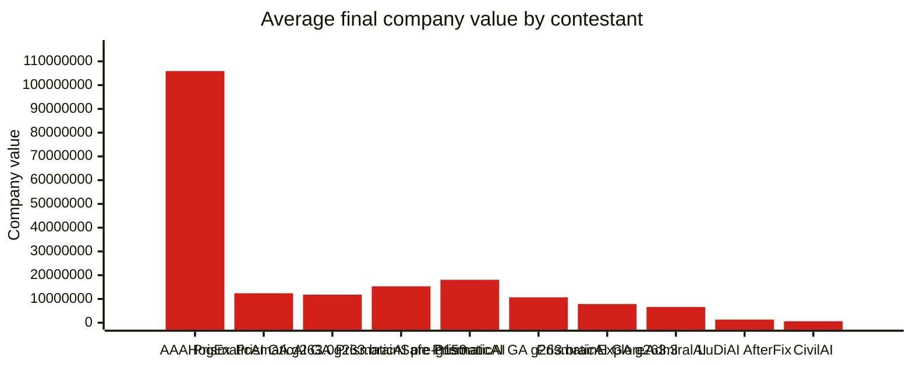
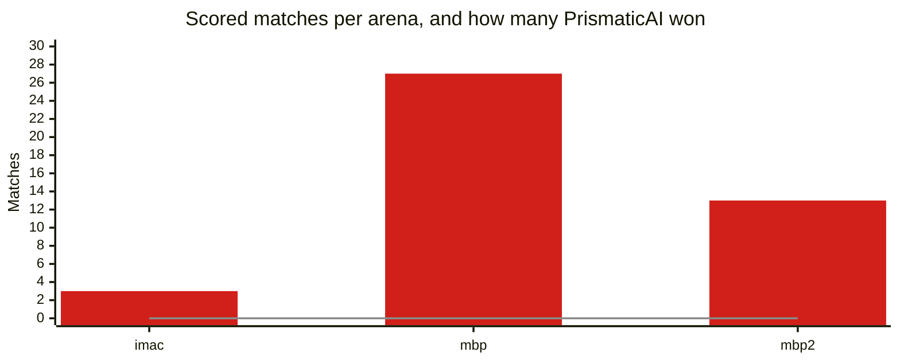

# battle-20261121T105822-35781ec1

Derived from `battle-20261121T105822-35781ec1.json` by `tools/research/ai-battle/battle.py report`; do not edit.

- Edition `35781ec1874614c3`: PrismaticAI and referee at `52f631b115782334f422f741a79ecabce78e58c4`, base set `opengfx-8.0.tar`
- 20-year free-for-all from 1960, map 256x256 temperate, breakdowns 1
- 43 scored match(es) on `imac` (20261119-master-gdf1e05e7d8), `mbp` (20261120-master-m17653b726e), `mbp2` (20261119-master-gdf1e05e7d8)
- Replays: 0 of 0 identical to their original on another arena

| # | Contestant | Played | Wins | Points | Points/match | Avg rank | Avg final value | Squirrel errors | Matches with anomalies |
|---|---|---|---|---|---|---|---|---|---|
| 1 | AAAHogEx | 43 | 43 | 172 | 4.0 | 1.0 | 105.9 M | 0 | 0 |
| 2 | PrismaticAI GA g263.0 | 8 | 0 | 24 | 3.0 | 2.0 | 12.4 M | 0 | 0 |
| 3 | PrismaticAI GA g263.brainSafe | 7 | 0 | 21 | 3.0 | 2.0 | 11.8 M | 0 | 0 |
| 4 | PrismaticAI pre-g150 | 8 | 0 | 23 | 2.875 | 2.12 | 15.3 M | 0 | 5 |
| 5 | PrismaticAI | 7 | 0 | 20 | 2.857 | 2.14 | 18.1 M | 0 | 0 |
| 6 | PrismaticAI GA g263.brainExplore | 7 | 0 | 19 | 2.714 | 2.29 | 10.7 M | 0 | 0 |
| 7 | PrismaticAI GA g263.3 | 6 | 0 | 16 | 2.667 | 2.33 | 7.9 M | 0 | 0 |
| 8 | AdmiralAI | 43 | 0 | 88 | 2.047 | 2.95 | 6.6 M | 0 | 1 |
| 9 | LuDiAI AfterFix | 43 | 0 | 37 | 0.86 | 4.14 | 1.3 M | 0 | 1 |
| 10 | CivilAI | 43 | 0 | 10 | 0.233 | 4.77 | 611.5 k | 0 | 3 |

```mermaid
---
config:
  xyChart:
    width: 900
    height: 360
  themeVariables:
    xyChart:
      plotColorPalette: "#d11f1a, #8a8a8a, #0b0b0b, #ece4d6"
---
xychart-beta
    title "Final company value per scored match: winner vs best PrismaticAI"
    x-axis ["m-0001", "m-0002", "m-0003", "m-0004", "m-0005", "m-0006", "m-0007", "m-0008", "m-0009", "m-0010", "m-0011", "m-0012", "m-0014", "m-0015", "m-0018", "m-0019", "m-0020", "m-0021", "m-0022", "m-0023", "m-0024", "m-0025", "m-0026", "m-0027", "m-0028", "m-0036", "m-0037", "m-0038", "m-0039", "m-0040", "m-0041", "m-0042", "m-0043", "m-0044", "m-0045", "m-0046", "m-0047", "m-0049", "m-0050", "m-0052", "m-0053", "m-0054", "m-0055"]
    %% series: Winner | Best PrismaticAI
    %% links: battle-20261121T105822-35781ec1.md?col=Match&filter=m-0001 | battle-20261121T105822-35781ec1.md?col=Match&filter=m-0002 | battle-20261121T105822-35781ec1.md?col=Match&filter=m-0003 | battle-20261121T105822-35781ec1.md?col=Match&filter=m-0004 | battle-20261121T105822-35781ec1.md?col=Match&filter=m-0005 | battle-20261121T105822-35781ec1.md?col=Match&filter=m-0006 | battle-20261121T105822-35781ec1.md?col=Match&filter=m-0007 | battle-20261121T105822-35781ec1.md?col=Match&filter=m-0008 | battle-20261121T105822-35781ec1.md?col=Match&filter=m-0009 | battle-20261121T105822-35781ec1.md?col=Match&filter=m-0010 | battle-20261121T105822-35781ec1.md?col=Match&filter=m-0011 | battle-20261121T105822-35781ec1.md?col=Match&filter=m-0012 | battle-20261121T105822-35781ec1.md?col=Match&filter=m-0014 | battle-20261121T105822-35781ec1.md?col=Match&filter=m-0015 | battle-20261121T105822-35781ec1.md?col=Match&filter=m-0018 | battle-20261121T105822-35781ec1.md?col=Match&filter=m-0019 | battle-20261121T105822-35781ec1.md?col=Match&filter=m-0020 | battle-20261121T105822-35781ec1.md?col=Match&filter=m-0021 | battle-20261121T105822-35781ec1.md?col=Match&filter=m-0022 | battle-20261121T105822-35781ec1.md?col=Match&filter=m-0023 | battle-20261121T105822-35781ec1.md?col=Match&filter=m-0024 | battle-20261121T105822-35781ec1.md?col=Match&filter=m-0025 | battle-20261121T105822-35781ec1.md?col=Match&filter=m-0026 | battle-20261121T105822-35781ec1.md?col=Match&filter=m-0027 | battle-20261121T105822-35781ec1.md?col=Match&filter=m-0028 | battle-20261121T105822-35781ec1.md?col=Match&filter=m-0036 | battle-20261121T105822-35781ec1.md?col=Match&filter=m-0037 | battle-20261121T105822-35781ec1.md?col=Match&filter=m-0038 | battle-20261121T105822-35781ec1.md?col=Match&filter=m-0039 | battle-20261121T105822-35781ec1.md?col=Match&filter=m-0040 | battle-20261121T105822-35781ec1.md?col=Match&filter=m-0041 | battle-20261121T105822-35781ec1.md?col=Match&filter=m-0042 | battle-20261121T105822-35781ec1.md?col=Match&filter=m-0043 | battle-20261121T105822-35781ec1.md?col=Match&filter=m-0044 | battle-20261121T105822-35781ec1.md?col=Match&filter=m-0045 | battle-20261121T105822-35781ec1.md?col=Match&filter=m-0046 | battle-20261121T105822-35781ec1.md?col=Match&filter=m-0047 | battle-20261121T105822-35781ec1.md?col=Match&filter=m-0049 | battle-20261121T105822-35781ec1.md?col=Match&filter=m-0050 | battle-20261121T105822-35781ec1.md?col=Match&filter=m-0052 | battle-20261121T105822-35781ec1.md?col=Match&filter=m-0053 | battle-20261121T105822-35781ec1.md?col=Match&filter=m-0054 | battle-20261121T105822-35781ec1.md?col=Match&filter=m-0055
    y-axis "Company value" 0 --> 155000000
    bar [117151743, 127342372, 127342372, 141137762, 127390450, 91148036, 96402705, 93486286, 93486286, 82996821, 84946529, 128743152, 135812403, 135812403, 95575843, 89756639, 86887413, 86887413, 108122261, 81501972, 83524362, 103332757, 82928201, 82928201, 112263002, 98933413, 94172170, 107557752, 107557752, 118157549, 93330615, 126378271, 104006207, 119830513, 119830513, 113567863, 106884562, 102080307, 96870479, 101386102, 118138085, 105057435, 123394753]
    line [16251332, 7281472, 7281472, 5244109, 7664275, 9305295, 7994953, 8204186, 8204186, 7961114, 7972859, 24639786, 16631156, 16631156, 10125517, 8023877, 15831334, 15831334, 7867841, 5666225, 18429387, 12067194, 7090182, 7090182, 13622831, 15666704, 15254885, 15632747, 15632747, 8986973, 6387683, 23899145, 25402616, 12033996, 12033996, 20299129, 9816438, 15216874, 16452307, 10884470, 9674339, 24378584, 22319768]
```

<!-- battle-charts:begin -->
<!-- derived from battle-20261121T105822-35781ec1.json by `battle.py render`; `battle.py check` fails when it is stale -->

<!-- battle-charts:end -->

| Match | Arena | Seed | Winner | Value | Last | Anomalies |
|---|---|---|---|---|---|---|
| m-0001 | mbp | 119881760 | AAAHogEx | 117.2 M | CivilAI | PrismaticAI pre-g150: fleet_drop:85->50 |
| m-0002 | mbp | 119881760 | AAAHogEx | 127.3 M | CivilAI | - |
| m-0003 | mbp | 119881760 | AAAHogEx | 127.3 M | CivilAI | - |
| m-0004 | mbp | 119881760 | AAAHogEx | 141.1 M | CivilAI | - |
| m-0005 | mbp | 119881760 | AAAHogEx | 127.4 M | CivilAI | - |
| m-0006 | mbp | 578098002 | AAAHogEx | 91.1 M | LuDiAI AfterFix | LuDiAI AfterFix: fleet_drop:24->3 |
| m-0007 | mbp | 578098002 | AAAHogEx | 96.4 M | CivilAI | - |
| m-0008 | mbp | 578098002 | AAAHogEx | 93.5 M | LuDiAI AfterFix | - |
| m-0009 | mbp | 578098002 | AAAHogEx | 93.5 M | LuDiAI AfterFix | - |
| m-0010 | imac | 578098002 | AAAHogEx | 83.0 M | CivilAI | - |
| m-0011 | imac | 578098002 | AAAHogEx | 84.9 M | CivilAI | - |
| m-0012 | imac | 614331397 | AAAHogEx | 128.7 M | CivilAI | - |
| m-0014 | mbp2 | 614331397 | AAAHogEx | 135.8 M | CivilAI | - |
| m-0015 | mbp2 | 614331397 | AAAHogEx | 135.8 M | CivilAI | - |
| m-0018 | mbp2 | 1431841517 | AAAHogEx | 95.6 M | LuDiAI AfterFix | - |
| m-0019 | mbp2 | 1431841517 | AAAHogEx | 89.8 M | LuDiAI AfterFix | PrismaticAI pre-g150: fleet_drop:120->52; CivilAI: fleet_drop:58->40 |
| m-0020 | mbp2 | 1431841517 | AAAHogEx | 86.9 M | CivilAI | - |
| m-0021 | mbp2 | 1431841517 | AAAHogEx | 86.9 M | CivilAI | - |
| m-0022 | mbp2 | 1431841517 | AAAHogEx | 108.1 M | CivilAI | - |
| m-0023 | mbp2 | 1431841517 | AAAHogEx | 81.5 M | LuDiAI AfterFix | - |
| m-0024 | mbp2 | 985486125 | AAAHogEx | 83.5 M | LuDiAI AfterFix | CivilAI: fleet_drop:81->43 |
| m-0025 | mbp2 | 985486125 | AAAHogEx | 103.3 M | AdmiralAI | PrismaticAI pre-g150: fleet_drop:79->46; CivilAI: fleet_drop:57->31 |
| m-0026 | mbp2 | 985486125 | AAAHogEx | 82.9 M | CivilAI | - |
| m-0027 | mbp2 | 985486125 | AAAHogEx | 82.9 M | CivilAI | - |
| m-0028 | mbp2 | 985486125 | AAAHogEx | 112.3 M | LuDiAI AfterFix | - |
| m-0036 | mbp | 803434999 | AAAHogEx | 98.9 M | CivilAI | - |
| m-0037 | mbp | 803434999 | AAAHogEx | 94.2 M | CivilAI | - |
| m-0038 | mbp | 803434999 | AAAHogEx | 107.6 M | CivilAI | - |
| m-0039 | mbp | 803434999 | AAAHogEx | 107.6 M | CivilAI | - |
| m-0040 | mbp | 803434999 | AAAHogEx | 118.2 M | CivilAI | - |
| m-0041 | mbp | 803434999 | AAAHogEx | 93.3 M | CivilAI | - |
| m-0042 | mbp | 1158464010 | AAAHogEx | 126.4 M | CivilAI | - |
| m-0043 | mbp | 1158464010 | AAAHogEx | 104.0 M | CivilAI | - |
| m-0044 | mbp | 1158464010 | AAAHogEx | 119.8 M | CivilAI | - |
| m-0045 | mbp | 1158464010 | AAAHogEx | 119.8 M | CivilAI | - |
| m-0046 | mbp | 1158464010 | AAAHogEx | 113.6 M | CivilAI | - |
| m-0047 | mbp | 1158464010 | AAAHogEx | 106.9 M | CivilAI | - |
| m-0049 | mbp | 803908630 | AAAHogEx | 102.1 M | CivilAI | PrismaticAI pre-g150: fleet_drop:124->68 |
| m-0050 | mbp | 803908630 | AAAHogEx | 96.9 M | CivilAI | - |
| m-0052 | mbp | 803908630 | AAAHogEx | 101.4 M | CivilAI | AdmiralAI: fleet_drop:185->129 |
| m-0053 | mbp | 803908630 | AAAHogEx | 118.1 M | CivilAI | - |
| m-0054 | mbp | 1670993718 | AAAHogEx | 105.1 M | CivilAI | - |
| m-0055 | mbp | 1670993718 | AAAHogEx | 123.4 M | CivilAI | PrismaticAI pre-g150: fleet_drop:116->81 |
