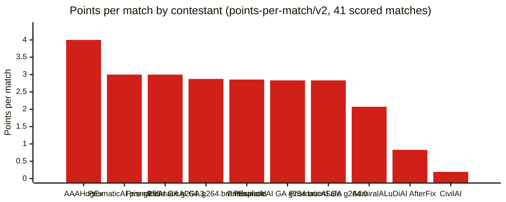
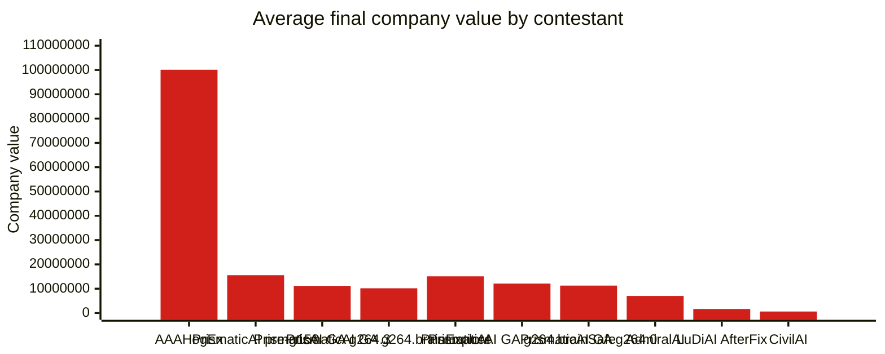
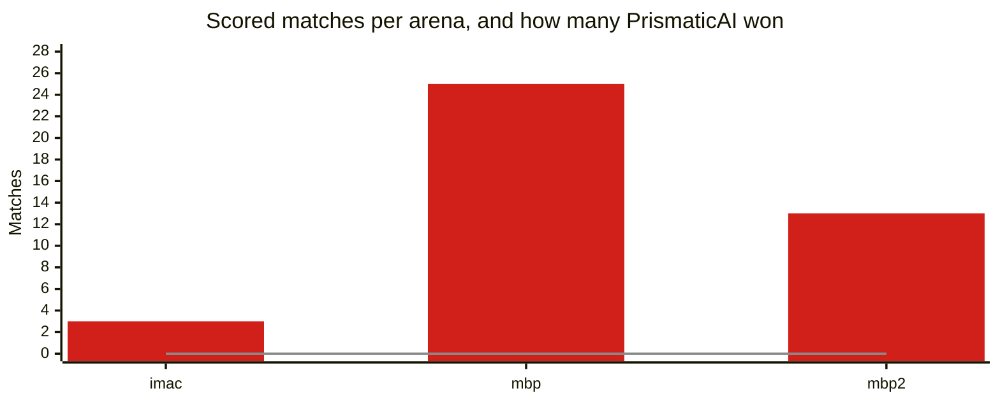

# battle-20261121T111157-aa8bff5d

Derived from `battle-20261121T111157-aa8bff5d.json` by `tools/research/ai-battle/battle.py report`; do not edit.

- Edition `aa8bff5d72e4265b`: PrismaticAI and referee at `52f631b115782334f422f741a79ecabce78e58c4`, base set `opengfx-8.0.tar`
- 20-year free-for-all from 1960, map 256x256 temperate, breakdowns 1
- 41 scored match(es) on `imac` (20261119-master-gdf1e05e7d8), `mbp` (20261120-master-m17653b726e), `mbp2` (20261119-master-gdf1e05e7d8)
- Replays: 0 of 2 identical to their original on another arena

| # | Contestant | Played | Wins | Points | Points/match | Avg rank | Avg final value | Squirrel errors | Matches with anomalies |
|---|---|---|---|---|---|---|---|---|---|
| 1 | AAAHogEx | 41 | 41 | 164 | 4.0 | 1.0 | 100.1 M | 0 | 0 |
| 2 | PrismaticAI pre-g150 | 8 | 0 | 24 | 3.0 | 2.0 | 15.5 M | 0 | 3 |
| 3 | PrismaticAI GA g264.3 | 6 | 0 | 18 | 3.0 | 2.0 | 11.1 M | 0 | 3 |
| 4 | PrismaticAI GA g264.brainExplore | 8 | 0 | 23 | 2.875 | 2.12 | 10.2 M | 0 | 2 |
| 5 | PrismaticAI | 7 | 0 | 20 | 2.857 | 2.14 | 15.1 M | 0 | 0 |
| 6 | PrismaticAI GA g264.brainSafe | 6 | 0 | 17 | 2.833 | 2.17 | 12.1 M | 0 | 3 |
| 7 | PrismaticAI GA g264.0 | 6 | 0 | 17 | 2.833 | 2.17 | 11.3 M | 0 | 1 |
| 8 | AdmiralAI | 41 | 0 | 85 | 2.073 | 2.93 | 7.0 M | 0 | 1 |
| 9 | LuDiAI AfterFix | 41 | 0 | 34 | 0.829 | 4.17 | 1.6 M | 0 | 0 |
| 10 | CivilAI | 41 | 0 | 8 | 0.195 | 4.8 | 601.9 k | 0 | 13 |

```mermaid
---
config:
  xyChart:
    width: 900
    height: 360
  themeVariables:
    xyChart:
      plotColorPalette: "#d11f1a, #8a8a8a, #0b0b0b, #ece4d6"
---
xychart-beta
    title "Final company value per scored match: winner vs best PrismaticAI"
    x-axis ["m-0001", "m-0002", "m-0003", "m-0004", "m-0005", "m-0006", "m-0007", "m-0008", "m-0009", "m-0010", "m-0011", "m-0012", "m-0013", "m-0014", "m-0015", "m-0016", "m-0017", "m-0018", "m-0021", "m-0022", "m-0024", "m-0025", "m-0026", "m-0027", "m-0028", "m-0036", "m-0037", "m-0038", "m-0039", "m-0040", "m-0041", "m-0042", "m-0043", "m-0044", "m-0046", "m-0047", "m-0049", "m-0052", "m-0053", "m-0054", "m-0055"]
    %% series: Winner | Best PrismaticAI
    %% links: battle-20261121T111157-aa8bff5d.md?col=Match&filter=m-0001 | battle-20261121T111157-aa8bff5d.md?col=Match&filter=m-0002 | battle-20261121T111157-aa8bff5d.md?col=Match&filter=m-0003 | battle-20261121T111157-aa8bff5d.md?col=Match&filter=m-0004 | battle-20261121T111157-aa8bff5d.md?col=Match&filter=m-0005 | battle-20261121T111157-aa8bff5d.md?col=Match&filter=m-0006 | battle-20261121T111157-aa8bff5d.md?col=Match&filter=m-0007 | battle-20261121T111157-aa8bff5d.md?col=Match&filter=m-0008 | battle-20261121T111157-aa8bff5d.md?col=Match&filter=m-0009 | battle-20261121T111157-aa8bff5d.md?col=Match&filter=m-0010 | battle-20261121T111157-aa8bff5d.md?col=Match&filter=m-0011 | battle-20261121T111157-aa8bff5d.md?col=Match&filter=m-0012 | battle-20261121T111157-aa8bff5d.md?col=Match&filter=m-0013 | battle-20261121T111157-aa8bff5d.md?col=Match&filter=m-0014 | battle-20261121T111157-aa8bff5d.md?col=Match&filter=m-0015 | battle-20261121T111157-aa8bff5d.md?col=Match&filter=m-0016 | battle-20261121T111157-aa8bff5d.md?col=Match&filter=m-0017 | battle-20261121T111157-aa8bff5d.md?col=Match&filter=m-0018 | battle-20261121T111157-aa8bff5d.md?col=Match&filter=m-0021 | battle-20261121T111157-aa8bff5d.md?col=Match&filter=m-0022 | battle-20261121T111157-aa8bff5d.md?col=Match&filter=m-0024 | battle-20261121T111157-aa8bff5d.md?col=Match&filter=m-0025 | battle-20261121T111157-aa8bff5d.md?col=Match&filter=m-0026 | battle-20261121T111157-aa8bff5d.md?col=Match&filter=m-0027 | battle-20261121T111157-aa8bff5d.md?col=Match&filter=m-0028 | battle-20261121T111157-aa8bff5d.md?col=Match&filter=m-0036 | battle-20261121T111157-aa8bff5d.md?col=Match&filter=m-0037 | battle-20261121T111157-aa8bff5d.md?col=Match&filter=m-0038 | battle-20261121T111157-aa8bff5d.md?col=Match&filter=m-0039 | battle-20261121T111157-aa8bff5d.md?col=Match&filter=m-0040 | battle-20261121T111157-aa8bff5d.md?col=Match&filter=m-0041 | battle-20261121T111157-aa8bff5d.md?col=Match&filter=m-0042 | battle-20261121T111157-aa8bff5d.md?col=Match&filter=m-0043 | battle-20261121T111157-aa8bff5d.md?col=Match&filter=m-0044 | battle-20261121T111157-aa8bff5d.md?col=Match&filter=m-0046 | battle-20261121T111157-aa8bff5d.md?col=Match&filter=m-0047 | battle-20261121T111157-aa8bff5d.md?col=Match&filter=m-0049 | battle-20261121T111157-aa8bff5d.md?col=Match&filter=m-0052 | battle-20261121T111157-aa8bff5d.md?col=Match&filter=m-0053 | battle-20261121T111157-aa8bff5d.md?col=Match&filter=m-0054 | battle-20261121T111157-aa8bff5d.md?col=Match&filter=m-0055
    y-axis "Company value" 0 --> 176000000
    bar [100527501, 127522933, 127581879, 113553198, 100720503, 98029825, 96292359, 108638725, 118859225, 101119314, 109296332, 97048351, 99816795, 98568973, 82515973, 114324469, 104844056, 95100986, 75875587, 95154358, 77105510, 80640416, 68242748, 83075164, 81978759, 89348627, 108555845, 95608016, 98019937, 75835549, 85910327, 100775743, 90105356, 88396312, 88571286, 114927523, 153197978, 160020271, 111939797, 112649649, 73280570]
    line [18175370, 7111890, 14710706, 11737079, 10264882, 17094284, 13976804, 15575806, 14506142, 11601122, 12395577, 11424078, 13157609, 13445638, 11020470, 7748215, 12260554, 15835217, 15535344, 10704130, 7923663, 8238918, 8590474, 8303302, 13578989, 19722907, 19196721, 12878123, 8625396, 7052333, 11162225, 12384573, 15616387, 9993829, 7337689, 8743713, 16879461, 11547901, 12065739, 21142047, 19068006]
```

<!-- battle-charts:begin -->
<!-- derived from battle-20261121T111157-aa8bff5d.json by `battle.py render`; `battle.py check` fails when it is stale -->

<!-- battle-charts:end -->

| Seed | Original | Replay | Arenas | Identical |
|---|---|---|---|---|
| 439456404 | m-0010 | m-0048 | imac / mbp | NO |
| 439456404 | m-0011 | m-0056 | imac / mbp | NO |

| Match | Arena | Seed | Winner | Value | Last | Anomalies |
|---|---|---|---|---|---|---|
| m-0001 | mbp | 1480363409 | AAAHogEx | 100.5 M | LuDiAI AfterFix | PrismaticAI pre-g150: fleet_drop:88->50 |
| m-0002 | mbp | 1480363409 | AAAHogEx | 127.5 M | LuDiAI AfterFix | PrismaticAI GA g264.0: fleet_drop:48->29; CivilAI: fleet_drop:84->55 |
| m-0003 | mbp | 1480363409 | AAAHogEx | 127.6 M | LuDiAI AfterFix | PrismaticAI GA g264.brainSafe: fleet_drop:49->30 |
| m-0004 | mbp | 1480363409 | AAAHogEx | 113.6 M | LuDiAI AfterFix | PrismaticAI GA g264.brainExplore: fleet_drop:125->80 |
| m-0005 | mbp | 1480363409 | AAAHogEx | 100.7 M | LuDiAI AfterFix | CivilAI: fleet_drop:67->30 |
| m-0006 | mbp | 439456404 | AAAHogEx | 98.0 M | CivilAI | CivilAI: fleet_drop:10->6 |
| m-0007 | mbp | 439456404 | AAAHogEx | 96.3 M | CivilAI | - |
| m-0008 | mbp | 439456404 | AAAHogEx | 108.6 M | CivilAI | - |
| m-0009 | mbp | 439456404 | AAAHogEx | 118.9 M | CivilAI | - |
| m-0010 | imac | 439456404 | AAAHogEx | 101.1 M | CivilAI | CivilAI: fleet_drop:23->8 |
| m-0011 | imac | 439456404 | AAAHogEx | 109.3 M | CivilAI | PrismaticAI GA g264.3: fleet_drop:42->28; CivilAI: fleet_drop:64->35 |
| m-0012 | imac | 1871815411 | AAAHogEx | 97.0 M | CivilAI | - |
| m-0013 | mbp2 | 1871815411 | AAAHogEx | 99.8 M | LuDiAI AfterFix | - |
| m-0014 | mbp2 | 1871815411 | AAAHogEx | 98.6 M | CivilAI | - |
| m-0015 | mbp2 | 1871815411 | AAAHogEx | 82.5 M | CivilAI | PrismaticAI GA g264.brainSafe: fleet_drop:87->50 |
| m-0016 | mbp2 | 1871815411 | AAAHogEx | 114.3 M | CivilAI | PrismaticAI GA g264.brainExplore: fleet_drop:159->101 |
| m-0017 | mbp2 | 1871815411 | AAAHogEx | 104.8 M | CivilAI | - |
| m-0018 | mbp2 | 284177365 | AAAHogEx | 95.1 M | CivilAI | - |
| m-0021 | mbp2 | 284177365 | AAAHogEx | 75.9 M | LuDiAI AfterFix | AdmiralAI: fleet_drop:431->277 |
| m-0022 | mbp2 | 284177365 | AAAHogEx | 95.2 M | CivilAI | - |
| m-0024 | mbp2 | 1952708038 | AAAHogEx | 77.1 M | LuDiAI AfterFix | - |
| m-0025 | mbp2 | 1952708038 | AAAHogEx | 80.6 M | CivilAI | - |
| m-0026 | mbp2 | 1952708038 | AAAHogEx | 68.2 M | CivilAI | - |
| m-0027 | mbp2 | 1952708038 | AAAHogEx | 83.1 M | CivilAI | CivilAI: no_vehicles |
| m-0028 | mbp2 | 1952708038 | AAAHogEx | 82.0 M | CivilAI | - |
| m-0036 | mbp | 1376099925 | AAAHogEx | 89.3 M | CivilAI | - |
| m-0037 | mbp | 1376099925 | AAAHogEx | 108.6 M | CivilAI | CivilAI: fleet_drop:62->41 |
| m-0038 | mbp | 1376099925 | AAAHogEx | 95.6 M | CivilAI | CivilAI: fleet_drop:52->33 |
| m-0039 | mbp | 1376099925 | AAAHogEx | 98.0 M | CivilAI | PrismaticAI GA g264.brainSafe: fleet_drop:48->31 |
| m-0040 | mbp | 1376099925 | AAAHogEx | 75.8 M | CivilAI | CivilAI: fleet_drop:74->36 |
| m-0041 | mbp | 1376099925 | AAAHogEx | 85.9 M | CivilAI | PrismaticAI GA g264.3: fleet_drop:51->34; CivilAI: fleet_drop:38->24 |
| m-0042 | mbp | 305354073 | AAAHogEx | 100.8 M | CivilAI | CivilAI: fleet_drop:26->11 |
| m-0043 | mbp | 305354073 | AAAHogEx | 90.1 M | CivilAI | PrismaticAI pre-g150: fleet_drop:97->57 |
| m-0044 | mbp | 305354073 | AAAHogEx | 88.4 M | CivilAI | - |
| m-0046 | mbp | 305354073 | AAAHogEx | 88.6 M | CivilAI | CivilAI: fleet_drop:48->31 |
| m-0047 | mbp | 305354073 | AAAHogEx | 114.9 M | CivilAI | PrismaticAI GA g264.3: fleet_drop:47->32 |
| m-0048 (replay) | mbp | 439456404 | AAAHogEx | 103.8 M | CivilAI | - |
| m-0049 | mbp | 906119618 | AAAHogEx | 153.2 M | CivilAI | - |
| m-0052 | mbp | 906119618 | AAAHogEx | 160.0 M | CivilAI | - |
| m-0053 | mbp | 906119618 | AAAHogEx | 111.9 M | CivilAI | CivilAI: fleet_drop:37->20 |
| m-0054 | mbp | 1609876577 | AAAHogEx | 112.6 M | CivilAI | - |
| m-0055 | mbp | 1609876577 | AAAHogEx | 73.3 M | CivilAI | PrismaticAI pre-g150: fleet_drop:88->59 |
| m-0056 (replay) | mbp | 439456404 | AAAHogEx | 108.1 M | CivilAI | PrismaticAI GA g264.3: fleet_drop:42->28; CivilAI: fleet_drop:64->34 |
