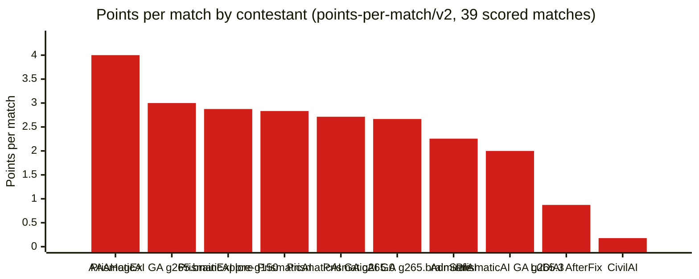
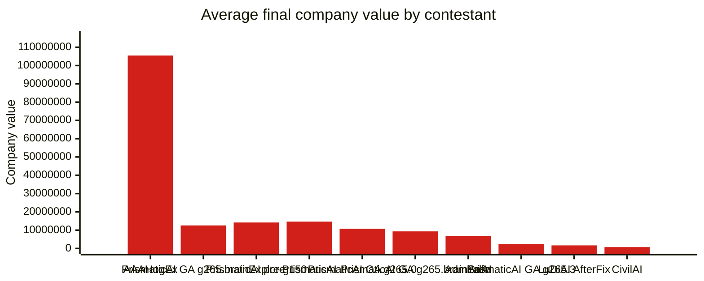
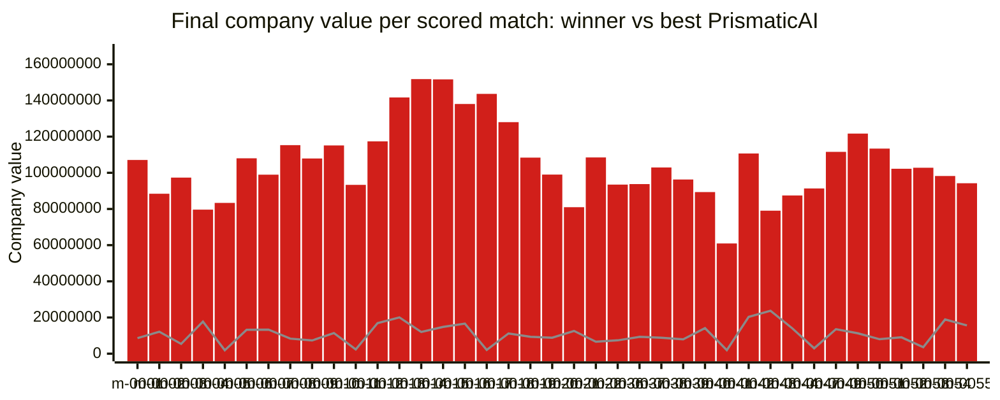
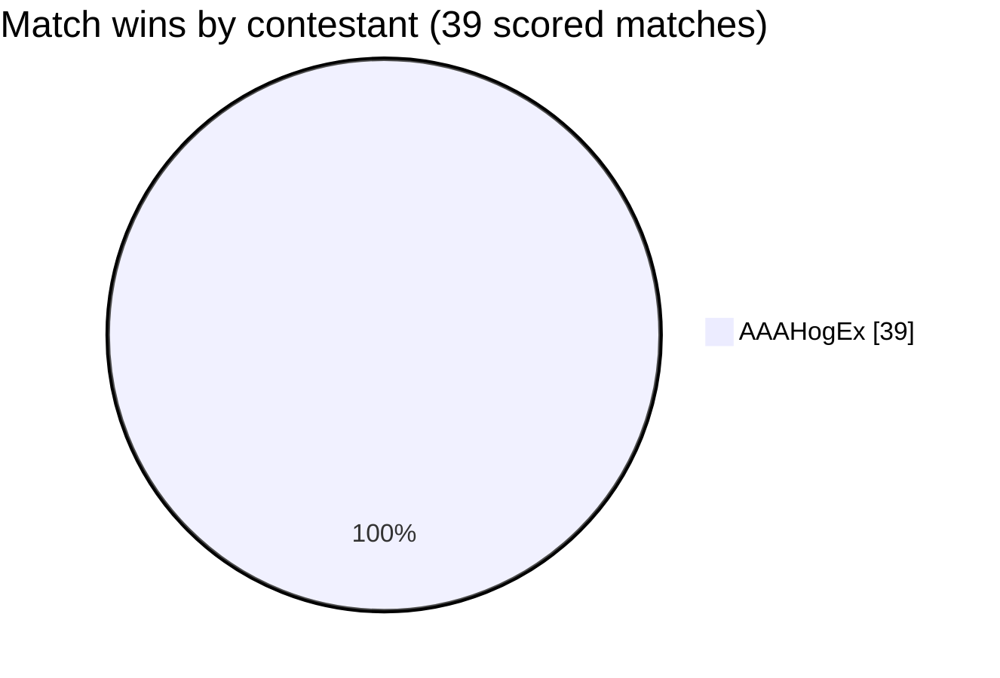
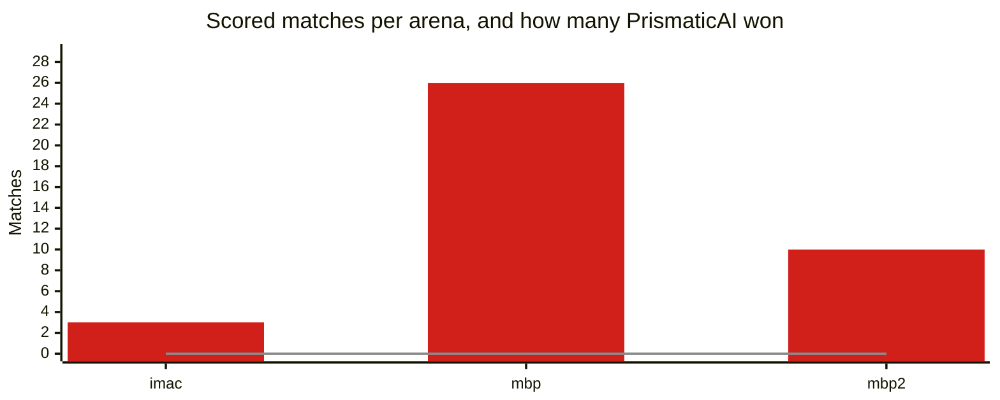

# battle-20261121T112419-b145c72d

Derived from `battle-20261121T112419-b145c72d.json` by `tools/research/ai-battle/battle.py report`; do not edit.

- Edition `b145c72d90065936`: PrismaticAI and referee at `52f631b115782334f422f741a79ecabce78e58c4`, base set `opengfx-8.0.tar`
- 20-year free-for-all from 1960, map 256x256 temperate, breakdowns 1
- 39 scored match(es) on `imac` (20261119-master-gdf1e05e7d8), `mbp` (20261120-master-m17653b726e), `mbp2` (20261119-master-gdf1e05e7d8)
- Replays: 0 of 1 identical to their original on another arena

| # | Contestant | Played | Wins | Points | Points/match | Avg rank | Avg final value | Squirrel errors | Matches with anomalies |
|---|---|---|---|---|---|---|---|---|---|
| 1 | AAAHogEx | 39 | 39 | 156 | 4.0 | 1.0 | 105.5 M | 0 | 0 |
| 2 | PrismaticAI GA g265.brainExplore | 6 | 0 | 18 | 3.0 | 2.0 | 12.6 M | 0 | 0 |
| 3 | PrismaticAI pre-g150 | 8 | 0 | 23 | 2.875 | 2.12 | 14.2 M | 0 | 4 |
| 4 | PrismaticAI | 6 | 0 | 17 | 2.833 | 2.17 | 14.7 M | 0 | 0 |
| 5 | PrismaticAI GA g265.0 | 7 | 0 | 19 | 2.714 | 2.29 | 10.8 M | 0 | 0 |
| 6 | PrismaticAI GA g265.brainSafe | 6 | 0 | 16 | 2.667 | 2.33 | 9.3 M | 0 | 2 |
| 7 | AdmiralAI | 39 | 0 | 88 | 2.256 | 2.74 | 6.7 M | 70 | 3 |
| 8 | PrismaticAI GA g265.3 | 6 | 0 | 12 | 2.0 | 3.0 | 2.5 M | 0 | 0 |
| 9 | LuDiAI AfterFix | 39 | 0 | 34 | 0.872 | 4.13 | 1.7 M | 0 | 1 |
| 10 | CivilAI | 39 | 0 | 7 | 0.179 | 4.82 | 736.3 k | 3885 | 10 |

<!-- battle-charts:begin -->
<!-- derived from battle-20261121T112419-b145c72d.json by `battle.py render`; `battle.py check` fails when it is stale -->

<!-- battle-charts:end -->

| Seed | Original | Replay | Arenas | Identical |
|---|---|---|---|---|
| 847240589 | m-0011 | m-0048 | imac / mbp | NO |

| Match | Arena | Seed | Winner | Value | Last | Anomalies |
|---|---|---|---|---|---|---|
| m-0001 | mbp | 185101926 | AAAHogEx | 107.1 M | CivilAI | - |
| m-0002 | mbp | 185101926 | AAAHogEx | 88.4 M | LuDiAI AfterFix | CivilAI: squirrel_errors:3885 |
| m-0003 | mbp | 185101926 | AAAHogEx | 97.3 M | CivilAI | - |
| m-0004 | mbp | 185101926 | AAAHogEx | 79.6 M | CivilAI | - |
| m-0005 | mbp | 185101926 | AAAHogEx | 83.4 M | CivilAI | - |
| m-0006 | mbp | 847240589 | AAAHogEx | 108.0 M | CivilAI | CivilAI: fleet_drop:41->16 |
| m-0007 | mbp | 847240589 | AAAHogEx | 99.0 M | CivilAI | PrismaticAI pre-g150: fleet_drop:86->52; CivilAI: fleet_drop:55->33 |
| m-0008 | mbp | 847240589 | AAAHogEx | 115.3 M | LuDiAI AfterFix | CivilAI: fleet_drop:60->39 |
| m-0009 | mbp | 847240589 | AAAHogEx | 107.9 M | CivilAI | PrismaticAI GA g265.brainSafe: fleet_drop:47->32; CivilAI: fleet_drop:61->28 |
| m-0010 | imac | 847240589 | AAAHogEx | 115.1 M | CivilAI | AdmiralAI: squirrel_errors:70; CivilAI: fleet_drop:56->32 |
| m-0011 | imac | 847240589 | AAAHogEx | 93.3 M | CivilAI | CivilAI: fleet_drop:70->40 |
| m-0012 | imac | 1727603948 | AAAHogEx | 117.4 M | CivilAI | - |
| m-0013 | mbp2 | 1727603948 | AAAHogEx | 141.7 M | CivilAI | - |
| m-0014 | mbp2 | 1727603948 | AAAHogEx | 151.8 M | CivilAI | - |
| m-0015 | mbp2 | 1727603948 | AAAHogEx | 151.7 M | CivilAI | - |
| m-0016 | mbp2 | 1727603948 | AAAHogEx | 138.1 M | CivilAI | - |
| m-0017 | mbp2 | 1727603948 | AAAHogEx | 143.6 M | CivilAI | CivilAI: fleet_drop:39->27 |
| m-0018 | mbp2 | 167832311 | AAAHogEx | 128.0 M | CivilAI | LuDiAI AfterFix: fleet_drop:83->50 |
| m-0019 | mbp2 | 167832311 | AAAHogEx | 108.4 M | CivilAI | PrismaticAI pre-g150: fleet_drop:88->57 |
| m-0020 | mbp2 | 167832311 | AAAHogEx | 99.0 M | CivilAI | - |
| m-0021 | mbp2 | 167832311 | AAAHogEx | 81.0 M | CivilAI | PrismaticAI GA g265.brainSafe: fleet_drop:80->49; CivilAI: fleet_drop:13->8 |
| m-0022 | mbp2 | 167832311 | AAAHogEx | 108.5 M | CivilAI | - |
| m-0036 | mbp | 796658976 | AAAHogEx | 93.5 M | LuDiAI AfterFix | - |
| m-0037 | mbp | 796658976 | AAAHogEx | 93.8 M | LuDiAI AfterFix | PrismaticAI pre-g150: fleet_drop:105->69 |
| m-0038 | mbp | 796658976 | AAAHogEx | 102.9 M | LuDiAI AfterFix | - |
| m-0039 | mbp | 796658976 | AAAHogEx | 96.3 M | LuDiAI AfterFix | - |
| m-0040 | mbp | 796658976 | AAAHogEx | 89.3 M | LuDiAI AfterFix | - |
| m-0041 | mbp | 796658976 | AAAHogEx | 60.9 M | CivilAI | - |
| m-0042 | mbp | 266737077 | AAAHogEx | 110.7 M | CivilAI | - |
| m-0043 | mbp | 266737077 | AAAHogEx | 79.1 M | CivilAI | - |
| m-0044 | mbp | 266737077 | AAAHogEx | 87.5 M | CivilAI | - |
| m-0047 | mbp | 266737077 | AAAHogEx | 91.3 M | CivilAI | - |
| m-0048 (replay) | mbp | 847240589 | AAAHogEx | 90.4 M | CivilAI | CivilAI: fleet_drop:70->44 |
| m-0049 | mbp | 1216716801 | AAAHogEx | 111.6 M | CivilAI | PrismaticAI pre-g150: fleet_drop:80->44 |
| m-0050 | mbp | 1216716801 | AAAHogEx | 121.7 M | CivilAI | - |
| m-0051 | mbp | 1216716801 | AAAHogEx | 113.4 M | CivilAI | AdmiralAI: fleet_drop:192->120 |
| m-0052 | mbp | 1216716801 | AAAHogEx | 102.2 M | CivilAI | - |
| m-0053 | mbp | 1216716801 | AAAHogEx | 102.8 M | CivilAI | - |
| m-0054 | mbp | 367865404 | AAAHogEx | 98.2 M | CivilAI | CivilAI: fleet_drop:31->14 |
| m-0055 | mbp | 367865404 | AAAHogEx | 94.2 M | CivilAI | AdmiralAI: fleet_drop:223->155 |
