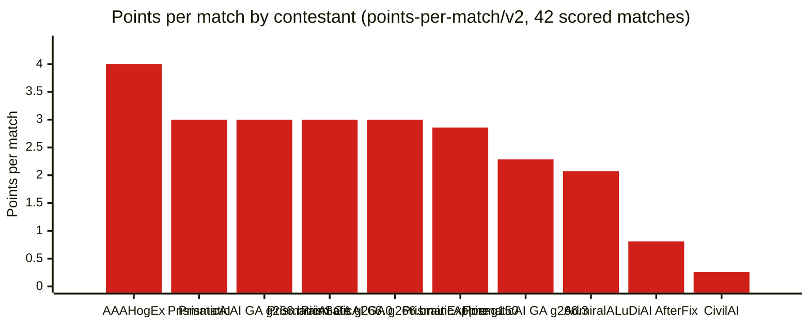
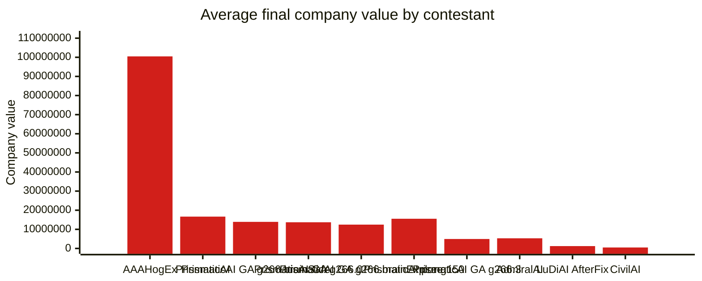
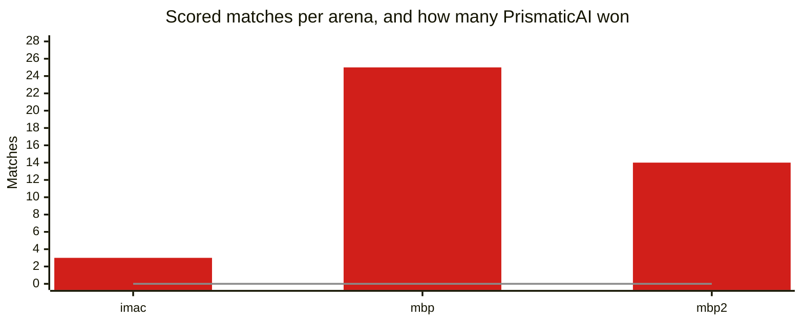

# battle-20261121T113716-662dee46

Derived from `battle-20261121T113716-662dee46.json` by `tools/research/ai-battle/battle.py report`; do not edit.

- Edition `662dee46d36d13d4`: PrismaticAI and referee at `52f631b115782334f422f741a79ecabce78e58c4`, base set `opengfx-8.0.tar`
- 20-year free-for-all from 1960, map 256x256 temperate, breakdowns 1
- 42 scored match(es) on `imac` (20261119-master-gdf1e05e7d8), `mbp` (20261120-master-m17653b726e), `mbp2` (20261119-master-gdf1e05e7d8)
- Replays: 0 of 2 identical to their original on another arena

| # | Contestant | Played | Wins | Points | Points/match | Avg rank | Avg final value | Squirrel errors | Matches with anomalies |
|---|---|---|---|---|---|---|---|---|---|
| 1 | AAAHogEx | 42 | 42 | 168 | 4.0 | 1.0 | 100.5 M | 0 | 0 |
| 2 | PrismaticAI | 7 | 0 | 21 | 3.0 | 2.0 | 16.7 M | 0 | 0 |
| 3 | PrismaticAI GA g266.brainSafe | 7 | 0 | 21 | 3.0 | 2.0 | 13.9 M | 0 | 0 |
| 4 | PrismaticAI GA g266.0 | 7 | 0 | 21 | 3.0 | 2.0 | 13.7 M | 0 | 0 |
| 5 | PrismaticAI GA g266.brainExplore | 7 | 0 | 21 | 3.0 | 2.0 | 12.5 M | 0 | 3 |
| 6 | PrismaticAI pre-g150 | 7 | 0 | 20 | 2.857 | 2.14 | 15.5 M | 0 | 3 |
| 7 | PrismaticAI GA g266.3 | 7 | 0 | 16 | 2.286 | 2.71 | 4.9 M | 0 | 0 |
| 8 | AdmiralAI | 42 | 0 | 87 | 2.071 | 2.93 | 5.3 M | 0 | 1 |
| 9 | LuDiAI AfterFix | 42 | 0 | 34 | 0.81 | 4.19 | 1.2 M | 0 | 3 |
| 10 | CivilAI | 42 | 0 | 11 | 0.262 | 4.74 | 499.0 k | 0 | 10 |

```mermaid
---
config:
  xyChart:
    width: 900
    height: 360
  themeVariables:
    xyChart:
      plotColorPalette: "#d11f1a, #8a8a8a, #0b0b0b, #ece4d6"
---
xychart-beta
    title "Final company value per scored match: winner vs best PrismaticAI"
    x-axis ["m-0001", "m-0002", "m-0003", "m-0004", "m-0005", "m-0006", "m-0007", "m-0008", "m-0009", "m-0010", "m-0011", "m-0012", "m-0013", "m-0014", "m-0015", "m-0016", "m-0017", "m-0018", "m-0021", "m-0022", "m-0023", "m-0024", "m-0025", "m-0026", "m-0027", "m-0028", "m-0036", "m-0037", "m-0038", "m-0039", "m-0040", "m-0041", "m-0042", "m-0043", "m-0044", "m-0045", "m-0047", "m-0049", "m-0050", "m-0052", "m-0053", "m-0054"]
    %% series: Winner | Best PrismaticAI
    %% links: battle-20261121T113716-662dee46.md?col=Match&filter=m-0001 | battle-20261121T113716-662dee46.md?col=Match&filter=m-0002 | battle-20261121T113716-662dee46.md?col=Match&filter=m-0003 | battle-20261121T113716-662dee46.md?col=Match&filter=m-0004 | battle-20261121T113716-662dee46.md?col=Match&filter=m-0005 | battle-20261121T113716-662dee46.md?col=Match&filter=m-0006 | battle-20261121T113716-662dee46.md?col=Match&filter=m-0007 | battle-20261121T113716-662dee46.md?col=Match&filter=m-0008 | battle-20261121T113716-662dee46.md?col=Match&filter=m-0009 | battle-20261121T113716-662dee46.md?col=Match&filter=m-0010 | battle-20261121T113716-662dee46.md?col=Match&filter=m-0011 | battle-20261121T113716-662dee46.md?col=Match&filter=m-0012 | battle-20261121T113716-662dee46.md?col=Match&filter=m-0013 | battle-20261121T113716-662dee46.md?col=Match&filter=m-0014 | battle-20261121T113716-662dee46.md?col=Match&filter=m-0015 | battle-20261121T113716-662dee46.md?col=Match&filter=m-0016 | battle-20261121T113716-662dee46.md?col=Match&filter=m-0017 | battle-20261121T113716-662dee46.md?col=Match&filter=m-0018 | battle-20261121T113716-662dee46.md?col=Match&filter=m-0021 | battle-20261121T113716-662dee46.md?col=Match&filter=m-0022 | battle-20261121T113716-662dee46.md?col=Match&filter=m-0023 | battle-20261121T113716-662dee46.md?col=Match&filter=m-0024 | battle-20261121T113716-662dee46.md?col=Match&filter=m-0025 | battle-20261121T113716-662dee46.md?col=Match&filter=m-0026 | battle-20261121T113716-662dee46.md?col=Match&filter=m-0027 | battle-20261121T113716-662dee46.md?col=Match&filter=m-0028 | battle-20261121T113716-662dee46.md?col=Match&filter=m-0036 | battle-20261121T113716-662dee46.md?col=Match&filter=m-0037 | battle-20261121T113716-662dee46.md?col=Match&filter=m-0038 | battle-20261121T113716-662dee46.md?col=Match&filter=m-0039 | battle-20261121T113716-662dee46.md?col=Match&filter=m-0040 | battle-20261121T113716-662dee46.md?col=Match&filter=m-0041 | battle-20261121T113716-662dee46.md?col=Match&filter=m-0042 | battle-20261121T113716-662dee46.md?col=Match&filter=m-0043 | battle-20261121T113716-662dee46.md?col=Match&filter=m-0044 | battle-20261121T113716-662dee46.md?col=Match&filter=m-0045 | battle-20261121T113716-662dee46.md?col=Match&filter=m-0047 | battle-20261121T113716-662dee46.md?col=Match&filter=m-0049 | battle-20261121T113716-662dee46.md?col=Match&filter=m-0050 | battle-20261121T113716-662dee46.md?col=Match&filter=m-0052 | battle-20261121T113716-662dee46.md?col=Match&filter=m-0053 | battle-20261121T113716-662dee46.md?col=Match&filter=m-0054
    y-axis "Company value" 0 --> 191000000
    bar [68199969, 78898688, 79504867, 93459833, 71209115, 102913786, 79820872, 99598223, 82328295, 92354375, 80193027, 150063059, 147618970, 146907350, 141729315, 158731256, 173600895, 97092220, 111960632, 128998069, 132678047, 114390094, 105056348, 84943941, 87967259, 127749615, 72673376, 82698517, 90699494, 80483632, 86159500, 64055053, 97235740, 79420217, 90248216, 92691810, 93399941, 90423022, 92769462, 92077656, 70466487, 106156456]
    line [5908083, 9585186, 10177251, 9924215, 4309398, 16061528, 17920191, 11181730, 11682423, 10609316, 5058643, 23320037, 19793781, 25036219, 21415381, 19935133, 9602797, 15683814, 16615431, 13535867, 538000, 18133343, 20558909, 17348000, 19094108, 15139971, 13393383, 12332273, 9616903, 8527208, 7367170, 3856817, 15902805, 15968347, 14323186, 9847024, 6407420, 16262948, 8807655, 10755694, 4842483, 14058760]
```

<!-- battle-charts:begin -->
<!-- derived from battle-20261121T113716-662dee46.json by `battle.py render`; `battle.py check` fails when it is stale -->

<!-- battle-charts:end -->

| Seed | Original | Replay | Arenas | Identical |
|---|---|---|---|---|
| 1543778352 | m-0010 | m-0048 | imac / mbp | NO |
| 1543778352 | m-0011 | m-0056 | imac / mbp | NO |

| Match | Arena | Seed | Winner | Value | Last | Anomalies |
|---|---|---|---|---|---|---|
| m-0001 | mbp | 974319239 | AAAHogEx | 68.2 M | LuDiAI AfterFix | CivilAI: fleet_drop:146->79 |
| m-0002 | mbp | 974319239 | AAAHogEx | 78.9 M | CivilAI | - |
| m-0003 | mbp | 974319239 | AAAHogEx | 79.5 M | LuDiAI AfterFix | - |
| m-0004 | mbp | 974319239 | AAAHogEx | 93.5 M | LuDiAI AfterFix | - |
| m-0005 | mbp | 974319239 | AAAHogEx | 71.2 M | CivilAI | - |
| m-0006 | mbp | 1543778352 | AAAHogEx | 102.9 M | CivilAI | - |
| m-0007 | mbp | 1543778352 | AAAHogEx | 79.8 M | CivilAI | AdmiralAI: fleet_drop:474->301; CivilAI: fleet_drop:96->65 |
| m-0008 | mbp | 1543778352 | AAAHogEx | 99.6 M | CivilAI | - |
| m-0009 | mbp | 1543778352 | AAAHogEx | 82.3 M | CivilAI | - |
| m-0010 | imac | 1543778352 | AAAHogEx | 92.4 M | CivilAI | - |
| m-0011 | imac | 1543778352 | AAAHogEx | 80.2 M | CivilAI | LuDiAI AfterFix: fleet_drop:47->24 |
| m-0012 | imac | 893348385 | AAAHogEx | 150.1 M | CivilAI | CivilAI: fleet_drop:68->45 |
| m-0013 | mbp2 | 893348385 | AAAHogEx | 147.6 M | CivilAI | PrismaticAI pre-g150: fleet_drop:182->76 |
| m-0014 | mbp2 | 893348385 | AAAHogEx | 146.9 M | CivilAI | - |
| m-0015 | mbp2 | 893348385 | AAAHogEx | 141.7 M | CivilAI | - |
| m-0016 | mbp2 | 893348385 | AAAHogEx | 158.7 M | CivilAI | PrismaticAI GA g266.brainExplore: fleet_drop:161->93 |
| m-0017 | mbp2 | 893348385 | AAAHogEx | 173.6 M | CivilAI | - |
| m-0018 | mbp2 | 236686090 | AAAHogEx | 97.1 M | CivilAI | CivilAI: fleet_drop:14->6 |
| m-0021 | mbp2 | 236686090 | AAAHogEx | 112.0 M | CivilAI | - |
| m-0022 | mbp2 | 236686090 | AAAHogEx | 129.0 M | CivilAI | PrismaticAI GA g266.brainExplore: fleet_drop:245->150 |
| m-0023 | mbp2 | 236686090 | AAAHogEx | 132.7 M | CivilAI | - |
| m-0024 | mbp2 | 1889031642 | AAAHogEx | 114.4 M | CivilAI | - |
| m-0025 | mbp2 | 1889031642 | AAAHogEx | 105.1 M | AdmiralAI | - |
| m-0026 | mbp2 | 1889031642 | AAAHogEx | 84.9 M | CivilAI | - |
| m-0027 | mbp2 | 1889031642 | AAAHogEx | 88.0 M | CivilAI | - |
| m-0028 | mbp2 | 1889031642 | AAAHogEx | 127.7 M | CivilAI | - |
| m-0036 | mbp | 1586531762 | AAAHogEx | 72.7 M | LuDiAI AfterFix | - |
| m-0037 | mbp | 1586531762 | AAAHogEx | 82.7 M | CivilAI | PrismaticAI pre-g150: fleet_drop:82->51 |
| m-0038 | mbp | 1586531762 | AAAHogEx | 90.7 M | CivilAI | - |
| m-0039 | mbp | 1586531762 | AAAHogEx | 80.5 M | CivilAI | CivilAI: fleet_drop:36->24 |
| m-0040 | mbp | 1586531762 | AAAHogEx | 86.2 M | CivilAI | PrismaticAI GA g266.brainExplore: fleet_drop:186->77 |
| m-0041 | mbp | 1586531762 | AAAHogEx | 64.1 M | CivilAI | CivilAI: fleet_drop:40->25 |
| m-0042 | mbp | 1672863856 | AAAHogEx | 97.2 M | LuDiAI AfterFix | LuDiAI AfterFix: fleet_drop:37->19 |
| m-0043 | mbp | 1672863856 | AAAHogEx | 79.4 M | LuDiAI AfterFix | PrismaticAI pre-g150: fleet_drop:112->56; CivilAI: fleet_drop:38->17 |
| m-0044 | mbp | 1672863856 | AAAHogEx | 90.2 M | CivilAI | - |
| m-0045 | mbp | 1672863856 | AAAHogEx | 92.7 M | CivilAI | - |
| m-0047 | mbp | 1672863856 | AAAHogEx | 93.4 M | CivilAI | - |
| m-0048 (replay) | mbp | 1543778352 | AAAHogEx | 94.6 M | CivilAI | - |
| m-0049 | mbp | 1748426733 | AAAHogEx | 90.4 M | CivilAI | - |
| m-0050 | mbp | 1748426733 | AAAHogEx | 92.8 M | LuDiAI AfterFix | CivilAI: fleet_drop:40->19 |
| m-0052 | mbp | 1748426733 | AAAHogEx | 92.1 M | LuDiAI AfterFix | CivilAI: fleet_drop:32->14 |
| m-0053 | mbp | 1748426733 | AAAHogEx | 70.5 M | LuDiAI AfterFix | LuDiAI AfterFix: fleet_drop:20->5 |
| m-0054 | mbp | 334694825 | AAAHogEx | 106.2 M | CivilAI | CivilAI: fleet_drop:19->11 |
| m-0056 (replay) | mbp | 1543778352 | AAAHogEx | 82.7 M | CivilAI | CivilAI: fleet_drop:15->9 |
