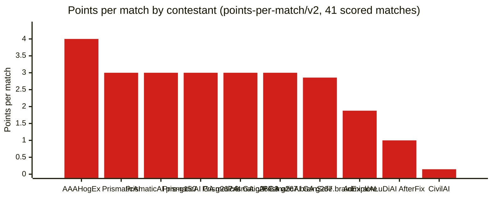
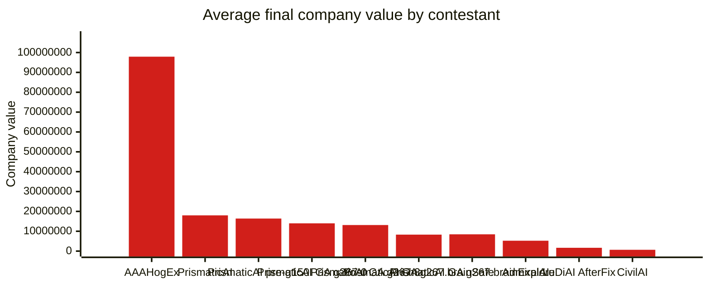
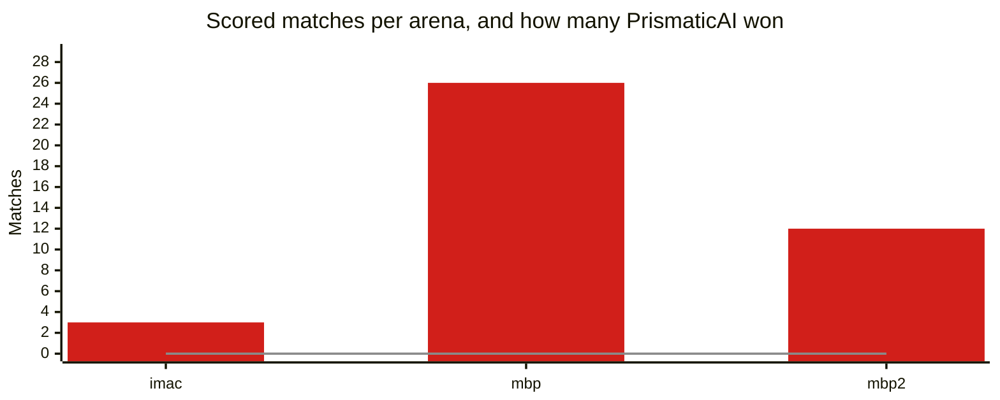

# battle-20261121T114946-ad811b81

Derived from `battle-20261121T114946-ad811b81.json` by `tools/research/ai-battle/battle.py report`; do not edit.

- Edition `ad811b81604de40d`: PrismaticAI and referee at `52f631b115782334f422f741a79ecabce78e58c4`, base set `opengfx-8.0.tar`
- 20-year free-for-all from 1960, map 256x256 temperate, breakdowns 1
- 41 scored match(es) on `imac` (20261119-master-gdf1e05e7d8), `mbp` (20261120-master-m17653b726e), `mbp2` (20261119-master-gdf1e05e7d8)
- Replays: 0 of 1 identical to their original on another arena

| # | Contestant | Played | Wins | Points | Points/match | Avg rank | Avg final value | Squirrel errors | Matches with anomalies |
|---|---|---|---|---|---|---|---|---|---|
| 1 | AAAHogEx | 41 | 41 | 164 | 4.0 | 1.0 | 97.9 M | 0 | 0 |
| 2 | PrismaticAI | 6 | 0 | 18 | 3.0 | 2.0 | 18.0 M | 0 | 0 |
| 3 | PrismaticAI pre-g150 | 9 | 0 | 27 | 3.0 | 2.0 | 16.4 M | 0 | 2 |
| 4 | PrismaticAI GA g267.0 | 7 | 0 | 21 | 3.0 | 2.0 | 14.0 M | 0 | 0 |
| 5 | PrismaticAI GA g267.3 | 6 | 0 | 18 | 3.0 | 2.0 | 13.1 M | 0 | 2 |
| 6 | PrismaticAI GA g267.brainSafe | 6 | 0 | 18 | 3.0 | 2.0 | 8.3 M | 0 | 1 |
| 7 | PrismaticAI GA g267.brainExplore | 7 | 0 | 20 | 2.857 | 2.14 | 8.4 M | 0 | 0 |
| 8 | AdmiralAI | 41 | 0 | 77 | 1.878 | 3.12 | 5.2 M | 0 | 2 |
| 9 | LuDiAI AfterFix | 41 | 0 | 41 | 1.0 | 4.0 | 1.7 M | 0 | 0 |
| 10 | CivilAI | 41 | 0 | 6 | 0.146 | 4.85 | 659.6 k | 0 | 10 |

```mermaid
---
config:
  xyChart:
    width: 900
    height: 360
  themeVariables:
    xyChart:
      plotColorPalette: "#d11f1a, #8a8a8a, #0b0b0b, #ece4d6"
---
xychart-beta
    title "Final company value per scored match: winner vs best PrismaticAI"
    x-axis ["m-0001", "m-0002", "m-0003", "m-0004", "m-0005", "m-0006", "m-0007", "m-0008", "m-0009", "m-0010", "m-0011", "m-0012", "m-0013", "m-0014", "m-0015", "m-0016", "m-0017", "m-0018", "m-0019", "m-0020", "m-0021", "m-0022", "m-0023", "m-0025", "m-0036", "m-0037", "m-0038", "m-0039", "m-0040", "m-0041", "m-0042", "m-0043", "m-0044", "m-0046", "m-0049", "m-0050", "m-0051", "m-0052", "m-0053", "m-0054", "m-0055"]
    %% series: Winner | Best PrismaticAI
    %% links: battle-20261121T114946-ad811b81.md?col=Match&filter=m-0001 | battle-20261121T114946-ad811b81.md?col=Match&filter=m-0002 | battle-20261121T114946-ad811b81.md?col=Match&filter=m-0003 | battle-20261121T114946-ad811b81.md?col=Match&filter=m-0004 | battle-20261121T114946-ad811b81.md?col=Match&filter=m-0005 | battle-20261121T114946-ad811b81.md?col=Match&filter=m-0006 | battle-20261121T114946-ad811b81.md?col=Match&filter=m-0007 | battle-20261121T114946-ad811b81.md?col=Match&filter=m-0008 | battle-20261121T114946-ad811b81.md?col=Match&filter=m-0009 | battle-20261121T114946-ad811b81.md?col=Match&filter=m-0010 | battle-20261121T114946-ad811b81.md?col=Match&filter=m-0011 | battle-20261121T114946-ad811b81.md?col=Match&filter=m-0012 | battle-20261121T114946-ad811b81.md?col=Match&filter=m-0013 | battle-20261121T114946-ad811b81.md?col=Match&filter=m-0014 | battle-20261121T114946-ad811b81.md?col=Match&filter=m-0015 | battle-20261121T114946-ad811b81.md?col=Match&filter=m-0016 | battle-20261121T114946-ad811b81.md?col=Match&filter=m-0017 | battle-20261121T114946-ad811b81.md?col=Match&filter=m-0018 | battle-20261121T114946-ad811b81.md?col=Match&filter=m-0019 | battle-20261121T114946-ad811b81.md?col=Match&filter=m-0020 | battle-20261121T114946-ad811b81.md?col=Match&filter=m-0021 | battle-20261121T114946-ad811b81.md?col=Match&filter=m-0022 | battle-20261121T114946-ad811b81.md?col=Match&filter=m-0023 | battle-20261121T114946-ad811b81.md?col=Match&filter=m-0025 | battle-20261121T114946-ad811b81.md?col=Match&filter=m-0036 | battle-20261121T114946-ad811b81.md?col=Match&filter=m-0037 | battle-20261121T114946-ad811b81.md?col=Match&filter=m-0038 | battle-20261121T114946-ad811b81.md?col=Match&filter=m-0039 | battle-20261121T114946-ad811b81.md?col=Match&filter=m-0040 | battle-20261121T114946-ad811b81.md?col=Match&filter=m-0041 | battle-20261121T114946-ad811b81.md?col=Match&filter=m-0042 | battle-20261121T114946-ad811b81.md?col=Match&filter=m-0043 | battle-20261121T114946-ad811b81.md?col=Match&filter=m-0044 | battle-20261121T114946-ad811b81.md?col=Match&filter=m-0046 | battle-20261121T114946-ad811b81.md?col=Match&filter=m-0049 | battle-20261121T114946-ad811b81.md?col=Match&filter=m-0050 | battle-20261121T114946-ad811b81.md?col=Match&filter=m-0051 | battle-20261121T114946-ad811b81.md?col=Match&filter=m-0052 | battle-20261121T114946-ad811b81.md?col=Match&filter=m-0053 | battle-20261121T114946-ad811b81.md?col=Match&filter=m-0054 | battle-20261121T114946-ad811b81.md?col=Match&filter=m-0055
    y-axis "Company value" 0 --> 172000000
    bar [104532185, 112212840, 125463927, 124502634, 118304125, 69346186, 73848733, 46020368, 99709598, 89602862, 52875627, 124241726, 96268983, 99835417, 128181889, 128612621, 112712271, 69243336, 61328742, 65272859, 82518710, 89236072, 72929256, 114711862, 120540633, 79112570, 75455482, 75340743, 80399349, 111517197, 94299180, 106185111, 92697940, 120808476, 100055771, 73339001, 115763415, 115990534, 111397978, 123612743, 156333431]
    line [16174650, 22220543, 9732411, 9656809, 15327197, 16345069, 16047336, 9646103, 6884359, 6350851, 7842708, 17737872, 16721462, 14529506, 9189875, 8807122, 16367594, 10847139, 11565986, 11923661, 5888782, 6257673, 12966411, 21587535, 21084856, 20265214, 16161443, 10595091, 11735659, 13433662, 16155660, 9275754, 9575471, 8829308, 13608826, 13828029, 7491732, 7503596, 12834441, 25808585, 22256860]
```

<!-- battle-charts:begin -->
<!-- derived from battle-20261121T114946-ad811b81.json by `battle.py render`; `battle.py check` fails when it is stale -->

<!-- battle-charts:end -->

| Seed | Original | Replay | Arenas | Identical |
|---|---|---|---|---|
| 1194658649 | m-0010 | m-0048 | imac / mbp | NO |

| Match | Arena | Seed | Winner | Value | Last | Anomalies |
|---|---|---|---|---|---|---|
| m-0001 | mbp | 1483250367 | AAAHogEx | 104.5 M | CivilAI | - |
| m-0002 | mbp | 1483250367 | AAAHogEx | 112.2 M | CivilAI | CivilAI: fleet_drop:61->39 |
| m-0003 | mbp | 1483250367 | AAAHogEx | 125.5 M | LuDiAI AfterFix | - |
| m-0004 | mbp | 1483250367 | AAAHogEx | 124.5 M | AdmiralAI | CivilAI: fleet_drop:68->47 |
| m-0005 | mbp | 1483250367 | AAAHogEx | 118.3 M | CivilAI | PrismaticAI GA g267.3: fleet_drop:90->51 |
| m-0006 | mbp | 1194658649 | AAAHogEx | 69.3 M | CivilAI | CivilAI: fleet_drop:59->18 |
| m-0007 | mbp | 1194658649 | AAAHogEx | 73.8 M | CivilAI | CivilAI: fleet_drop:24->14 |
| m-0008 | mbp | 1194658649 | AAAHogEx | 46.0 M | CivilAI | CivilAI: fleet_drop:14->9 |
| m-0009 | mbp | 1194658649 | AAAHogEx | 99.7 M | CivilAI | - |
| m-0010 | imac | 1194658649 | AAAHogEx | 89.6 M | CivilAI | - |
| m-0011 | imac | 1194658649 | AAAHogEx | 52.9 M | CivilAI | CivilAI: fleet_drop:21->9 |
| m-0012 | imac | 418119689 | AAAHogEx | 124.2 M | CivilAI | CivilAI: fleet_drop:48->20 |
| m-0013 | mbp2 | 418119689 | AAAHogEx | 96.3 M | CivilAI | PrismaticAI pre-g150: fleet_drop:125->68 |
| m-0014 | mbp2 | 418119689 | AAAHogEx | 99.8 M | CivilAI | - |
| m-0015 | mbp2 | 418119689 | AAAHogEx | 128.2 M | CivilAI | - |
| m-0016 | mbp2 | 418119689 | AAAHogEx | 128.6 M | CivilAI | - |
| m-0017 | mbp2 | 418119689 | AAAHogEx | 112.7 M | CivilAI | - |
| m-0018 | mbp2 | 1824970444 | AAAHogEx | 69.2 M | CivilAI | - |
| m-0019 | mbp2 | 1824970444 | AAAHogEx | 61.3 M | CivilAI | - |
| m-0020 | mbp2 | 1824970444 | AAAHogEx | 65.3 M | CivilAI | - |
| m-0021 | mbp2 | 1824970444 | AAAHogEx | 82.5 M | CivilAI | - |
| m-0022 | mbp2 | 1824970444 | AAAHogEx | 89.2 M | CivilAI | - |
| m-0023 | mbp2 | 1824970444 | AAAHogEx | 72.9 M | LuDiAI AfterFix | - |
| m-0025 | mbp2 | 1365626973 | AAAHogEx | 114.7 M | CivilAI | - |
| m-0036 | mbp | 1507011071 | AAAHogEx | 120.5 M | CivilAI | CivilAI: fleet_drop:32->14 |
| m-0037 | mbp | 1507011071 | AAAHogEx | 79.1 M | CivilAI | - |
| m-0038 | mbp | 1507011071 | AAAHogEx | 75.5 M | CivilAI | CivilAI: fleet_drop:25->16 |
| m-0039 | mbp | 1507011071 | AAAHogEx | 75.3 M | CivilAI | PrismaticAI GA g267.brainSafe: fleet_drop:42->29 |
| m-0040 | mbp | 1507011071 | AAAHogEx | 80.4 M | CivilAI | - |
| m-0041 | mbp | 1507011071 | AAAHogEx | 111.5 M | CivilAI | PrismaticAI GA g267.3: fleet_drop:60->34 |
| m-0042 | mbp | 185961024 | AAAHogEx | 94.3 M | CivilAI | CivilAI: fleet_drop:33->22 |
| m-0043 | mbp | 185961024 | AAAHogEx | 106.2 M | CivilAI | - |
| m-0044 | mbp | 185961024 | AAAHogEx | 92.7 M | CivilAI | - |
| m-0046 | mbp | 185961024 | AAAHogEx | 120.8 M | CivilAI | - |
| m-0048 (replay) | mbp | 1194658649 | AAAHogEx | 93.4 M | CivilAI | - |
| m-0049 | mbp | 1688007243 | AAAHogEx | 100.1 M | CivilAI | PrismaticAI pre-g150: fleet_drop:97->57 |
| m-0050 | mbp | 1688007243 | AAAHogEx | 73.3 M | CivilAI | - |
| m-0051 | mbp | 1688007243 | AAAHogEx | 115.8 M | LuDiAI AfterFix | AdmiralAI: fleet_drop:169->85 |
| m-0052 | mbp | 1688007243 | AAAHogEx | 116.0 M | LuDiAI AfterFix | AdmiralAI: fleet_drop:169->89 |
| m-0053 | mbp | 1688007243 | AAAHogEx | 111.4 M | LuDiAI AfterFix | - |
| m-0054 | mbp | 1309991516 | AAAHogEx | 123.6 M | CivilAI | - |
| m-0055 | mbp | 1309991516 | AAAHogEx | 156.3 M | CivilAI | - |
