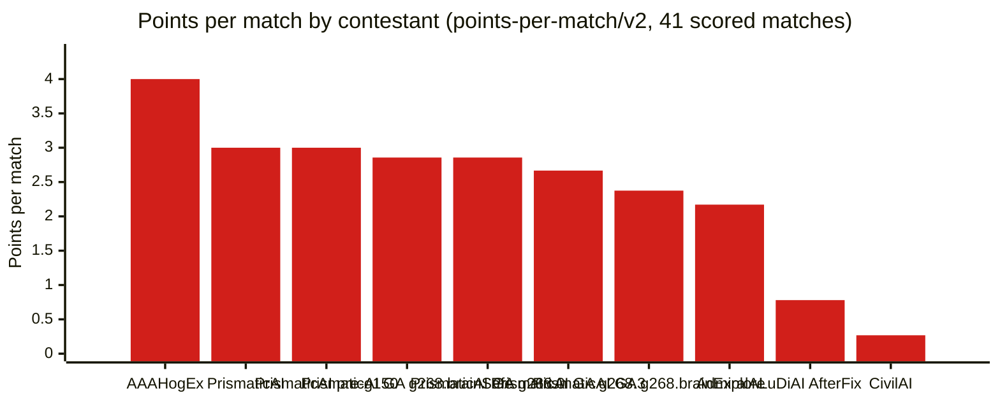
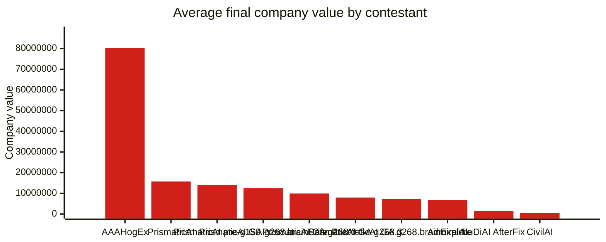
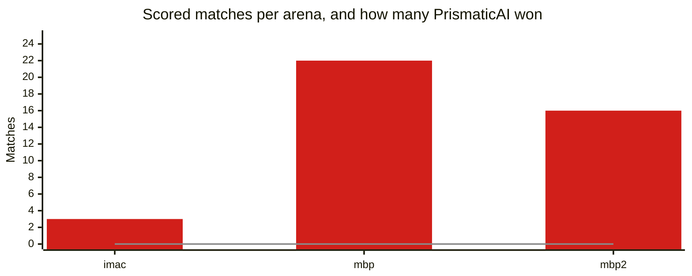

# battle-20261121T120147-2bfc221a

Derived from `battle-20261121T120147-2bfc221a.json` by `tools/research/ai-battle/battle.py report`; do not edit.

- Edition `2bfc221a5d13e503`: PrismaticAI and referee at `52f631b115782334f422f741a79ecabce78e58c4`, base set `opengfx-8.0.tar`
- 20-year free-for-all from 1960, map 256x256 temperate, breakdowns 1
- 41 scored match(es) on `imac` (20261119-master-gdf1e05e7d8), `mbp` (20261120-master-m17653b726e), `mbp2` (20261119-master-gdf1e05e7d8)
- Replays: 0 of 1 identical to their original on another arena

| # | Contestant | Played | Wins | Points | Points/match | Avg rank | Avg final value | Squirrel errors | Matches with anomalies |
|---|---|---|---|---|---|---|---|---|---|
| 1 | AAAHogEx | 41 | 41 | 164 | 4.0 | 1.0 | 80.4 M | 35 | 1 |
| 2 | PrismaticAI | 6 | 0 | 18 | 3.0 | 2.0 | 15.7 M | 0 | 0 |
| 3 | PrismaticAI pre-g150 | 7 | 0 | 21 | 3.0 | 2.0 | 14.1 M | 0 | 4 |
| 4 | PrismaticAI GA g268.brainSafe | 7 | 0 | 20 | 2.857 | 2.14 | 12.5 M | 0 | 0 |
| 5 | PrismaticAI GA g268.0 | 7 | 0 | 20 | 2.857 | 2.14 | 9.9 M | 0 | 0 |
| 6 | PrismaticAI GA g268.3 | 6 | 0 | 16 | 2.667 | 2.33 | 8.0 M | 0 | 2 |
| 7 | PrismaticAI GA g268.brainExplore | 8 | 0 | 19 | 2.375 | 2.62 | 7.3 M | 0 | 1 |
| 8 | AdmiralAI | 41 | 0 | 89 | 2.171 | 2.83 | 6.7 M | 0 | 0 |
| 9 | LuDiAI AfterFix | 41 | 0 | 32 | 0.78 | 4.22 | 1.5 M | 0 | 2 |
| 10 | CivilAI | 41 | 0 | 11 | 0.268 | 4.73 | 492.5 k | 0 | 6 |

```mermaid
---
config:
  xyChart:
    width: 900
    height: 360
  themeVariables:
    xyChart:
      plotColorPalette: "#d11f1a, #8a8a8a, #0b0b0b, #ece4d6"
---
xychart-beta
    title "Final company value per scored match: winner vs best PrismaticAI"
    x-axis ["m-0001", "m-0002", "m-0003", "m-0004", "m-0005", "m-0006", "m-0007", "m-0008", "m-0009", "m-0010", "m-0011", "m-0012", "m-0013", "m-0014", "m-0015", "m-0016", "m-0017", "m-0018", "m-0019", "m-0020", "m-0021", "m-0022", "m-0023", "m-0024", "m-0025", "m-0026", "m-0027", "m-0028", "m-0036", "m-0037", "m-0038", "m-0039", "m-0040", "m-0041", "m-0042", "m-0043", "m-0044", "m-0045", "m-0046", "m-0047", "m-0052"]
    %% series: Winner | Best PrismaticAI
    %% links: battle-20261121T120147-2bfc221a.md?col=Match&filter=m-0001 | battle-20261121T120147-2bfc221a.md?col=Match&filter=m-0002 | battle-20261121T120147-2bfc221a.md?col=Match&filter=m-0003 | battle-20261121T120147-2bfc221a.md?col=Match&filter=m-0004 | battle-20261121T120147-2bfc221a.md?col=Match&filter=m-0005 | battle-20261121T120147-2bfc221a.md?col=Match&filter=m-0006 | battle-20261121T120147-2bfc221a.md?col=Match&filter=m-0007 | battle-20261121T120147-2bfc221a.md?col=Match&filter=m-0008 | battle-20261121T120147-2bfc221a.md?col=Match&filter=m-0009 | battle-20261121T120147-2bfc221a.md?col=Match&filter=m-0010 | battle-20261121T120147-2bfc221a.md?col=Match&filter=m-0011 | battle-20261121T120147-2bfc221a.md?col=Match&filter=m-0012 | battle-20261121T120147-2bfc221a.md?col=Match&filter=m-0013 | battle-20261121T120147-2bfc221a.md?col=Match&filter=m-0014 | battle-20261121T120147-2bfc221a.md?col=Match&filter=m-0015 | battle-20261121T120147-2bfc221a.md?col=Match&filter=m-0016 | battle-20261121T120147-2bfc221a.md?col=Match&filter=m-0017 | battle-20261121T120147-2bfc221a.md?col=Match&filter=m-0018 | battle-20261121T120147-2bfc221a.md?col=Match&filter=m-0019 | battle-20261121T120147-2bfc221a.md?col=Match&filter=m-0020 | battle-20261121T120147-2bfc221a.md?col=Match&filter=m-0021 | battle-20261121T120147-2bfc221a.md?col=Match&filter=m-0022 | battle-20261121T120147-2bfc221a.md?col=Match&filter=m-0023 | battle-20261121T120147-2bfc221a.md?col=Match&filter=m-0024 | battle-20261121T120147-2bfc221a.md?col=Match&filter=m-0025 | battle-20261121T120147-2bfc221a.md?col=Match&filter=m-0026 | battle-20261121T120147-2bfc221a.md?col=Match&filter=m-0027 | battle-20261121T120147-2bfc221a.md?col=Match&filter=m-0028 | battle-20261121T120147-2bfc221a.md?col=Match&filter=m-0036 | battle-20261121T120147-2bfc221a.md?col=Match&filter=m-0037 | battle-20261121T120147-2bfc221a.md?col=Match&filter=m-0038 | battle-20261121T120147-2bfc221a.md?col=Match&filter=m-0039 | battle-20261121T120147-2bfc221a.md?col=Match&filter=m-0040 | battle-20261121T120147-2bfc221a.md?col=Match&filter=m-0041 | battle-20261121T120147-2bfc221a.md?col=Match&filter=m-0042 | battle-20261121T120147-2bfc221a.md?col=Match&filter=m-0043 | battle-20261121T120147-2bfc221a.md?col=Match&filter=m-0044 | battle-20261121T120147-2bfc221a.md?col=Match&filter=m-0045 | battle-20261121T120147-2bfc221a.md?col=Match&filter=m-0046 | battle-20261121T120147-2bfc221a.md?col=Match&filter=m-0047 | battle-20261121T120147-2bfc221a.md?col=Match&filter=m-0052
    y-axis "Company value" 0 --> 129000000
    bar [97542699, 96378975, 117220192, 111940178, 111128102, 55558960, 51273264, 58046509, 54390550, 72500873, 55115975, 66444003, 62095030, 49486929, 57731850, 67409119, 60475754, 54102167, 81457341, 74923144, 72685701, 64314745, 79388758, 94178766, 91468614, 80609614, 76236321, 111792757, 82159062, 80591478, 90955450, 96417895, 92297027, 75250779, 100200965, 85725174, 97020359, 85318717, 84342259, 84301611, 114704956]
    line [15643908, 13388814, 12341804, 11213801, 11773062, 12305688, 13645225, 7355880, 10735857, 7764740, 5134855, 13151764, 9985340, 7249423, 6479803, 1, 5425824, 20731440, 14405826, 14459643, 18755652, 14636094, 12787127, 12962616, 13491704, 10797340, 16843827, 7950933, 17079898, 14782118, 9423689, 10038385, 7416707, 5685153, 18122876, 16401382, 6569174, 12336352, 7376733, 6895822, 1743236]
```

<!-- battle-charts:begin -->
<!-- derived from battle-20261121T120147-2bfc221a.json by `battle.py render`; `battle.py check` fails when it is stale -->

<!-- battle-charts:end -->

| Seed | Original | Replay | Arenas | Identical |
|---|---|---|---|---|
| 374070731 | m-0010 | m-0048 | imac / mbp | NO |

| Match | Arena | Seed | Winner | Value | Last | Anomalies |
|---|---|---|---|---|---|---|
| m-0001 | mbp | 73175337 | AAAHogEx | 97.5 M | CivilAI | PrismaticAI pre-g150: fleet_drop:70->43 |
| m-0002 | mbp | 73175337 | AAAHogEx | 96.4 M | CivilAI | - |
| m-0003 | mbp | 73175337 | AAAHogEx | 117.2 M | CivilAI | CivilAI: fleet_drop:14->8 |
| m-0004 | mbp | 73175337 | AAAHogEx | 111.9 M | CivilAI | - |
| m-0005 | mbp | 73175337 | AAAHogEx | 111.1 M | CivilAI | - |
| m-0006 | mbp | 374070731 | AAAHogEx | 55.6 M | LuDiAI AfterFix | LuDiAI AfterFix: fleet_drop:75->23 |
| m-0007 | mbp | 374070731 | AAAHogEx | 51.3 M | CivilAI | PrismaticAI pre-g150: fleet_drop:88->56 |
| m-0008 | mbp | 374070731 | AAAHogEx | 58.0 M | CivilAI | - |
| m-0009 | mbp | 374070731 | AAAHogEx | 54.4 M | CivilAI | - |
| m-0010 | imac | 374070731 | AAAHogEx | 72.5 M | CivilAI | - |
| m-0011 | imac | 374070731 | AAAHogEx | 55.1 M | CivilAI | PrismaticAI GA g268.3: fleet_drop:114->73; CivilAI: fleet_drop:63->41 |
| m-0012 | imac | 475454748 | AAAHogEx | 66.4 M | CivilAI | - |
| m-0013 | mbp2 | 475454748 | AAAHogEx | 62.1 M | LuDiAI AfterFix | - |
| m-0014 | mbp2 | 475454748 | AAAHogEx | 49.5 M | CivilAI | - |
| m-0015 | mbp2 | 475454748 | AAAHogEx | 57.7 M | CivilAI | - |
| m-0016 | mbp2 | 475454748 | AAAHogEx | 67.4 M | PrismaticAI GA g268.brainExplore | PrismaticAI GA g268.brainExplore: fleet_drop:23->5 |
| m-0017 | mbp2 | 475454748 | AAAHogEx | 60.5 M | LuDiAI AfterFix | PrismaticAI GA g268.3: fleet_drop:101->55 |
| m-0018 | mbp2 | 1766152102 | AAAHogEx | 54.1 M | CivilAI | CivilAI: fleet_drop:16->11 |
| m-0019 | mbp2 | 1766152102 | AAAHogEx | 81.5 M | CivilAI | - |
| m-0020 | mbp2 | 1766152102 | AAAHogEx | 74.9 M | CivilAI | - |
| m-0021 | mbp2 | 1766152102 | AAAHogEx | 72.7 M | CivilAI | - |
| m-0022 | mbp2 | 1766152102 | AAAHogEx | 64.3 M | CivilAI | - |
| m-0023 | mbp2 | 1766152102 | AAAHogEx | 79.4 M | CivilAI | - |
| m-0024 | mbp2 | 1720728113 | AAAHogEx | 94.2 M | LuDiAI AfterFix | - |
| m-0025 | mbp2 | 1720728113 | AAAHogEx | 91.5 M | CivilAI | CivilAI: fleet_drop:23->13 |
| m-0026 | mbp2 | 1720728113 | AAAHogEx | 80.6 M | CivilAI | - |
| m-0027 | mbp2 | 1720728113 | AAAHogEx | 76.2 M | LuDiAI AfterFix | - |
| m-0028 | mbp2 | 1720728113 | AAAHogEx | 111.8 M | LuDiAI AfterFix | - |
| m-0036 | mbp | 761181686 | AAAHogEx | 82.2 M | CivilAI | - |
| m-0037 | mbp | 761181686 | AAAHogEx | 80.6 M | LuDiAI AfterFix | PrismaticAI pre-g150: fleet_drop:124->60 |
| m-0038 | mbp | 761181686 | AAAHogEx | 91.0 M | LuDiAI AfterFix | - |
| m-0039 | mbp | 761181686 | AAAHogEx | 96.4 M | LuDiAI AfterFix | LuDiAI AfterFix: fleet_drop:97->60 |
| m-0040 | mbp | 761181686 | AAAHogEx | 92.3 M | CivilAI | - |
| m-0041 | mbp | 761181686 | AAAHogEx | 75.3 M | CivilAI | - |
| m-0042 | mbp | 1726959072 | AAAHogEx | 100.2 M | CivilAI | CivilAI: fleet_drop:39->12 |
| m-0043 | mbp | 1726959072 | AAAHogEx | 85.7 M | CivilAI | PrismaticAI pre-g150: fleet_drop:77->51; CivilAI: fleet_drop:56->32 |
| m-0044 | mbp | 1726959072 | AAAHogEx | 97.0 M | CivilAI | - |
| m-0045 | mbp | 1726959072 | AAAHogEx | 85.3 M | CivilAI | - |
| m-0046 | mbp | 1726959072 | AAAHogEx | 84.3 M | LuDiAI AfterFix | AAAHogEx: squirrel_errors:35 |
| m-0047 | mbp | 1726959072 | AAAHogEx | 84.3 M | CivilAI | - |
| m-0048 (replay) | mbp | 374070731 | AAAHogEx | 68.1 M | CivilAI | - |
| m-0052 | mbp | 1875948852 | AAAHogEx | 114.7 M | CivilAI | - |
