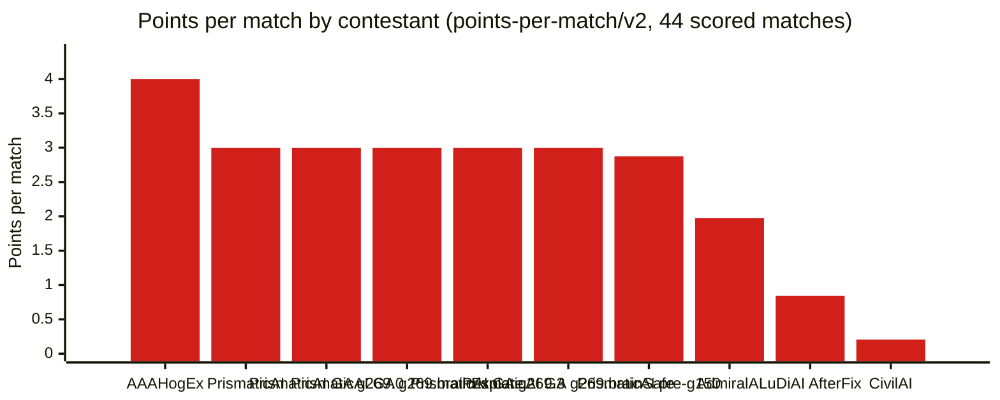
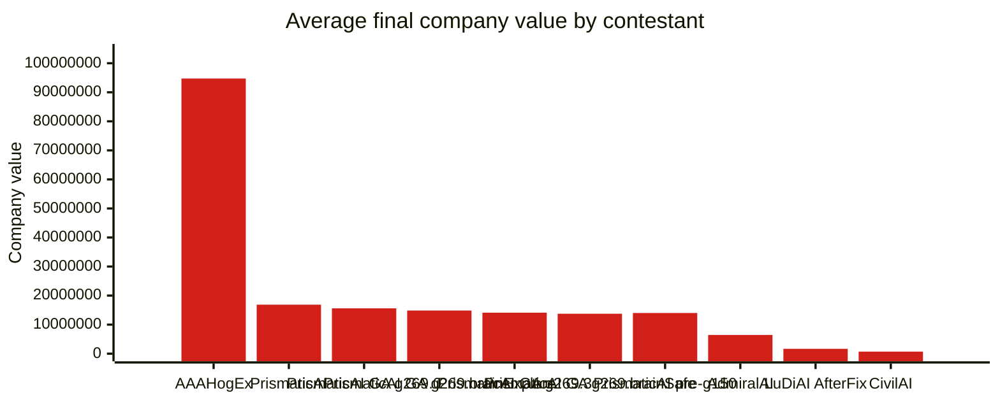
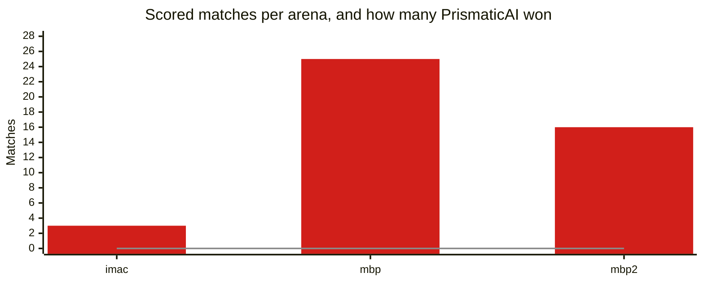

# battle-20261121T121510-f6e4afdd

Derived from `battle-20261121T121510-f6e4afdd.json` by `tools/research/ai-battle/battle.py report`; do not edit.

- Edition `f6e4afdd6b5d9485`: PrismaticAI and referee at `52f631b115782334f422f741a79ecabce78e58c4`, base set `opengfx-8.0.tar`
- 20-year free-for-all from 1960, map 256x256 temperate, breakdowns 1
- 44 scored match(es) on `imac` (20261119-master-gdf1e05e7d8), `mbp` (20261120-master-m17653b726e), `mbp2` (20261119-master-gdf1e05e7d8)
- Replays: 0 of 0 identical to their original on another arena

| # | Contestant | Played | Wins | Points | Points/match | Avg rank | Avg final value | Squirrel errors | Matches with anomalies |
|---|---|---|---|---|---|---|---|---|---|
| 1 | AAAHogEx | 44 | 44 | 176 | 4.0 | 1.0 | 94.7 M | 0 | 0 |
| 2 | PrismaticAI | 7 | 0 | 21 | 3.0 | 2.0 | 16.9 M | 0 | 0 |
| 3 | PrismaticAI GA g269.0 | 7 | 0 | 21 | 3.0 | 2.0 | 15.6 M | 0 | 0 |
| 4 | PrismaticAI GA g269.brainExplore | 7 | 0 | 21 | 3.0 | 2.0 | 14.9 M | 0 | 0 |
| 5 | PrismaticAI GA g269.3 | 7 | 0 | 21 | 3.0 | 2.0 | 14.1 M | 0 | 0 |
| 6 | PrismaticAI GA g269.brainSafe | 8 | 0 | 24 | 3.0 | 2.0 | 13.7 M | 0 | 1 |
| 7 | PrismaticAI pre-g150 | 8 | 0 | 23 | 2.875 | 2.12 | 14.0 M | 0 | 5 |
| 8 | AdmiralAI | 44 | 0 | 87 | 1.977 | 3.02 | 6.4 M | 0 | 0 |
| 9 | LuDiAI AfterFix | 44 | 0 | 37 | 0.841 | 4.16 | 1.7 M | 0 | 1 |
| 10 | CivilAI | 44 | 0 | 9 | 0.205 | 4.8 | 699.8 k | 3844 | 7 |

```mermaid
---
config:
  xyChart:
    width: 900
    height: 360
  themeVariables:
    xyChart:
      plotColorPalette: "#d11f1a, #8a8a8a, #0b0b0b, #ece4d6"
---
xychart-beta
    title "Final company value per scored match: winner vs best PrismaticAI"
    x-axis ["m-0001", "m-0002", "m-0003", "m-0004", "m-0005", "m-0006", "m-0007", "m-0008", "m-0009", "m-0010", "m-0011", "m-0012", "m-0013", "m-0014", "m-0015", "m-0016", "m-0017", "m-0018", "m-0019", "m-0020", "m-0021", "m-0022", "m-0023", "m-0024", "m-0025", "m-0026", "m-0027", "m-0028", "m-0036", "m-0037", "m-0038", "m-0039", "m-0040", "m-0041", "m-0042", "m-0043", "m-0044", "m-0045", "m-0046", "m-0047", "m-0051", "m-0053", "m-0054", "m-0055"]
    %% series: Winner | Best PrismaticAI
    %% links: battle-20261121T121510-f6e4afdd.md?col=Match&filter=m-0001 | battle-20261121T121510-f6e4afdd.md?col=Match&filter=m-0002 | battle-20261121T121510-f6e4afdd.md?col=Match&filter=m-0003 | battle-20261121T121510-f6e4afdd.md?col=Match&filter=m-0004 | battle-20261121T121510-f6e4afdd.md?col=Match&filter=m-0005 | battle-20261121T121510-f6e4afdd.md?col=Match&filter=m-0006 | battle-20261121T121510-f6e4afdd.md?col=Match&filter=m-0007 | battle-20261121T121510-f6e4afdd.md?col=Match&filter=m-0008 | battle-20261121T121510-f6e4afdd.md?col=Match&filter=m-0009 | battle-20261121T121510-f6e4afdd.md?col=Match&filter=m-0010 | battle-20261121T121510-f6e4afdd.md?col=Match&filter=m-0011 | battle-20261121T121510-f6e4afdd.md?col=Match&filter=m-0012 | battle-20261121T121510-f6e4afdd.md?col=Match&filter=m-0013 | battle-20261121T121510-f6e4afdd.md?col=Match&filter=m-0014 | battle-20261121T121510-f6e4afdd.md?col=Match&filter=m-0015 | battle-20261121T121510-f6e4afdd.md?col=Match&filter=m-0016 | battle-20261121T121510-f6e4afdd.md?col=Match&filter=m-0017 | battle-20261121T121510-f6e4afdd.md?col=Match&filter=m-0018 | battle-20261121T121510-f6e4afdd.md?col=Match&filter=m-0019 | battle-20261121T121510-f6e4afdd.md?col=Match&filter=m-0020 | battle-20261121T121510-f6e4afdd.md?col=Match&filter=m-0021 | battle-20261121T121510-f6e4afdd.md?col=Match&filter=m-0022 | battle-20261121T121510-f6e4afdd.md?col=Match&filter=m-0023 | battle-20261121T121510-f6e4afdd.md?col=Match&filter=m-0024 | battle-20261121T121510-f6e4afdd.md?col=Match&filter=m-0025 | battle-20261121T121510-f6e4afdd.md?col=Match&filter=m-0026 | battle-20261121T121510-f6e4afdd.md?col=Match&filter=m-0027 | battle-20261121T121510-f6e4afdd.md?col=Match&filter=m-0028 | battle-20261121T121510-f6e4afdd.md?col=Match&filter=m-0036 | battle-20261121T121510-f6e4afdd.md?col=Match&filter=m-0037 | battle-20261121T121510-f6e4afdd.md?col=Match&filter=m-0038 | battle-20261121T121510-f6e4afdd.md?col=Match&filter=m-0039 | battle-20261121T121510-f6e4afdd.md?col=Match&filter=m-0040 | battle-20261121T121510-f6e4afdd.md?col=Match&filter=m-0041 | battle-20261121T121510-f6e4afdd.md?col=Match&filter=m-0042 | battle-20261121T121510-f6e4afdd.md?col=Match&filter=m-0043 | battle-20261121T121510-f6e4afdd.md?col=Match&filter=m-0044 | battle-20261121T121510-f6e4afdd.md?col=Match&filter=m-0045 | battle-20261121T121510-f6e4afdd.md?col=Match&filter=m-0046 | battle-20261121T121510-f6e4afdd.md?col=Match&filter=m-0047 | battle-20261121T121510-f6e4afdd.md?col=Match&filter=m-0051 | battle-20261121T121510-f6e4afdd.md?col=Match&filter=m-0053 | battle-20261121T121510-f6e4afdd.md?col=Match&filter=m-0054 | battle-20261121T121510-f6e4afdd.md?col=Match&filter=m-0055
    y-axis "Company value" 0 --> 165000000
    bar [85861320, 108384569, 103448032, 124731586, 104143896, 76087199, 100194211, 100003843, 87372120, 95734885, 101269975, 73502607, 77052348, 61557042, 68603509, 68603509, 74254053, 91668110, 79540367, 91017161, 90593624, 72868125, 79220710, 82633193, 85668330, 83227168, 78445743, 94545993, 85412662, 99859113, 97921206, 95638077, 85052547, 80945800, 94073910, 147066628, 128128926, 150095976, 94754709, 121772610, 106657434, 96823230, 130402985, 113389630]
    line [16319363, 15334971, 13460867, 13518887, 14131015, 16694035, 19202046, 19112633, 16675599, 15330262, 18048216, 16032032, 11698236, 14703524, 15852612, 15852612, 15629811, 11053995, 10657373, 23370907, 16231651, 16531725, 17386235, 20309575, 17815135, 14754803, 17914308, 13003280, 9504662, 4640777, 7936924, 8815969, 8765978, 10711353, 29612462, 16183644, 14015343, 13491237, 20954051, 12368151, 7528065, 10525247, 14895142, 15516744]
```

<!-- battle-charts:begin -->
<!-- derived from battle-20261121T121510-f6e4afdd.json by `battle.py render`; `battle.py check` fails when it is stale -->

<!-- battle-charts:end -->

| Match | Arena | Seed | Winner | Value | Last | Anomalies |
|---|---|---|---|---|---|---|
| m-0001 | mbp | 706495747 | AAAHogEx | 85.9 M | CivilAI | PrismaticAI pre-g150: fleet_drop:130->79 |
| m-0002 | mbp | 706495747 | AAAHogEx | 108.4 M | CivilAI | - |
| m-0003 | mbp | 706495747 | AAAHogEx | 103.4 M | CivilAI | - |
| m-0004 | mbp | 706495747 | AAAHogEx | 124.7 M | CivilAI | - |
| m-0005 | mbp | 706495747 | AAAHogEx | 104.1 M | CivilAI | - |
| m-0006 | mbp | 157560953 | AAAHogEx | 76.1 M | CivilAI | - |
| m-0007 | mbp | 157560953 | AAAHogEx | 100.2 M | CivilAI | - |
| m-0008 | mbp | 157560953 | AAAHogEx | 100.0 M | CivilAI | - |
| m-0009 | mbp | 157560953 | AAAHogEx | 87.4 M | CivilAI | - |
| m-0010 | imac | 157560953 | AAAHogEx | 95.7 M | CivilAI | - |
| m-0011 | imac | 157560953 | AAAHogEx | 101.3 M | CivilAI | - |
| m-0012 | imac | 805917223 | AAAHogEx | 73.5 M | CivilAI | CivilAI: fleet_drop:23->7 |
| m-0013 | mbp2 | 805917223 | AAAHogEx | 77.1 M | CivilAI | PrismaticAI pre-g150: fleet_drop:86->41 |
| m-0014 | mbp2 | 805917223 | AAAHogEx | 61.6 M | CivilAI | CivilAI: fleet_drop:71->48 |
| m-0015 | mbp2 | 805917223 | AAAHogEx | 68.6 M | CivilAI | - |
| m-0016 | mbp2 | 805917223 | AAAHogEx | 68.6 M | CivilAI | - |
| m-0017 | mbp2 | 805917223 | AAAHogEx | 74.3 M | CivilAI | - |
| m-0018 | mbp2 | 232831449 | AAAHogEx | 91.7 M | LuDiAI AfterFix | CivilAI: fleet_drop:63->42 |
| m-0019 | mbp2 | 232831449 | AAAHogEx | 79.5 M | LuDiAI AfterFix | CivilAI: fleet_drop:37->24 |
| m-0020 | mbp2 | 232831449 | AAAHogEx | 91.0 M | LuDiAI AfterFix | - |
| m-0021 | mbp2 | 232831449 | AAAHogEx | 90.6 M | LuDiAI AfterFix | - |
| m-0022 | mbp2 | 232831449 | AAAHogEx | 72.9 M | LuDiAI AfterFix | - |
| m-0023 | mbp2 | 232831449 | AAAHogEx | 79.2 M | LuDiAI AfterFix | CivilAI: squirrel_errors:3844 |
| m-0024 | mbp2 | 30874555 | AAAHogEx | 82.6 M | CivilAI | - |
| m-0025 | mbp2 | 30874555 | AAAHogEx | 85.7 M | CivilAI | PrismaticAI pre-g150: fleet_drop:64->43; LuDiAI AfterFix: fleet_drop:98->60 |
| m-0026 | mbp2 | 30874555 | AAAHogEx | 83.2 M | CivilAI | - |
| m-0027 | mbp2 | 30874555 | AAAHogEx | 78.4 M | CivilAI | - |
| m-0028 | mbp2 | 30874555 | AAAHogEx | 94.5 M | CivilAI | CivilAI: fleet_drop:44->25 |
| m-0036 | mbp | 451394184 | AAAHogEx | 85.4 M | CivilAI | - |
| m-0037 | mbp | 451394184 | AAAHogEx | 99.9 M | CivilAI | PrismaticAI pre-g150: fleet_drop:56->30 |
| m-0038 | mbp | 451394184 | AAAHogEx | 97.9 M | CivilAI | CivilAI: fleet_drop:26->18 |
| m-0039 | mbp | 451394184 | AAAHogEx | 95.6 M | CivilAI | PrismaticAI GA g269.brainSafe: fleet_drop:45->30 |
| m-0040 | mbp | 451394184 | AAAHogEx | 85.1 M | CivilAI | - |
| m-0041 | mbp | 451394184 | AAAHogEx | 80.9 M | LuDiAI AfterFix | - |
| m-0042 | mbp | 386969289 | AAAHogEx | 94.1 M | CivilAI | - |
| m-0043 | mbp | 386969289 | AAAHogEx | 147.1 M | CivilAI | - |
| m-0044 | mbp | 386969289 | AAAHogEx | 128.1 M | CivilAI | - |
| m-0045 | mbp | 386969289 | AAAHogEx | 150.1 M | CivilAI | - |
| m-0046 | mbp | 386969289 | AAAHogEx | 94.8 M | CivilAI | - |
| m-0047 | mbp | 386969289 | AAAHogEx | 121.8 M | LuDiAI AfterFix | - |
| m-0051 | mbp | 100155870 | AAAHogEx | 106.7 M | LuDiAI AfterFix | - |
| m-0053 | mbp | 100155870 | AAAHogEx | 96.8 M | CivilAI | - |
| m-0054 | mbp | 1299476105 | AAAHogEx | 130.4 M | CivilAI | - |
| m-0055 | mbp | 1299476105 | AAAHogEx | 113.4 M | CivilAI | PrismaticAI pre-g150: fleet_drop:92->61 |
