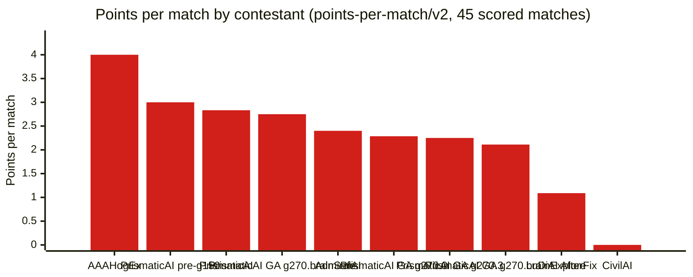
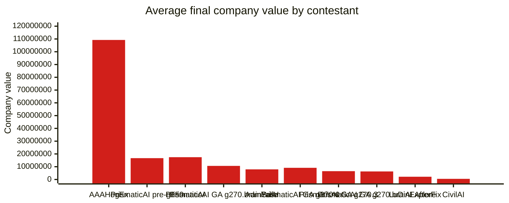
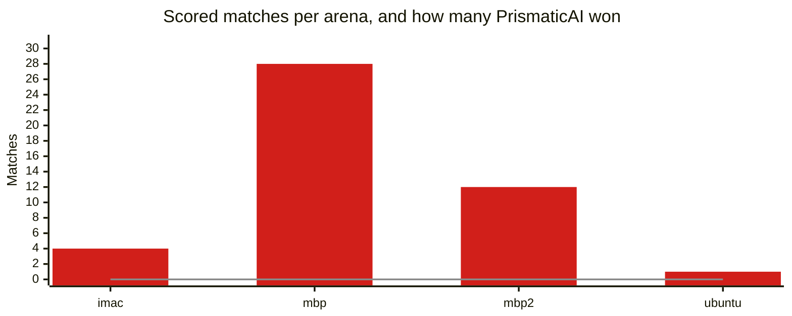

# battle-20261121T123056-0069f56f

Derived from `battle-20261121T123056-0069f56f.json` by `tools/research/ai-battle/battle.py report`; do not edit.

- Edition `0069f56f8ffe64ae`: PrismaticAI and referee at `52f631b115782334f422f741a79ecabce78e58c4`, base set `opengfx-8.0.tar`
- 20-year free-for-all from 1960, map 256x256 temperate, breakdowns 1
- 45 scored match(es) on `imac` (20261119-master-gdf1e05e7d8), `mbp` (20261120-master-m17653b726e), `mbp2` (20261119-master-gdf1e05e7d8), `ubuntu` (20261119-master-gdf1e05e7d8)
- Replays: 0 of 1 identical to their original on another arena

| # | Contestant | Played | Wins | Points | Points/match | Avg rank | Avg final value | Squirrel errors | Matches with anomalies |
|---|---|---|---|---|---|---|---|---|---|
| 1 | AAAHogEx | 45 | 45 | 180 | 4.0 | 1.0 | 109.2 M | 0 | 0 |
| 2 | PrismaticAI pre-g150 | 7 | 0 | 21 | 3.0 | 2.0 | 16.7 M | 0 | 4 |
| 3 | PrismaticAI | 6 | 0 | 17 | 2.833 | 2.17 | 17.5 M | 0 | 0 |
| 4 | PrismaticAI GA g270.brainSafe | 8 | 0 | 22 | 2.75 | 2.25 | 10.6 M | 0 | 1 |
| 5 | AdmiralAI | 45 | 0 | 108 | 2.4 | 2.6 | 7.9 M | 0 | 2 |
| 6 | PrismaticAI GA g270.0 | 7 | 0 | 16 | 2.286 | 2.71 | 9.1 M | 0 | 0 |
| 7 | PrismaticAI GA g270.3 | 8 | 0 | 18 | 2.25 | 2.75 | 6.5 M | 0 | 1 |
| 8 | PrismaticAI GA g270.brainExplore | 9 | 0 | 19 | 2.111 | 2.89 | 6.3 M | 0 | 0 |
| 9 | LuDiAI AfterFix | 45 | 0 | 49 | 1.089 | 3.91 | 2.2 M | 0 | 2 |
| 10 | CivilAI | 45 | 0 | 0 | 0.0 | 5.0 | 501.1 k | 3690 | 9 |

```mermaid
---
config:
  xyChart:
    width: 900
    height: 360
  themeVariables:
    xyChart:
      plotColorPalette: "#d11f1a, #8a8a8a, #0b0b0b, #ece4d6"
---
xychart-beta
    title "Final company value per scored match: winner vs best PrismaticAI"
    x-axis ["m-0001", "m-0002", "m-0003", "m-0004", "m-0005", "m-0006", "m-0007", "m-0008", "m-0009", "m-0010", "m-0011", "m-0012", "m-0013", "m-0014", "m-0015", "m-0016", "m-0017", "m-0018", "m-0019", "m-0022", "m-0023", "m-0026", "m-0027", "m-0028", "m-0029", "m-0036", "m-0037", "m-0038", "m-0039", "m-0040", "m-0041", "m-0042", "m-0043", "m-0044", "m-0045", "m-0046", "m-0047", "m-0049", "m-0050", "m-0051", "m-0052", "m-0053", "m-0054", "m-0057", "m-0058"]
    %% series: Winner | Best PrismaticAI
    %% links: battle-20261121T123056-0069f56f.md?col=Match&filter=m-0001 | battle-20261121T123056-0069f56f.md?col=Match&filter=m-0002 | battle-20261121T123056-0069f56f.md?col=Match&filter=m-0003 | battle-20261121T123056-0069f56f.md?col=Match&filter=m-0004 | battle-20261121T123056-0069f56f.md?col=Match&filter=m-0005 | battle-20261121T123056-0069f56f.md?col=Match&filter=m-0006 | battle-20261121T123056-0069f56f.md?col=Match&filter=m-0007 | battle-20261121T123056-0069f56f.md?col=Match&filter=m-0008 | battle-20261121T123056-0069f56f.md?col=Match&filter=m-0009 | battle-20261121T123056-0069f56f.md?col=Match&filter=m-0010 | battle-20261121T123056-0069f56f.md?col=Match&filter=m-0011 | battle-20261121T123056-0069f56f.md?col=Match&filter=m-0012 | battle-20261121T123056-0069f56f.md?col=Match&filter=m-0013 | battle-20261121T123056-0069f56f.md?col=Match&filter=m-0014 | battle-20261121T123056-0069f56f.md?col=Match&filter=m-0015 | battle-20261121T123056-0069f56f.md?col=Match&filter=m-0016 | battle-20261121T123056-0069f56f.md?col=Match&filter=m-0017 | battle-20261121T123056-0069f56f.md?col=Match&filter=m-0018 | battle-20261121T123056-0069f56f.md?col=Match&filter=m-0019 | battle-20261121T123056-0069f56f.md?col=Match&filter=m-0022 | battle-20261121T123056-0069f56f.md?col=Match&filter=m-0023 | battle-20261121T123056-0069f56f.md?col=Match&filter=m-0026 | battle-20261121T123056-0069f56f.md?col=Match&filter=m-0027 | battle-20261121T123056-0069f56f.md?col=Match&filter=m-0028 | battle-20261121T123056-0069f56f.md?col=Match&filter=m-0029 | battle-20261121T123056-0069f56f.md?col=Match&filter=m-0036 | battle-20261121T123056-0069f56f.md?col=Match&filter=m-0037 | battle-20261121T123056-0069f56f.md?col=Match&filter=m-0038 | battle-20261121T123056-0069f56f.md?col=Match&filter=m-0039 | battle-20261121T123056-0069f56f.md?col=Match&filter=m-0040 | battle-20261121T123056-0069f56f.md?col=Match&filter=m-0041 | battle-20261121T123056-0069f56f.md?col=Match&filter=m-0042 | battle-20261121T123056-0069f56f.md?col=Match&filter=m-0043 | battle-20261121T123056-0069f56f.md?col=Match&filter=m-0044 | battle-20261121T123056-0069f56f.md?col=Match&filter=m-0045 | battle-20261121T123056-0069f56f.md?col=Match&filter=m-0046 | battle-20261121T123056-0069f56f.md?col=Match&filter=m-0047 | battle-20261121T123056-0069f56f.md?col=Match&filter=m-0049 | battle-20261121T123056-0069f56f.md?col=Match&filter=m-0050 | battle-20261121T123056-0069f56f.md?col=Match&filter=m-0051 | battle-20261121T123056-0069f56f.md?col=Match&filter=m-0052 | battle-20261121T123056-0069f56f.md?col=Match&filter=m-0053 | battle-20261121T123056-0069f56f.md?col=Match&filter=m-0054 | battle-20261121T123056-0069f56f.md?col=Match&filter=m-0057 | battle-20261121T123056-0069f56f.md?col=Match&filter=m-0058
    y-axis "Company value" 0 --> 207000000
    bar [107612237, 121072676, 98625107, 124466043, 126930709, 87994829, 88843163, 67781734, 107649119, 80115180, 86778719, 146710136, 132539796, 172096338, 146505355, 136547010, 188320170, 119183565, 109537402, 120400991, 109302161, 101824534, 89421955, 98545949, 71227522, 92014861, 113578383, 120090332, 120108983, 97215080, 144149137, 92449702, 99739053, 118938238, 106039832, 114701180, 95515778, 118550761, 87156763, 114864679, 117631103, 90869904, 74049765, 76068857, 81568225]
    line [15494019, 8522245, 11610866, 8901574, 6063969, 12253122, 13238344, 5809318, 10213253, 8197841, 6929211, 26531361, 18965670, 12331315, 13351371, 8054706, 5120053, 15010844, 13034297, 6175004, 2090163, 5932355, 5699687, 5630185, 7702971, 13529715, 12140336, 7186957, 7720617, 3334521, 6037993, 21762002, 17883404, 9452694, 11699616, 1722195, 9490789, 26129174, 14682357, 14765561, 10938420, 8664863, 15642558, 10048874, 3659708]
```

<!-- battle-charts:begin -->
<!-- derived from battle-20261121T123056-0069f56f.json by `battle.py render`; `battle.py check` fails when it is stale -->

<!-- battle-charts:end -->

| Seed | Original | Replay | Arenas | Identical |
|---|---|---|---|---|
| 1364391309 | m-0010 | m-0056 | imac / mbp | NO |

| Match | Arena | Seed | Winner | Value | Last | Anomalies |
|---|---|---|---|---|---|---|
| m-0001 | mbp | 1878342341 | AAAHogEx | 107.6 M | CivilAI | PrismaticAI pre-g150: fleet_drop:129->73; CivilAI: fleet_drop:75->31 |
| m-0002 | mbp | 1878342341 | AAAHogEx | 121.1 M | CivilAI | - |
| m-0003 | mbp | 1878342341 | AAAHogEx | 98.6 M | CivilAI | LuDiAI AfterFix: fleet_drop:83->47 |
| m-0004 | mbp | 1878342341 | AAAHogEx | 124.5 M | CivilAI | CivilAI: fleet_drop:31->13 |
| m-0005 | mbp | 1878342341 | AAAHogEx | 126.9 M | CivilAI | CivilAI: squirrel_errors:3690 |
| m-0006 | mbp | 1364391309 | AAAHogEx | 88.0 M | CivilAI | - |
| m-0007 | mbp | 1364391309 | AAAHogEx | 88.8 M | CivilAI | LuDiAI AfterFix: fleet_drop:186->105 |
| m-0008 | mbp | 1364391309 | AAAHogEx | 67.8 M | CivilAI | CivilAI: fleet_drop:60->28 |
| m-0009 | mbp | 1364391309 | AAAHogEx | 107.6 M | CivilAI | CivilAI: fleet_drop:49->27 |
| m-0010 | imac | 1364391309 | AAAHogEx | 80.1 M | CivilAI | AdmiralAI: fleet_drop:251->118; CivilAI: fleet_drop:53->29 |
| m-0011 | imac | 1364391309 | AAAHogEx | 86.8 M | CivilAI | - |
| m-0012 | imac | 730185624 | AAAHogEx | 146.7 M | CivilAI | - |
| m-0013 | mbp2 | 730185624 | AAAHogEx | 132.5 M | CivilAI | PrismaticAI pre-g150: fleet_drop:156->96 |
| m-0014 | mbp2 | 730185624 | AAAHogEx | 172.1 M | CivilAI | - |
| m-0015 | mbp2 | 730185624 | AAAHogEx | 146.5 M | CivilAI | - |
| m-0016 | mbp2 | 730185624 | AAAHogEx | 136.5 M | CivilAI | - |
| m-0017 | mbp2 | 730185624 | AAAHogEx | 188.3 M | CivilAI | - |
| m-0018 | mbp2 | 1688068941 | AAAHogEx | 119.2 M | CivilAI | - |
| m-0019 | mbp2 | 1688068941 | AAAHogEx | 109.5 M | CivilAI | - |
| m-0022 | mbp2 | 1688068941 | AAAHogEx | 120.4 M | CivilAI | - |
| m-0023 | mbp2 | 1688068941 | AAAHogEx | 109.3 M | CivilAI | - |
| m-0026 | mbp2 | 681758530 | AAAHogEx | 101.8 M | CivilAI | - |
| m-0027 | mbp2 | 681758530 | AAAHogEx | 89.4 M | CivilAI | - |
| m-0028 | mbp2 | 681758530 | AAAHogEx | 98.5 M | CivilAI | - |
| m-0029 | ubuntu | 681758530 | AAAHogEx | 71.2 M | CivilAI | - |
| m-0036 | mbp | 1313674024 | AAAHogEx | 92.0 M | CivilAI | CivilAI: fleet_drop:102->28 |
| m-0037 | mbp | 1313674024 | AAAHogEx | 113.6 M | CivilAI | AdmiralAI: fleet_drop:193->93 |
| m-0038 | mbp | 1313674024 | AAAHogEx | 120.1 M | CivilAI | - |
| m-0039 | mbp | 1313674024 | AAAHogEx | 120.1 M | CivilAI | PrismaticAI GA g270.brainSafe: fleet_drop:76->53 |
| m-0040 | mbp | 1313674024 | AAAHogEx | 97.2 M | CivilAI | - |
| m-0041 | mbp | 1313674024 | AAAHogEx | 144.1 M | CivilAI | - |
| m-0042 | mbp | 1517164608 | AAAHogEx | 92.4 M | CivilAI | - |
| m-0043 | mbp | 1517164608 | AAAHogEx | 99.7 M | CivilAI | PrismaticAI pre-g150: fleet_drop:75->37 |
| m-0044 | mbp | 1517164608 | AAAHogEx | 118.9 M | CivilAI | CivilAI: fleet_drop:42->20 |
| m-0045 | mbp | 1517164608 | AAAHogEx | 106.0 M | CivilAI | - |
| m-0046 | mbp | 1517164608 | AAAHogEx | 114.7 M | CivilAI | - |
| m-0047 | mbp | 1517164608 | AAAHogEx | 95.5 M | CivilAI | PrismaticAI GA g270.3: fleet_drop:58->37 |
| m-0049 | mbp | 941103030 | AAAHogEx | 118.6 M | CivilAI | PrismaticAI pre-g150: fleet_drop:125->83 |
| m-0050 | mbp | 941103030 | AAAHogEx | 87.2 M | CivilAI | - |
| m-0051 | mbp | 941103030 | AAAHogEx | 114.9 M | CivilAI | - |
| m-0052 | mbp | 941103030 | AAAHogEx | 117.6 M | CivilAI | - |
| m-0053 | mbp | 941103030 | AAAHogEx | 90.9 M | CivilAI | CivilAI: fleet_drop:74->50 |
| m-0054 | imac | 63598587 | AAAHogEx | 74.0 M | CivilAI | - |
| m-0056 (replay) | mbp | 1364391309 | AAAHogEx | 78.4 M | CivilAI | AdmiralAI: fleet_drop:251->116; CivilAI: fleet_drop:53->24 |
| m-0057 | mbp | 63598587 | AAAHogEx | 76.1 M | CivilAI | - |
| m-0058 | mbp | 63598587 | AAAHogEx | 81.6 M | CivilAI | - |
