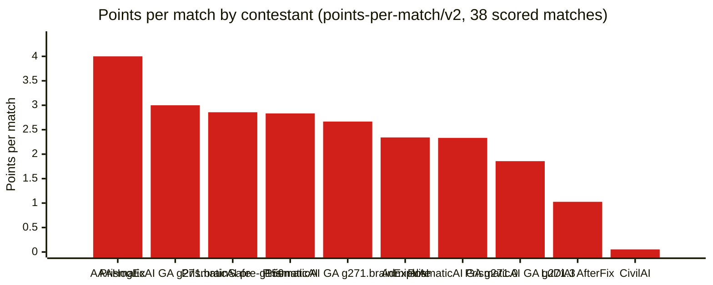
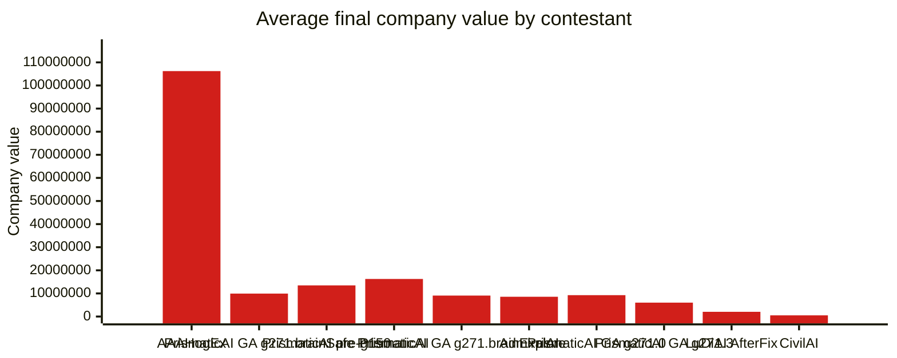
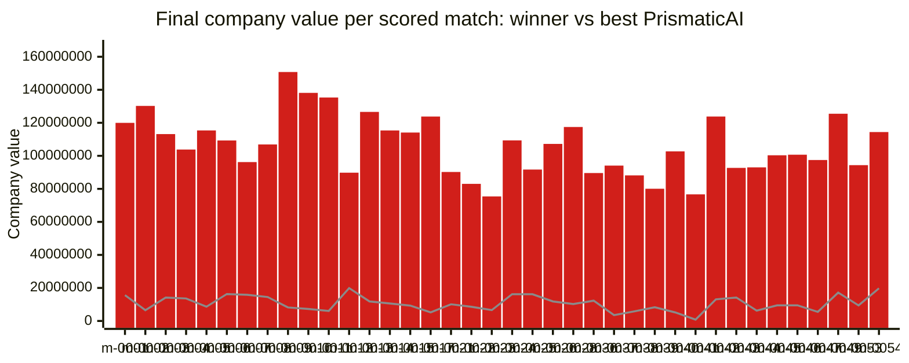
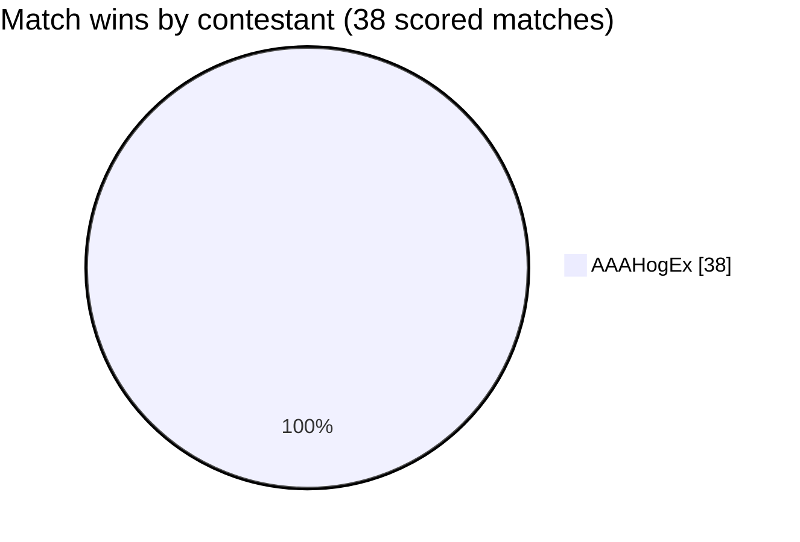
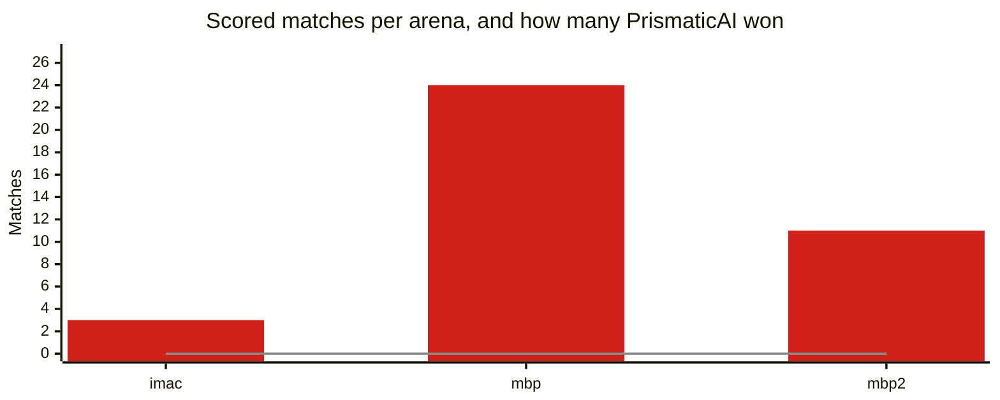

# battle-20261121T124357-aee94c89

Derived from `battle-20261121T124357-aee94c89.json` by `tools/research/ai-battle/battle.py report`; do not edit.

- Edition `aee94c892e7e970d`: PrismaticAI and referee at `52f631b115782334f422f741a79ecabce78e58c4`, base set `opengfx-8.0.tar`
- 20-year free-for-all from 1960, map 256x256 temperate, breakdowns 1
- 38 scored match(es) on `imac` (20261119-master-gdf1e05e7d8), `mbp` (20261120-master-m17653b726e), `mbp2` (20261119-master-gdf1e05e7d8)
- Replays: 0 of 1 identical to their original on another arena

| # | Contestant | Played | Wins | Points | Points/match | Avg rank | Avg final value | Squirrel errors | Matches with anomalies |
|---|---|---|---|---|---|---|---|---|---|
| 1 | AAAHogEx | 38 | 38 | 152 | 4.0 | 1.0 | 106.2 M | 0 | 0 |
| 2 | PrismaticAI GA g271.brainSafe | 6 | 0 | 18 | 3.0 | 2.0 | 9.9 M | 0 | 0 |
| 3 | PrismaticAI pre-g150 | 7 | 0 | 20 | 2.857 | 2.14 | 13.5 M | 0 | 1 |
| 4 | PrismaticAI | 6 | 0 | 17 | 2.833 | 2.17 | 16.3 M | 0 | 0 |
| 5 | PrismaticAI GA g271.brainExplore | 6 | 0 | 16 | 2.667 | 2.33 | 9.1 M | 0 | 0 |
| 6 | AdmiralAI | 38 | 0 | 89 | 2.342 | 2.66 | 8.6 M | 47 | 1 |
| 7 | PrismaticAI GA g271.0 | 6 | 0 | 14 | 2.333 | 2.67 | 9.2 M | 0 | 1 |
| 8 | PrismaticAI GA g271.3 | 7 | 0 | 13 | 1.857 | 3.14 | 6.0 M | 0 | 4 |
| 9 | LuDiAI AfterFix | 38 | 0 | 39 | 1.026 | 3.97 | 2.0 M | 0 | 0 |
| 10 | CivilAI | 38 | 0 | 2 | 0.053 | 4.95 | 512.1 k | 0 | 3 |

<!-- battle-charts:begin -->
<!-- derived from battle-20261121T124357-aee94c89.json by `battle.py render`; `battle.py check` fails when it is stale -->

<!-- battle-charts:end -->

| Seed | Original | Replay | Arenas | Identical |
|---|---|---|---|---|
| 1316853059 | m-0010 | m-0048 | imac / mbp | NO |

| Match | Arena | Seed | Winner | Value | Last | Anomalies |
|---|---|---|---|---|---|---|
| m-0001 | mbp | 1675765037 | AAAHogEx | 120.0 M | CivilAI | - |
| m-0002 | mbp | 1675765037 | AAAHogEx | 130.2 M | CivilAI | PrismaticAI GA g271.0: fleet_drop:92->34 |
| m-0003 | mbp | 1675765037 | AAAHogEx | 113.2 M | CivilAI | - |
| m-0004 | mbp | 1675765037 | AAAHogEx | 103.8 M | CivilAI | - |
| m-0005 | mbp | 1675765037 | AAAHogEx | 115.4 M | CivilAI | PrismaticAI GA g271.3: fleet_drop:58->30 |
| m-0006 | mbp | 1316853059 | AAAHogEx | 109.3 M | CivilAI | CivilAI: fleet_drop:47->16 |
| m-0007 | mbp | 1316853059 | AAAHogEx | 96.2 M | CivilAI | - |
| m-0008 | mbp | 1316853059 | AAAHogEx | 106.9 M | CivilAI | - |
| m-0009 | mbp | 1316853059 | AAAHogEx | 150.8 M | CivilAI | - |
| m-0010 | imac | 1316853059 | AAAHogEx | 138.1 M | CivilAI | - |
| m-0011 | imac | 1316853059 | AAAHogEx | 135.3 M | CivilAI | PrismaticAI GA g271.3: fleet_drop:61->31; CivilAI: fleet_drop:69->38 |
| m-0012 | imac | 235225024 | AAAHogEx | 89.8 M | CivilAI | - |
| m-0013 | mbp2 | 235225024 | AAAHogEx | 126.6 M | CivilAI | - |
| m-0014 | mbp2 | 235225024 | AAAHogEx | 115.4 M | CivilAI | - |
| m-0015 | mbp2 | 235225024 | AAAHogEx | 114.1 M | CivilAI | - |
| m-0017 | mbp2 | 235225024 | AAAHogEx | 123.8 M | CivilAI | - |
| m-0021 | mbp2 | 380519555 | AAAHogEx | 90.2 M | LuDiAI AfterFix | - |
| m-0022 | mbp2 | 380519555 | AAAHogEx | 83.0 M | CivilAI | - |
| m-0023 | mbp2 | 380519555 | AAAHogEx | 75.4 M | CivilAI | PrismaticAI GA g271.3: fleet_drop:54->31 |
| m-0024 | mbp2 | 1067966311 | AAAHogEx | 109.3 M | CivilAI | - |
| m-0025 | mbp2 | 1067966311 | AAAHogEx | 91.7 M | CivilAI | - |
| m-0026 | mbp2 | 1067966311 | AAAHogEx | 107.2 M | CivilAI | - |
| m-0028 | mbp2 | 1067966311 | AAAHogEx | 117.5 M | CivilAI | CivilAI: fleet_drop:30->14 |
| m-0036 | mbp | 260603278 | AAAHogEx | 89.6 M | CivilAI | - |
| m-0037 | mbp | 260603278 | AAAHogEx | 94.1 M | CivilAI | - |
| m-0038 | mbp | 260603278 | AAAHogEx | 88.2 M | CivilAI | - |
| m-0039 | mbp | 260603278 | AAAHogEx | 80.1 M | CivilAI | - |
| m-0040 | mbp | 260603278 | AAAHogEx | 102.7 M | CivilAI | - |
| m-0041 | mbp | 260603278 | AAAHogEx | 76.7 M | PrismaticAI GA g271.3 | PrismaticAI GA g271.3: fleet_drop:25->17 |
| m-0042 | mbp | 764120639 | AAAHogEx | 123.8 M | CivilAI | - |
| m-0043 | mbp | 764120639 | AAAHogEx | 92.7 M | CivilAI | - |
| m-0044 | mbp | 764120639 | AAAHogEx | 93.0 M | CivilAI | - |
| m-0045 | mbp | 764120639 | AAAHogEx | 100.3 M | CivilAI | - |
| m-0046 | mbp | 764120639 | AAAHogEx | 100.7 M | CivilAI | AdmiralAI: squirrel_errors:47 |
| m-0047 | mbp | 764120639 | AAAHogEx | 97.5 M | CivilAI | - |
| m-0048 (replay) | mbp | 1316853059 | AAAHogEx | 148.8 M | CivilAI | - |
| m-0049 | mbp | 1019636123 | AAAHogEx | 125.5 M | CivilAI | PrismaticAI pre-g150: fleet_drop:123->77 |
| m-0053 | mbp | 1019636123 | AAAHogEx | 94.4 M | CivilAI | - |
| m-0054 | mbp | 1133694284 | AAAHogEx | 114.4 M | CivilAI | - |
