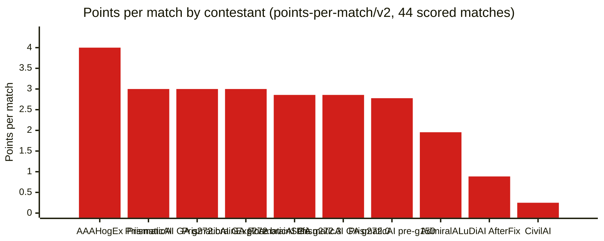
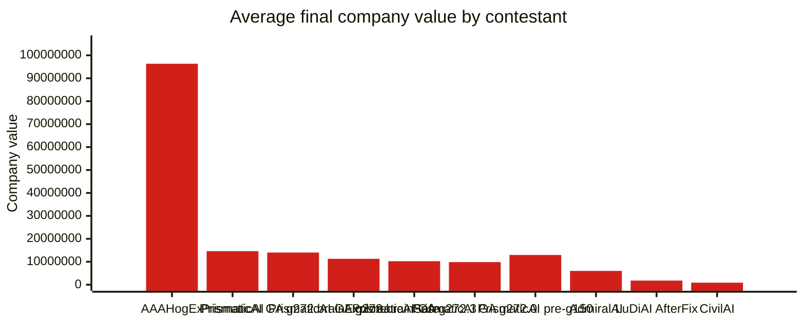
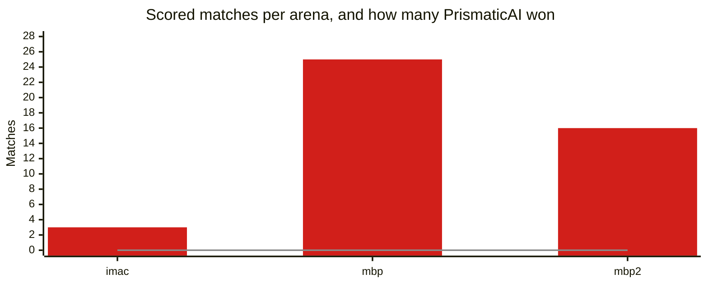

# battle-20261121T125714-d467b23a

Derived from `battle-20261121T125714-d467b23a.json` by `tools/research/ai-battle/battle.py report`; do not edit.

- Edition `d467b23ac04daa7f`: PrismaticAI and referee at `52f631b115782334f422f741a79ecabce78e58c4`, base set `opengfx-8.0.tar`
- 20-year free-for-all from 1960, map 256x256 temperate, breakdowns 1
- 44 scored match(es) on `imac` (20261119-master-gdf1e05e7d8), `mbp` (20261120-master-m17653b726e), `mbp2` (20261119-master-gdf1e05e7d8)
- Replays: 0 of 2 identical to their original on another arena

| # | Contestant | Played | Wins | Points | Points/match | Avg rank | Avg final value | Squirrel errors | Matches with anomalies |
|---|---|---|---|---|---|---|---|---|---|
| 1 | AAAHogEx | 44 | 44 | 176 | 4.0 | 1.0 | 96.3 M | 0 | 0 |
| 2 | PrismaticAI | 7 | 0 | 21 | 3.0 | 2.0 | 14.6 M | 0 | 1 |
| 3 | PrismaticAI GA g272.brainExplore | 8 | 0 | 24 | 3.0 | 2.0 | 14.0 M | 0 | 1 |
| 4 | PrismaticAI GA g272.brainSafe | 6 | 0 | 18 | 3.0 | 2.0 | 11.3 M | 0 | 0 |
| 5 | PrismaticAI GA g272.3 | 7 | 0 | 20 | 2.857 | 2.14 | 10.2 M | 0 | 1 |
| 6 | PrismaticAI GA g272.0 | 7 | 0 | 20 | 2.857 | 2.14 | 9.8 M | 0 | 0 |
| 7 | PrismaticAI pre-g150 | 9 | 0 | 25 | 2.778 | 2.22 | 13.0 M | 0 | 4 |
| 8 | AdmiralAI | 44 | 0 | 86 | 1.955 | 3.05 | 6.0 M | 0 | 1 |
| 9 | LuDiAI AfterFix | 44 | 0 | 39 | 0.886 | 4.11 | 1.8 M | 0 | 1 |
| 10 | CivilAI | 44 | 0 | 11 | 0.25 | 4.75 | 878.5 k | 0 | 6 |

```mermaid
---
config:
  xyChart:
    width: 900
    height: 360
  themeVariables:
    xyChart:
      plotColorPalette: "#d11f1a, #8a8a8a, #0b0b0b, #ece4d6"
---
xychart-beta
    title "Final company value per scored match: winner vs best PrismaticAI"
    x-axis ["m-0001", "m-0002", "m-0003", "m-0004", "m-0005", "m-0006", "m-0007", "m-0008", "m-0009", "m-0010", "m-0011", "m-0012", "m-0013", "m-0014", "m-0015", "m-0016", "m-0017", "m-0018", "m-0019", "m-0020", "m-0021", "m-0022", "m-0023", "m-0024", "m-0025", "m-0026", "m-0027", "m-0028", "m-0036", "m-0037", "m-0038", "m-0039", "m-0040", "m-0041", "m-0042", "m-0043", "m-0044", "m-0046", "m-0047", "m-0049", "m-0052", "m-0053", "m-0054", "m-0055"]
    %% series: Winner | Best PrismaticAI
    %% links: battle-20261121T125714-d467b23a.md?col=Match&filter=m-0001 | battle-20261121T125714-d467b23a.md?col=Match&filter=m-0002 | battle-20261121T125714-d467b23a.md?col=Match&filter=m-0003 | battle-20261121T125714-d467b23a.md?col=Match&filter=m-0004 | battle-20261121T125714-d467b23a.md?col=Match&filter=m-0005 | battle-20261121T125714-d467b23a.md?col=Match&filter=m-0006 | battle-20261121T125714-d467b23a.md?col=Match&filter=m-0007 | battle-20261121T125714-d467b23a.md?col=Match&filter=m-0008 | battle-20261121T125714-d467b23a.md?col=Match&filter=m-0009 | battle-20261121T125714-d467b23a.md?col=Match&filter=m-0010 | battle-20261121T125714-d467b23a.md?col=Match&filter=m-0011 | battle-20261121T125714-d467b23a.md?col=Match&filter=m-0012 | battle-20261121T125714-d467b23a.md?col=Match&filter=m-0013 | battle-20261121T125714-d467b23a.md?col=Match&filter=m-0014 | battle-20261121T125714-d467b23a.md?col=Match&filter=m-0015 | battle-20261121T125714-d467b23a.md?col=Match&filter=m-0016 | battle-20261121T125714-d467b23a.md?col=Match&filter=m-0017 | battle-20261121T125714-d467b23a.md?col=Match&filter=m-0018 | battle-20261121T125714-d467b23a.md?col=Match&filter=m-0019 | battle-20261121T125714-d467b23a.md?col=Match&filter=m-0020 | battle-20261121T125714-d467b23a.md?col=Match&filter=m-0021 | battle-20261121T125714-d467b23a.md?col=Match&filter=m-0022 | battle-20261121T125714-d467b23a.md?col=Match&filter=m-0023 | battle-20261121T125714-d467b23a.md?col=Match&filter=m-0024 | battle-20261121T125714-d467b23a.md?col=Match&filter=m-0025 | battle-20261121T125714-d467b23a.md?col=Match&filter=m-0026 | battle-20261121T125714-d467b23a.md?col=Match&filter=m-0027 | battle-20261121T125714-d467b23a.md?col=Match&filter=m-0028 | battle-20261121T125714-d467b23a.md?col=Match&filter=m-0036 | battle-20261121T125714-d467b23a.md?col=Match&filter=m-0037 | battle-20261121T125714-d467b23a.md?col=Match&filter=m-0038 | battle-20261121T125714-d467b23a.md?col=Match&filter=m-0039 | battle-20261121T125714-d467b23a.md?col=Match&filter=m-0040 | battle-20261121T125714-d467b23a.md?col=Match&filter=m-0041 | battle-20261121T125714-d467b23a.md?col=Match&filter=m-0042 | battle-20261121T125714-d467b23a.md?col=Match&filter=m-0043 | battle-20261121T125714-d467b23a.md?col=Match&filter=m-0044 | battle-20261121T125714-d467b23a.md?col=Match&filter=m-0046 | battle-20261121T125714-d467b23a.md?col=Match&filter=m-0047 | battle-20261121T125714-d467b23a.md?col=Match&filter=m-0049 | battle-20261121T125714-d467b23a.md?col=Match&filter=m-0052 | battle-20261121T125714-d467b23a.md?col=Match&filter=m-0053 | battle-20261121T125714-d467b23a.md?col=Match&filter=m-0054 | battle-20261121T125714-d467b23a.md?col=Match&filter=m-0055
    y-axis "Company value" 0 --> 149000000
    bar [92375457, 94168776, 110871172, 96371132, 114538222, 62735944, 56592790, 62393148, 78753456, 72436261, 63675458, 79439700, 72162355, 85177193, 74976758, 73654599, 96721971, 101078696, 121102242, 105797638, 125221651, 92842432, 95072387, 114133195, 102060815, 111127478, 105028479, 103718409, 102660932, 117855772, 121437566, 114350853, 114454212, 121976655, 117498230, 135622841, 109642192, 94120314, 101770976, 91579935, 82476386, 114309861, 71400176, 62635521]
    line [9754468, 9463337, 10135660, 7682443, 8624729, 11250539, 11506448, 5192267, 10756793, 10019084, 8006379, 12862778, 11309869, 8659378, 10619771, 13584390, 9180174, 13777551, 9042696, 9954105, 9640779, 22817864, 18933010, 20348195, 15370789, 10607922, 16406678, 14915026, 17525521, 12220773, 13658862, 10138329, 12652316, 11496235, 18123681, 12615266, 11407778, 11443934, 12779485, 26886593, 19049614, 2587120, 8533221, 7880631]
```

<!-- battle-charts:begin -->
<!-- derived from battle-20261121T125714-d467b23a.json by `battle.py render`; `battle.py check` fails when it is stale -->

<!-- battle-charts:end -->

| Seed | Original | Replay | Arenas | Identical |
|---|---|---|---|---|
| 1612584684 | m-0010 | m-0048 | imac / mbp | NO |
| 1612584684 | m-0011 | m-0056 | imac / mbp | NO |

| Match | Arena | Seed | Winner | Value | Last | Anomalies |
|---|---|---|---|---|---|---|
| m-0001 | mbp | 862125463 | AAAHogEx | 92.4 M | CivilAI | PrismaticAI pre-g150: fleet_drop:88->45 |
| m-0002 | mbp | 862125463 | AAAHogEx | 94.2 M | CivilAI | - |
| m-0003 | mbp | 862125463 | AAAHogEx | 110.9 M | CivilAI | - |
| m-0004 | mbp | 862125463 | AAAHogEx | 96.4 M | CivilAI | PrismaticAI GA g272.brainExplore: fleet_drop:86->47; CivilAI: fleet_drop:41->24 |
| m-0005 | mbp | 862125463 | AAAHogEx | 114.5 M | CivilAI | - |
| m-0006 | mbp | 1612584684 | AAAHogEx | 62.7 M | LuDiAI AfterFix | LuDiAI AfterFix: fleet_drop:69->43 |
| m-0007 | mbp | 1612584684 | AAAHogEx | 56.6 M | CivilAI | - |
| m-0008 | mbp | 1612584684 | AAAHogEx | 62.4 M | CivilAI | - |
| m-0009 | mbp | 1612584684 | AAAHogEx | 78.8 M | CivilAI | - |
| m-0010 | imac | 1612584684 | AAAHogEx | 72.4 M | LuDiAI AfterFix | CivilAI: fleet_drop:47->17 |
| m-0011 | imac | 1612584684 | AAAHogEx | 63.7 M | CivilAI | - |
| m-0012 | imac | 1280346364 | AAAHogEx | 79.4 M | LuDiAI AfterFix | - |
| m-0013 | mbp2 | 1280346364 | AAAHogEx | 72.2 M | LuDiAI AfterFix | PrismaticAI pre-g150: fleet_drop:102->44 |
| m-0014 | mbp2 | 1280346364 | AAAHogEx | 85.2 M | CivilAI | - |
| m-0015 | mbp2 | 1280346364 | AAAHogEx | 75.0 M | LuDiAI AfterFix | - |
| m-0016 | mbp2 | 1280346364 | AAAHogEx | 73.7 M | CivilAI | - |
| m-0017 | mbp2 | 1280346364 | AAAHogEx | 96.7 M | CivilAI | - |
| m-0018 | mbp2 | 1935901550 | AAAHogEx | 101.1 M | AdmiralAI | AdmiralAI: fleet_drop:76->35 |
| m-0019 | mbp2 | 1935901550 | AAAHogEx | 121.1 M | CivilAI | - |
| m-0020 | mbp2 | 1935901550 | AAAHogEx | 105.8 M | CivilAI | - |
| m-0021 | mbp2 | 1935901550 | AAAHogEx | 125.2 M | LuDiAI AfterFix | - |
| m-0022 | mbp2 | 1935901550 | AAAHogEx | 92.8 M | LuDiAI AfterFix | - |
| m-0023 | mbp2 | 1935901550 | AAAHogEx | 95.1 M | LuDiAI AfterFix | - |
| m-0024 | mbp2 | 1433070832 | AAAHogEx | 114.1 M | CivilAI | CivilAI: fleet_drop:86->60 |
| m-0025 | mbp2 | 1433070832 | AAAHogEx | 102.1 M | CivilAI | PrismaticAI pre-g150: fleet_drop:103->64; CivilAI: fleet_drop:82->47 |
| m-0026 | mbp2 | 1433070832 | AAAHogEx | 111.1 M | CivilAI | - |
| m-0027 | mbp2 | 1433070832 | AAAHogEx | 105.0 M | CivilAI | - |
| m-0028 | mbp2 | 1433070832 | AAAHogEx | 103.7 M | CivilAI | - |
| m-0036 | mbp | 1298496868 | AAAHogEx | 102.7 M | CivilAI | - |
| m-0037 | mbp | 1298496868 | AAAHogEx | 117.9 M | CivilAI | - |
| m-0038 | mbp | 1298496868 | AAAHogEx | 121.4 M | CivilAI | - |
| m-0039 | mbp | 1298496868 | AAAHogEx | 114.4 M | CivilAI | - |
| m-0040 | mbp | 1298496868 | AAAHogEx | 114.5 M | CivilAI | - |
| m-0041 | mbp | 1298496868 | AAAHogEx | 122.0 M | CivilAI | - |
| m-0042 | mbp | 1937771162 | AAAHogEx | 117.5 M | CivilAI | - |
| m-0043 | mbp | 1937771162 | AAAHogEx | 135.6 M | CivilAI | - |
| m-0044 | mbp | 1937771162 | AAAHogEx | 109.6 M | CivilAI | CivilAI: fleet_drop:73->51 |
| m-0046 | mbp | 1937771162 | AAAHogEx | 94.1 M | CivilAI | - |
| m-0047 | mbp | 1937771162 | AAAHogEx | 101.8 M | CivilAI | - |
| m-0048 (replay) | mbp | 1612584684 | AAAHogEx | 72.9 M | CivilAI | CivilAI: fleet_drop:47->22 |
| m-0049 | mbp | 14436431 | AAAHogEx | 91.6 M | CivilAI | - |
| m-0052 | mbp | 14436431 | AAAHogEx | 82.5 M | CivilAI | - |
| m-0053 | mbp | 14436431 | AAAHogEx | 114.3 M | CivilAI | PrismaticAI GA g272.3: fleet_drop:36->24; CivilAI: no_vehicles |
| m-0054 | mbp | 214820297 | AAAHogEx | 71.4 M | CivilAI | PrismaticAI: fleet_drop:41->28 |
| m-0055 | mbp | 214820297 | AAAHogEx | 62.6 M | CivilAI | PrismaticAI pre-g150: fleet_drop:67->37 |
| m-0056 (replay) | mbp | 1612584684 | AAAHogEx | 63.9 M | CivilAI | PrismaticAI GA g272.3: fleet_drop:59->41 |
