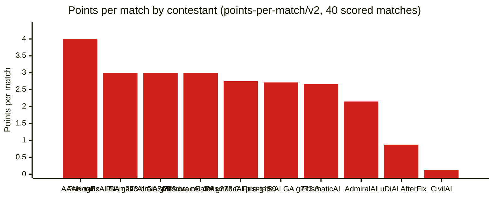
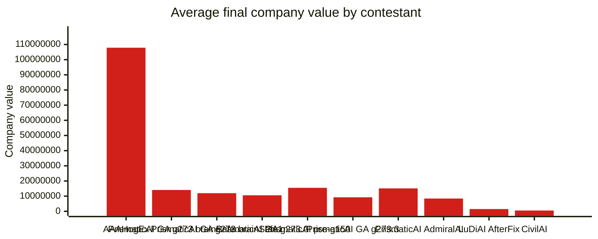
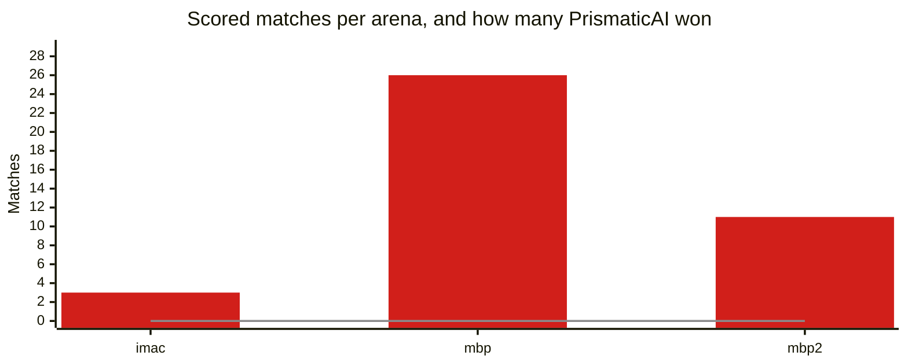

# battle-20261121T131020-da0ed41d

Derived from `battle-20261121T131020-da0ed41d.json` by `tools/research/ai-battle/battle.py report`; do not edit.

- Edition `da0ed41db732decf`: PrismaticAI and referee at `52f631b115782334f422f741a79ecabce78e58c4`, base set `opengfx-8.0.tar`
- 20-year free-for-all from 1960, map 256x256 temperate, breakdowns 1
- 40 scored match(es) on `imac` (20261119-master-gdf1e05e7d8), `mbp` (20261120-master-m17653b726e), `mbp2` (20261119-master-gdf1e05e7d8)
- Replays: 0 of 1 identical to their original on another arena

| # | Contestant | Played | Wins | Points | Points/match | Avg rank | Avg final value | Squirrel errors | Matches with anomalies |
|---|---|---|---|---|---|---|---|---|---|
| 1 | AAAHogEx | 40 | 40 | 160 | 4.0 | 1.0 | 107.9 M | 0 | 0 |
| 2 | PrismaticAI GA g273.brainSafe | 6 | 0 | 18 | 3.0 | 2.0 | 14.1 M | 0 | 0 |
| 3 | PrismaticAI GA g273.brainSafe1 | 7 | 0 | 21 | 3.0 | 2.0 | 12.0 M | 0 | 1 |
| 4 | PrismaticAI GA g273.0 | 6 | 0 | 18 | 3.0 | 2.0 | 10.6 M | 0 | 1 |
| 5 | PrismaticAI pre-g150 | 8 | 0 | 22 | 2.75 | 2.25 | 15.5 M | 0 | 2 |
| 6 | PrismaticAI GA g273.3 | 7 | 0 | 19 | 2.714 | 2.29 | 9.2 M | 0 | 1 |
| 7 | PrismaticAI | 6 | 0 | 16 | 2.667 | 2.33 | 15.1 M | 0 | 1 |
| 8 | AdmiralAI | 40 | 0 | 86 | 2.15 | 2.85 | 8.4 M | 70 | 3 |
| 9 | LuDiAI AfterFix | 40 | 0 | 35 | 0.875 | 4.12 | 1.5 M | 0 | 2 |
| 10 | CivilAI | 40 | 0 | 5 | 0.125 | 4.88 | 522.4 k | 0 | 2 |

```mermaid
---
config:
  xyChart:
    width: 900
    height: 360
  themeVariables:
    xyChart:
      plotColorPalette: "#d11f1a, #8a8a8a, #0b0b0b, #ece4d6"
---
xychart-beta
    title "Final company value per scored match: winner vs best PrismaticAI"
    x-axis ["m-0001", "m-0002", "m-0003", "m-0004", "m-0005", "m-0006", "m-0007", "m-0008", "m-0009", "m-0010", "m-0011", "m-0012", "m-0014", "m-0015", "m-0017", "m-0018", "m-0019", "m-0020", "m-0022", "m-0023", "m-0025", "m-0027", "m-0028", "m-0036", "m-0037", "m-0038", "m-0039", "m-0040", "m-0041", "m-0042", "m-0043", "m-0044", "m-0045", "m-0046", "m-0047", "m-0049", "m-0052", "m-0053", "m-0054", "m-0055"]
    %% series: Winner | Best PrismaticAI
    %% links: battle-20261121T131020-da0ed41d.md?col=Match&filter=m-0001 | battle-20261121T131020-da0ed41d.md?col=Match&filter=m-0002 | battle-20261121T131020-da0ed41d.md?col=Match&filter=m-0003 | battle-20261121T131020-da0ed41d.md?col=Match&filter=m-0004 | battle-20261121T131020-da0ed41d.md?col=Match&filter=m-0005 | battle-20261121T131020-da0ed41d.md?col=Match&filter=m-0006 | battle-20261121T131020-da0ed41d.md?col=Match&filter=m-0007 | battle-20261121T131020-da0ed41d.md?col=Match&filter=m-0008 | battle-20261121T131020-da0ed41d.md?col=Match&filter=m-0009 | battle-20261121T131020-da0ed41d.md?col=Match&filter=m-0010 | battle-20261121T131020-da0ed41d.md?col=Match&filter=m-0011 | battle-20261121T131020-da0ed41d.md?col=Match&filter=m-0012 | battle-20261121T131020-da0ed41d.md?col=Match&filter=m-0014 | battle-20261121T131020-da0ed41d.md?col=Match&filter=m-0015 | battle-20261121T131020-da0ed41d.md?col=Match&filter=m-0017 | battle-20261121T131020-da0ed41d.md?col=Match&filter=m-0018 | battle-20261121T131020-da0ed41d.md?col=Match&filter=m-0019 | battle-20261121T131020-da0ed41d.md?col=Match&filter=m-0020 | battle-20261121T131020-da0ed41d.md?col=Match&filter=m-0022 | battle-20261121T131020-da0ed41d.md?col=Match&filter=m-0023 | battle-20261121T131020-da0ed41d.md?col=Match&filter=m-0025 | battle-20261121T131020-da0ed41d.md?col=Match&filter=m-0027 | battle-20261121T131020-da0ed41d.md?col=Match&filter=m-0028 | battle-20261121T131020-da0ed41d.md?col=Match&filter=m-0036 | battle-20261121T131020-da0ed41d.md?col=Match&filter=m-0037 | battle-20261121T131020-da0ed41d.md?col=Match&filter=m-0038 | battle-20261121T131020-da0ed41d.md?col=Match&filter=m-0039 | battle-20261121T131020-da0ed41d.md?col=Match&filter=m-0040 | battle-20261121T131020-da0ed41d.md?col=Match&filter=m-0041 | battle-20261121T131020-da0ed41d.md?col=Match&filter=m-0042 | battle-20261121T131020-da0ed41d.md?col=Match&filter=m-0043 | battle-20261121T131020-da0ed41d.md?col=Match&filter=m-0044 | battle-20261121T131020-da0ed41d.md?col=Match&filter=m-0045 | battle-20261121T131020-da0ed41d.md?col=Match&filter=m-0046 | battle-20261121T131020-da0ed41d.md?col=Match&filter=m-0047 | battle-20261121T131020-da0ed41d.md?col=Match&filter=m-0049 | battle-20261121T131020-da0ed41d.md?col=Match&filter=m-0052 | battle-20261121T131020-da0ed41d.md?col=Match&filter=m-0053 | battle-20261121T131020-da0ed41d.md?col=Match&filter=m-0054 | battle-20261121T131020-da0ed41d.md?col=Match&filter=m-0055
    y-axis "Company value" 0 --> 174000000
    bar [88408194, 96704648, 80242574, 91384522, 83204821, 111674317, 129144387, 135814315, 139031053, 111772910, 129330710, 93574366, 103129542, 67027374, 114404373, 99178552, 102869162, 94559203, 81018478, 81156627, 158008002, 110212209, 134192111, 85813781, 75061589, 124982106, 102422219, 144257932, 114567279, 106680475, 107687065, 128034085, 101230112, 141859297, 106204976, 114194531, 146593042, 105765611, 79023705, 94708844]
    line [15337392, 14151632, 12311640, 12273749, 10395573, 25396652, 22471588, 12699769, 12393392, 13443528, 15746176, 15917819, 6842361, 14850975, 1967489, 6607303, 9878951, 7992605, 11617131, 7445438, 5513960, 17539629, 12102321, 7871302, 11546573, 9215802, 16782419, 11741792, 7272573, 15716726, 15520350, 12417499, 10575085, 12473952, 8243484, 21426054, 10107642, 13625761, 19175464, 22208824]
```

<!-- battle-charts:begin -->
<!-- derived from battle-20261121T131020-da0ed41d.json by `battle.py render`; `battle.py check` fails when it is stale -->

<!-- battle-charts:end -->

| Seed | Original | Replay | Arenas | Identical |
|---|---|---|---|---|
| 128619855 | m-0010 | m-0048 | imac / mbp | NO |

| Match | Arena | Seed | Winner | Value | Last | Anomalies |
|---|---|---|---|---|---|---|
| m-0001 | mbp | 623220564 | AAAHogEx | 88.4 M | CivilAI | PrismaticAI pre-g150: fleet_drop:59->38 |
| m-0002 | mbp | 623220564 | AAAHogEx | 96.7 M | CivilAI | - |
| m-0003 | mbp | 623220564 | AAAHogEx | 80.2 M | CivilAI | CivilAI: fleet_drop:33->12 |
| m-0004 | mbp | 623220564 | AAAHogEx | 91.4 M | CivilAI | - |
| m-0005 | mbp | 623220564 | AAAHogEx | 83.2 M | CivilAI | - |
| m-0006 | mbp | 128619855 | AAAHogEx | 111.7 M | CivilAI | - |
| m-0007 | mbp | 128619855 | AAAHogEx | 129.1 M | CivilAI | - |
| m-0008 | mbp | 128619855 | AAAHogEx | 135.8 M | CivilAI | PrismaticAI GA g273.0: fleet_drop:89->52 |
| m-0009 | mbp | 128619855 | AAAHogEx | 139.0 M | CivilAI | - |
| m-0010 | imac | 128619855 | AAAHogEx | 111.8 M | CivilAI | - |
| m-0011 | imac | 128619855 | AAAHogEx | 129.3 M | CivilAI | - |
| m-0012 | imac | 1703487399 | AAAHogEx | 93.6 M | CivilAI | - |
| m-0014 | mbp2 | 1703487399 | AAAHogEx | 103.1 M | CivilAI | - |
| m-0015 | mbp2 | 1703487399 | AAAHogEx | 67.0 M | LuDiAI AfterFix | - |
| m-0017 | mbp2 | 1703487399 | AAAHogEx | 114.4 M | CivilAI | - |
| m-0018 | mbp2 | 291638243 | AAAHogEx | 99.2 M | CivilAI | LuDiAI AfterFix: fleet_drop:195->65 |
| m-0019 | mbp2 | 291638243 | AAAHogEx | 102.9 M | CivilAI | - |
| m-0020 | mbp2 | 291638243 | AAAHogEx | 94.6 M | CivilAI | - |
| m-0022 | mbp2 | 291638243 | AAAHogEx | 81.0 M | CivilAI | - |
| m-0023 | mbp2 | 291638243 | AAAHogEx | 81.2 M | LuDiAI AfterFix | LuDiAI AfterFix: fleet_drop:77->35 |
| m-0025 | mbp2 | 769710952 | AAAHogEx | 158.0 M | CivilAI | - |
| m-0027 | mbp2 | 769710952 | AAAHogEx | 110.2 M | CivilAI | - |
| m-0028 | mbp2 | 769710952 | AAAHogEx | 134.2 M | CivilAI | AdmiralAI: fleet_drop:102->67; CivilAI: fleet_drop:30->15 |
| m-0036 | mbp | 179815852 | AAAHogEx | 85.8 M | CivilAI | PrismaticAI: fleet_drop:78->52 |
| m-0037 | mbp | 179815852 | AAAHogEx | 75.1 M | CivilAI | - |
| m-0038 | mbp | 179815852 | AAAHogEx | 125.0 M | CivilAI | - |
| m-0039 | mbp | 179815852 | AAAHogEx | 102.4 M | CivilAI | AdmiralAI: fleet_drop:287->191 |
| m-0040 | mbp | 179815852 | AAAHogEx | 144.3 M | CivilAI | - |
| m-0041 | mbp | 179815852 | AAAHogEx | 114.6 M | CivilAI | PrismaticAI GA g273.3: fleet_drop:82->41 |
| m-0042 | mbp | 765839292 | AAAHogEx | 106.7 M | CivilAI | - |
| m-0043 | mbp | 765839292 | AAAHogEx | 107.7 M | CivilAI | - |
| m-0044 | mbp | 765839292 | AAAHogEx | 128.0 M | CivilAI | - |
| m-0045 | mbp | 765839292 | AAAHogEx | 101.2 M | CivilAI | - |
| m-0046 | mbp | 765839292 | AAAHogEx | 141.9 M | LuDiAI AfterFix | - |
| m-0047 | mbp | 765839292 | AAAHogEx | 106.2 M | CivilAI | - |
| m-0048 (replay) | mbp | 128619855 | AAAHogEx | 114.0 M | CivilAI | - |
| m-0049 | mbp | 1813274549 | AAAHogEx | 114.2 M | CivilAI | PrismaticAI pre-g150: fleet_drop:106->64 |
| m-0052 | mbp | 1813274549 | AAAHogEx | 146.6 M | CivilAI | PrismaticAI GA g273.brainSafe1: fleet_drop:79->55 |
| m-0053 | mbp | 1813274549 | AAAHogEx | 105.8 M | CivilAI | - |
| m-0054 | mbp | 162025578 | AAAHogEx | 79.0 M | LuDiAI AfterFix | - |
| m-0055 | mbp | 162025578 | AAAHogEx | 94.7 M | LuDiAI AfterFix | AdmiralAI: squirrel_errors:70 |
