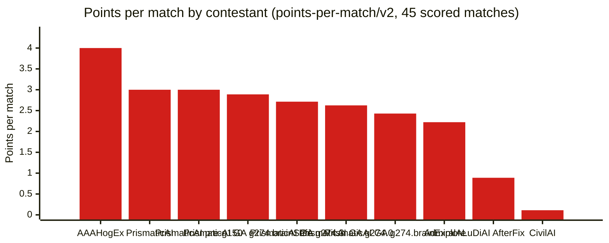
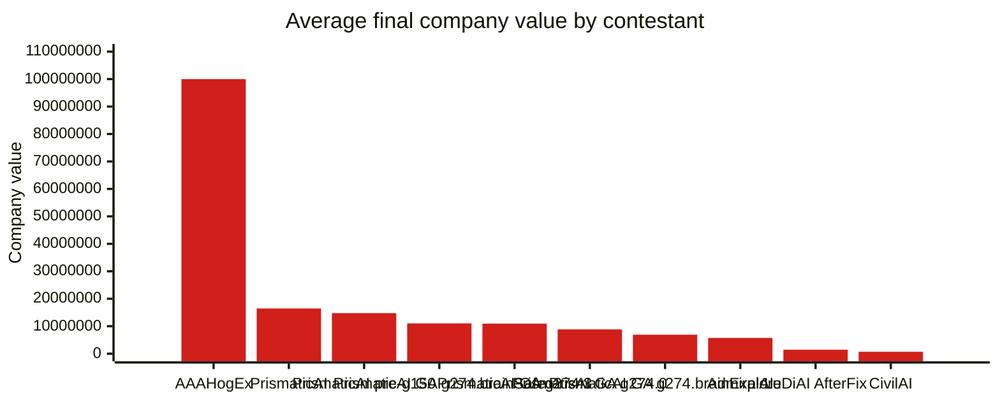
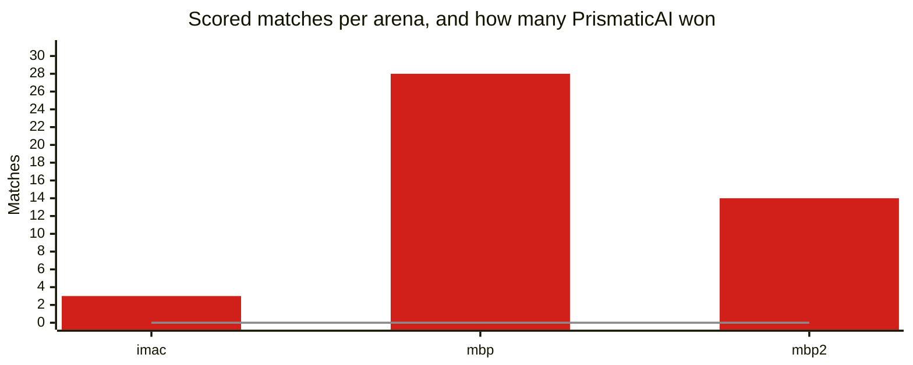

# battle-20261121T132634-cd02f5e8

Derived from `battle-20261121T132634-cd02f5e8.json` by `tools/research/ai-battle/battle.py report`; do not edit.

- Edition `cd02f5e8f136daad`: PrismaticAI and referee at `61b2483618b164d4d3c1c106ee7f6069fd5385c1`, base set `opengfx-8.0.tar`
- 20-year free-for-all from 1960, map 256x256 temperate, breakdowns 1
- 45 scored match(es) on `imac` (20261119-master-gdf1e05e7d8), `mbp` (20261120-master-m17653b726e), `mbp2` (20261119-master-gdf1e05e7d8)
- Replays: 0 of 0 identical to their original on another arena

| # | Contestant | Played | Wins | Points | Points/match | Avg rank | Avg final value | Squirrel errors | Matches with anomalies |
|---|---|---|---|---|---|---|---|---|---|
| 1 | AAAHogEx | 45 | 45 | 180 | 4.0 | 1.0 | 100.0 M | 0 | 0 |
| 2 | PrismaticAI | 6 | 0 | 18 | 3.0 | 2.0 | 16.5 M | 0 | 0 |
| 3 | PrismaticAI pre-g150 | 8 | 0 | 24 | 3.0 | 2.0 | 14.8 M | 0 | 3 |
| 4 | PrismaticAI GA g274.brainSafe | 9 | 0 | 26 | 2.889 | 2.11 | 11.0 M | 0 | 1 |
| 5 | PrismaticAI GA g274.3 | 7 | 0 | 19 | 2.714 | 2.29 | 10.9 M | 0 | 0 |
| 6 | PrismaticAI GA g274.0 | 8 | 0 | 21 | 2.625 | 2.38 | 8.8 M | 0 | 1 |
| 7 | PrismaticAI GA g274.brainExplore | 7 | 0 | 17 | 2.429 | 2.57 | 6.9 M | 0 | 5 |
| 8 | AdmiralAI | 45 | 0 | 100 | 2.222 | 2.78 | 5.7 M | 0 | 0 |
| 9 | LuDiAI AfterFix | 45 | 0 | 40 | 0.889 | 4.11 | 1.4 M | 0 | 3 |
| 10 | CivilAI | 45 | 0 | 5 | 0.111 | 4.89 | 693.9 k | 0 | 15 |

```mermaid
---
config:
  xyChart:
    width: 900
    height: 360
  themeVariables:
    xyChart:
      plotColorPalette: "#d11f1a, #8a8a8a, #0b0b0b, #ece4d6"
---
xychart-beta
    title "Final company value per scored match: winner vs best PrismaticAI"
    x-axis ["m-0001", "m-0002", "m-0003", "m-0004", "m-0005", "m-0006", "m-0007", "m-0008", "m-0009", "m-0010", "m-0011", "m-0012", "m-0013", "m-0014", "m-0015", "m-0016", "m-0017", "m-0019", "m-0020", "m-0021", "m-0023", "m-0024", "m-0025", "m-0026", "m-0027", "m-0028", "m-0036", "m-0037", "m-0038", "m-0039", "m-0040", "m-0041", "m-0042", "m-0043", "m-0044", "m-0045", "m-0046", "m-0047", "m-0048", "m-0049", "m-0050", "m-0051", "m-0052", "m-0053", "m-0057"]
    %% series: Winner | Best PrismaticAI
    %% links: battle-20261121T132634-cd02f5e8.md?col=Match&filter=m-0001 | battle-20261121T132634-cd02f5e8.md?col=Match&filter=m-0002 | battle-20261121T132634-cd02f5e8.md?col=Match&filter=m-0003 | battle-20261121T132634-cd02f5e8.md?col=Match&filter=m-0004 | battle-20261121T132634-cd02f5e8.md?col=Match&filter=m-0005 | battle-20261121T132634-cd02f5e8.md?col=Match&filter=m-0006 | battle-20261121T132634-cd02f5e8.md?col=Match&filter=m-0007 | battle-20261121T132634-cd02f5e8.md?col=Match&filter=m-0008 | battle-20261121T132634-cd02f5e8.md?col=Match&filter=m-0009 | battle-20261121T132634-cd02f5e8.md?col=Match&filter=m-0010 | battle-20261121T132634-cd02f5e8.md?col=Match&filter=m-0011 | battle-20261121T132634-cd02f5e8.md?col=Match&filter=m-0012 | battle-20261121T132634-cd02f5e8.md?col=Match&filter=m-0013 | battle-20261121T132634-cd02f5e8.md?col=Match&filter=m-0014 | battle-20261121T132634-cd02f5e8.md?col=Match&filter=m-0015 | battle-20261121T132634-cd02f5e8.md?col=Match&filter=m-0016 | battle-20261121T132634-cd02f5e8.md?col=Match&filter=m-0017 | battle-20261121T132634-cd02f5e8.md?col=Match&filter=m-0019 | battle-20261121T132634-cd02f5e8.md?col=Match&filter=m-0020 | battle-20261121T132634-cd02f5e8.md?col=Match&filter=m-0021 | battle-20261121T132634-cd02f5e8.md?col=Match&filter=m-0023 | battle-20261121T132634-cd02f5e8.md?col=Match&filter=m-0024 | battle-20261121T132634-cd02f5e8.md?col=Match&filter=m-0025 | battle-20261121T132634-cd02f5e8.md?col=Match&filter=m-0026 | battle-20261121T132634-cd02f5e8.md?col=Match&filter=m-0027 | battle-20261121T132634-cd02f5e8.md?col=Match&filter=m-0028 | battle-20261121T132634-cd02f5e8.md?col=Match&filter=m-0036 | battle-20261121T132634-cd02f5e8.md?col=Match&filter=m-0037 | battle-20261121T132634-cd02f5e8.md?col=Match&filter=m-0038 | battle-20261121T132634-cd02f5e8.md?col=Match&filter=m-0039 | battle-20261121T132634-cd02f5e8.md?col=Match&filter=m-0040 | battle-20261121T132634-cd02f5e8.md?col=Match&filter=m-0041 | battle-20261121T132634-cd02f5e8.md?col=Match&filter=m-0042 | battle-20261121T132634-cd02f5e8.md?col=Match&filter=m-0043 | battle-20261121T132634-cd02f5e8.md?col=Match&filter=m-0044 | battle-20261121T132634-cd02f5e8.md?col=Match&filter=m-0045 | battle-20261121T132634-cd02f5e8.md?col=Match&filter=m-0046 | battle-20261121T132634-cd02f5e8.md?col=Match&filter=m-0047 | battle-20261121T132634-cd02f5e8.md?col=Match&filter=m-0048 | battle-20261121T132634-cd02f5e8.md?col=Match&filter=m-0049 | battle-20261121T132634-cd02f5e8.md?col=Match&filter=m-0050 | battle-20261121T132634-cd02f5e8.md?col=Match&filter=m-0051 | battle-20261121T132634-cd02f5e8.md?col=Match&filter=m-0052 | battle-20261121T132634-cd02f5e8.md?col=Match&filter=m-0053 | battle-20261121T132634-cd02f5e8.md?col=Match&filter=m-0057
    y-axis "Company value" 0 --> 185000000
    bar [94617625, 92082679, 87763327, 77054027, 99541638, 58650481, 52588504, 71424820, 71842877, 68105458, 71915433, 83210171, 73784532, 104112776, 99382106, 79779649, 82807107, 84282245, 85578178, 71449324, 80969736, 99811169, 121533715, 114309595, 128215959, 103796009, 98684257, 106307039, 102353881, 109360903, 112746377, 102544919, 100517836, 106187121, 104121566, 123502003, 92438392, 109855309, 134536723, 141557642, 129116650, 153995404, 139898795, 168605770, 104541222]
    line [7921575, 4859099, 10372959, 3479338, 6843788, 10165281, 9070381, 2575631, 5083232, 4753204, 6237861, 14571371, 15790382, 7848564, 7643724, 6988937, 13586025, 15051379, 10589258, 11399598, 13153176, 17009146, 20637863, 11342830, 10852511, 7714928, 17927558, 13817041, 8596141, 9759309, 5013491, 8924887, 18227259, 15476632, 13810556, 12217874, 10280589, 15490727, 20807860, 20359513, 11046682, 16770118, 10107565, 12313397, 15125176]
```

<!-- battle-charts:begin -->
<!-- derived from battle-20261121T132634-cd02f5e8.json by `battle.py render`; `battle.py check` fails when it is stale -->

<!-- battle-charts:end -->

| Match | Arena | Seed | Winner | Value | Last | Anomalies |
|---|---|---|---|---|---|---|
| m-0001 | mbp | 67462311 | AAAHogEx | 94.6 M | CivilAI | - |
| m-0002 | mbp | 67462311 | AAAHogEx | 92.1 M | CivilAI | - |
| m-0003 | mbp | 67462311 | AAAHogEx | 87.8 M | LuDiAI AfterFix | - |
| m-0004 | mbp | 67462311 | AAAHogEx | 77.1 M | LuDiAI AfterFix | - |
| m-0005 | mbp | 67462311 | AAAHogEx | 99.5 M | LuDiAI AfterFix | CivilAI: fleet_drop:43->18; LuDiAI AfterFix: fleet_drop:56->32 |
| m-0006 | mbp | 1075191515 | AAAHogEx | 58.7 M | CivilAI | CivilAI: fleet_drop:102->66 |
| m-0007 | mbp | 1075191515 | AAAHogEx | 52.6 M | CivilAI | PrismaticAI pre-g150: fleet_drop:66->44 |
| m-0008 | mbp | 1075191515 | AAAHogEx | 71.4 M | CivilAI | PrismaticAI GA g274.0: fleet_drop:30->12; CivilAI: fleet_drop:13->9 |
| m-0009 | mbp | 1075191515 | AAAHogEx | 71.8 M | CivilAI | CivilAI: fleet_drop:71->36 |
| m-0010 | imac | 1075191515 | AAAHogEx | 68.1 M | CivilAI | PrismaticAI GA g274.brainExplore: fleet_drop:141->61 |
| m-0011 | imac | 1075191515 | AAAHogEx | 71.9 M | CivilAI | - |
| m-0012 | imac | 258673074 | AAAHogEx | 83.2 M | CivilAI | - |
| m-0013 | mbp2 | 258673074 | AAAHogEx | 73.8 M | LuDiAI AfterFix | PrismaticAI pre-g150: fleet_drop:90->49; LuDiAI AfterFix: fleet_drop:75->51 |
| m-0014 | mbp2 | 258673074 | AAAHogEx | 104.1 M | CivilAI | - |
| m-0015 | mbp2 | 258673074 | AAAHogEx | 99.4 M | CivilAI | - |
| m-0016 | mbp2 | 258673074 | AAAHogEx | 79.8 M | CivilAI | PrismaticAI GA g274.brainExplore: fleet_drop:115->75 |
| m-0017 | mbp2 | 258673074 | AAAHogEx | 82.8 M | CivilAI | - |
| m-0019 | mbp2 | 270896786 | AAAHogEx | 84.3 M | CivilAI | - |
| m-0020 | mbp2 | 270896786 | AAAHogEx | 85.6 M | CivilAI | - |
| m-0021 | mbp2 | 270896786 | AAAHogEx | 71.4 M | CivilAI | - |
| m-0023 | mbp2 | 270896786 | AAAHogEx | 81.0 M | CivilAI | - |
| m-0024 | mbp2 | 59365712 | AAAHogEx | 99.8 M | LuDiAI AfterFix | - |
| m-0025 | mbp2 | 59365712 | AAAHogEx | 121.5 M | CivilAI | - |
| m-0026 | mbp2 | 59365712 | AAAHogEx | 114.3 M | CivilAI | - |
| m-0027 | mbp2 | 59365712 | AAAHogEx | 128.2 M | CivilAI | CivilAI: fleet_drop:23->13 |
| m-0028 | mbp2 | 59365712 | AAAHogEx | 103.8 M | CivilAI | PrismaticAI GA g274.brainExplore: fleet_drop:121->72 |
| m-0036 | mbp | 1996562190 | AAAHogEx | 98.7 M | CivilAI | CivilAI: fleet_drop:60->17 |
| m-0037 | mbp | 1996562190 | AAAHogEx | 106.3 M | CivilAI | CivilAI: fleet_drop:59->10 |
| m-0038 | mbp | 1996562190 | AAAHogEx | 102.4 M | CivilAI | CivilAI: fleet_drop:41->13 |
| m-0039 | mbp | 1996562190 | AAAHogEx | 109.4 M | CivilAI | PrismaticAI GA g274.brainSafe: fleet_drop:125->83 |
| m-0040 | mbp | 1996562190 | AAAHogEx | 112.7 M | CivilAI | CivilAI: fleet_drop:33->11 |
| m-0041 | mbp | 1996562190 | AAAHogEx | 102.5 M | CivilAI | - |
| m-0042 | mbp | 1250093633 | AAAHogEx | 100.5 M | CivilAI | CivilAI: fleet_drop:61->24 |
| m-0043 | mbp | 1250093633 | AAAHogEx | 106.2 M | CivilAI | PrismaticAI pre-g150: fleet_drop:73->49; CivilAI: fleet_drop:54->13 |
| m-0044 | mbp | 1250093633 | AAAHogEx | 104.1 M | CivilAI | - |
| m-0045 | mbp | 1250093633 | AAAHogEx | 123.5 M | CivilAI | - |
| m-0046 | mbp | 1250093633 | AAAHogEx | 92.4 M | CivilAI | PrismaticAI GA g274.brainExplore: fleet_drop:131->82; CivilAI: fleet_drop:76->49 |
| m-0047 | mbp | 1250093633 | AAAHogEx | 109.9 M | CivilAI | LuDiAI AfterFix: fleet_drop:35->23 |
| m-0048 | mbp | 24988791 | AAAHogEx | 134.5 M | CivilAI | - |
| m-0049 | mbp | 24988791 | AAAHogEx | 141.6 M | CivilAI | CivilAI: fleet_drop:66->35 |
| m-0050 | mbp | 24988791 | AAAHogEx | 129.1 M | CivilAI | - |
| m-0051 | mbp | 24988791 | AAAHogEx | 154.0 M | CivilAI | CivilAI: no_vehicles |
| m-0052 | mbp | 24988791 | AAAHogEx | 139.9 M | CivilAI | PrismaticAI GA g274.brainExplore: fleet_drop:112->67 |
| m-0053 | mbp | 24988791 | AAAHogEx | 168.6 M | CivilAI | CivilAI: no_vehicles |
| m-0057 | mbp | 1290685746 | AAAHogEx | 104.5 M | CivilAI | - |
