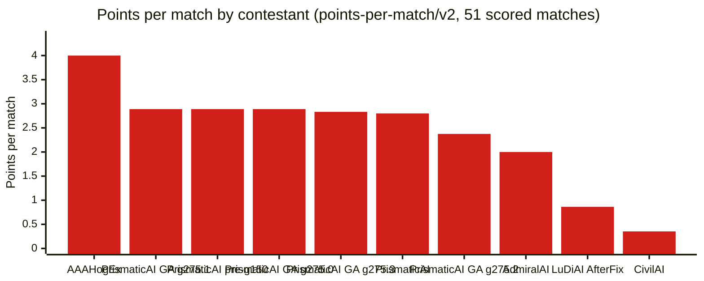
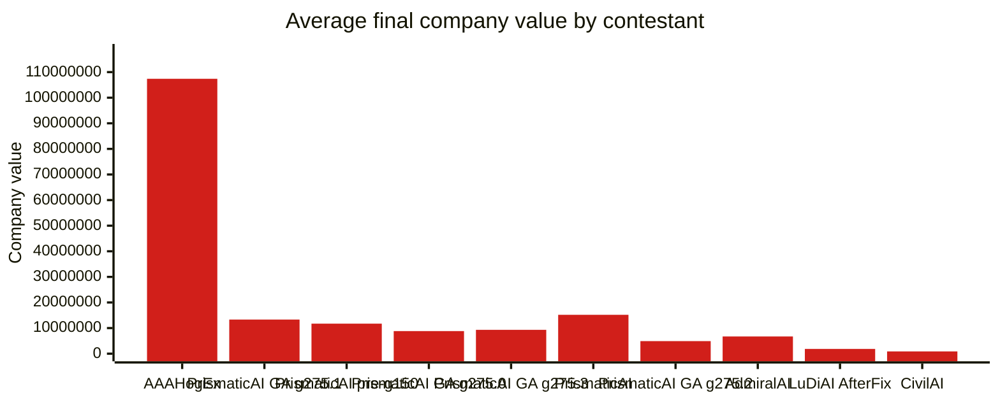
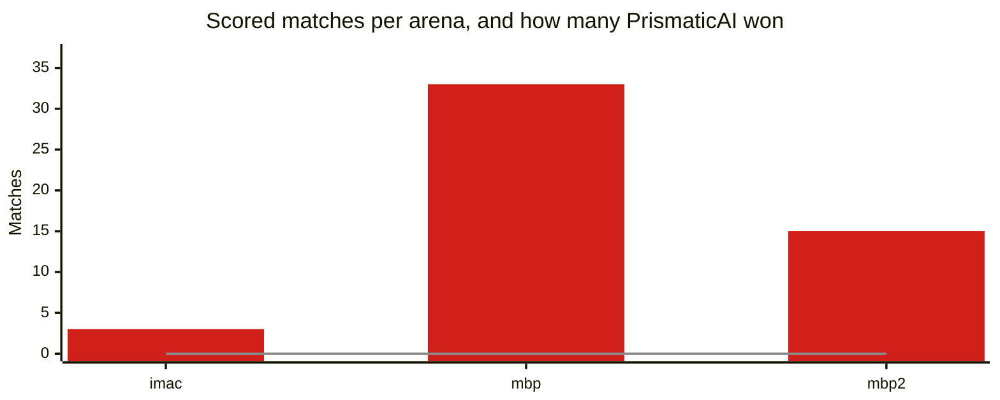

# battle-20261121T134109-38fb260b

Derived from `battle-20261121T134109-38fb260b.json` by `tools/research/ai-battle/battle.py report`; do not edit.

- Edition `38fb260b635c47d2`: PrismaticAI and referee at `61b2483618b164d4d3c1c106ee7f6069fd5385c1`, base set `opengfx-8.0.tar`
- 20-year free-for-all from 1960, map 256x256 temperate, breakdowns 1
- 51 scored match(es) on `imac` (20261119-master-gdf1e05e7d8), `mbp` (20261120-master-m17653b726e), `mbp2` (20261119-master-gdf1e05e7d8)
- Replays: 0 of 1 identical to their original on another arena

| # | Contestant | Played | Wins | Points | Points/match | Avg rank | Avg final value | Squirrel errors | Matches with anomalies |
|---|---|---|---|---|---|---|---|---|---|
| 1 | AAAHogEx | 51 | 51 | 204 | 4.0 | 1.0 | 107.4 M | 0 | 0 |
| 2 | PrismaticAI GA g275.1 | 9 | 0 | 26 | 2.889 | 2.11 | 13.3 M | 0 | 0 |
| 3 | PrismaticAI pre-g150 | 9 | 0 | 26 | 2.889 | 2.11 | 11.7 M | 0 | 2 |
| 4 | PrismaticAI GA g275.0 | 9 | 0 | 26 | 2.889 | 2.11 | 8.8 M | 0 | 3 |
| 5 | PrismaticAI GA g275.3 | 6 | 0 | 17 | 2.833 | 2.17 | 9.3 M | 0 | 1 |
| 6 | PrismaticAI | 10 | 0 | 28 | 2.8 | 2.2 | 15.2 M | 0 | 0 |
| 7 | PrismaticAI GA g275.2 | 8 | 0 | 19 | 2.375 | 2.62 | 4.9 M | 0 | 0 |
| 8 | AdmiralAI | 51 | 0 | 102 | 2.0 | 3.0 | 6.7 M | 70 | 8 |
| 9 | LuDiAI AfterFix | 51 | 0 | 44 | 0.863 | 4.14 | 1.9 M | 0 | 3 |
| 10 | CivilAI | 51 | 0 | 18 | 0.353 | 4.65 | 879.5 k | 3965 | 12 |

```mermaid
---
config:
  xyChart:
    width: 900
    height: 360
  themeVariables:
    xyChart:
      plotColorPalette: "#d11f1a, #8a8a8a, #0b0b0b, #ece4d6"
---
xychart-beta
    title "Final company value per scored match: winner vs best PrismaticAI"
    x-axis ["m-0001", "m-0002", "m-0003", "m-0004", "m-0005", "m-0006", "m-0007", "m-0008", "m-0009", "m-0010", "m-0011", "m-0012", "m-0013", "m-0014", "m-0015", "m-0016", "m-0017", "m-0018", "m-0019", "m-0020", "m-0021", "m-0022", "m-0024", "m-0025", "m-0026", "m-0027", "m-0028", "m-0036", "m-0037", "m-0038", "m-0039", "m-0040", "m-0041", "m-0042", "m-0043", "m-0044", "m-0045", "m-0046", "m-0047", "m-0048", "m-0049", "m-0050", "m-0051", "m-0052", "m-0054", "m-0057", "m-0059", "m-0060", "m-0061", "m-0062", "m-0066"]
    %% series: Winner | Best PrismaticAI
    %% links: battle-20261121T134109-38fb260b.md?col=Match&filter=m-0001 | battle-20261121T134109-38fb260b.md?col=Match&filter=m-0002 | battle-20261121T134109-38fb260b.md?col=Match&filter=m-0003 | battle-20261121T134109-38fb260b.md?col=Match&filter=m-0004 | battle-20261121T134109-38fb260b.md?col=Match&filter=m-0005 | battle-20261121T134109-38fb260b.md?col=Match&filter=m-0006 | battle-20261121T134109-38fb260b.md?col=Match&filter=m-0007 | battle-20261121T134109-38fb260b.md?col=Match&filter=m-0008 | battle-20261121T134109-38fb260b.md?col=Match&filter=m-0009 | battle-20261121T134109-38fb260b.md?col=Match&filter=m-0010 | battle-20261121T134109-38fb260b.md?col=Match&filter=m-0011 | battle-20261121T134109-38fb260b.md?col=Match&filter=m-0012 | battle-20261121T134109-38fb260b.md?col=Match&filter=m-0013 | battle-20261121T134109-38fb260b.md?col=Match&filter=m-0014 | battle-20261121T134109-38fb260b.md?col=Match&filter=m-0015 | battle-20261121T134109-38fb260b.md?col=Match&filter=m-0016 | battle-20261121T134109-38fb260b.md?col=Match&filter=m-0017 | battle-20261121T134109-38fb260b.md?col=Match&filter=m-0018 | battle-20261121T134109-38fb260b.md?col=Match&filter=m-0019 | battle-20261121T134109-38fb260b.md?col=Match&filter=m-0020 | battle-20261121T134109-38fb260b.md?col=Match&filter=m-0021 | battle-20261121T134109-38fb260b.md?col=Match&filter=m-0022 | battle-20261121T134109-38fb260b.md?col=Match&filter=m-0024 | battle-20261121T134109-38fb260b.md?col=Match&filter=m-0025 | battle-20261121T134109-38fb260b.md?col=Match&filter=m-0026 | battle-20261121T134109-38fb260b.md?col=Match&filter=m-0027 | battle-20261121T134109-38fb260b.md?col=Match&filter=m-0028 | battle-20261121T134109-38fb260b.md?col=Match&filter=m-0036 | battle-20261121T134109-38fb260b.md?col=Match&filter=m-0037 | battle-20261121T134109-38fb260b.md?col=Match&filter=m-0038 | battle-20261121T134109-38fb260b.md?col=Match&filter=m-0039 | battle-20261121T134109-38fb260b.md?col=Match&filter=m-0040 | battle-20261121T134109-38fb260b.md?col=Match&filter=m-0041 | battle-20261121T134109-38fb260b.md?col=Match&filter=m-0042 | battle-20261121T134109-38fb260b.md?col=Match&filter=m-0043 | battle-20261121T134109-38fb260b.md?col=Match&filter=m-0044 | battle-20261121T134109-38fb260b.md?col=Match&filter=m-0045 | battle-20261121T134109-38fb260b.md?col=Match&filter=m-0046 | battle-20261121T134109-38fb260b.md?col=Match&filter=m-0047 | battle-20261121T134109-38fb260b.md?col=Match&filter=m-0048 | battle-20261121T134109-38fb260b.md?col=Match&filter=m-0049 | battle-20261121T134109-38fb260b.md?col=Match&filter=m-0050 | battle-20261121T134109-38fb260b.md?col=Match&filter=m-0051 | battle-20261121T134109-38fb260b.md?col=Match&filter=m-0052 | battle-20261121T134109-38fb260b.md?col=Match&filter=m-0054 | battle-20261121T134109-38fb260b.md?col=Match&filter=m-0057 | battle-20261121T134109-38fb260b.md?col=Match&filter=m-0059 | battle-20261121T134109-38fb260b.md?col=Match&filter=m-0060 | battle-20261121T134109-38fb260b.md?col=Match&filter=m-0061 | battle-20261121T134109-38fb260b.md?col=Match&filter=m-0062 | battle-20261121T134109-38fb260b.md?col=Match&filter=m-0066
    y-axis "Company value" 0 --> 196000000
    bar [88811968, 75504951, 78605852, 69552648, 65094384, 122775755, 107100072, 135560612, 141427045, 112824063, 120680885, 82994089, 88468120, 114412185, 89974458, 91755345, 119057897, 110600740, 88341438, 111432467, 97479389, 94622279, 141777154, 94885455, 150387501, 177785438, 141634270, 128676836, 117623579, 120918757, 105985701, 93483624, 132062266, 76057763, 96939628, 88870812, 98420754, 103651219, 104225832, 125841064, 133606222, 100981439, 115186703, 106164323, 97986876, 133479373, 122782133, 93767888, 81137347, 111844291, 73407530]
    line [12895348, 8455426, 15428523, 5080139, 12773198, 12458708, 11375073, 9176171, 17741700, 10439650, 14765282, 20508977, 18066199, 12301524, 20203454, 3452625, 8712840, 8565275, 7968015, 9427356, 8423300, 812427, 9968097, 13008787, 9074003, 11754445, 2378116, 16294203, 13676675, 10043191, 13635623, 6705212, 10277454, 11656683, 4947963, 7479001, 9900731, 4338257, 6235891, 15947589, 10080671, 8359078, 11926116, 6024061, 12346885, 10910235, 3102316, 15938729, 13508689, 5046297, 28098502]
```

<!-- battle-charts:begin -->
<!-- derived from battle-20261121T134109-38fb260b.json by `battle.py render`; `battle.py check` fails when it is stale -->

<!-- battle-charts:end -->

| Seed | Original | Replay | Arenas | Identical |
|---|---|---|---|---|
| 689263449 | m-0010 | m-0064 | imac / mbp | NO |

| Match | Arena | Seed | Winner | Value | Last | Anomalies |
|---|---|---|---|---|---|---|
| m-0001 | mbp | 1097390619 | AAAHogEx | 88.8 M | LuDiAI AfterFix | AdmiralAI: fleet_drop:175->121 |
| m-0002 | mbp | 1097390619 | AAAHogEx | 75.5 M | CivilAI | CivilAI: fleet_drop:93->47 |
| m-0003 | mbp | 1097390619 | AAAHogEx | 78.6 M | CivilAI | AdmiralAI: fleet_drop:433->251; CivilAI: fleet_drop:62->18 |
| m-0004 | mbp | 1097390619 | AAAHogEx | 69.6 M | CivilAI | CivilAI: fleet_drop:56->29 |
| m-0005 | mbp | 1097390619 | AAAHogEx | 65.1 M | CivilAI | CivilAI: fleet_drop:66->45 |
| m-0006 | mbp | 689263449 | AAAHogEx | 122.8 M | CivilAI | - |
| m-0007 | mbp | 689263449 | AAAHogEx | 107.1 M | CivilAI | PrismaticAI pre-g150: fleet_drop:107->40 |
| m-0008 | mbp | 689263449 | AAAHogEx | 135.6 M | CivilAI | - |
| m-0009 | mbp | 689263449 | AAAHogEx | 141.4 M | CivilAI | - |
| m-0010 | imac | 689263449 | AAAHogEx | 112.8 M | LuDiAI AfterFix | LuDiAI AfterFix: fleet_drop:184->122 |
| m-0011 | imac | 689263449 | AAAHogEx | 120.7 M | CivilAI | PrismaticAI GA g275.3: fleet_drop:195->133 |
| m-0012 | imac | 334965591 | AAAHogEx | 83.0 M | LuDiAI AfterFix | - |
| m-0013 | mbp2 | 334965591 | AAAHogEx | 88.5 M | LuDiAI AfterFix | - |
| m-0014 | mbp2 | 334965591 | AAAHogEx | 114.4 M | CivilAI | PrismaticAI GA g275.0: fleet_drop:97->65 |
| m-0015 | mbp2 | 334965591 | AAAHogEx | 90.0 M | LuDiAI AfterFix | - |
| m-0016 | mbp2 | 334965591 | AAAHogEx | 91.8 M | CivilAI | - |
| m-0017 | mbp2 | 334965591 | AAAHogEx | 119.1 M | LuDiAI AfterFix | LuDiAI AfterFix: fleet_drop:26->0, no_vehicles |
| m-0018 | mbp2 | 1906475681 | AAAHogEx | 110.6 M | CivilAI | CivilAI: fleet_drop:47->7 |
| m-0019 | mbp2 | 1906475681 | AAAHogEx | 88.3 M | CivilAI | CivilAI: fleet_drop:57->2 |
| m-0020 | mbp2 | 1906475681 | AAAHogEx | 111.4 M | CivilAI | - |
| m-0021 | mbp2 | 1906475681 | AAAHogEx | 97.5 M | CivilAI | AdmiralAI: fleet_drop:515->337 |
| m-0022 | mbp2 | 1906475681 | AAAHogEx | 94.6 M | CivilAI | AdmiralAI: squirrel_errors:70; LuDiAI AfterFix: fleet_drop:84->45 |
| m-0024 | mbp2 | 1500621035 | AAAHogEx | 141.8 M | CivilAI | CivilAI: fleet_drop:34->8 |
| m-0025 | mbp2 | 1500621035 | AAAHogEx | 94.9 M | CivilAI | - |
| m-0026 | mbp2 | 1500621035 | AAAHogEx | 150.4 M | AdmiralAI | - |
| m-0027 | mbp2 | 1500621035 | AAAHogEx | 177.8 M | AdmiralAI | - |
| m-0028 | mbp2 | 1500621035 | AAAHogEx | 141.6 M | AdmiralAI | - |
| m-0036 | mbp | 1445575457 | AAAHogEx | 128.7 M | CivilAI | CivilAI: fleet_drop:94->56 |
| m-0037 | mbp | 1445575457 | AAAHogEx | 117.6 M | CivilAI | PrismaticAI pre-g150: fleet_drop:52->36 |
| m-0038 | mbp | 1445575457 | AAAHogEx | 120.9 M | CivilAI | PrismaticAI GA g275.0: fleet_drop:72->37; AdmiralAI: fleet_drop:452->304 |
| m-0039 | mbp | 1445575457 | AAAHogEx | 106.0 M | CivilAI | - |
| m-0040 | mbp | 1445575457 | AAAHogEx | 93.5 M | CivilAI | CivilAI: fleet_drop:59->41 |
| m-0041 | mbp | 1445575457 | AAAHogEx | 132.1 M | CivilAI | AdmiralAI: fleet_drop:329->212 |
| m-0042 | mbp | 1344621995 | AAAHogEx | 76.1 M | CivilAI | AdmiralAI: fleet_drop:275->176 |
| m-0043 | mbp | 1344621995 | AAAHogEx | 96.9 M | LuDiAI AfterFix | - |
| m-0044 | mbp | 1344621995 | AAAHogEx | 88.9 M | LuDiAI AfterFix | PrismaticAI GA g275.0: fleet_drop:102->42; CivilAI: fleet_drop:40->24 |
| m-0045 | mbp | 1344621995 | AAAHogEx | 98.4 M | LuDiAI AfterFix | - |
| m-0046 | mbp | 1344621995 | AAAHogEx | 103.7 M | LuDiAI AfterFix | - |
| m-0047 | mbp | 1344621995 | AAAHogEx | 104.2 M | LuDiAI AfterFix | - |
| m-0048 | mbp | 1218710519 | AAAHogEx | 125.8 M | CivilAI | CivilAI: squirrel_errors:3965 |
| m-0049 | mbp | 1218710519 | AAAHogEx | 133.6 M | CivilAI | CivilAI: no_vehicles |
| m-0050 | mbp | 1218710519 | AAAHogEx | 101.0 M | CivilAI | - |
| m-0051 | mbp | 1218710519 | AAAHogEx | 115.2 M | CivilAI | AdmiralAI: fleet_drop:150->97 |
| m-0052 | mbp | 1218710519 | AAAHogEx | 106.2 M | CivilAI | - |
| m-0054 | mbp | 999166964 | AAAHogEx | 98.0 M | CivilAI | - |
| m-0057 | mbp | 999166964 | AAAHogEx | 133.5 M | LuDiAI AfterFix | - |
| m-0059 | mbp | 999166964 | AAAHogEx | 122.8 M | CivilAI | - |
| m-0060 | mbp | 594261351 | AAAHogEx | 93.8 M | CivilAI | - |
| m-0061 | mbp | 594261351 | AAAHogEx | 81.1 M | LuDiAI AfterFix | - |
| m-0062 | mbp | 594261351 | AAAHogEx | 111.8 M | LuDiAI AfterFix | - |
| m-0064 (replay) | mbp | 689263449 | AAAHogEx | 116.2 M | LuDiAI AfterFix | - |
| m-0066 | mbp | 1420966667 | AAAHogEx | 73.4 M | CivilAI | - |
