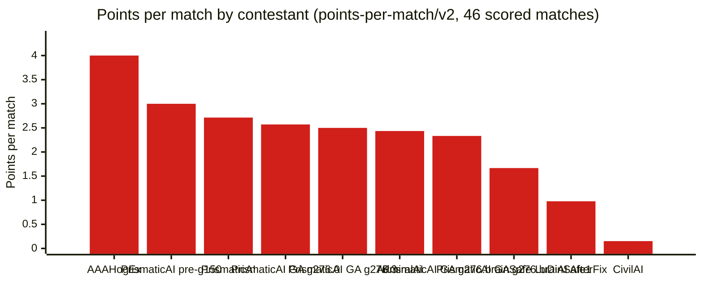
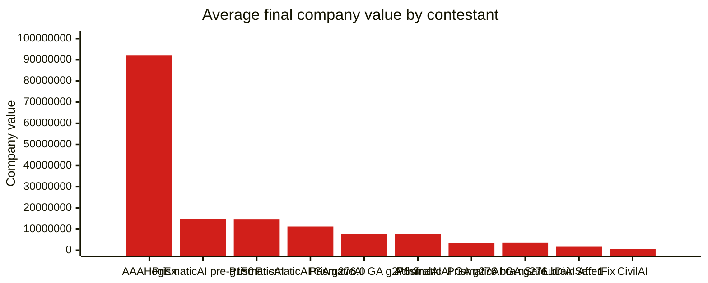
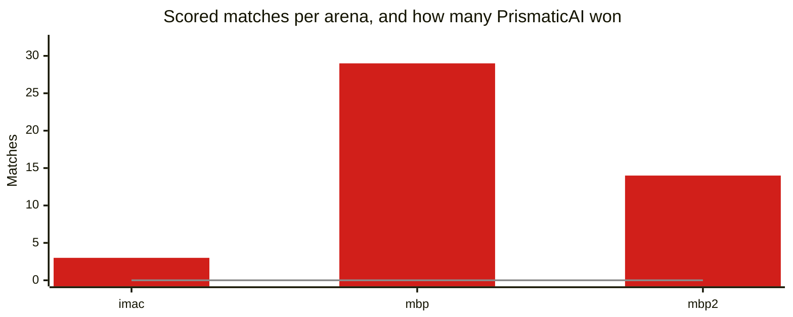

# battle-20261121T135341-fcf40bbd

Derived from `battle-20261121T135341-fcf40bbd.json` by `tools/research/ai-battle/battle.py report`; do not edit.

- Edition `fcf40bbdfec60700`: PrismaticAI and referee at `61b2483618b164d4d3c1c106ee7f6069fd5385c1`, base set `opengfx-8.0.tar`
- 20-year free-for-all from 1960, map 256x256 temperate, breakdowns 1
- 46 scored match(es) on `imac` (20261119-master-gdf1e05e7d8), `mbp` (20261120-master-m17653b726e), `mbp2` (20261119-master-gdf1e05e7d8)
- Replays: 0 of 0 identical to their original on another arena

| # | Contestant | Played | Wins | Points | Points/match | Avg rank | Avg final value | Squirrel errors | Matches with anomalies |
|---|---|---|---|---|---|---|---|---|---|
| 1 | AAAHogEx | 46 | 46 | 184 | 4.0 | 1.0 | 92.0 M | 0 | 0 |
| 2 | PrismaticAI pre-g150 | 8 | 0 | 24 | 3.0 | 2.0 | 14.9 M | 0 | 3 |
| 3 | PrismaticAI | 7 | 0 | 19 | 2.714 | 2.29 | 14.5 M | 0 | 0 |
| 4 | PrismaticAI GA g276.0 | 7 | 0 | 18 | 2.571 | 2.43 | 11.2 M | 0 | 1 |
| 5 | PrismaticAI GA g276.3 | 6 | 0 | 15 | 2.5 | 2.5 | 7.6 M | 0 | 0 |
| 6 | AdmiralAI | 46 | 0 | 112 | 2.435 | 2.57 | 7.6 M | 0 | 1 |
| 7 | PrismaticAI GA g276.brainSafe | 9 | 0 | 21 | 2.333 | 2.67 | 3.5 M | 0 | 1 |
| 8 | PrismaticAI GA g276.brainSafe1 | 9 | 0 | 15 | 1.667 | 3.33 | 3.5 M | 0 | 4 |
| 9 | LuDiAI AfterFix | 46 | 0 | 45 | 0.978 | 4.02 | 1.6 M | 0 | 4 |
| 10 | CivilAI | 46 | 0 | 7 | 0.152 | 4.85 | 521.7 k | 0 | 14 |

```mermaid
---
config:
  xyChart:
    width: 900
    height: 360
  themeVariables:
    xyChart:
      plotColorPalette: "#d11f1a, #8a8a8a, #0b0b0b, #ece4d6"
---
xychart-beta
    title "Final company value per scored match: winner vs best PrismaticAI"
    x-axis ["m-0001", "m-0002", "m-0003", "m-0004", "m-0005", "m-0006", "m-0007", "m-0008", "m-0009", "m-0010", "m-0011", "m-0012", "m-0013", "m-0014", "m-0015", "m-0016", "m-0017", "m-0018", "m-0019", "m-0021", "m-0022", "m-0024", "m-0025", "m-0026", "m-0027", "m-0028", "m-0036", "m-0037", "m-0038", "m-0039", "m-0040", "m-0041", "m-0042", "m-0043", "m-0044", "m-0045", "m-0046", "m-0047", "m-0048", "m-0049", "m-0050", "m-0051", "m-0052", "m-0053", "m-0057", "m-0058"]
    %% series: Winner | Best PrismaticAI
    %% links: battle-20261121T135341-fcf40bbd.md?col=Match&filter=m-0001 | battle-20261121T135341-fcf40bbd.md?col=Match&filter=m-0002 | battle-20261121T135341-fcf40bbd.md?col=Match&filter=m-0003 | battle-20261121T135341-fcf40bbd.md?col=Match&filter=m-0004 | battle-20261121T135341-fcf40bbd.md?col=Match&filter=m-0005 | battle-20261121T135341-fcf40bbd.md?col=Match&filter=m-0006 | battle-20261121T135341-fcf40bbd.md?col=Match&filter=m-0007 | battle-20261121T135341-fcf40bbd.md?col=Match&filter=m-0008 | battle-20261121T135341-fcf40bbd.md?col=Match&filter=m-0009 | battle-20261121T135341-fcf40bbd.md?col=Match&filter=m-0010 | battle-20261121T135341-fcf40bbd.md?col=Match&filter=m-0011 | battle-20261121T135341-fcf40bbd.md?col=Match&filter=m-0012 | battle-20261121T135341-fcf40bbd.md?col=Match&filter=m-0013 | battle-20261121T135341-fcf40bbd.md?col=Match&filter=m-0014 | battle-20261121T135341-fcf40bbd.md?col=Match&filter=m-0015 | battle-20261121T135341-fcf40bbd.md?col=Match&filter=m-0016 | battle-20261121T135341-fcf40bbd.md?col=Match&filter=m-0017 | battle-20261121T135341-fcf40bbd.md?col=Match&filter=m-0018 | battle-20261121T135341-fcf40bbd.md?col=Match&filter=m-0019 | battle-20261121T135341-fcf40bbd.md?col=Match&filter=m-0021 | battle-20261121T135341-fcf40bbd.md?col=Match&filter=m-0022 | battle-20261121T135341-fcf40bbd.md?col=Match&filter=m-0024 | battle-20261121T135341-fcf40bbd.md?col=Match&filter=m-0025 | battle-20261121T135341-fcf40bbd.md?col=Match&filter=m-0026 | battle-20261121T135341-fcf40bbd.md?col=Match&filter=m-0027 | battle-20261121T135341-fcf40bbd.md?col=Match&filter=m-0028 | battle-20261121T135341-fcf40bbd.md?col=Match&filter=m-0036 | battle-20261121T135341-fcf40bbd.md?col=Match&filter=m-0037 | battle-20261121T135341-fcf40bbd.md?col=Match&filter=m-0038 | battle-20261121T135341-fcf40bbd.md?col=Match&filter=m-0039 | battle-20261121T135341-fcf40bbd.md?col=Match&filter=m-0040 | battle-20261121T135341-fcf40bbd.md?col=Match&filter=m-0041 | battle-20261121T135341-fcf40bbd.md?col=Match&filter=m-0042 | battle-20261121T135341-fcf40bbd.md?col=Match&filter=m-0043 | battle-20261121T135341-fcf40bbd.md?col=Match&filter=m-0044 | battle-20261121T135341-fcf40bbd.md?col=Match&filter=m-0045 | battle-20261121T135341-fcf40bbd.md?col=Match&filter=m-0046 | battle-20261121T135341-fcf40bbd.md?col=Match&filter=m-0047 | battle-20261121T135341-fcf40bbd.md?col=Match&filter=m-0048 | battle-20261121T135341-fcf40bbd.md?col=Match&filter=m-0049 | battle-20261121T135341-fcf40bbd.md?col=Match&filter=m-0050 | battle-20261121T135341-fcf40bbd.md?col=Match&filter=m-0051 | battle-20261121T135341-fcf40bbd.md?col=Match&filter=m-0052 | battle-20261121T135341-fcf40bbd.md?col=Match&filter=m-0053 | battle-20261121T135341-fcf40bbd.md?col=Match&filter=m-0057 | battle-20261121T135341-fcf40bbd.md?col=Match&filter=m-0058
    y-axis "Company value" 0 --> 134000000
    bar [106285306, 119153941, 107691505, 88592507, 111225107, 58097699, 81678819, 93674983, 59861048, 59284084, 106877478, 93436188, 76334404, 79403585, 108044051, 88076093, 92857447, 92578285, 102582890, 108577727, 121997662, 85787200, 75038565, 99471812, 97084402, 68268972, 101822160, 93169902, 97431651, 92692595, 115563854, 112271590, 77620886, 73609020, 83252726, 91410688, 80855102, 106118266, 95585727, 80760034, 115795816, 105232791, 94389003, 96885394, 56089579, 79793900]
    line [20332469, 20626643, 4600750, 9238226, 16114808, 10588745, 10749018, 7363777, 2395772, 4591397, 1852853, 19634496, 17757554, 11810894, 4102067, 6076273, 6748854, 14809604, 16841422, 3950826, 2346131, 12157771, 10484080, 15519298, 2379527, 911314, 16804157, 14229048, 7543983, 3872717, 4547554, 12316298, 11618896, 16804614, 7678585, 1709626, 954798, 790635, 15930089, 11830136, 8094722, 2363166, 1732669, 7746095, 5767243, 1061419]
```

<!-- battle-charts:begin -->
<!-- derived from battle-20261121T135341-fcf40bbd.json by `battle.py render`; `battle.py check` fails when it is stale -->

<!-- battle-charts:end -->

| Match | Arena | Seed | Winner | Value | Last | Anomalies |
|---|---|---|---|---|---|---|
| m-0001 | mbp | 55398730 | AAAHogEx | 106.3 M | CivilAI | CivilAI: fleet_drop:16->10 |
| m-0002 | mbp | 55398730 | AAAHogEx | 119.2 M | CivilAI | CivilAI: fleet_drop:32->16 |
| m-0003 | mbp | 55398730 | AAAHogEx | 107.7 M | CivilAI | CivilAI: fleet_drop:63->30 |
| m-0004 | mbp | 55398730 | AAAHogEx | 88.6 M | CivilAI | - |
| m-0005 | mbp | 55398730 | AAAHogEx | 111.2 M | LuDiAI AfterFix | - |
| m-0006 | mbp | 1819831033 | AAAHogEx | 58.1 M | CivilAI | - |
| m-0007 | mbp | 1819831033 | AAAHogEx | 81.7 M | LuDiAI AfterFix | PrismaticAI pre-g150: fleet_drop:77->28; LuDiAI AfterFix: fleet_drop:40->16 |
| m-0008 | mbp | 1819831033 | AAAHogEx | 93.7 M | CivilAI | LuDiAI AfterFix: fleet_drop:48->21; CivilAI: fleet_drop:47->15 |
| m-0009 | mbp | 1819831033 | AAAHogEx | 59.9 M | CivilAI | - |
| m-0010 | imac | 1819831033 | AAAHogEx | 59.3 M | CivilAI | - |
| m-0011 | imac | 1819831033 | AAAHogEx | 106.9 M | CivilAI | LuDiAI AfterFix: fleet_drop:28->14; CivilAI: fleet_drop:46->22 |
| m-0012 | imac | 1451271907 | AAAHogEx | 93.4 M | CivilAI | - |
| m-0013 | mbp2 | 1451271907 | AAAHogEx | 76.3 M | CivilAI | - |
| m-0014 | mbp2 | 1451271907 | AAAHogEx | 79.4 M | CivilAI | - |
| m-0015 | mbp2 | 1451271907 | AAAHogEx | 108.0 M | CivilAI | - |
| m-0016 | mbp2 | 1451271907 | AAAHogEx | 88.1 M | LuDiAI AfterFix | - |
| m-0017 | mbp2 | 1451271907 | AAAHogEx | 92.9 M | CivilAI | - |
| m-0018 | mbp2 | 848810330 | AAAHogEx | 92.6 M | CivilAI | - |
| m-0019 | mbp2 | 848810330 | AAAHogEx | 102.6 M | CivilAI | CivilAI: fleet_drop:13->4 |
| m-0021 | mbp2 | 848810330 | AAAHogEx | 108.6 M | CivilAI | - |
| m-0022 | mbp2 | 848810330 | AAAHogEx | 122.0 M | CivilAI | - |
| m-0024 | mbp2 | 1878134858 | AAAHogEx | 85.8 M | CivilAI | - |
| m-0025 | mbp2 | 1878134858 | AAAHogEx | 75.0 M | CivilAI | PrismaticAI pre-g150: fleet_drop:66->36 |
| m-0026 | mbp2 | 1878134858 | AAAHogEx | 99.5 M | CivilAI | CivilAI: fleet_drop:37->12 |
| m-0027 | mbp2 | 1878134858 | AAAHogEx | 97.1 M | CivilAI | - |
| m-0028 | mbp2 | 1878134858 | AAAHogEx | 68.3 M | PrismaticAI GA g276.brainSafe1 | - |
| m-0036 | mbp | 864988302 | AAAHogEx | 101.8 M | CivilAI | - |
| m-0037 | mbp | 864988302 | AAAHogEx | 93.2 M | CivilAI | - |
| m-0038 | mbp | 864988302 | AAAHogEx | 97.4 M | CivilAI | PrismaticAI GA g276.0: fleet_drop:71->39 |
| m-0039 | mbp | 864988302 | AAAHogEx | 92.7 M | CivilAI | - |
| m-0040 | mbp | 864988302 | AAAHogEx | 115.6 M | CivilAI | PrismaticAI GA g276.brainSafe1: fleet_drop:61->35 |
| m-0041 | mbp | 864988302 | AAAHogEx | 112.3 M | CivilAI | - |
| m-0042 | mbp | 1402953105 | AAAHogEx | 77.6 M | CivilAI | - |
| m-0043 | mbp | 1402953105 | AAAHogEx | 73.6 M | LuDiAI AfterFix | - |
| m-0044 | mbp | 1402953105 | AAAHogEx | 83.3 M | CivilAI | CivilAI: fleet_drop:19->13 |
| m-0045 | mbp | 1402953105 | AAAHogEx | 91.4 M | LuDiAI AfterFix | CivilAI: fleet_drop:100->66; LuDiAI AfterFix: fleet_drop:61->36 |
| m-0046 | mbp | 1402953105 | AAAHogEx | 80.9 M | CivilAI | PrismaticAI GA g276.brainSafe1: fleet_drop:85->40; CivilAI: fleet_drop:20->9 |
| m-0047 | mbp | 1402953105 | AAAHogEx | 106.1 M | LuDiAI AfterFix | - |
| m-0048 | mbp | 769875357 | AAAHogEx | 95.6 M | CivilAI | - |
| m-0049 | mbp | 769875357 | AAAHogEx | 80.8 M | CivilAI | PrismaticAI pre-g150: fleet_drop:61->39; CivilAI: fleet_drop:16->5 |
| m-0050 | mbp | 769875357 | AAAHogEx | 115.8 M | CivilAI | CivilAI: fleet_drop:75->49 |
| m-0051 | mbp | 769875357 | AAAHogEx | 105.2 M | CivilAI | AdmiralAI: fleet_drop:254->160; PrismaticAI GA g276.brainSafe: fleet_drop:84->50 |
| m-0052 | mbp | 769875357 | AAAHogEx | 94.4 M | CivilAI | PrismaticAI GA g276.brainSafe1: fleet_drop:97->61; CivilAI: fleet_drop:41->23 |
| m-0053 | mbp | 769875357 | AAAHogEx | 96.9 M | CivilAI | - |
| m-0057 | mbp | 1079368959 | AAAHogEx | 56.1 M | CivilAI | - |
| m-0058 | mbp | 1079368959 | AAAHogEx | 79.8 M | CivilAI | PrismaticAI GA g276.brainSafe1: fleet_drop:72->42; CivilAI: no_vehicles |
