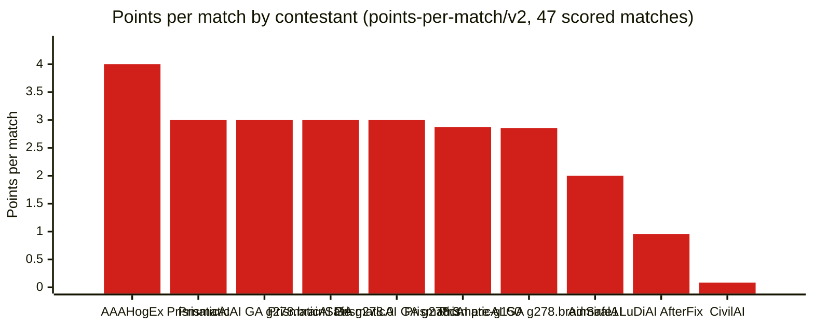
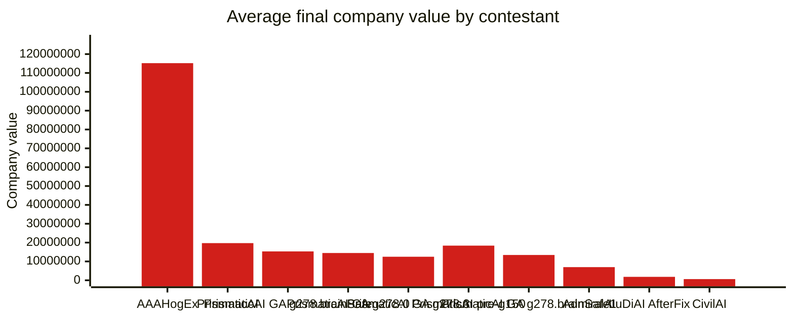
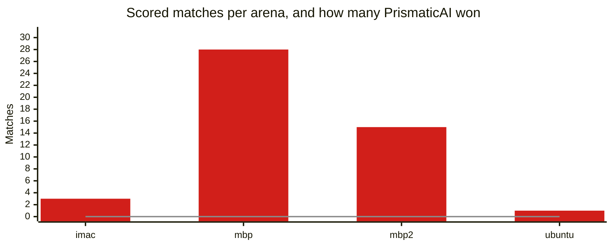

# battle-20261121T142134-ca2bfae7

Derived from `battle-20261121T142134-ca2bfae7.json` by `tools/research/ai-battle/battle.py report`; do not edit.

- Edition `ca2bfae779963f29`: PrismaticAI and referee at `61b2483618b164d4d3c1c106ee7f6069fd5385c1`, base set `opengfx-8.0.tar`
- 20-year free-for-all from 1960, map 256x256 temperate, breakdowns 1
- 47 scored match(es) on `imac` (20261119-master-gdf1e05e7d8), `mbp` (20261120-master-m17653b726e), `mbp2` (20261119-master-gdf1e05e7d8), `ubuntu` (20261119-master-gdf1e05e7d8)
- Replays: 0 of 0 identical to their original on another arena

| # | Contestant | Played | Wins | Points | Points/match | Avg rank | Avg final value | Squirrel errors | Matches with anomalies |
|---|---|---|---|---|---|---|---|---|---|
| 1 | AAAHogEx | 47 | 47 | 188 | 4.0 | 1.0 | 115.2 M | 0 | 0 |
| 2 | PrismaticAI | 8 | 0 | 24 | 3.0 | 2.0 | 19.7 M | 0 | 0 |
| 3 | PrismaticAI GA g278.brainSafe | 9 | 0 | 27 | 3.0 | 2.0 | 15.3 M | 0 | 0 |
| 4 | PrismaticAI GA g278.0 | 9 | 0 | 27 | 3.0 | 2.0 | 14.5 M | 0 | 1 |
| 5 | PrismaticAI GA g278.3 | 6 | 0 | 18 | 3.0 | 2.0 | 12.5 M | 0 | 0 |
| 6 | PrismaticAI pre-g150 | 8 | 0 | 23 | 2.875 | 2.12 | 18.4 M | 0 | 1 |
| 7 | PrismaticAI GA g278.brainSafe1 | 7 | 0 | 20 | 2.857 | 2.14 | 13.4 M | 0 | 3 |
| 8 | AdmiralAI | 47 | 0 | 94 | 2.0 | 3.0 | 7.0 M | 59 | 1 |
| 9 | LuDiAI AfterFix | 47 | 0 | 45 | 0.957 | 4.04 | 1.8 M | 0 | 1 |
| 10 | CivilAI | 47 | 0 | 4 | 0.085 | 4.91 | 626.8 k | 3715 | 7 |

```mermaid
---
config:
  xyChart:
    width: 900
    height: 360
  themeVariables:
    xyChart:
      plotColorPalette: "#d11f1a, #8a8a8a, #0b0b0b, #ece4d6"
---
xychart-beta
    title "Final company value per scored match: winner vs best PrismaticAI"
    x-axis ["m-0001", "m-0002", "m-0003", "m-0004", "m-0005", "m-0006", "m-0007", "m-0008", "m-0009", "m-0010", "m-0011", "m-0012", "m-0013", "m-0014", "m-0015", "m-0016", "m-0017", "m-0018", "m-0019", "m-0020", "m-0021", "m-0023", "m-0024", "m-0025", "m-0026", "m-0027", "m-0028", "m-0032", "m-0036", "m-0037", "m-0038", "m-0039", "m-0040", "m-0041", "m-0042", "m-0043", "m-0044", "m-0045", "m-0046", "m-0047", "m-0048", "m-0049", "m-0050", "m-0051", "m-0052", "m-0054", "m-0057"]
    %% series: Winner | Best PrismaticAI
    %% links: battle-20261121T142134-ca2bfae7.md?col=Match&filter=m-0001 | battle-20261121T142134-ca2bfae7.md?col=Match&filter=m-0002 | battle-20261121T142134-ca2bfae7.md?col=Match&filter=m-0003 | battle-20261121T142134-ca2bfae7.md?col=Match&filter=m-0004 | battle-20261121T142134-ca2bfae7.md?col=Match&filter=m-0005 | battle-20261121T142134-ca2bfae7.md?col=Match&filter=m-0006 | battle-20261121T142134-ca2bfae7.md?col=Match&filter=m-0007 | battle-20261121T142134-ca2bfae7.md?col=Match&filter=m-0008 | battle-20261121T142134-ca2bfae7.md?col=Match&filter=m-0009 | battle-20261121T142134-ca2bfae7.md?col=Match&filter=m-0010 | battle-20261121T142134-ca2bfae7.md?col=Match&filter=m-0011 | battle-20261121T142134-ca2bfae7.md?col=Match&filter=m-0012 | battle-20261121T142134-ca2bfae7.md?col=Match&filter=m-0013 | battle-20261121T142134-ca2bfae7.md?col=Match&filter=m-0014 | battle-20261121T142134-ca2bfae7.md?col=Match&filter=m-0015 | battle-20261121T142134-ca2bfae7.md?col=Match&filter=m-0016 | battle-20261121T142134-ca2bfae7.md?col=Match&filter=m-0017 | battle-20261121T142134-ca2bfae7.md?col=Match&filter=m-0018 | battle-20261121T142134-ca2bfae7.md?col=Match&filter=m-0019 | battle-20261121T142134-ca2bfae7.md?col=Match&filter=m-0020 | battle-20261121T142134-ca2bfae7.md?col=Match&filter=m-0021 | battle-20261121T142134-ca2bfae7.md?col=Match&filter=m-0023 | battle-20261121T142134-ca2bfae7.md?col=Match&filter=m-0024 | battle-20261121T142134-ca2bfae7.md?col=Match&filter=m-0025 | battle-20261121T142134-ca2bfae7.md?col=Match&filter=m-0026 | battle-20261121T142134-ca2bfae7.md?col=Match&filter=m-0027 | battle-20261121T142134-ca2bfae7.md?col=Match&filter=m-0028 | battle-20261121T142134-ca2bfae7.md?col=Match&filter=m-0032 | battle-20261121T142134-ca2bfae7.md?col=Match&filter=m-0036 | battle-20261121T142134-ca2bfae7.md?col=Match&filter=m-0037 | battle-20261121T142134-ca2bfae7.md?col=Match&filter=m-0038 | battle-20261121T142134-ca2bfae7.md?col=Match&filter=m-0039 | battle-20261121T142134-ca2bfae7.md?col=Match&filter=m-0040 | battle-20261121T142134-ca2bfae7.md?col=Match&filter=m-0041 | battle-20261121T142134-ca2bfae7.md?col=Match&filter=m-0042 | battle-20261121T142134-ca2bfae7.md?col=Match&filter=m-0043 | battle-20261121T142134-ca2bfae7.md?col=Match&filter=m-0044 | battle-20261121T142134-ca2bfae7.md?col=Match&filter=m-0045 | battle-20261121T142134-ca2bfae7.md?col=Match&filter=m-0046 | battle-20261121T142134-ca2bfae7.md?col=Match&filter=m-0047 | battle-20261121T142134-ca2bfae7.md?col=Match&filter=m-0048 | battle-20261121T142134-ca2bfae7.md?col=Match&filter=m-0049 | battle-20261121T142134-ca2bfae7.md?col=Match&filter=m-0050 | battle-20261121T142134-ca2bfae7.md?col=Match&filter=m-0051 | battle-20261121T142134-ca2bfae7.md?col=Match&filter=m-0052 | battle-20261121T142134-ca2bfae7.md?col=Match&filter=m-0054 | battle-20261121T142134-ca2bfae7.md?col=Match&filter=m-0057
    y-axis "Company value" 0 --> 173000000
    bar [103232506, 118458656, 125338056, 157608868, 120200674, 146108915, 95283804, 134495252, 121223679, 117870736, 106343577, 120896153, 109920042, 122106823, 108794781, 110541971, 121880116, 103499726, 106153573, 140261223, 126665461, 123241997, 108340884, 109804402, 120757293, 100944554, 111291616, 121710667, 119475489, 105047925, 124799439, 110027686, 82267793, 111583659, 87875481, 109386147, 117400758, 85858589, 83942002, 88870213, 131702834, 122196233, 123119349, 123506092, 147355540, 122115417, 104506190]
    line [11568300, 21668222, 16744292, 14661140, 14379321, 17538780, 20264516, 14315300, 15427430, 17200892, 8524399, 18612624, 16783579, 12073622, 16089861, 13424178, 18960304, 15920732, 24203856, 11189044, 10145034, 7789003, 20909940, 23757125, 13839294, 12594648, 12310101, 12622705, 28729948, 20568575, 18515079, 18964167, 12114669, 16272418, 19297248, 15927336, 9508809, 14161612, 11189010, 9011710, 14575422, 14016967, 16495999, 14829682, 13049277, 22138474, 18859201]
```

<!-- battle-charts:begin -->
<!-- derived from battle-20261121T142134-ca2bfae7.json by `battle.py render`; `battle.py check` fails when it is stale -->

<!-- battle-charts:end -->

| Match | Arena | Seed | Winner | Value | Last | Anomalies |
|---|---|---|---|---|---|---|
| m-0001 | mbp | 1342088779 | AAAHogEx | 103.2 M | CivilAI | CivilAI: squirrel_errors:3715 |
| m-0002 | mbp | 1342088779 | AAAHogEx | 118.5 M | CivilAI | PrismaticAI GA g278.0: fleet_drop:91->62 |
| m-0003 | mbp | 1342088779 | AAAHogEx | 125.3 M | CivilAI | - |
| m-0004 | mbp | 1342088779 | AAAHogEx | 157.6 M | CivilAI | PrismaticAI GA g278.brainSafe1: fleet_drop:72->43 |
| m-0005 | mbp | 1342088779 | AAAHogEx | 120.2 M | CivilAI | - |
| m-0006 | mbp | 198965074 | AAAHogEx | 146.1 M | CivilAI | AdmiralAI: squirrel_errors:59 |
| m-0007 | mbp | 198965074 | AAAHogEx | 95.3 M | CivilAI | - |
| m-0008 | mbp | 198965074 | AAAHogEx | 134.5 M | CivilAI | - |
| m-0009 | mbp | 198965074 | AAAHogEx | 121.2 M | CivilAI | - |
| m-0010 | imac | 198965074 | AAAHogEx | 117.9 M | CivilAI | - |
| m-0011 | imac | 198965074 | AAAHogEx | 106.3 M | CivilAI | - |
| m-0012 | imac | 1321237520 | AAAHogEx | 120.9 M | LuDiAI AfterFix | - |
| m-0013 | mbp2 | 1321237520 | AAAHogEx | 109.9 M | CivilAI | - |
| m-0014 | mbp2 | 1321237520 | AAAHogEx | 122.1 M | CivilAI | - |
| m-0015 | mbp2 | 1321237520 | AAAHogEx | 108.8 M | CivilAI | CivilAI: fleet_drop:10->5 |
| m-0016 | mbp2 | 1321237520 | AAAHogEx | 110.5 M | CivilAI | - |
| m-0017 | mbp2 | 1321237520 | AAAHogEx | 121.9 M | CivilAI | CivilAI: fleet_drop:47->20 |
| m-0018 | mbp2 | 1705568086 | AAAHogEx | 103.5 M | CivilAI | - |
| m-0019 | mbp2 | 1705568086 | AAAHogEx | 106.2 M | CivilAI | - |
| m-0020 | mbp2 | 1705568086 | AAAHogEx | 140.3 M | CivilAI | - |
| m-0021 | mbp2 | 1705568086 | AAAHogEx | 126.7 M | CivilAI | - |
| m-0023 | mbp2 | 1705568086 | AAAHogEx | 123.2 M | CivilAI | - |
| m-0024 | mbp2 | 1515773540 | AAAHogEx | 108.3 M | CivilAI | CivilAI: fleet_drop:29->16 |
| m-0025 | mbp2 | 1515773540 | AAAHogEx | 109.8 M | CivilAI | CivilAI: fleet_drop:12->7 |
| m-0026 | mbp2 | 1515773540 | AAAHogEx | 120.8 M | CivilAI | - |
| m-0027 | mbp2 | 1515773540 | AAAHogEx | 100.9 M | CivilAI | - |
| m-0028 | mbp2 | 1515773540 | AAAHogEx | 111.3 M | CivilAI | - |
| m-0032 | ubuntu | 1598240429 | AAAHogEx | 121.7 M | LuDiAI AfterFix | - |
| m-0036 | mbp | 1167512879 | AAAHogEx | 119.5 M | CivilAI | - |
| m-0037 | mbp | 1167512879 | AAAHogEx | 105.0 M | CivilAI | - |
| m-0038 | mbp | 1167512879 | AAAHogEx | 124.8 M | CivilAI | - |
| m-0039 | mbp | 1167512879 | AAAHogEx | 110.0 M | CivilAI | - |
| m-0040 | mbp | 1167512879 | AAAHogEx | 82.3 M | CivilAI | - |
| m-0041 | mbp | 1167512879 | AAAHogEx | 111.6 M | CivilAI | - |
| m-0042 | mbp | 513961501 | AAAHogEx | 87.9 M | CivilAI | CivilAI: fleet_drop:50->26 |
| m-0043 | mbp | 513961501 | AAAHogEx | 109.4 M | CivilAI | PrismaticAI pre-g150: fleet_drop:127->84 |
| m-0044 | mbp | 513961501 | AAAHogEx | 117.4 M | CivilAI | - |
| m-0045 | mbp | 513961501 | AAAHogEx | 85.9 M | CivilAI | - |
| m-0046 | mbp | 513961501 | AAAHogEx | 83.9 M | CivilAI | PrismaticAI GA g278.brainSafe1: fleet_drop:87->52 |
| m-0047 | mbp | 513961501 | AAAHogEx | 88.9 M | CivilAI | - |
| m-0048 | mbp | 683394507 | AAAHogEx | 131.7 M | LuDiAI AfterFix | - |
| m-0049 | mbp | 683394507 | AAAHogEx | 122.2 M | LuDiAI AfterFix | - |
| m-0050 | mbp | 683394507 | AAAHogEx | 123.1 M | CivilAI | LuDiAI AfterFix: fleet_drop:71->46 |
| m-0051 | mbp | 683394507 | AAAHogEx | 123.5 M | CivilAI | - |
| m-0052 | mbp | 683394507 | AAAHogEx | 147.4 M | CivilAI | PrismaticAI GA g278.brainSafe1: fleet_drop:63->35 |
| m-0054 | mbp | 130807806 | AAAHogEx | 122.1 M | CivilAI | CivilAI: fleet_drop:53->31 |
| m-0057 | mbp | 130807806 | AAAHogEx | 104.5 M | CivilAI | - |
