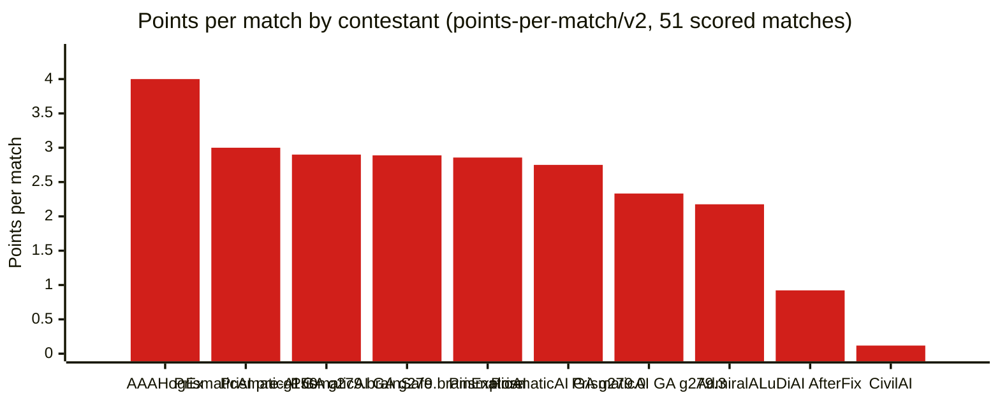
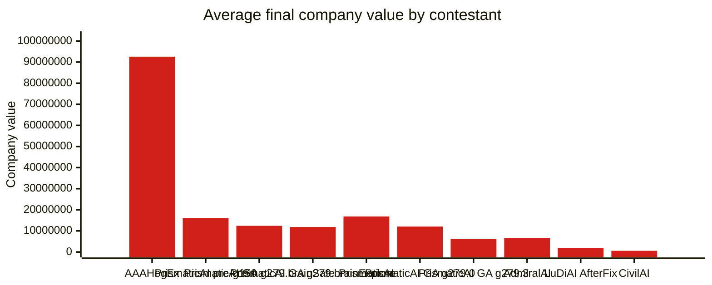
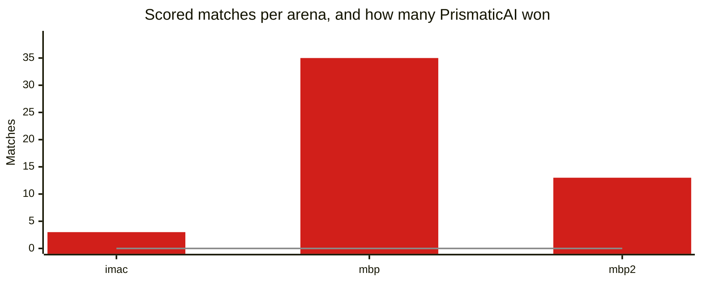

# battle-20261121T144641-b7e14fbf

Derived from `battle-20261121T144641-b7e14fbf.json` by `tools/research/ai-battle/battle.py report`; do not edit.

- Edition `b7e14fbff103a5ba`: PrismaticAI and referee at `ce3fcf5c2995269a2742c6c1421ca77f924cfb0f`, base set `opengfx-8.0.tar`
- 20-year free-for-all from 1960, map 256x256 temperate, breakdowns 1
- 51 scored match(es) on `imac` (20261119-master-gdf1e05e7d8), `mbp` (20261120-master-m17653b726e), `mbp2` (20261119-master-gdf1e05e7d8)
- Replays: 0 of 1 identical to their original on another arena

| # | Contestant | Played | Wins | Points | Points/match | Avg rank | Avg final value | Squirrel errors | Matches with anomalies |
|---|---|---|---|---|---|---|---|---|---|
| 1 | AAAHogEx | 51 | 51 | 204 | 4.0 | 1.0 | 92.6 M | 0 | 0 |
| 2 | PrismaticAI pre-g150 | 8 | 0 | 24 | 3.0 | 2.0 | 16.0 M | 0 | 0 |
| 3 | PrismaticAI GA g279.brainSafe | 10 | 0 | 29 | 2.9 | 2.1 | 12.4 M | 0 | 0 |
| 4 | PrismaticAI GA g279.brainExplore | 9 | 0 | 26 | 2.889 | 2.11 | 11.9 M | 0 | 0 |
| 5 | PrismaticAI | 7 | 0 | 20 | 2.857 | 2.14 | 16.8 M | 0 | 0 |
| 6 | PrismaticAI GA g279.0 | 8 | 0 | 22 | 2.75 | 2.25 | 12.1 M | 0 | 0 |
| 7 | PrismaticAI GA g279.3 | 9 | 0 | 21 | 2.333 | 2.67 | 6.2 M | 0 | 0 |
| 8 | AdmiralAI | 51 | 0 | 111 | 2.176 | 2.82 | 6.6 M | 0 | 4 |
| 9 | LuDiAI AfterFix | 51 | 0 | 47 | 0.922 | 4.08 | 1.8 M | 0 | 0 |
| 10 | CivilAI | 51 | 0 | 6 | 0.118 | 4.88 | 573.5 k | 3640 | 10 |

```mermaid
---
config:
  xyChart:
    width: 900
    height: 360
  themeVariables:
    xyChart:
      plotColorPalette: "#d11f1a, #8a8a8a, #0b0b0b, #ece4d6"
---
xychart-beta
    title "Final company value per scored match: winner vs best PrismaticAI"
    x-axis ["m-0001", "m-0002", "m-0003", "m-0004", "m-0005", "m-0006", "m-0007", "m-0008", "m-0009", "m-0010", "m-0011", "m-0012", "m-0013", "m-0014", "m-0015", "m-0016", "m-0017", "m-0018", "m-0019", "m-0020", "m-0021", "m-0022", "m-0023", "m-0027", "m-0028", "m-0036", "m-0037", "m-0038", "m-0039", "m-0040", "m-0041", "m-0042", "m-0043", "m-0044", "m-0045", "m-0046", "m-0047", "m-0048", "m-0049", "m-0050", "m-0051", "m-0052", "m-0053", "m-0057", "m-0058", "m-0059", "m-0060", "m-0061", "m-0062", "m-0063", "m-0065"]
    %% series: Winner | Best PrismaticAI
    %% links: battle-20261121T144641-b7e14fbf.md?col=Match&filter=m-0001 | battle-20261121T144641-b7e14fbf.md?col=Match&filter=m-0002 | battle-20261121T144641-b7e14fbf.md?col=Match&filter=m-0003 | battle-20261121T144641-b7e14fbf.md?col=Match&filter=m-0004 | battle-20261121T144641-b7e14fbf.md?col=Match&filter=m-0005 | battle-20261121T144641-b7e14fbf.md?col=Match&filter=m-0006 | battle-20261121T144641-b7e14fbf.md?col=Match&filter=m-0007 | battle-20261121T144641-b7e14fbf.md?col=Match&filter=m-0008 | battle-20261121T144641-b7e14fbf.md?col=Match&filter=m-0009 | battle-20261121T144641-b7e14fbf.md?col=Match&filter=m-0010 | battle-20261121T144641-b7e14fbf.md?col=Match&filter=m-0011 | battle-20261121T144641-b7e14fbf.md?col=Match&filter=m-0012 | battle-20261121T144641-b7e14fbf.md?col=Match&filter=m-0013 | battle-20261121T144641-b7e14fbf.md?col=Match&filter=m-0014 | battle-20261121T144641-b7e14fbf.md?col=Match&filter=m-0015 | battle-20261121T144641-b7e14fbf.md?col=Match&filter=m-0016 | battle-20261121T144641-b7e14fbf.md?col=Match&filter=m-0017 | battle-20261121T144641-b7e14fbf.md?col=Match&filter=m-0018 | battle-20261121T144641-b7e14fbf.md?col=Match&filter=m-0019 | battle-20261121T144641-b7e14fbf.md?col=Match&filter=m-0020 | battle-20261121T144641-b7e14fbf.md?col=Match&filter=m-0021 | battle-20261121T144641-b7e14fbf.md?col=Match&filter=m-0022 | battle-20261121T144641-b7e14fbf.md?col=Match&filter=m-0023 | battle-20261121T144641-b7e14fbf.md?col=Match&filter=m-0027 | battle-20261121T144641-b7e14fbf.md?col=Match&filter=m-0028 | battle-20261121T144641-b7e14fbf.md?col=Match&filter=m-0036 | battle-20261121T144641-b7e14fbf.md?col=Match&filter=m-0037 | battle-20261121T144641-b7e14fbf.md?col=Match&filter=m-0038 | battle-20261121T144641-b7e14fbf.md?col=Match&filter=m-0039 | battle-20261121T144641-b7e14fbf.md?col=Match&filter=m-0040 | battle-20261121T144641-b7e14fbf.md?col=Match&filter=m-0041 | battle-20261121T144641-b7e14fbf.md?col=Match&filter=m-0042 | battle-20261121T144641-b7e14fbf.md?col=Match&filter=m-0043 | battle-20261121T144641-b7e14fbf.md?col=Match&filter=m-0044 | battle-20261121T144641-b7e14fbf.md?col=Match&filter=m-0045 | battle-20261121T144641-b7e14fbf.md?col=Match&filter=m-0046 | battle-20261121T144641-b7e14fbf.md?col=Match&filter=m-0047 | battle-20261121T144641-b7e14fbf.md?col=Match&filter=m-0048 | battle-20261121T144641-b7e14fbf.md?col=Match&filter=m-0049 | battle-20261121T144641-b7e14fbf.md?col=Match&filter=m-0050 | battle-20261121T144641-b7e14fbf.md?col=Match&filter=m-0051 | battle-20261121T144641-b7e14fbf.md?col=Match&filter=m-0052 | battle-20261121T144641-b7e14fbf.md?col=Match&filter=m-0053 | battle-20261121T144641-b7e14fbf.md?col=Match&filter=m-0057 | battle-20261121T144641-b7e14fbf.md?col=Match&filter=m-0058 | battle-20261121T144641-b7e14fbf.md?col=Match&filter=m-0059 | battle-20261121T144641-b7e14fbf.md?col=Match&filter=m-0060 | battle-20261121T144641-b7e14fbf.md?col=Match&filter=m-0061 | battle-20261121T144641-b7e14fbf.md?col=Match&filter=m-0062 | battle-20261121T144641-b7e14fbf.md?col=Match&filter=m-0063 | battle-20261121T144641-b7e14fbf.md?col=Match&filter=m-0065
    y-axis "Company value" 0 --> 144000000
    bar [109290867, 101614944, 96873725, 96836798, 110541654, 76945170, 101056160, 106175068, 76557312, 80691106, 76682910, 109463789, 65890385, 91344413, 93622357, 93622357, 117232277, 88692338, 117505136, 92820612, 105772373, 105772373, 83886145, 130535108, 130535108, 59031592, 62620385, 125143644, 91608289, 92054594, 119042436, 71665571, 93519314, 80642270, 71383776, 71383776, 90424187, 68994502, 93111952, 89401254, 73568091, 73568091, 86472442, 98233438, 98233438, 84003884, 109341956, 104684338, 74969563, 90629834, 88087642]
    line [17469877, 14043782, 16023556, 16358417, 9219401, 15202275, 14740453, 11586887, 11523936, 11304044, 8347430, 4761992, 13438308, 5875783, 5548947, 5548947, 1693369, 20366204, 15878395, 12607458, 8176424, 8176424, 8892322, 8662645, 8662645, 33980561, 26600853, 10586795, 12527722, 12534869, 9798752, 10721447, 11652186, 9700246, 12830348, 12830348, 2347755, 15593314, 5781630, 9216421, 12812392, 12812392, 660111, 18535728, 18535728, 5223151, 17098932, 22464545, 22798954, 17448285, 9751877]
```

<!-- battle-charts:begin -->
<!-- derived from battle-20261121T144641-b7e14fbf.json by `battle.py render`; `battle.py check` fails when it is stale -->

<!-- battle-charts:end -->

| Seed | Original | Replay | Arenas | Identical |
|---|---|---|---|---|
| 223393647 | m-0010 | m-0064 | imac / mbp | NO |

| Match | Arena | Seed | Winner | Value | Last | Anomalies |
|---|---|---|---|---|---|---|
| m-0001 | mbp | 27029063 | AAAHogEx | 109.3 M | CivilAI | CivilAI: fleet_drop:73->31 |
| m-0002 | mbp | 27029063 | AAAHogEx | 101.6 M | CivilAI | - |
| m-0003 | mbp | 27029063 | AAAHogEx | 96.9 M | CivilAI | - |
| m-0004 | mbp | 27029063 | AAAHogEx | 96.8 M | CivilAI | - |
| m-0005 | mbp | 27029063 | AAAHogEx | 110.5 M | CivilAI | CivilAI: squirrel_errors:3640 |
| m-0006 | mbp | 223393647 | AAAHogEx | 76.9 M | CivilAI | - |
| m-0007 | mbp | 223393647 | AAAHogEx | 101.1 M | CivilAI | - |
| m-0008 | mbp | 223393647 | AAAHogEx | 106.2 M | CivilAI | - |
| m-0009 | mbp | 223393647 | AAAHogEx | 76.6 M | CivilAI | - |
| m-0010 | imac | 223393647 | AAAHogEx | 80.7 M | CivilAI | - |
| m-0011 | imac | 223393647 | AAAHogEx | 76.7 M | CivilAI | AdmiralAI: fleet_drop:212->116 |
| m-0012 | imac | 1110784497 | AAAHogEx | 109.5 M | CivilAI | AdmiralAI: fleet_drop:302->122 |
| m-0013 | mbp2 | 1110784497 | AAAHogEx | 65.9 M | CivilAI | - |
| m-0014 | mbp2 | 1110784497 | AAAHogEx | 91.3 M | CivilAI | - |
| m-0015 | mbp2 | 1110784497 | AAAHogEx | 93.6 M | CivilAI | - |
| m-0016 | mbp2 | 1110784497 | AAAHogEx | 93.6 M | CivilAI | - |
| m-0017 | mbp2 | 1110784497 | AAAHogEx | 117.2 M | CivilAI | - |
| m-0018 | mbp2 | 1285857056 | AAAHogEx | 88.7 M | CivilAI | CivilAI: no_vehicles |
| m-0019 | mbp2 | 1285857056 | AAAHogEx | 117.5 M | CivilAI | CivilAI: no_vehicles |
| m-0020 | mbp2 | 1285857056 | AAAHogEx | 92.8 M | CivilAI | CivilAI: fleet_drop:84->35 |
| m-0021 | mbp2 | 1285857056 | AAAHogEx | 105.8 M | CivilAI | - |
| m-0022 | mbp2 | 1285857056 | AAAHogEx | 105.8 M | CivilAI | - |
| m-0023 | mbp2 | 1285857056 | AAAHogEx | 83.9 M | CivilAI | AdmiralAI: fleet_drop:384->250 |
| m-0027 | mbp2 | 1760975917 | AAAHogEx | 130.5 M | CivilAI | CivilAI: fleet_drop:80->42 |
| m-0028 | mbp2 | 1760975917 | AAAHogEx | 130.5 M | CivilAI | CivilAI: fleet_drop:80->42 |
| m-0036 | mbp | 530299006 | AAAHogEx | 59.0 M | CivilAI | - |
| m-0037 | mbp | 530299006 | AAAHogEx | 62.6 M | LuDiAI AfterFix | AdmiralAI: fleet_drop:346->166 |
| m-0038 | mbp | 530299006 | AAAHogEx | 125.1 M | CivilAI | - |
| m-0039 | mbp | 530299006 | AAAHogEx | 91.6 M | CivilAI | - |
| m-0040 | mbp | 530299006 | AAAHogEx | 92.1 M | CivilAI | - |
| m-0041 | mbp | 530299006 | AAAHogEx | 119.0 M | CivilAI | - |
| m-0042 | mbp | 1885903688 | AAAHogEx | 71.7 M | CivilAI | - |
| m-0043 | mbp | 1885903688 | AAAHogEx | 93.5 M | CivilAI | CivilAI: fleet_drop:28->7 |
| m-0044 | mbp | 1885903688 | AAAHogEx | 80.6 M | CivilAI | - |
| m-0045 | mbp | 1885903688 | AAAHogEx | 71.4 M | CivilAI | - |
| m-0046 | mbp | 1885903688 | AAAHogEx | 71.4 M | CivilAI | - |
| m-0047 | mbp | 1885903688 | AAAHogEx | 90.4 M | CivilAI | - |
| m-0048 | mbp | 853334149 | AAAHogEx | 69.0 M | CivilAI | - |
| m-0049 | mbp | 853334149 | AAAHogEx | 93.1 M | CivilAI | - |
| m-0050 | mbp | 853334149 | AAAHogEx | 89.4 M | CivilAI | - |
| m-0051 | mbp | 853334149 | AAAHogEx | 73.6 M | LuDiAI AfterFix | - |
| m-0052 | mbp | 853334149 | AAAHogEx | 73.6 M | LuDiAI AfterFix | - |
| m-0053 | mbp | 853334149 | AAAHogEx | 86.5 M | PrismaticAI GA g279.3 | - |
| m-0057 | mbp | 1596209194 | AAAHogEx | 98.2 M | LuDiAI AfterFix | - |
| m-0058 | mbp | 1596209194 | AAAHogEx | 98.2 M | LuDiAI AfterFix | - |
| m-0059 | mbp | 1596209194 | AAAHogEx | 84.0 M | CivilAI | - |
| m-0060 | mbp | 196822307 | AAAHogEx | 109.3 M | CivilAI | CivilAI: fleet_drop:80->35 |
| m-0061 | mbp | 196822307 | AAAHogEx | 104.7 M | CivilAI | CivilAI: fleet_drop:84->55 |
| m-0062 | mbp | 196822307 | AAAHogEx | 75.0 M | CivilAI | - |
| m-0063 | mbp | 196822307 | AAAHogEx | 90.6 M | CivilAI | - |
| m-0064 (replay) | mbp | 223393647 | AAAHogEx | 89.3 M | CivilAI | - |
| m-0065 | mbp | 196822307 | AAAHogEx | 88.1 M | CivilAI | - |
