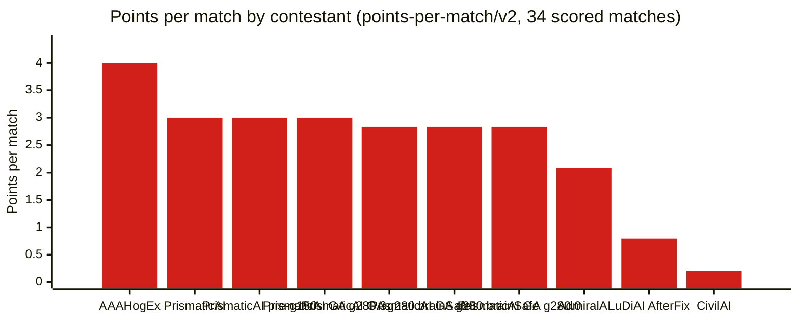
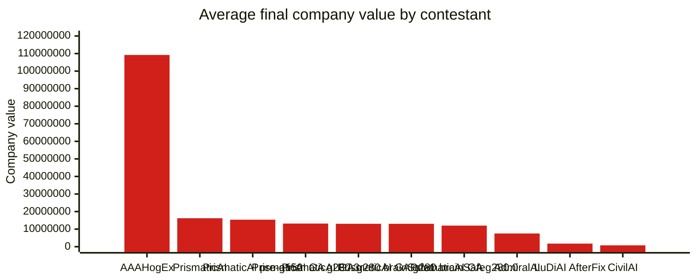
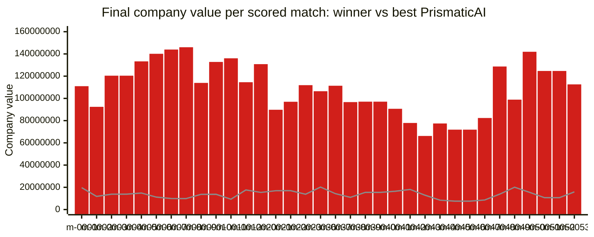
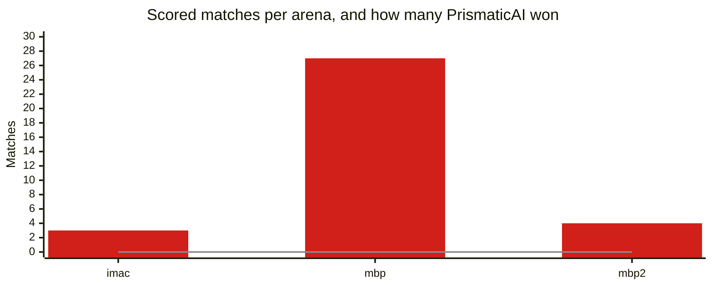

# battle-20261121T145752-37b00525

Derived from `battle-20261121T145752-37b00525.json` by `tools/research/ai-battle/battle.py report`; do not edit.

- Edition `37b00525105ea721`: PrismaticAI and referee at `ce3fcf5c2995269a2742c6c1421ca77f924cfb0f`, base set `opengfx-8.0.tar`
- 20-year free-for-all from 1960, map 256x256 temperate, breakdowns 1
- 34 scored match(es) on `imac` (20261119-master-gdf1e05e7d8), `mbp` (20261120-master-m17653b726e), `mbp2` (20261119-master-gdf1e05e7d8)
- Replays: 0 of 1 identical to their original on another arena

| # | Contestant | Played | Wins | Points | Points/match | Avg rank | Avg final value | Squirrel errors | Matches with anomalies |
|---|---|---|---|---|---|---|---|---|---|
| 1 | AAAHogEx | 34 | 34 | 136 | 4.0 | 1.0 | 109.2 M | 0 | 0 |
| 2 | PrismaticAI | 5 | 0 | 15 | 3.0 | 2.0 | 16.2 M | 0 | 0 |
| 3 | PrismaticAI pre-g150 | 5 | 0 | 15 | 3.0 | 2.0 | 15.4 M | 0 | 0 |
| 4 | PrismaticAI GA g280.3 | 6 | 0 | 18 | 3.0 | 2.0 | 13.2 M | 0 | 0 |
| 5 | PrismaticAI GA g280.brainSafe1 | 6 | 0 | 17 | 2.833 | 2.17 | 13.0 M | 0 | 0 |
| 6 | PrismaticAI GA g280.brainSafe | 6 | 0 | 17 | 2.833 | 2.17 | 13.0 M | 0 | 0 |
| 7 | PrismaticAI GA g280.0 | 6 | 0 | 17 | 2.833 | 2.17 | 12.0 M | 0 | 0 |
| 8 | AdmiralAI | 34 | 0 | 71 | 2.088 | 2.91 | 7.5 M | 0 | 1 |
| 9 | LuDiAI AfterFix | 34 | 0 | 27 | 0.794 | 4.21 | 1.7 M | 0 | 1 |
| 10 | CivilAI | 34 | 0 | 7 | 0.206 | 4.79 | 759.7 k | 0 | 5 |

<!-- battle-charts:begin -->
<!-- derived from battle-20261121T145752-37b00525.json by `battle.py render`; `battle.py check` fails when it is stale -->

<!-- battle-charts:end -->

| Seed | Original | Replay | Arenas | Identical |
|---|---|---|---|---|
| 1897744870 | m-0010 | m-0056 | imac / mbp | NO |

| Match | Arena | Seed | Winner | Value | Last | Anomalies |
|---|---|---|---|---|---|---|
| m-0001 | mbp | 1590795696 | AAAHogEx | 111.0 M | CivilAI | - |
| m-0002 | mbp | 1590795696 | AAAHogEx | 92.4 M | CivilAI | CivilAI: fleet_drop:84->49 |
| m-0003 | mbp | 1590795696 | AAAHogEx | 120.4 M | CivilAI | - |
| m-0004 | mbp | 1590795696 | AAAHogEx | 120.4 M | CivilAI | - |
| m-0005 | mbp | 1590795696 | AAAHogEx | 133.3 M | CivilAI | LuDiAI AfterFix: fleet_drop:93->59 |
| m-0006 | mbp | 1897744870 | AAAHogEx | 140.1 M | LuDiAI AfterFix | - |
| m-0007 | mbp | 1897744870 | AAAHogEx | 143.9 M | CivilAI | - |
| m-0008 | mbp | 1897744870 | AAAHogEx | 146.0 M | CivilAI | - |
| m-0009 | mbp | 1897744870 | AAAHogEx | 113.9 M | LuDiAI AfterFix | - |
| m-0010 | imac | 1897744870 | AAAHogEx | 132.8 M | CivilAI | - |
| m-0011 | imac | 1897744870 | AAAHogEx | 136.1 M | CivilAI | - |
| m-0012 | imac | 1510607482 | AAAHogEx | 114.6 M | CivilAI | - |
| m-0020 | mbp2 | 499984339 | AAAHogEx | 130.8 M | CivilAI | CivilAI: fleet_drop:54->16 |
| m-0021 | mbp2 | 499984339 | AAAHogEx | 89.8 M | LuDiAI AfterFix | - |
| m-0022 | mbp2 | 499984339 | AAAHogEx | 97.0 M | LuDiAI AfterFix | - |
| m-0023 | mbp2 | 499984339 | AAAHogEx | 111.9 M | LuDiAI AfterFix | CivilAI: fleet_drop:42->16 |
| m-0036 | mbp | 32936941 | AAAHogEx | 106.5 M | CivilAI | - |
| m-0037 | mbp | 32936941 | AAAHogEx | 111.4 M | CivilAI | AdmiralAI: fleet_drop:263->154 |
| m-0038 | mbp | 32936941 | AAAHogEx | 96.7 M | CivilAI | - |
| m-0039 | mbp | 32936941 | AAAHogEx | 97.1 M | CivilAI | - |
| m-0040 | mbp | 32936941 | AAAHogEx | 97.1 M | CivilAI | - |
| m-0041 | mbp | 32936941 | AAAHogEx | 90.6 M | CivilAI | - |
| m-0042 | mbp | 217453231 | AAAHogEx | 77.9 M | CivilAI | - |
| m-0043 | mbp | 217453231 | AAAHogEx | 66.2 M | LuDiAI AfterFix | CivilAI: fleet_drop:84->48 |
| m-0044 | mbp | 217453231 | AAAHogEx | 77.4 M | CivilAI | CivilAI: no_vehicles |
| m-0045 | mbp | 217453231 | AAAHogEx | 71.9 M | CivilAI | - |
| m-0046 | mbp | 217453231 | AAAHogEx | 71.9 M | CivilAI | - |
| m-0047 | mbp | 217453231 | AAAHogEx | 82.4 M | CivilAI | - |
| m-0048 | mbp | 678017383 | AAAHogEx | 128.7 M | CivilAI | - |
| m-0049 | mbp | 678017383 | AAAHogEx | 98.9 M | LuDiAI AfterFix | - |
| m-0050 | mbp | 678017383 | AAAHogEx | 141.9 M | CivilAI | - |
| m-0051 | mbp | 678017383 | AAAHogEx | 124.7 M | CivilAI | - |
| m-0052 | mbp | 678017383 | AAAHogEx | 124.7 M | CivilAI | - |
| m-0053 | mbp | 678017383 | AAAHogEx | 112.6 M | CivilAI | - |
| m-0056 (replay) | mbp | 1897744870 | AAAHogEx | 113.9 M | LuDiAI AfterFix | - |
