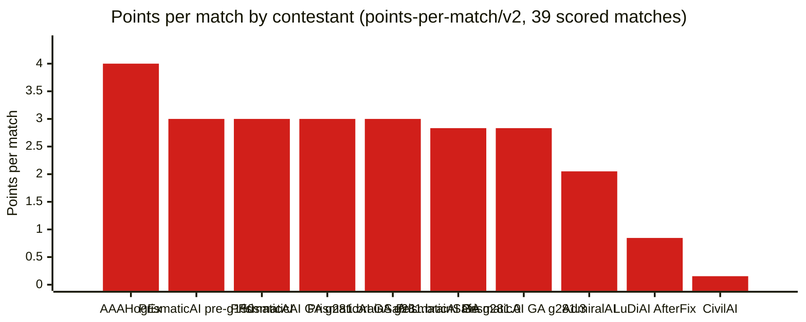
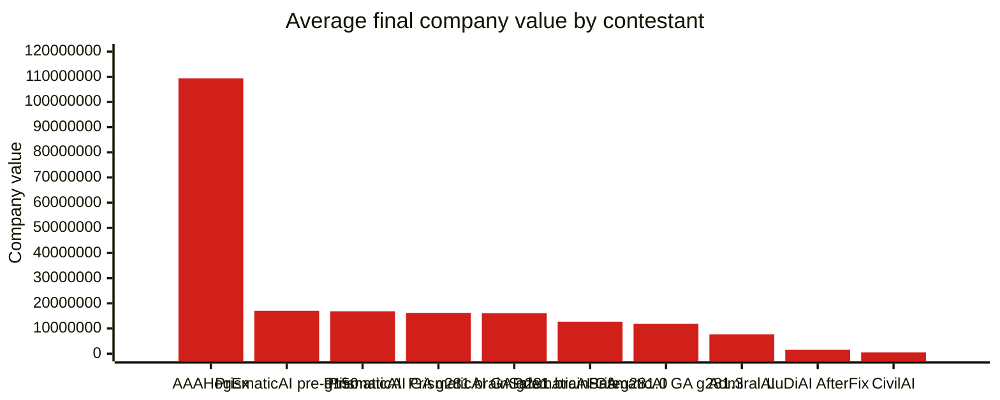
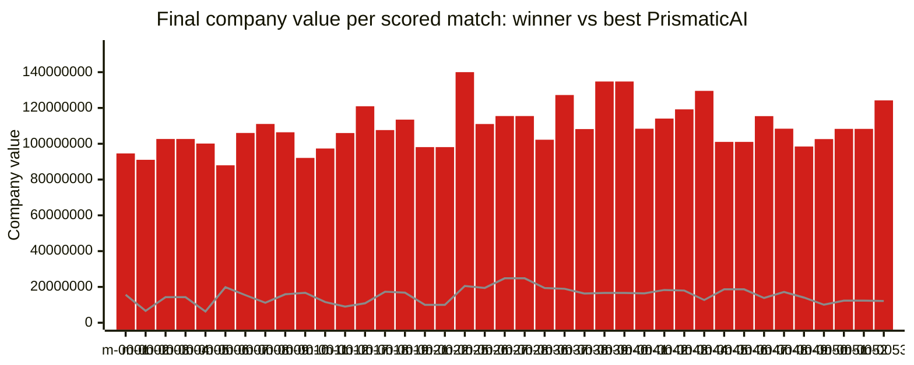
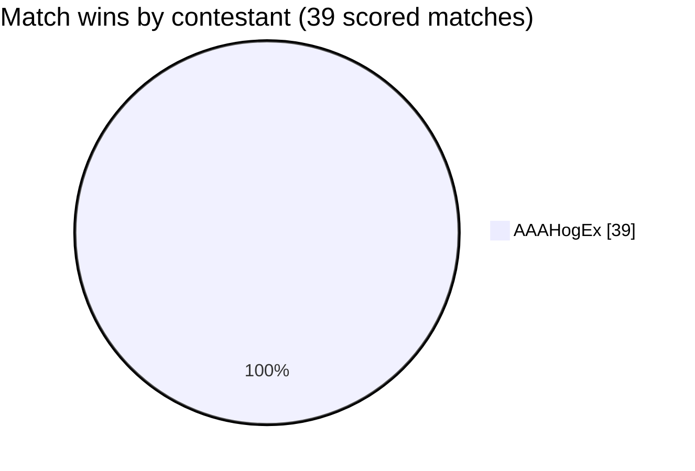
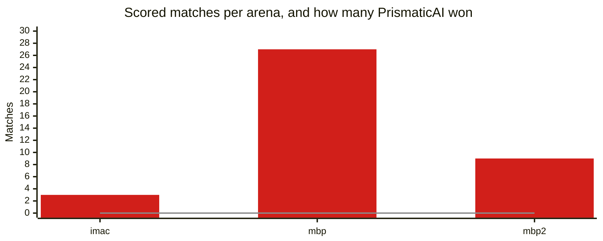

# battle-20261121T150851-7cb5110f

Derived from `battle-20261121T150851-7cb5110f.json` by `tools/research/ai-battle/battle.py report`; do not edit.

- Edition `7cb5110f1462635d`: PrismaticAI and referee at `ce3fcf5c2995269a2742c6c1421ca77f924cfb0f`, base set `opengfx-8.0.tar`
- 20-year free-for-all from 1960, map 256x256 temperate, breakdowns 1
- 39 scored match(es) on `imac` (20261119-master-gdf1e05e7d8), `mbp` (20261120-master-m17653b726e), `mbp2` (20261119-master-gdf1e05e7d8)
- Replays: 0 of 0 identical to their original on another arena

| # | Contestant | Played | Wins | Points | Points/match | Avg rank | Avg final value | Squirrel errors | Matches with anomalies |
|---|---|---|---|---|---|---|---|---|---|
| 1 | AAAHogEx | 39 | 39 | 156 | 4.0 | 1.0 | 109.3 M | 0 | 0 |
| 2 | PrismaticAI pre-g150 | 7 | 0 | 21 | 3.0 | 2.0 | 17.1 M | 0 | 0 |
| 3 | PrismaticAI | 6 | 0 | 18 | 3.0 | 2.0 | 16.8 M | 0 | 0 |
| 4 | PrismaticAI GA g281.brainSafe1 | 7 | 0 | 21 | 3.0 | 2.0 | 16.2 M | 0 | 0 |
| 5 | PrismaticAI GA g281.brainSafe | 7 | 0 | 21 | 3.0 | 2.0 | 16.1 M | 0 | 0 |
| 6 | PrismaticAI GA g281.0 | 6 | 0 | 17 | 2.833 | 2.17 | 12.7 M | 0 | 0 |
| 7 | PrismaticAI GA g281.3 | 6 | 0 | 17 | 2.833 | 2.17 | 11.8 M | 0 | 0 |
| 8 | AdmiralAI | 39 | 0 | 80 | 2.051 | 2.95 | 7.7 M | 47 | 2 |
| 9 | LuDiAI AfterFix | 39 | 0 | 33 | 0.846 | 4.15 | 1.6 M | 0 | 2 |
| 10 | CivilAI | 39 | 0 | 6 | 0.154 | 4.85 | 485.7 k | 7430 | 6 |

<!-- battle-charts:begin -->
<!-- derived from battle-20261121T150851-7cb5110f.json by `battle.py render`; `battle.py check` fails when it is stale -->

<!-- battle-charts:end -->

| Match | Arena | Seed | Winner | Value | Last | Anomalies |
|---|---|---|---|---|---|---|
| m-0001 | mbp | 1794803702 | AAAHogEx | 94.6 M | CivilAI | - |
| m-0002 | mbp | 1794803702 | AAAHogEx | 91.0 M | CivilAI | CivilAI: fleet_drop:13->8 |
| m-0003 | mbp | 1794803702 | AAAHogEx | 102.7 M | CivilAI | CivilAI: squirrel_errors:3715 |
| m-0004 | mbp | 1794803702 | AAAHogEx | 102.7 M | CivilAI | CivilAI: squirrel_errors:3715 |
| m-0005 | mbp | 1794803702 | AAAHogEx | 100.1 M | CivilAI | - |
| m-0006 | mbp | 1463872550 | AAAHogEx | 88.0 M | CivilAI | - |
| m-0007 | mbp | 1463872550 | AAAHogEx | 106.0 M | CivilAI | - |
| m-0008 | mbp | 1463872550 | AAAHogEx | 111.1 M | CivilAI | - |
| m-0009 | mbp | 1463872550 | AAAHogEx | 106.4 M | CivilAI | - |
| m-0010 | imac | 1463872550 | AAAHogEx | 92.1 M | CivilAI | - |
| m-0011 | imac | 1463872550 | AAAHogEx | 97.3 M | CivilAI | - |
| m-0012 | imac | 1400512051 | AAAHogEx | 106.0 M | CivilAI | AdmiralAI: fleet_drop:296->155 |
| m-0017 | mbp2 | 1400512051 | AAAHogEx | 121.0 M | CivilAI | - |
| m-0018 | mbp2 | 1534347378 | AAAHogEx | 107.6 M | LuDiAI AfterFix | LuDiAI AfterFix: no_vehicles |
| m-0019 | mbp2 | 1534347378 | AAAHogEx | 113.5 M | LuDiAI AfterFix | - |
| m-0021 | mbp2 | 1534347378 | AAAHogEx | 98.1 M | CivilAI | - |
| m-0022 | mbp2 | 1534347378 | AAAHogEx | 98.1 M | CivilAI | - |
| m-0025 | mbp2 | 1927961725 | AAAHogEx | 140.0 M | CivilAI | AdmiralAI: squirrel_errors:47 |
| m-0026 | mbp2 | 1927961725 | AAAHogEx | 111.0 M | CivilAI | - |
| m-0027 | mbp2 | 1927961725 | AAAHogEx | 115.5 M | LuDiAI AfterFix | - |
| m-0028 | mbp2 | 1927961725 | AAAHogEx | 115.5 M | LuDiAI AfterFix | - |
| m-0036 | mbp | 512616956 | AAAHogEx | 102.3 M | CivilAI | - |
| m-0037 | mbp | 512616956 | AAAHogEx | 127.2 M | CivilAI | - |
| m-0038 | mbp | 512616956 | AAAHogEx | 108.2 M | CivilAI | - |
| m-0039 | mbp | 512616956 | AAAHogEx | 134.8 M | CivilAI | - |
| m-0040 | mbp | 512616956 | AAAHogEx | 134.8 M | CivilAI | - |
| m-0041 | mbp | 512616956 | AAAHogEx | 108.4 M | CivilAI | - |
| m-0042 | mbp | 390900939 | AAAHogEx | 114.1 M | CivilAI | LuDiAI AfterFix: fleet_drop:77->53 |
| m-0043 | mbp | 390900939 | AAAHogEx | 119.2 M | LuDiAI AfterFix | - |
| m-0044 | mbp | 390900939 | AAAHogEx | 129.5 M | CivilAI | - |
| m-0045 | mbp | 390900939 | AAAHogEx | 101.0 M | CivilAI | - |
| m-0046 | mbp | 390900939 | AAAHogEx | 101.0 M | CivilAI | - |
| m-0047 | mbp | 390900939 | AAAHogEx | 115.4 M | CivilAI | - |
| m-0048 | mbp | 674207592 | AAAHogEx | 108.4 M | LuDiAI AfterFix | - |
| m-0049 | mbp | 674207592 | AAAHogEx | 98.5 M | CivilAI | - |
| m-0050 | mbp | 674207592 | AAAHogEx | 102.6 M | CivilAI | - |
| m-0051 | mbp | 674207592 | AAAHogEx | 108.3 M | CivilAI | CivilAI: fleet_drop:27->10 |
| m-0052 | mbp | 674207592 | AAAHogEx | 108.3 M | CivilAI | CivilAI: fleet_drop:27->10 |
| m-0053 | mbp | 674207592 | AAAHogEx | 124.2 M | CivilAI | CivilAI: fleet_drop:30->20 |
