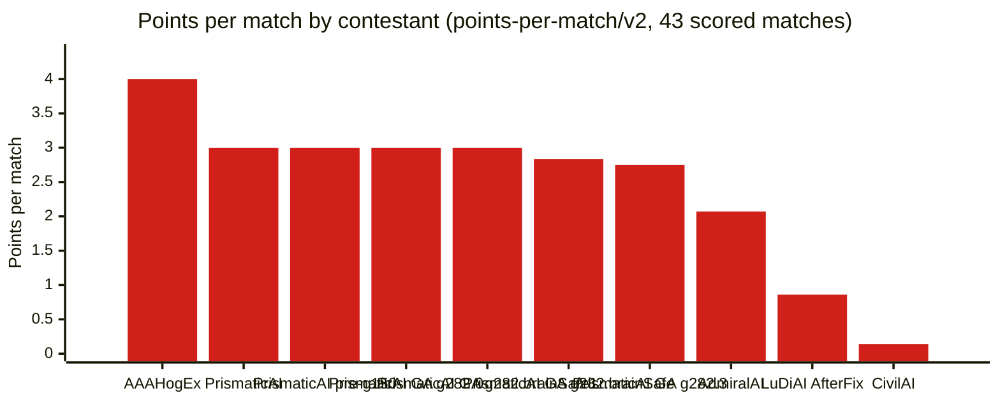
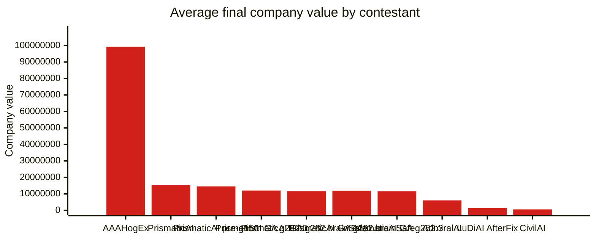
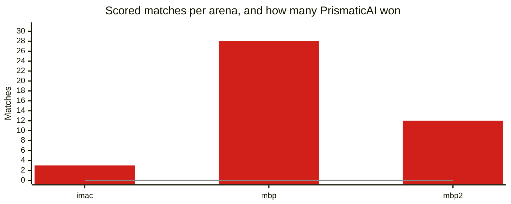

# battle-20261121T152112-2294b427

Derived from `battle-20261121T152112-2294b427.json` by `tools/research/ai-battle/battle.py report`; do not edit.

- Edition `2294b4276cc23bcf`: PrismaticAI and referee at `ce3fcf5c2995269a2742c6c1421ca77f924cfb0f`, base set `opengfx-8.0.tar`
- 20-year free-for-all from 1960, map 256x256 temperate, breakdowns 1
- 43 scored match(es) on `imac` (20261119-master-gdf1e05e7d8), `mbp` (20261120-master-m17653b726e), `mbp2` (20261119-master-gdf1e05e7d8)
- Replays: 0 of 2 identical to their original on another arena

| # | Contestant | Played | Wins | Points | Points/match | Avg rank | Avg final value | Squirrel errors | Matches with anomalies |
|---|---|---|---|---|---|---|---|---|---|
| 1 | AAAHogEx | 43 | 43 | 172 | 4.0 | 1.0 | 99.3 M | 0 | 0 |
| 2 | PrismaticAI | 7 | 0 | 21 | 3.0 | 2.0 | 15.4 M | 0 | 0 |
| 3 | PrismaticAI pre-g150 | 6 | 0 | 18 | 3.0 | 2.0 | 14.6 M | 0 | 0 |
| 4 | PrismaticAI GA g282.0 | 8 | 0 | 24 | 3.0 | 2.0 | 12.1 M | 0 | 0 |
| 5 | PrismaticAI GA g282.brainSafe1 | 8 | 0 | 24 | 3.0 | 2.0 | 11.6 M | 0 | 0 |
| 6 | PrismaticAI GA g282.brainSafe | 6 | 0 | 17 | 2.833 | 2.17 | 12.0 M | 0 | 0 |
| 7 | PrismaticAI GA g282.3 | 8 | 0 | 22 | 2.75 | 2.25 | 11.6 M | 0 | 0 |
| 8 | AdmiralAI | 43 | 0 | 89 | 2.07 | 2.93 | 6.1 M | 0 | 4 |
| 9 | LuDiAI AfterFix | 43 | 0 | 37 | 0.86 | 4.14 | 1.5 M | 0 | 2 |
| 10 | CivilAI | 43 | 0 | 6 | 0.14 | 4.86 | 628.7 k | 33 | 5 |

```mermaid
---
config:
  xyChart:
    width: 900
    height: 360
  themeVariables:
    xyChart:
      plotColorPalette: "#d11f1a, #8a8a8a, #0b0b0b, #ece4d6"
---
xychart-beta
    title "Final company value per scored match: winner vs best PrismaticAI"
    x-axis ["m-0001", "m-0002", "m-0003", "m-0004", "m-0005", "m-0006", "m-0007", "m-0008", "m-0009", "m-0010", "m-0011", "m-0012", "m-0014", "m-0015", "m-0017", "m-0018", "m-0020", "m-0021", "m-0022", "m-0023", "m-0024", "m-0025", "m-0026", "m-0028", "m-0036", "m-0037", "m-0038", "m-0039", "m-0040", "m-0041", "m-0042", "m-0043", "m-0044", "m-0045", "m-0046", "m-0047", "m-0049", "m-0050", "m-0052", "m-0053", "m-0054", "m-0058", "m-0059"]
    %% series: Winner | Best PrismaticAI
    %% links: battle-20261121T152112-2294b427.md?col=Match&filter=m-0001 | battle-20261121T152112-2294b427.md?col=Match&filter=m-0002 | battle-20261121T152112-2294b427.md?col=Match&filter=m-0003 | battle-20261121T152112-2294b427.md?col=Match&filter=m-0004 | battle-20261121T152112-2294b427.md?col=Match&filter=m-0005 | battle-20261121T152112-2294b427.md?col=Match&filter=m-0006 | battle-20261121T152112-2294b427.md?col=Match&filter=m-0007 | battle-20261121T152112-2294b427.md?col=Match&filter=m-0008 | battle-20261121T152112-2294b427.md?col=Match&filter=m-0009 | battle-20261121T152112-2294b427.md?col=Match&filter=m-0010 | battle-20261121T152112-2294b427.md?col=Match&filter=m-0011 | battle-20261121T152112-2294b427.md?col=Match&filter=m-0012 | battle-20261121T152112-2294b427.md?col=Match&filter=m-0014 | battle-20261121T152112-2294b427.md?col=Match&filter=m-0015 | battle-20261121T152112-2294b427.md?col=Match&filter=m-0017 | battle-20261121T152112-2294b427.md?col=Match&filter=m-0018 | battle-20261121T152112-2294b427.md?col=Match&filter=m-0020 | battle-20261121T152112-2294b427.md?col=Match&filter=m-0021 | battle-20261121T152112-2294b427.md?col=Match&filter=m-0022 | battle-20261121T152112-2294b427.md?col=Match&filter=m-0023 | battle-20261121T152112-2294b427.md?col=Match&filter=m-0024 | battle-20261121T152112-2294b427.md?col=Match&filter=m-0025 | battle-20261121T152112-2294b427.md?col=Match&filter=m-0026 | battle-20261121T152112-2294b427.md?col=Match&filter=m-0028 | battle-20261121T152112-2294b427.md?col=Match&filter=m-0036 | battle-20261121T152112-2294b427.md?col=Match&filter=m-0037 | battle-20261121T152112-2294b427.md?col=Match&filter=m-0038 | battle-20261121T152112-2294b427.md?col=Match&filter=m-0039 | battle-20261121T152112-2294b427.md?col=Match&filter=m-0040 | battle-20261121T152112-2294b427.md?col=Match&filter=m-0041 | battle-20261121T152112-2294b427.md?col=Match&filter=m-0042 | battle-20261121T152112-2294b427.md?col=Match&filter=m-0043 | battle-20261121T152112-2294b427.md?col=Match&filter=m-0044 | battle-20261121T152112-2294b427.md?col=Match&filter=m-0045 | battle-20261121T152112-2294b427.md?col=Match&filter=m-0046 | battle-20261121T152112-2294b427.md?col=Match&filter=m-0047 | battle-20261121T152112-2294b427.md?col=Match&filter=m-0049 | battle-20261121T152112-2294b427.md?col=Match&filter=m-0050 | battle-20261121T152112-2294b427.md?col=Match&filter=m-0052 | battle-20261121T152112-2294b427.md?col=Match&filter=m-0053 | battle-20261121T152112-2294b427.md?col=Match&filter=m-0054 | battle-20261121T152112-2294b427.md?col=Match&filter=m-0058 | battle-20261121T152112-2294b427.md?col=Match&filter=m-0059
    y-axis "Company value" 0 --> 143000000
    bar [121845940, 103314420, 89055978, 96912864, 95001974, 90856947, 87118462, 89509080, 124196799, 105588782, 106465416, 125430125, 101556633, 102578619, 112368764, 95837664, 107323152, 109636471, 92214649, 109445911, 114525929, 124663833, 103131756, 130425307, 91971492, 90497021, 129745086, 112095272, 100400527, 110974106, 51829762, 56871635, 61086630, 66370731, 65408295, 55218162, 92251383, 111733714, 109844777, 84080170, 112973988, 110830459, 115587919]
    line [15026262, 15794648, 13508517, 18427493, 11012296, 15608716, 15859869, 13832523, 15175377, 11940574, 14299401, 15840380, 11605859, 8984336, 5822300, 8815680, 8524826, 8730507, 9719860, 8465148, 16876705, 13834388, 10143699, 10655899, 20694074, 17015734, 17982765, 17937238, 16995256, 22229602, 8874392, 10532507, 7050562, 7539018, 8073803, 4439901, 15099000, 11663271, 7987559, 9376051, 20774053, 9373967, 17138202]
```

<!-- battle-charts:begin -->
<!-- derived from battle-20261121T152112-2294b427.json by `battle.py render`; `battle.py check` fails when it is stale -->

<!-- battle-charts:end -->

| Seed | Original | Replay | Arenas | Identical |
|---|---|---|---|---|
| 226591328 | m-0010 | m-0048 | imac / mbp | NO |
| 226591328 | m-0011 | m-0056 | imac / mbp | NO |

| Match | Arena | Seed | Winner | Value | Last | Anomalies |
|---|---|---|---|---|---|---|
| m-0001 | mbp | 1556514697 | AAAHogEx | 121.8 M | LuDiAI AfterFix | - |
| m-0002 | mbp | 1556514697 | AAAHogEx | 103.3 M | CivilAI | - |
| m-0003 | mbp | 1556514697 | AAAHogEx | 89.1 M | CivilAI | - |
| m-0004 | mbp | 1556514697 | AAAHogEx | 96.9 M | CivilAI | - |
| m-0005 | mbp | 1556514697 | AAAHogEx | 95.0 M | LuDiAI AfterFix | - |
| m-0006 | mbp | 226591328 | AAAHogEx | 90.9 M | CivilAI | - |
| m-0007 | mbp | 226591328 | AAAHogEx | 87.1 M | CivilAI | - |
| m-0008 | mbp | 226591328 | AAAHogEx | 89.5 M | CivilAI | - |
| m-0009 | mbp | 226591328 | AAAHogEx | 124.2 M | LuDiAI AfterFix | - |
| m-0010 | imac | 226591328 | AAAHogEx | 105.6 M | CivilAI | - |
| m-0011 | imac | 226591328 | AAAHogEx | 106.5 M | CivilAI | - |
| m-0012 | imac | 276497236 | AAAHogEx | 125.4 M | CivilAI | - |
| m-0014 | mbp2 | 276497236 | AAAHogEx | 101.6 M | CivilAI | - |
| m-0015 | mbp2 | 276497236 | AAAHogEx | 102.6 M | CivilAI | - |
| m-0017 | mbp2 | 276497236 | AAAHogEx | 112.4 M | CivilAI | - |
| m-0018 | mbp2 | 1370958790 | AAAHogEx | 95.8 M | CivilAI | - |
| m-0020 | mbp2 | 1370958790 | AAAHogEx | 107.3 M | CivilAI | - |
| m-0021 | mbp2 | 1370958790 | AAAHogEx | 109.6 M | CivilAI | - |
| m-0022 | mbp2 | 1370958790 | AAAHogEx | 92.2 M | CivilAI | - |
| m-0023 | mbp2 | 1370958790 | AAAHogEx | 109.4 M | CivilAI | - |
| m-0024 | mbp2 | 1938557809 | AAAHogEx | 114.5 M | CivilAI | - |
| m-0025 | mbp2 | 1938557809 | AAAHogEx | 124.7 M | CivilAI | AdmiralAI: fleet_drop:160->87 |
| m-0026 | mbp2 | 1938557809 | AAAHogEx | 103.1 M | CivilAI | CivilAI: fleet_drop:37->24 |
| m-0028 | mbp2 | 1938557809 | AAAHogEx | 130.4 M | CivilAI | CivilAI: fleet_drop:35->24 |
| m-0036 | mbp | 241769776 | AAAHogEx | 92.0 M | CivilAI | - |
| m-0037 | mbp | 241769776 | AAAHogEx | 90.5 M | CivilAI | - |
| m-0038 | mbp | 241769776 | AAAHogEx | 129.7 M | CivilAI | - |
| m-0039 | mbp | 241769776 | AAAHogEx | 112.1 M | CivilAI | - |
| m-0040 | mbp | 241769776 | AAAHogEx | 100.4 M | CivilAI | - |
| m-0041 | mbp | 241769776 | AAAHogEx | 111.0 M | CivilAI | - |
| m-0042 | mbp | 270068811 | AAAHogEx | 51.8 M | CivilAI | AdmiralAI: fleet_drop:485->304 |
| m-0043 | mbp | 270068811 | AAAHogEx | 56.9 M | CivilAI | LuDiAI AfterFix: fleet_drop:104->59 |
| m-0044 | mbp | 270068811 | AAAHogEx | 61.1 M | CivilAI | AdmiralAI: fleet_drop:457->302; CivilAI: fleet_drop:14->9 |
| m-0045 | mbp | 270068811 | AAAHogEx | 66.4 M | CivilAI | - |
| m-0046 | mbp | 270068811 | AAAHogEx | 65.4 M | CivilAI | - |
| m-0047 | mbp | 270068811 | AAAHogEx | 55.2 M | CivilAI | LuDiAI AfterFix: fleet_drop:73->40 |
| m-0048 (replay) | mbp | 226591328 | AAAHogEx | 102.6 M | CivilAI | - |
| m-0049 | mbp | 1630532223 | AAAHogEx | 92.3 M | CivilAI | AdmiralAI: fleet_drop:139->94 |
| m-0050 | mbp | 1630532223 | AAAHogEx | 111.7 M | LuDiAI AfterFix | - |
| m-0052 | mbp | 1630532223 | AAAHogEx | 109.8 M | LuDiAI AfterFix | - |
| m-0053 | mbp | 1630532223 | AAAHogEx | 84.1 M | LuDiAI AfterFix | CivilAI: fleet_drop:63->38 |
| m-0054 | mbp | 1044020808 | AAAHogEx | 113.0 M | CivilAI | CivilAI: squirrel_errors:33 |
| m-0056 (replay) | mbp | 226591328 | AAAHogEx | 107.0 M | CivilAI | - |
| m-0058 | mbp | 1044020808 | AAAHogEx | 110.8 M | CivilAI | - |
| m-0059 | mbp | 1044020808 | AAAHogEx | 115.6 M | CivilAI | - |
