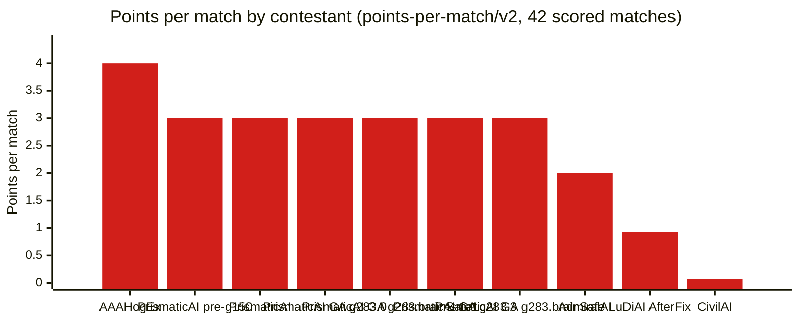
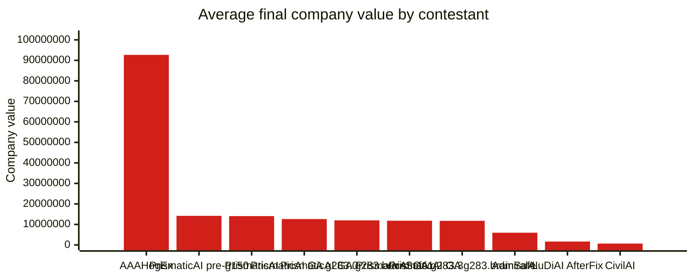
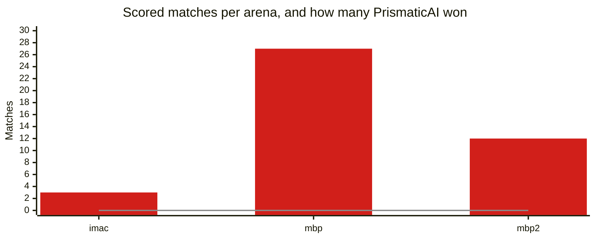

# battle-20261121T153205-ed3b5162

Derived from `battle-20261121T153205-ed3b5162.json` by `tools/research/ai-battle/battle.py report`; do not edit.

- Edition `ed3b5162caf43cfd`: PrismaticAI and referee at `ce3fcf5c2995269a2742c6c1421ca77f924cfb0f`, base set `opengfx-8.0.tar`
- 20-year free-for-all from 1960, map 256x256 temperate, breakdowns 1
- 42 scored match(es) on `imac` (20261119-master-gdf1e05e7d8), `mbp` (20261120-master-m17653b726e), `mbp2` (20261119-master-gdf1e05e7d8)
- Replays: 0 of 0 identical to their original on another arena

| # | Contestant | Played | Wins | Points | Points/match | Avg rank | Avg final value | Squirrel errors | Matches with anomalies |
|---|---|---|---|---|---|---|---|---|---|
| 1 | AAAHogEx | 42 | 42 | 168 | 4.0 | 1.0 | 92.7 M | 0 | 0 |
| 2 | PrismaticAI pre-g150 | 7 | 0 | 21 | 3.0 | 2.0 | 14.2 M | 0 | 0 |
| 3 | PrismaticAI | 6 | 0 | 18 | 3.0 | 2.0 | 14.1 M | 0 | 0 |
| 4 | PrismaticAI GA g283.0 | 8 | 0 | 24 | 3.0 | 2.0 | 12.6 M | 0 | 0 |
| 5 | PrismaticAI GA g283.brainSafe1 | 7 | 0 | 21 | 3.0 | 2.0 | 12.0 M | 0 | 0 |
| 6 | PrismaticAI GA g283.3 | 6 | 0 | 18 | 3.0 | 2.0 | 11.8 M | 0 | 0 |
| 7 | PrismaticAI GA g283.brainSafe | 8 | 0 | 24 | 3.0 | 2.0 | 11.8 M | 0 | 0 |
| 8 | AdmiralAI | 42 | 0 | 84 | 2.0 | 3.0 | 5.9 M | 47 | 1 |
| 9 | LuDiAI AfterFix | 42 | 0 | 39 | 0.929 | 4.07 | 1.6 M | 0 | 2 |
| 10 | CivilAI | 42 | 0 | 3 | 0.071 | 4.93 | 650.9 k | 0 | 15 |

```mermaid
---
config:
  xyChart:
    width: 900
    height: 360
  themeVariables:
    xyChart:
      plotColorPalette: "#d11f1a, #8a8a8a, #0b0b0b, #ece4d6"
---
xychart-beta
    title "Final company value per scored match: winner vs best PrismaticAI"
    x-axis ["m-0001", "m-0002", "m-0003", "m-0004", "m-0005", "m-0006", "m-0007", "m-0008", "m-0009", "m-0010", "m-0011", "m-0012", "m-0013", "m-0014", "m-0015", "m-0016", "m-0017", "m-0020", "m-0021", "m-0022", "m-0023", "m-0026", "m-0027", "m-0028", "m-0036", "m-0037", "m-0038", "m-0039", "m-0040", "m-0041", "m-0042", "m-0043", "m-0044", "m-0045", "m-0046", "m-0047", "m-0048", "m-0049", "m-0050", "m-0051", "m-0054", "m-0055"]
    %% series: Winner | Best PrismaticAI
    %% links: battle-20261121T153205-ed3b5162.md?col=Match&filter=m-0001 | battle-20261121T153205-ed3b5162.md?col=Match&filter=m-0002 | battle-20261121T153205-ed3b5162.md?col=Match&filter=m-0003 | battle-20261121T153205-ed3b5162.md?col=Match&filter=m-0004 | battle-20261121T153205-ed3b5162.md?col=Match&filter=m-0005 | battle-20261121T153205-ed3b5162.md?col=Match&filter=m-0006 | battle-20261121T153205-ed3b5162.md?col=Match&filter=m-0007 | battle-20261121T153205-ed3b5162.md?col=Match&filter=m-0008 | battle-20261121T153205-ed3b5162.md?col=Match&filter=m-0009 | battle-20261121T153205-ed3b5162.md?col=Match&filter=m-0010 | battle-20261121T153205-ed3b5162.md?col=Match&filter=m-0011 | battle-20261121T153205-ed3b5162.md?col=Match&filter=m-0012 | battle-20261121T153205-ed3b5162.md?col=Match&filter=m-0013 | battle-20261121T153205-ed3b5162.md?col=Match&filter=m-0014 | battle-20261121T153205-ed3b5162.md?col=Match&filter=m-0015 | battle-20261121T153205-ed3b5162.md?col=Match&filter=m-0016 | battle-20261121T153205-ed3b5162.md?col=Match&filter=m-0017 | battle-20261121T153205-ed3b5162.md?col=Match&filter=m-0020 | battle-20261121T153205-ed3b5162.md?col=Match&filter=m-0021 | battle-20261121T153205-ed3b5162.md?col=Match&filter=m-0022 | battle-20261121T153205-ed3b5162.md?col=Match&filter=m-0023 | battle-20261121T153205-ed3b5162.md?col=Match&filter=m-0026 | battle-20261121T153205-ed3b5162.md?col=Match&filter=m-0027 | battle-20261121T153205-ed3b5162.md?col=Match&filter=m-0028 | battle-20261121T153205-ed3b5162.md?col=Match&filter=m-0036 | battle-20261121T153205-ed3b5162.md?col=Match&filter=m-0037 | battle-20261121T153205-ed3b5162.md?col=Match&filter=m-0038 | battle-20261121T153205-ed3b5162.md?col=Match&filter=m-0039 | battle-20261121T153205-ed3b5162.md?col=Match&filter=m-0040 | battle-20261121T153205-ed3b5162.md?col=Match&filter=m-0041 | battle-20261121T153205-ed3b5162.md?col=Match&filter=m-0042 | battle-20261121T153205-ed3b5162.md?col=Match&filter=m-0043 | battle-20261121T153205-ed3b5162.md?col=Match&filter=m-0044 | battle-20261121T153205-ed3b5162.md?col=Match&filter=m-0045 | battle-20261121T153205-ed3b5162.md?col=Match&filter=m-0046 | battle-20261121T153205-ed3b5162.md?col=Match&filter=m-0047 | battle-20261121T153205-ed3b5162.md?col=Match&filter=m-0048 | battle-20261121T153205-ed3b5162.md?col=Match&filter=m-0049 | battle-20261121T153205-ed3b5162.md?col=Match&filter=m-0050 | battle-20261121T153205-ed3b5162.md?col=Match&filter=m-0051 | battle-20261121T153205-ed3b5162.md?col=Match&filter=m-0054 | battle-20261121T153205-ed3b5162.md?col=Match&filter=m-0055
    y-axis "Company value" 0 --> 140000000
    bar [108721921, 125396266, 117079954, 106911763, 127328345, 65136751, 96713052, 83676210, 70224589, 84526281, 94619168, 77541297, 92748622, 106057950, 99630035, 106057950, 94649234, 101171570, 108205992, 101171570, 101174706, 74508269, 80533087, 74508269, 91807913, 78068983, 65656057, 65891177, 65656057, 79466292, 109592189, 97392954, 97634495, 92287205, 97634495, 106772119, 102650279, 93992118, 102547145, 112234536, 60450900, 73956478]
    line [19831840, 19538441, 14581208, 17481563, 20210851, 11206764, 9655799, 10926249, 13602228, 11290833, 9506361, 10301933, 5456871, 7363827, 5730404, 7363827, 7187823, 7946755, 6666571, 7946755, 9024414, 12840382, 12998758, 12840382, 13507441, 8385040, 9918050, 10900084, 9918050, 10059747, 19352460, 21825692, 17000623, 16815474, 17000623, 14826992, 18245913, 16039072, 15378703, 12736354, 11694795, 18008407]
```

<!-- battle-charts:begin -->
<!-- derived from battle-20261121T153205-ed3b5162.json by `battle.py render`; `battle.py check` fails when it is stale -->

<!-- battle-charts:end -->

| Match | Arena | Seed | Winner | Value | Last | Anomalies |
|---|---|---|---|---|---|---|
| m-0001 | mbp | 465193006 | AAAHogEx | 108.7 M | CivilAI | - |
| m-0002 | mbp | 465193006 | AAAHogEx | 125.4 M | CivilAI | - |
| m-0003 | mbp | 465193006 | AAAHogEx | 117.1 M | LuDiAI AfterFix | - |
| m-0004 | mbp | 465193006 | AAAHogEx | 106.9 M | CivilAI | AdmiralAI: squirrel_errors:47; CivilAI: fleet_drop:23->16 |
| m-0005 | mbp | 465193006 | AAAHogEx | 127.3 M | CivilAI | - |
| m-0006 | mbp | 1822395479 | AAAHogEx | 65.1 M | CivilAI | - |
| m-0007 | mbp | 1822395479 | AAAHogEx | 96.7 M | LuDiAI AfterFix | - |
| m-0008 | mbp | 1822395479 | AAAHogEx | 83.7 M | CivilAI | - |
| m-0009 | mbp | 1822395479 | AAAHogEx | 70.2 M | CivilAI | - |
| m-0010 | imac | 1822395479 | AAAHogEx | 84.5 M | CivilAI | CivilAI: fleet_drop:69->18 |
| m-0011 | imac | 1822395479 | AAAHogEx | 94.6 M | CivilAI | CivilAI: fleet_drop:85->59 |
| m-0012 | imac | 1763695483 | AAAHogEx | 77.5 M | CivilAI | - |
| m-0013 | mbp2 | 1763695483 | AAAHogEx | 92.7 M | CivilAI | - |
| m-0014 | mbp2 | 1763695483 | AAAHogEx | 106.1 M | CivilAI | - |
| m-0015 | mbp2 | 1763695483 | AAAHogEx | 99.6 M | CivilAI | CivilAI: fleet_drop:27->15 |
| m-0016 | mbp2 | 1763695483 | AAAHogEx | 106.1 M | CivilAI | - |
| m-0017 | mbp2 | 1763695483 | AAAHogEx | 94.6 M | CivilAI | CivilAI: fleet_drop:26->18 |
| m-0020 | mbp2 | 628346434 | AAAHogEx | 101.2 M | CivilAI | CivilAI: fleet_drop:32->20 |
| m-0021 | mbp2 | 628346434 | AAAHogEx | 108.2 M | CivilAI | - |
| m-0022 | mbp2 | 628346434 | AAAHogEx | 101.2 M | CivilAI | CivilAI: fleet_drop:32->20 |
| m-0023 | mbp2 | 628346434 | AAAHogEx | 101.2 M | CivilAI | - |
| m-0026 | mbp2 | 1025115410 | AAAHogEx | 74.5 M | CivilAI | CivilAI: fleet_drop:22->7 |
| m-0027 | mbp2 | 1025115410 | AAAHogEx | 80.5 M | CivilAI | - |
| m-0028 | mbp2 | 1025115410 | AAAHogEx | 74.5 M | CivilAI | CivilAI: fleet_drop:22->7 |
| m-0036 | mbp | 1850794534 | AAAHogEx | 91.8 M | CivilAI | - |
| m-0037 | mbp | 1850794534 | AAAHogEx | 78.1 M | CivilAI | CivilAI: fleet_drop:58->38 |
| m-0038 | mbp | 1850794534 | AAAHogEx | 65.7 M | CivilAI | - |
| m-0039 | mbp | 1850794534 | AAAHogEx | 65.9 M | CivilAI | CivilAI: fleet_drop:50->21 |
| m-0040 | mbp | 1850794534 | AAAHogEx | 65.7 M | CivilAI | - |
| m-0041 | mbp | 1850794534 | AAAHogEx | 79.5 M | CivilAI | - |
| m-0042 | mbp | 109884667 | AAAHogEx | 109.6 M | CivilAI | - |
| m-0043 | mbp | 109884667 | AAAHogEx | 97.4 M | CivilAI | - |
| m-0044 | mbp | 109884667 | AAAHogEx | 97.6 M | CivilAI | CivilAI: fleet_drop:85->55 |
| m-0045 | mbp | 109884667 | AAAHogEx | 92.3 M | CivilAI | - |
| m-0046 | mbp | 109884667 | AAAHogEx | 97.6 M | CivilAI | CivilAI: fleet_drop:85->55 |
| m-0047 | mbp | 109884667 | AAAHogEx | 106.8 M | CivilAI | CivilAI: fleet_drop:85->51 |
| m-0048 | mbp | 73681883 | AAAHogEx | 102.7 M | CivilAI | CivilAI: fleet_drop:77->16 |
| m-0049 | mbp | 73681883 | AAAHogEx | 94.0 M | CivilAI | - |
| m-0050 | mbp | 73681883 | AAAHogEx | 102.5 M | CivilAI | LuDiAI AfterFix: fleet_drop:159->93 |
| m-0051 | mbp | 73681883 | AAAHogEx | 112.2 M | LuDiAI AfterFix | LuDiAI AfterFix: fleet_drop:76->42 |
| m-0054 | mbp | 678759943 | AAAHogEx | 60.5 M | CivilAI | - |
| m-0055 | mbp | 678759943 | AAAHogEx | 74.0 M | CivilAI | - |
