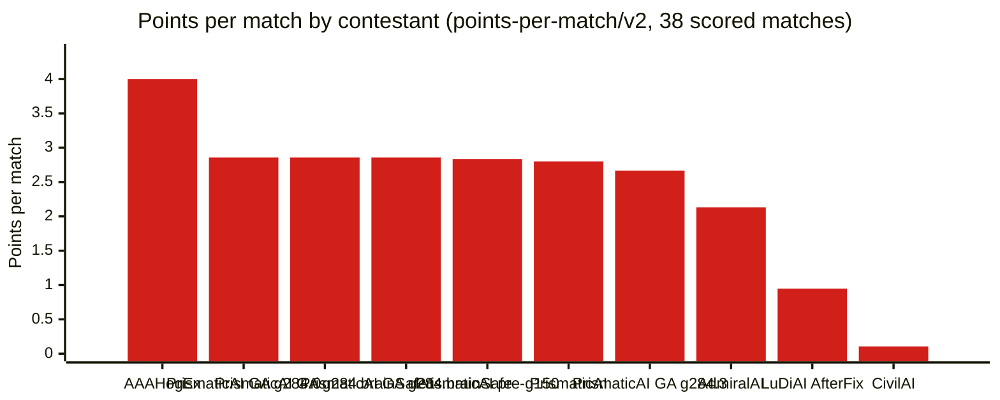
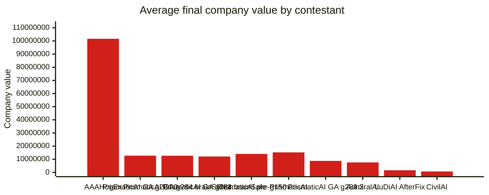
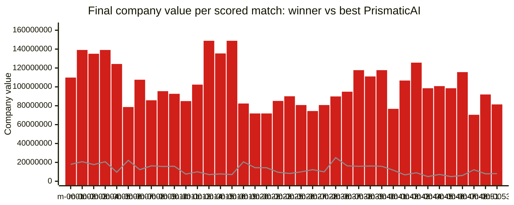
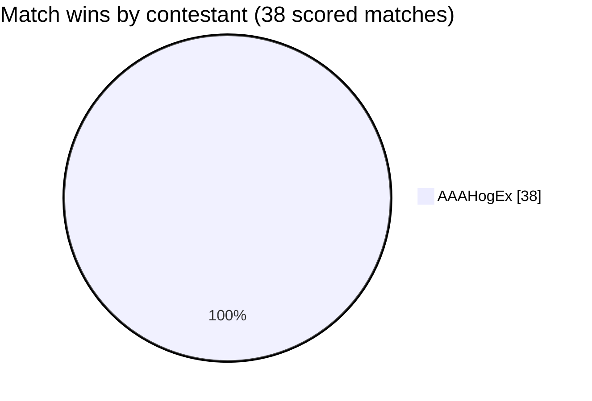
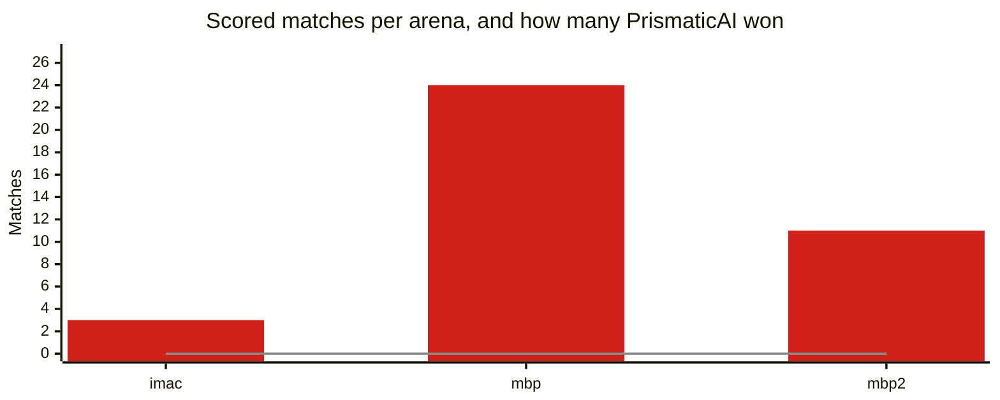

# battle-20261121T154319-a2edcad6

Derived from `battle-20261121T154319-a2edcad6.json` by `tools/research/ai-battle/battle.py report`; do not edit.

- Edition `a2edcad61a88495f`: PrismaticAI and referee at `ce3fcf5c2995269a2742c6c1421ca77f924cfb0f`, base set `opengfx-8.0.tar`
- 20-year free-for-all from 1960, map 256x256 temperate, breakdowns 1
- 38 scored match(es) on `imac` (20261119-master-gdf1e05e7d8), `mbp` (20261120-master-m17653b726e), `mbp2` (20261119-master-gdf1e05e7d8)
- Replays: 0 of 0 identical to their original on another arena

| # | Contestant | Played | Wins | Points | Points/match | Avg rank | Avg final value | Squirrel errors | Matches with anomalies |
|---|---|---|---|---|---|---|---|---|---|
| 1 | AAAHogEx | 38 | 38 | 152 | 4.0 | 1.0 | 101.6 M | 0 | 0 |
| 2 | PrismaticAI GA g284.0 | 7 | 0 | 20 | 2.857 | 2.14 | 12.8 M | 0 | 0 |
| 3 | PrismaticAI GA g284.brainSafe1 | 7 | 0 | 20 | 2.857 | 2.14 | 12.7 M | 0 | 0 |
| 4 | PrismaticAI GA g284.brainSafe | 7 | 0 | 20 | 2.857 | 2.14 | 12.1 M | 0 | 0 |
| 5 | PrismaticAI pre-g150 | 6 | 0 | 17 | 2.833 | 2.17 | 14.1 M | 0 | 0 |
| 6 | PrismaticAI | 5 | 0 | 14 | 2.8 | 2.2 | 15.2 M | 0 | 0 |
| 7 | PrismaticAI GA g284.3 | 6 | 0 | 16 | 2.667 | 2.33 | 8.8 M | 0 | 0 |
| 8 | AdmiralAI | 38 | 0 | 81 | 2.132 | 2.87 | 7.6 M | 0 | 1 |
| 9 | LuDiAI AfterFix | 38 | 0 | 36 | 0.947 | 4.05 | 1.6 M | 0 | 0 |
| 10 | CivilAI | 38 | 0 | 4 | 0.105 | 4.89 | 720.7 k | 0 | 8 |

<!-- battle-charts:begin -->
<!-- derived from battle-20261121T154319-a2edcad6.json by `battle.py render`; `battle.py check` fails when it is stale -->

<!-- battle-charts:end -->

| Match | Arena | Seed | Winner | Value | Last | Anomalies |
|---|---|---|---|---|---|---|
| m-0001 | mbp | 1531789281 | AAAHogEx | 109.8 M | CivilAI | CivilAI: fleet_drop:95->48 |
| m-0002 | mbp | 1531789281 | AAAHogEx | 139.1 M | CivilAI | - |
| m-0003 | mbp | 1531789281 | AAAHogEx | 135.1 M | CivilAI | - |
| m-0004 | mbp | 1531789281 | AAAHogEx | 139.1 M | CivilAI | - |
| m-0005 | mbp | 1531789281 | AAAHogEx | 124.3 M | CivilAI | - |
| m-0006 | mbp | 888654609 | AAAHogEx | 78.6 M | CivilAI | - |
| m-0007 | mbp | 888654609 | AAAHogEx | 107.5 M | LuDiAI AfterFix | - |
| m-0008 | mbp | 888654609 | AAAHogEx | 85.8 M | LuDiAI AfterFix | - |
| m-0009 | mbp | 888654609 | AAAHogEx | 95.4 M | CivilAI | - |
| m-0010 | imac | 888654609 | AAAHogEx | 92.6 M | CivilAI | - |
| m-0011 | imac | 888654609 | AAAHogEx | 84.9 M | CivilAI | - |
| m-0012 | imac | 457754782 | AAAHogEx | 102.4 M | LuDiAI AfterFix | - |
| m-0014 | mbp2 | 457754782 | AAAHogEx | 148.8 M | CivilAI | - |
| m-0015 | mbp2 | 457754782 | AAAHogEx | 135.4 M | CivilAI | - |
| m-0016 | mbp2 | 457754782 | AAAHogEx | 148.8 M | CivilAI | - |
| m-0019 | mbp2 | 1453736560 | AAAHogEx | 82.4 M | CivilAI | - |
| m-0020 | mbp2 | 1453736560 | AAAHogEx | 71.8 M | CivilAI | CivilAI: fleet_drop:12->8 |
| m-0022 | mbp2 | 1453736560 | AAAHogEx | 71.8 M | CivilAI | CivilAI: fleet_drop:12->8 |
| m-0023 | mbp2 | 1453736560 | AAAHogEx | 85.1 M | CivilAI | CivilAI: fleet_drop:55->14 |
| m-0025 | mbp2 | 1810619931 | AAAHogEx | 90.0 M | CivilAI | - |
| m-0026 | mbp2 | 1810619931 | AAAHogEx | 80.7 M | CivilAI | CivilAI: fleet_drop:22->8 |
| m-0027 | mbp2 | 1810619931 | AAAHogEx | 74.4 M | CivilAI | CivilAI: fleet_drop:21->6 |
| m-0028 | mbp2 | 1810619931 | AAAHogEx | 80.7 M | CivilAI | CivilAI: fleet_drop:22->8 |
| m-0036 | mbp | 402407313 | AAAHogEx | 89.9 M | CivilAI | - |
| m-0037 | mbp | 402407313 | AAAHogEx | 94.9 M | CivilAI | - |
| m-0038 | mbp | 402407313 | AAAHogEx | 117.7 M | CivilAI | - |
| m-0039 | mbp | 402407313 | AAAHogEx | 111.0 M | CivilAI | CivilAI: fleet_drop:24->11 |
| m-0040 | mbp | 402407313 | AAAHogEx | 117.7 M | CivilAI | - |
| m-0041 | mbp | 402407313 | AAAHogEx | 76.7 M | LuDiAI AfterFix | - |
| m-0042 | mbp | 981032092 | AAAHogEx | 106.7 M | CivilAI | - |
| m-0043 | mbp | 981032092 | AAAHogEx | 125.6 M | CivilAI | AdmiralAI: fleet_drop:168->100 |
| m-0044 | mbp | 981032092 | AAAHogEx | 98.5 M | CivilAI | - |
| m-0045 | mbp | 981032092 | AAAHogEx | 100.8 M | CivilAI | - |
| m-0046 | mbp | 981032092 | AAAHogEx | 98.5 M | CivilAI | - |
| m-0047 | mbp | 981032092 | AAAHogEx | 115.6 M | CivilAI | - |
| m-0048 | mbp | 32795622 | AAAHogEx | 70.4 M | CivilAI | - |
| m-0051 | mbp | 32795622 | AAAHogEx | 91.9 M | CivilAI | - |
| m-0053 | mbp | 32795622 | AAAHogEx | 81.4 M | CivilAI | - |
