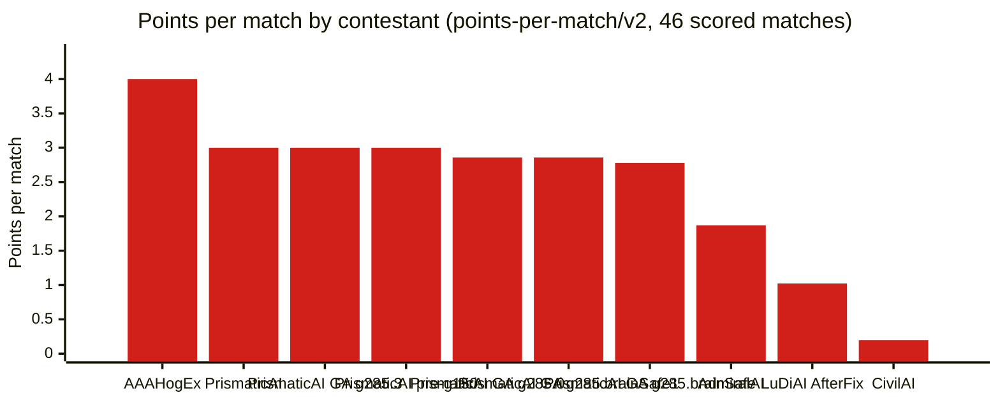
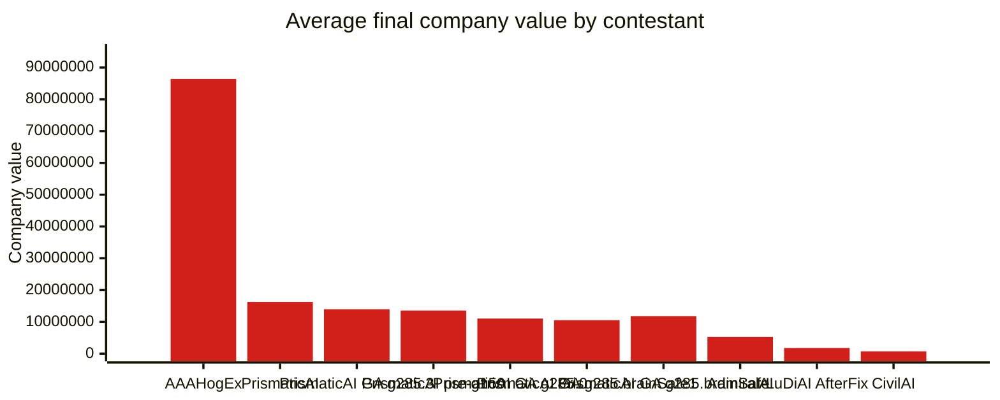
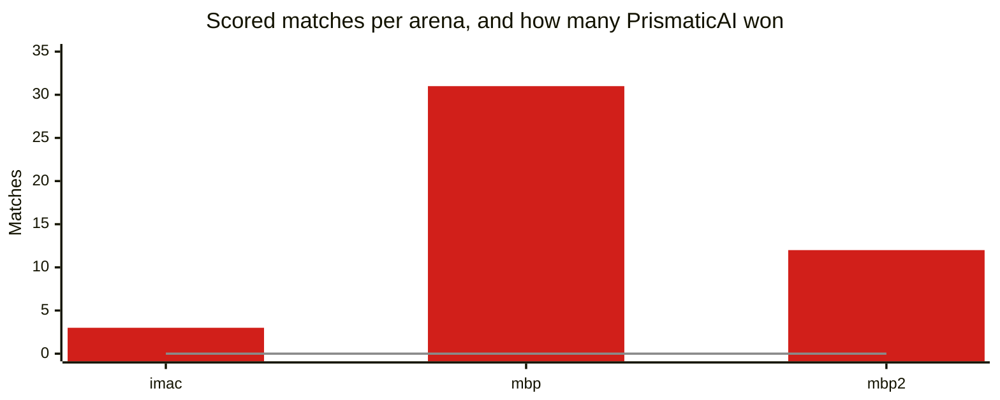

# battle-20261121T160337-9529abff

Derived from `battle-20261121T160337-9529abff.json` by `tools/research/ai-battle/battle.py report`; do not edit.

- Edition `9529abff09d1f074`: PrismaticAI and referee at `c3e8a705e21596bbdc0536482373eb176e5e9d8b`, base set `opengfx-8.0.tar`
- 20-year free-for-all from 1960, map 256x256 temperate, breakdowns 1
- 46 scored match(es) on `imac` (20261119-master-gdf1e05e7d8), `mbp` (20261120-master-m17653b726e), `mbp2` (20261119-master-gdf1e05e7d8)
- Replays: 0 of 1 identical to their original on another arena

| # | Contestant | Played | Wins | Points | Points/match | Avg rank | Avg final value | Squirrel errors | Matches with anomalies |
|---|---|---|---|---|---|---|---|---|---|
| 1 | AAAHogEx | 46 | 46 | 184 | 4.0 | 1.0 | 86.4 M | 68 | 1 |
| 2 | PrismaticAI | 9 | 0 | 27 | 3.0 | 2.0 | 16.3 M | 0 | 0 |
| 3 | PrismaticAI GA g285.3 | 6 | 0 | 18 | 3.0 | 2.0 | 14.0 M | 0 | 0 |
| 4 | PrismaticAI pre-g150 | 8 | 0 | 24 | 3.0 | 2.0 | 13.6 M | 0 | 0 |
| 5 | PrismaticAI GA g285.0 | 7 | 0 | 20 | 2.857 | 2.14 | 11.0 M | 0 | 0 |
| 6 | PrismaticAI GA g285.brainSafe1 | 7 | 0 | 20 | 2.857 | 2.14 | 10.5 M | 0 | 0 |
| 7 | PrismaticAI GA g285.brainSafe | 9 | 0 | 25 | 2.778 | 2.22 | 11.8 M | 0 | 0 |
| 8 | AdmiralAI | 46 | 0 | 86 | 1.87 | 3.13 | 5.3 M | 72 | 2 |
| 9 | LuDiAI AfterFix | 46 | 0 | 47 | 1.022 | 3.98 | 1.8 M | 0 | 0 |
| 10 | CivilAI | 46 | 0 | 9 | 0.196 | 4.8 | 741.5 k | 0 | 8 |

```mermaid
---
config:
  xyChart:
    width: 900
    height: 360
  themeVariables:
    xyChart:
      plotColorPalette: "#d11f1a, #8a8a8a, #0b0b0b, #ece4d6"
---
xychart-beta
    title "Final company value per scored match: winner vs best PrismaticAI"
    x-axis ["m-0001", "m-0002", "m-0003", "m-0004", "m-0005", "m-0006", "m-0007", "m-0008", "m-0009", "m-0010", "m-0011", "m-0012", "m-0013", "m-0015", "m-0018", "m-0019", "m-0020", "m-0021", "m-0023", "m-0024", "m-0025", "m-0026", "m-0027", "m-0028", "m-0036", "m-0037", "m-0038", "m-0039", "m-0040", "m-0041", "m-0042", "m-0043", "m-0044", "m-0045", "m-0046", "m-0047", "m-0048", "m-0049", "m-0050", "m-0051", "m-0052", "m-0053", "m-0054", "m-0057", "m-0058", "m-0060"]
    %% series: Winner | Best PrismaticAI
    %% links: battle-20261121T160337-9529abff.md?col=Match&filter=m-0001 | battle-20261121T160337-9529abff.md?col=Match&filter=m-0002 | battle-20261121T160337-9529abff.md?col=Match&filter=m-0003 | battle-20261121T160337-9529abff.md?col=Match&filter=m-0004 | battle-20261121T160337-9529abff.md?col=Match&filter=m-0005 | battle-20261121T160337-9529abff.md?col=Match&filter=m-0006 | battle-20261121T160337-9529abff.md?col=Match&filter=m-0007 | battle-20261121T160337-9529abff.md?col=Match&filter=m-0008 | battle-20261121T160337-9529abff.md?col=Match&filter=m-0009 | battle-20261121T160337-9529abff.md?col=Match&filter=m-0010 | battle-20261121T160337-9529abff.md?col=Match&filter=m-0011 | battle-20261121T160337-9529abff.md?col=Match&filter=m-0012 | battle-20261121T160337-9529abff.md?col=Match&filter=m-0013 | battle-20261121T160337-9529abff.md?col=Match&filter=m-0015 | battle-20261121T160337-9529abff.md?col=Match&filter=m-0018 | battle-20261121T160337-9529abff.md?col=Match&filter=m-0019 | battle-20261121T160337-9529abff.md?col=Match&filter=m-0020 | battle-20261121T160337-9529abff.md?col=Match&filter=m-0021 | battle-20261121T160337-9529abff.md?col=Match&filter=m-0023 | battle-20261121T160337-9529abff.md?col=Match&filter=m-0024 | battle-20261121T160337-9529abff.md?col=Match&filter=m-0025 | battle-20261121T160337-9529abff.md?col=Match&filter=m-0026 | battle-20261121T160337-9529abff.md?col=Match&filter=m-0027 | battle-20261121T160337-9529abff.md?col=Match&filter=m-0028 | battle-20261121T160337-9529abff.md?col=Match&filter=m-0036 | battle-20261121T160337-9529abff.md?col=Match&filter=m-0037 | battle-20261121T160337-9529abff.md?col=Match&filter=m-0038 | battle-20261121T160337-9529abff.md?col=Match&filter=m-0039 | battle-20261121T160337-9529abff.md?col=Match&filter=m-0040 | battle-20261121T160337-9529abff.md?col=Match&filter=m-0041 | battle-20261121T160337-9529abff.md?col=Match&filter=m-0042 | battle-20261121T160337-9529abff.md?col=Match&filter=m-0043 | battle-20261121T160337-9529abff.md?col=Match&filter=m-0044 | battle-20261121T160337-9529abff.md?col=Match&filter=m-0045 | battle-20261121T160337-9529abff.md?col=Match&filter=m-0046 | battle-20261121T160337-9529abff.md?col=Match&filter=m-0047 | battle-20261121T160337-9529abff.md?col=Match&filter=m-0048 | battle-20261121T160337-9529abff.md?col=Match&filter=m-0049 | battle-20261121T160337-9529abff.md?col=Match&filter=m-0050 | battle-20261121T160337-9529abff.md?col=Match&filter=m-0051 | battle-20261121T160337-9529abff.md?col=Match&filter=m-0052 | battle-20261121T160337-9529abff.md?col=Match&filter=m-0053 | battle-20261121T160337-9529abff.md?col=Match&filter=m-0054 | battle-20261121T160337-9529abff.md?col=Match&filter=m-0057 | battle-20261121T160337-9529abff.md?col=Match&filter=m-0058 | battle-20261121T160337-9529abff.md?col=Match&filter=m-0060
    y-axis "Company value" 0 --> 139000000
    bar [81811377, 75961344, 69687196, 83144311, 83457193, 83472583, 81162548, 97331772, 98803709, 95341040, 96586495, 89262474, 83080254, 81841114, 101370699, 91247416, 88648726, 76697469, 98803014, 73115236, 85122121, 82793026, 79886086, 86268858, 84874197, 97912866, 96258611, 86572898, 100182076, 94509071, 66527660, 79481149, 79053151, 76351683, 77677972, 54377002, 75583335, 78344548, 85763325, 94503278, 83253318, 104860601, 109116021, 126073695, 96388806, 62019817]
    line [12339890, 17265595, 18589989, 13878486, 14960960, 22754504, 16805956, 12930622, 14929789, 14123305, 18404478, 17705195, 12850352, 14949773, 16062455, 8482503, 10783607, 8796652, 11673646, 17283950, 14930377, 4399605, 4188142, 9125417, 16209351, 12212505, 13184507, 14642104, 12894956, 16217408, 17571415, 20384805, 11917656, 14678120, 5617213, 14631221, 10776120, 10515064, 6804158, 7758917, 5485938, 7993535, 12848920, 7690323, 12613664, 15214611]
```

<!-- battle-charts:begin -->
<!-- derived from battle-20261121T160337-9529abff.json by `battle.py render`; `battle.py check` fails when it is stale -->

<!-- battle-charts:end -->

| Seed | Original | Replay | Arenas | Identical |
|---|---|---|---|---|
| 1205753677 | m-0012 | m-0056 | imac / mbp | NO |

| Match | Arena | Seed | Winner | Value | Last | Anomalies |
|---|---|---|---|---|---|---|
| m-0001 | mbp | 81906801 | AAAHogEx | 81.8 M | AdmiralAI | - |
| m-0002 | mbp | 81906801 | AAAHogEx | 76.0 M | AdmiralAI | - |
| m-0003 | mbp | 81906801 | AAAHogEx | 69.7 M | CivilAI | - |
| m-0004 | mbp | 81906801 | AAAHogEx | 83.1 M | AdmiralAI | - |
| m-0005 | mbp | 81906801 | AAAHogEx | 83.5 M | AdmiralAI | - |
| m-0006 | mbp | 1148576729 | AAAHogEx | 83.5 M | CivilAI | - |
| m-0007 | mbp | 1148576729 | AAAHogEx | 81.2 M | CivilAI | - |
| m-0008 | mbp | 1148576729 | AAAHogEx | 97.3 M | LuDiAI AfterFix | - |
| m-0009 | mbp | 1148576729 | AAAHogEx | 98.8 M | CivilAI | - |
| m-0010 | imac | 1148576729 | AAAHogEx | 95.3 M | LuDiAI AfterFix | - |
| m-0011 | imac | 1148576729 | AAAHogEx | 96.6 M | CivilAI | - |
| m-0012 | imac | 1205753677 | AAAHogEx | 89.3 M | CivilAI | - |
| m-0013 | mbp2 | 1205753677 | AAAHogEx | 83.1 M | CivilAI | - |
| m-0015 | mbp2 | 1205753677 | AAAHogEx | 81.8 M | CivilAI | - |
| m-0018 | mbp2 | 496620290 | AAAHogEx | 101.4 M | CivilAI | - |
| m-0019 | mbp2 | 496620290 | AAAHogEx | 91.2 M | CivilAI | CivilAI: fleet_drop:66->35 |
| m-0020 | mbp2 | 496620290 | AAAHogEx | 88.6 M | CivilAI | - |
| m-0021 | mbp2 | 496620290 | AAAHogEx | 76.7 M | CivilAI | AAAHogEx: squirrel_errors:68; CivilAI: fleet_drop:45->23 |
| m-0023 | mbp2 | 496620290 | AAAHogEx | 98.8 M | CivilAI | CivilAI: no_vehicles |
| m-0024 | mbp2 | 173027343 | AAAHogEx | 73.1 M | CivilAI | - |
| m-0025 | mbp2 | 173027343 | AAAHogEx | 85.1 M | CivilAI | - |
| m-0026 | mbp2 | 173027343 | AAAHogEx | 82.8 M | CivilAI | AdmiralAI: squirrel_errors:72; CivilAI: fleet_drop:13->6 |
| m-0027 | mbp2 | 173027343 | AAAHogEx | 79.9 M | CivilAI | - |
| m-0028 | mbp2 | 173027343 | AAAHogEx | 86.3 M | CivilAI | CivilAI: fleet_drop:62->29 |
| m-0036 | mbp | 262171552 | AAAHogEx | 84.9 M | LuDiAI AfterFix | - |
| m-0037 | mbp | 262171552 | AAAHogEx | 97.9 M | LuDiAI AfterFix | - |
| m-0038 | mbp | 262171552 | AAAHogEx | 96.3 M | CivilAI | - |
| m-0039 | mbp | 262171552 | AAAHogEx | 86.6 M | CivilAI | - |
| m-0040 | mbp | 262171552 | AAAHogEx | 100.2 M | CivilAI | - |
| m-0041 | mbp | 262171552 | AAAHogEx | 94.5 M | CivilAI | - |
| m-0042 | mbp | 958453739 | AAAHogEx | 66.5 M | CivilAI | - |
| m-0043 | mbp | 958453739 | AAAHogEx | 79.5 M | CivilAI | - |
| m-0044 | mbp | 958453739 | AAAHogEx | 79.1 M | CivilAI | - |
| m-0045 | mbp | 958453739 | AAAHogEx | 76.4 M | CivilAI | CivilAI: fleet_drop:32->16 |
| m-0046 | mbp | 958453739 | AAAHogEx | 77.7 M | CivilAI | - |
| m-0047 | mbp | 958453739 | AAAHogEx | 54.4 M | CivilAI | - |
| m-0048 | mbp | 255692995 | AAAHogEx | 75.6 M | CivilAI | AdmiralAI: fleet_drop:295->177 |
| m-0049 | mbp | 255692995 | AAAHogEx | 78.3 M | CivilAI | - |
| m-0050 | mbp | 255692995 | AAAHogEx | 85.8 M | CivilAI | - |
| m-0051 | mbp | 255692995 | AAAHogEx | 94.5 M | CivilAI | CivilAI: fleet_drop:51->28 |
| m-0052 | mbp | 255692995 | AAAHogEx | 83.3 M | CivilAI | - |
| m-0053 | mbp | 255692995 | AAAHogEx | 104.9 M | CivilAI | CivilAI: fleet_drop:45->21 |
| m-0054 | mbp | 1489455582 | AAAHogEx | 109.1 M | CivilAI | - |
| m-0056 (replay) | mbp | 1205753677 | AAAHogEx | 77.7 M | CivilAI | - |
| m-0057 | mbp | 1489455582 | AAAHogEx | 126.1 M | CivilAI | - |
| m-0058 | mbp | 1489455582 | AAAHogEx | 96.4 M | CivilAI | - |
| m-0060 | mbp | 1633385201 | AAAHogEx | 62.0 M | CivilAI | - |
