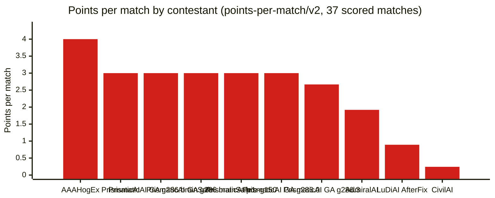
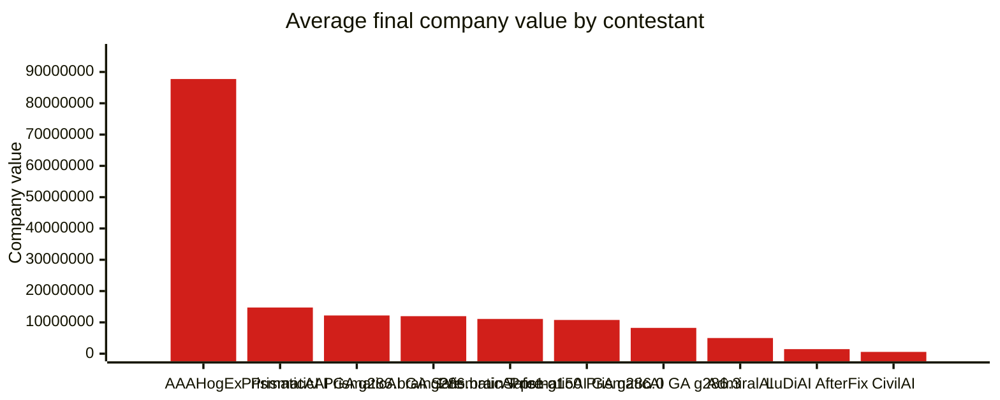
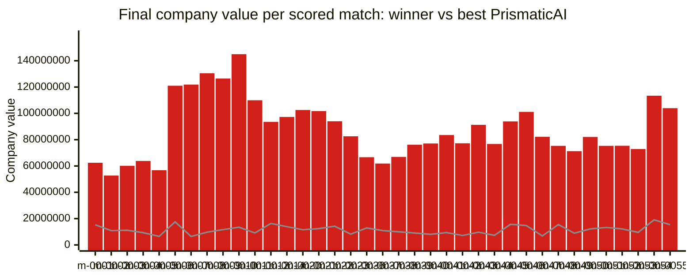
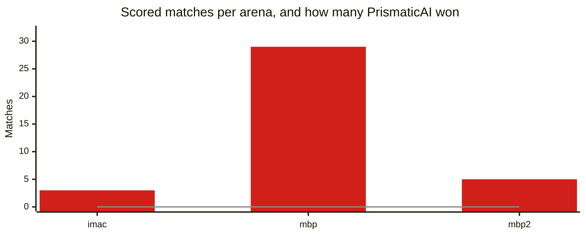

# battle-20261121T161417-b01dfc4f

Derived from `battle-20261121T161417-b01dfc4f.json` by `tools/research/ai-battle/battle.py report`; do not edit.

- Edition `b01dfc4f9a76ee1a`: PrismaticAI and referee at `c3e8a705e21596bbdc0536482373eb176e5e9d8b`, base set `opengfx-8.0.tar`
- 20-year free-for-all from 1960, map 256x256 temperate, breakdowns 1
- 37 scored match(es) on `imac` (20261119-master-gdf1e05e7d8), `mbp` (20261120-master-m17653b726e), `mbp2` (20261119-master-gdf1e05e7d8)
- Replays: 0 of 0 identical to their original on another arena

| # | Contestant | Played | Wins | Points | Points/match | Avg rank | Avg final value | Squirrel errors | Matches with anomalies |
|---|---|---|---|---|---|---|---|---|---|
| 1 | AAAHogEx | 37 | 37 | 148 | 4.0 | 1.0 | 87.7 M | 0 | 0 |
| 2 | PrismaticAI | 6 | 0 | 18 | 3.0 | 2.0 | 14.7 M | 0 | 0 |
| 3 | PrismaticAI GA g286.brainSafe | 6 | 0 | 18 | 3.0 | 2.0 | 12.2 M | 0 | 0 |
| 4 | PrismaticAI GA g286.brainSafe1 | 6 | 0 | 18 | 3.0 | 2.0 | 12.0 M | 0 | 0 |
| 5 | PrismaticAI pre-g150 | 6 | 0 | 18 | 3.0 | 2.0 | 11.1 M | 0 | 0 |
| 6 | PrismaticAI GA g286.0 | 7 | 0 | 21 | 3.0 | 2.0 | 10.8 M | 0 | 0 |
| 7 | PrismaticAI GA g286.3 | 6 | 0 | 16 | 2.667 | 2.33 | 8.2 M | 0 | 1 |
| 8 | AdmiralAI | 37 | 0 | 71 | 1.919 | 3.08 | 5.0 M | 62 | 2 |
| 9 | LuDiAI AfterFix | 37 | 0 | 33 | 0.892 | 4.11 | 1.4 M | 0 | 1 |
| 10 | CivilAI | 37 | 0 | 9 | 0.243 | 4.76 | 565.2 k | 3660 | 3 |

<!-- battle-charts:begin -->
<!-- derived from battle-20261121T161417-b01dfc4f.json by `battle.py render`; `battle.py check` fails when it is stale -->

<!-- battle-charts:end -->

| Match | Arena | Seed | Winner | Value | Last | Anomalies |
|---|---|---|---|---|---|---|
| m-0001 | mbp | 96885917 | AAAHogEx | 62.4 M | CivilAI | LuDiAI AfterFix: fleet_drop:34->19 |
| m-0002 | mbp | 96885917 | AAAHogEx | 52.7 M | CivilAI | - |
| m-0003 | mbp | 96885917 | AAAHogEx | 60.2 M | CivilAI | CivilAI: fleet_drop:12->7 |
| m-0004 | mbp | 96885917 | AAAHogEx | 63.8 M | LuDiAI AfterFix | - |
| m-0005 | mbp | 96885917 | AAAHogEx | 56.8 M | CivilAI | CivilAI: fleet_drop:38->13 |
| m-0006 | mbp | 1159977078 | AAAHogEx | 121.0 M | LuDiAI AfterFix | CivilAI: squirrel_errors:3660 |
| m-0007 | mbp | 1159977078 | AAAHogEx | 121.9 M | LuDiAI AfterFix | - |
| m-0008 | mbp | 1159977078 | AAAHogEx | 130.5 M | CivilAI | - |
| m-0009 | mbp | 1159977078 | AAAHogEx | 126.5 M | AdmiralAI | - |
| m-0010 | imac | 1159977078 | AAAHogEx | 145.0 M | AdmiralAI | - |
| m-0011 | imac | 1159977078 | AAAHogEx | 109.9 M | LuDiAI AfterFix | - |
| m-0012 | imac | 225471256 | AAAHogEx | 93.5 M | CivilAI | - |
| m-0014 | mbp2 | 225471256 | AAAHogEx | 97.3 M | LuDiAI AfterFix | - |
| m-0020 | mbp2 | 235833758 | AAAHogEx | 102.6 M | CivilAI | - |
| m-0021 | mbp2 | 235833758 | AAAHogEx | 101.7 M | LuDiAI AfterFix | - |
| m-0022 | mbp2 | 235833758 | AAAHogEx | 94.0 M | CivilAI | - |
| m-0023 | mbp2 | 235833758 | AAAHogEx | 82.6 M | CivilAI | - |
| m-0036 | mbp | 1484860814 | AAAHogEx | 66.7 M | CivilAI | - |
| m-0037 | mbp | 1484860814 | AAAHogEx | 61.9 M | CivilAI | - |
| m-0038 | mbp | 1484860814 | AAAHogEx | 66.9 M | CivilAI | - |
| m-0039 | mbp | 1484860814 | AAAHogEx | 76.2 M | CivilAI | - |
| m-0040 | mbp | 1484860814 | AAAHogEx | 77.1 M | CivilAI | - |
| m-0041 | mbp | 1484860814 | AAAHogEx | 83.5 M | CivilAI | - |
| m-0042 | mbp | 32336992 | AAAHogEx | 77.3 M | CivilAI | - |
| m-0043 | mbp | 32336992 | AAAHogEx | 91.3 M | CivilAI | - |
| m-0044 | mbp | 32336992 | AAAHogEx | 76.7 M | CivilAI | - |
| m-0045 | mbp | 32336992 | AAAHogEx | 93.9 M | CivilAI | - |
| m-0046 | mbp | 32336992 | AAAHogEx | 101.1 M | CivilAI | - |
| m-0047 | mbp | 32336992 | AAAHogEx | 82.2 M | CivilAI | - |
| m-0048 | mbp | 59363918 | AAAHogEx | 75.3 M | CivilAI | AdmiralAI: squirrel_errors:62 |
| m-0049 | mbp | 59363918 | AAAHogEx | 71.3 M | CivilAI | - |
| m-0050 | mbp | 59363918 | AAAHogEx | 82.1 M | CivilAI | - |
| m-0051 | mbp | 59363918 | AAAHogEx | 75.3 M | CivilAI | - |
| m-0052 | mbp | 59363918 | AAAHogEx | 75.4 M | CivilAI | - |
| m-0053 | mbp | 59363918 | AAAHogEx | 72.9 M | CivilAI | PrismaticAI GA g286.3: fleet_drop:37->23; AdmiralAI: fleet_drop:234->135 |
| m-0054 | mbp | 314600034 | AAAHogEx | 113.4 M | CivilAI | - |
| m-0055 | mbp | 314600034 | AAAHogEx | 103.9 M | CivilAI | - |
