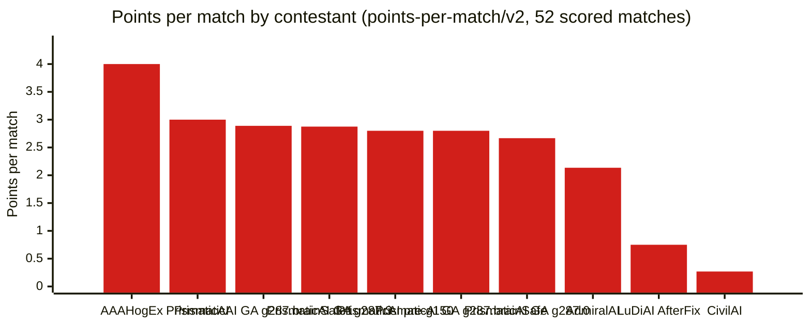
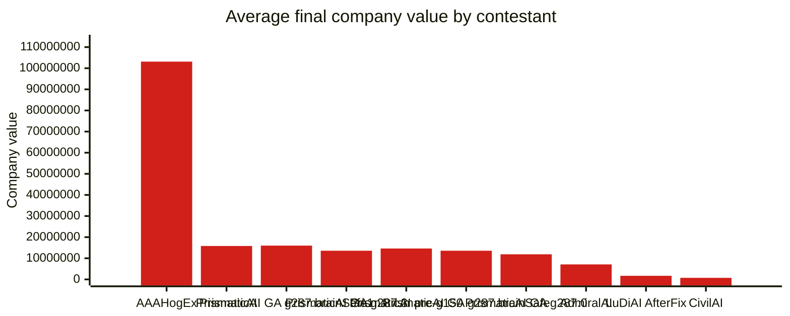
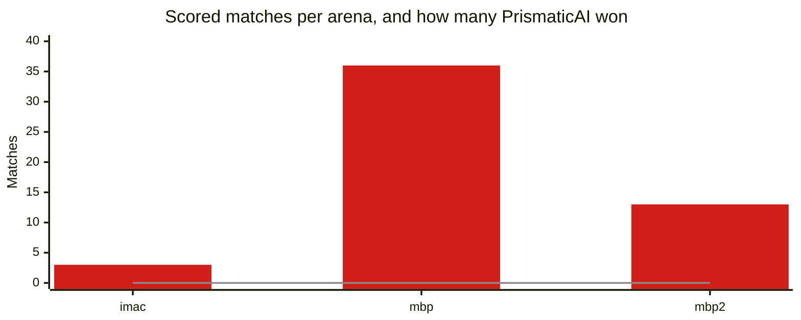

# battle-20261121T162904-7a8d053a

Derived from `battle-20261121T162904-7a8d053a.json` by `tools/research/ai-battle/battle.py report`; do not edit.

- Edition `7a8d053aa5fd45f1`: PrismaticAI and referee at `c3e8a705e21596bbdc0536482373eb176e5e9d8b`, base set `opengfx-8.0.tar`
- 20-year free-for-all from 1960, map 256x256 temperate, breakdowns 1
- 52 scored match(es) on `imac` (20261119-master-gdf1e05e7d8), `mbp` (20261120-master-m17653b726e), `mbp2` (20261119-master-gdf1e05e7d8)
- Replays: 0 of 2 identical to their original on another arena

| # | Contestant | Played | Wins | Points | Points/match | Avg rank | Avg final value | Squirrel errors | Matches with anomalies |
|---|---|---|---|---|---|---|---|---|---|
| 1 | AAAHogEx | 52 | 52 | 208 | 4.0 | 1.0 | 103.1 M | 0 | 0 |
| 2 | PrismaticAI | 9 | 0 | 27 | 3.0 | 2.0 | 15.8 M | 0 | 0 |
| 3 | PrismaticAI GA g287.brainSafe1 | 9 | 0 | 26 | 2.889 | 2.11 | 16.0 M | 0 | 0 |
| 4 | PrismaticAI GA g287.3 | 8 | 0 | 23 | 2.875 | 2.12 | 13.6 M | 0 | 0 |
| 5 | PrismaticAI pre-g150 | 10 | 0 | 28 | 2.8 | 2.2 | 14.6 M | 0 | 0 |
| 6 | PrismaticAI GA g287.brainSafe | 10 | 0 | 28 | 2.8 | 2.2 | 13.6 M | 0 | 0 |
| 7 | PrismaticAI GA g287.0 | 6 | 0 | 16 | 2.667 | 2.33 | 11.9 M | 0 | 0 |
| 8 | AdmiralAI | 52 | 0 | 111 | 2.135 | 2.87 | 7.1 M | 44 | 3 |
| 9 | LuDiAI AfterFix | 52 | 0 | 39 | 0.75 | 4.25 | 1.7 M | 0 | 0 |
| 10 | CivilAI | 52 | 0 | 14 | 0.269 | 4.73 | 736.4 k | 3680 | 10 |

```mermaid
---
config:
  xyChart:
    width: 900
    height: 360
  themeVariables:
    xyChart:
      plotColorPalette: "#d11f1a, #8a8a8a, #0b0b0b, #ece4d6"
---
xychart-beta
    title "Final company value per scored match: winner vs best PrismaticAI"
    x-axis ["m-0001", "m-0002", "m-0003", "m-0004", "m-0005", "m-0006", "m-0007", "m-0008", "m-0009", "m-0010", "m-0011", "m-0012", "m-0013", "m-0014", "m-0015", "m-0016", "m-0017", "m-0018", "m-0019", "m-0020", "m-0021", "m-0022", "m-0024", "m-0025", "m-0027", "m-0036", "m-0037", "m-0038", "m-0039", "m-0040", "m-0041", "m-0042", "m-0043", "m-0044", "m-0045", "m-0046", "m-0047", "m-0049", "m-0051", "m-0052", "m-0053", "m-0054", "m-0057", "m-0058", "m-0059", "m-0060", "m-0061", "m-0065", "m-0066", "m-0067", "m-0069", "m-0070"]
    %% series: Winner | Best PrismaticAI
    %% links: battle-20261121T162904-7a8d053a.md?col=Match&filter=m-0001 | battle-20261121T162904-7a8d053a.md?col=Match&filter=m-0002 | battle-20261121T162904-7a8d053a.md?col=Match&filter=m-0003 | battle-20261121T162904-7a8d053a.md?col=Match&filter=m-0004 | battle-20261121T162904-7a8d053a.md?col=Match&filter=m-0005 | battle-20261121T162904-7a8d053a.md?col=Match&filter=m-0006 | battle-20261121T162904-7a8d053a.md?col=Match&filter=m-0007 | battle-20261121T162904-7a8d053a.md?col=Match&filter=m-0008 | battle-20261121T162904-7a8d053a.md?col=Match&filter=m-0009 | battle-20261121T162904-7a8d053a.md?col=Match&filter=m-0010 | battle-20261121T162904-7a8d053a.md?col=Match&filter=m-0011 | battle-20261121T162904-7a8d053a.md?col=Match&filter=m-0012 | battle-20261121T162904-7a8d053a.md?col=Match&filter=m-0013 | battle-20261121T162904-7a8d053a.md?col=Match&filter=m-0014 | battle-20261121T162904-7a8d053a.md?col=Match&filter=m-0015 | battle-20261121T162904-7a8d053a.md?col=Match&filter=m-0016 | battle-20261121T162904-7a8d053a.md?col=Match&filter=m-0017 | battle-20261121T162904-7a8d053a.md?col=Match&filter=m-0018 | battle-20261121T162904-7a8d053a.md?col=Match&filter=m-0019 | battle-20261121T162904-7a8d053a.md?col=Match&filter=m-0020 | battle-20261121T162904-7a8d053a.md?col=Match&filter=m-0021 | battle-20261121T162904-7a8d053a.md?col=Match&filter=m-0022 | battle-20261121T162904-7a8d053a.md?col=Match&filter=m-0024 | battle-20261121T162904-7a8d053a.md?col=Match&filter=m-0025 | battle-20261121T162904-7a8d053a.md?col=Match&filter=m-0027 | battle-20261121T162904-7a8d053a.md?col=Match&filter=m-0036 | battle-20261121T162904-7a8d053a.md?col=Match&filter=m-0037 | battle-20261121T162904-7a8d053a.md?col=Match&filter=m-0038 | battle-20261121T162904-7a8d053a.md?col=Match&filter=m-0039 | battle-20261121T162904-7a8d053a.md?col=Match&filter=m-0040 | battle-20261121T162904-7a8d053a.md?col=Match&filter=m-0041 | battle-20261121T162904-7a8d053a.md?col=Match&filter=m-0042 | battle-20261121T162904-7a8d053a.md?col=Match&filter=m-0043 | battle-20261121T162904-7a8d053a.md?col=Match&filter=m-0044 | battle-20261121T162904-7a8d053a.md?col=Match&filter=m-0045 | battle-20261121T162904-7a8d053a.md?col=Match&filter=m-0046 | battle-20261121T162904-7a8d053a.md?col=Match&filter=m-0047 | battle-20261121T162904-7a8d053a.md?col=Match&filter=m-0049 | battle-20261121T162904-7a8d053a.md?col=Match&filter=m-0051 | battle-20261121T162904-7a8d053a.md?col=Match&filter=m-0052 | battle-20261121T162904-7a8d053a.md?col=Match&filter=m-0053 | battle-20261121T162904-7a8d053a.md?col=Match&filter=m-0054 | battle-20261121T162904-7a8d053a.md?col=Match&filter=m-0057 | battle-20261121T162904-7a8d053a.md?col=Match&filter=m-0058 | battle-20261121T162904-7a8d053a.md?col=Match&filter=m-0059 | battle-20261121T162904-7a8d053a.md?col=Match&filter=m-0060 | battle-20261121T162904-7a8d053a.md?col=Match&filter=m-0061 | battle-20261121T162904-7a8d053a.md?col=Match&filter=m-0065 | battle-20261121T162904-7a8d053a.md?col=Match&filter=m-0066 | battle-20261121T162904-7a8d053a.md?col=Match&filter=m-0067 | battle-20261121T162904-7a8d053a.md?col=Match&filter=m-0069 | battle-20261121T162904-7a8d053a.md?col=Match&filter=m-0070
    y-axis "Company value" 0 --> 153000000
    bar [87664991, 110686110, 104756409, 87434596, 109303528, 137344023, 107925239, 94148746, 98373660, 88876003, 89348666, 81747043, 82234448, 85935270, 83729756, 80182501, 86147682, 96912757, 97161839, 76829436, 103098509, 112976456, 91624645, 104330436, 108373003, 110663740, 108789578, 110504520, 119645211, 108739121, 112044511, 109589679, 125033434, 139300237, 124095285, 97405540, 121052979, 96344453, 94546172, 100747881, 104743714, 133581606, 107186538, 132568355, 112030303, 108028479, 123988976, 96748692, 79277204, 93824353, 97275062, 87720682]
    line [13514057, 12795210, 9516347, 15412094, 12898311, 13536095, 8755781, 6307521, 5978312, 7381811, 7613920, 16572980, 15286032, 12565267, 11369721, 11744605, 11581547, 17921629, 17473715, 9820590, 19254143, 19290142, 10850750, 8616587, 7198995, 17907721, 15971416, 15852979, 18293464, 18680120, 16004843, 17368733, 20013600, 13947864, 15699683, 20541570, 13472239, 15981594, 15771461, 13804187, 15203995, 16111088, 20574871, 20615063, 18178647, 14301129, 15278838, 13672773, 17796174, 15394032, 12120406, 16460733]
```

<!-- battle-charts:begin -->
<!-- derived from battle-20261121T162904-7a8d053a.json by `battle.py render`; `battle.py check` fails when it is stale -->

<!-- battle-charts:end -->

| Seed | Original | Replay | Arenas | Identical |
|---|---|---|---|---|
| 1561274521 | m-0012 | m-0048 | imac / mbp | NO |
| 1290777202 | m-0010 | m-0064 | imac / mbp | NO |

| Match | Arena | Seed | Winner | Value | Last | Anomalies |
|---|---|---|---|---|---|---|
| m-0001 | mbp | 1703817065 | AAAHogEx | 87.7 M | CivilAI | - |
| m-0002 | mbp | 1703817065 | AAAHogEx | 110.7 M | CivilAI | - |
| m-0003 | mbp | 1703817065 | AAAHogEx | 104.8 M | LuDiAI AfterFix | CivilAI: fleet_drop:45->30 |
| m-0004 | mbp | 1703817065 | AAAHogEx | 87.4 M | LuDiAI AfterFix | CivilAI: fleet_drop:41->25 |
| m-0005 | mbp | 1703817065 | AAAHogEx | 109.3 M | CivilAI | - |
| m-0006 | mbp | 1290777202 | AAAHogEx | 137.3 M | CivilAI | - |
| m-0007 | mbp | 1290777202 | AAAHogEx | 107.9 M | CivilAI | - |
| m-0008 | mbp | 1290777202 | AAAHogEx | 94.1 M | CivilAI | - |
| m-0009 | mbp | 1290777202 | AAAHogEx | 98.4 M | CivilAI | CivilAI: fleet_drop:68->44 |
| m-0010 | imac | 1290777202 | AAAHogEx | 88.9 M | CivilAI | - |
| m-0011 | imac | 1290777202 | AAAHogEx | 89.3 M | LuDiAI AfterFix | - |
| m-0012 | imac | 1561274521 | AAAHogEx | 81.7 M | LuDiAI AfterFix | - |
| m-0013 | mbp2 | 1561274521 | AAAHogEx | 82.2 M | CivilAI | - |
| m-0014 | mbp2 | 1561274521 | AAAHogEx | 85.9 M | LuDiAI AfterFix | - |
| m-0015 | mbp2 | 1561274521 | AAAHogEx | 83.7 M | LuDiAI AfterFix | - |
| m-0016 | mbp2 | 1561274521 | AAAHogEx | 80.2 M | CivilAI | - |
| m-0017 | mbp2 | 1561274521 | AAAHogEx | 86.1 M | LuDiAI AfterFix | CivilAI: fleet_drop:66->27 |
| m-0018 | mbp2 | 1599162194 | AAAHogEx | 96.9 M | CivilAI | - |
| m-0019 | mbp2 | 1599162194 | AAAHogEx | 97.2 M | CivilAI | - |
| m-0020 | mbp2 | 1599162194 | AAAHogEx | 76.8 M | CivilAI | - |
| m-0021 | mbp2 | 1599162194 | AAAHogEx | 103.1 M | LuDiAI AfterFix | - |
| m-0022 | mbp2 | 1599162194 | AAAHogEx | 113.0 M | CivilAI | CivilAI: fleet_drop:85->47 |
| m-0024 | mbp2 | 1264150193 | AAAHogEx | 91.6 M | CivilAI | AdmiralAI: fleet_drop:288->162 |
| m-0025 | mbp2 | 1264150193 | AAAHogEx | 104.3 M | CivilAI | - |
| m-0027 | mbp2 | 1264150193 | AAAHogEx | 108.4 M | CivilAI | CivilAI: fleet_drop:33->11 |
| m-0036 | mbp | 1220216186 | AAAHogEx | 110.7 M | CivilAI | CivilAI: squirrel_errors:3680 |
| m-0037 | mbp | 1220216186 | AAAHogEx | 108.8 M | CivilAI | CivilAI: fleet_drop:59->35 |
| m-0038 | mbp | 1220216186 | AAAHogEx | 110.5 M | LuDiAI AfterFix | CivilAI: fleet_drop:65->40 |
| m-0039 | mbp | 1220216186 | AAAHogEx | 119.6 M | CivilAI | AdmiralAI: squirrel_errors:44; CivilAI: fleet_drop:36->25 |
| m-0040 | mbp | 1220216186 | AAAHogEx | 108.7 M | CivilAI | - |
| m-0041 | mbp | 1220216186 | AAAHogEx | 112.0 M | CivilAI | - |
| m-0042 | mbp | 1643114667 | AAAHogEx | 109.6 M | CivilAI | - |
| m-0043 | mbp | 1643114667 | AAAHogEx | 125.0 M | CivilAI | - |
| m-0044 | mbp | 1643114667 | AAAHogEx | 139.3 M | CivilAI | - |
| m-0045 | mbp | 1643114667 | AAAHogEx | 124.1 M | CivilAI | - |
| m-0046 | mbp | 1643114667 | AAAHogEx | 97.4 M | CivilAI | - |
| m-0047 | mbp | 1643114667 | AAAHogEx | 121.1 M | CivilAI | - |
| m-0048 (replay) | mbp | 1561274521 | AAAHogEx | 82.1 M | LuDiAI AfterFix | - |
| m-0049 | mbp | 398971388 | AAAHogEx | 96.3 M | CivilAI | - |
| m-0051 | mbp | 398971388 | AAAHogEx | 94.5 M | CivilAI | - |
| m-0052 | mbp | 398971388 | AAAHogEx | 100.7 M | CivilAI | AdmiralAI: fleet_drop:363->216 |
| m-0053 | mbp | 398971388 | AAAHogEx | 104.7 M | CivilAI | - |
| m-0054 | mbp | 378912279 | AAAHogEx | 133.6 M | CivilAI | - |
| m-0057 | mbp | 378912279 | AAAHogEx | 107.2 M | CivilAI | - |
| m-0058 | mbp | 378912279 | AAAHogEx | 132.6 M | CivilAI | - |
| m-0059 | mbp | 378912279 | AAAHogEx | 112.0 M | CivilAI | - |
| m-0060 | mbp | 1042988590 | AAAHogEx | 108.0 M | LuDiAI AfterFix | - |
| m-0061 | mbp | 1042988590 | AAAHogEx | 124.0 M | LuDiAI AfterFix | - |
| m-0064 (replay) | mbp | 1290777202 | AAAHogEx | 92.1 M | CivilAI | LuDiAI AfterFix: fleet_drop:48->31 |
| m-0065 | mbp | 1042988590 | AAAHogEx | 96.7 M | LuDiAI AfterFix | - |
| m-0066 | mbp | 1071199943 | AAAHogEx | 79.3 M | CivilAI | - |
| m-0067 | mbp | 1071199943 | AAAHogEx | 93.8 M | CivilAI | - |
| m-0069 | mbp | 1071199943 | AAAHogEx | 97.3 M | LuDiAI AfterFix | - |
| m-0070 | mbp | 1071199943 | AAAHogEx | 87.7 M | LuDiAI AfterFix | - |
