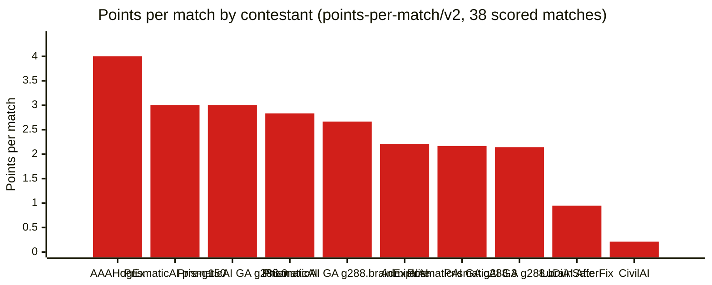
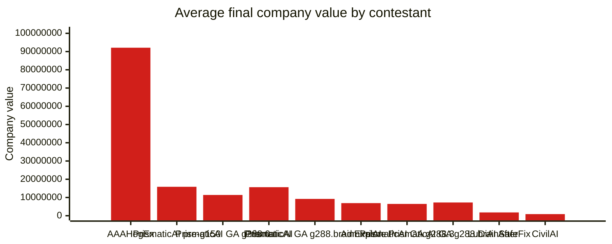
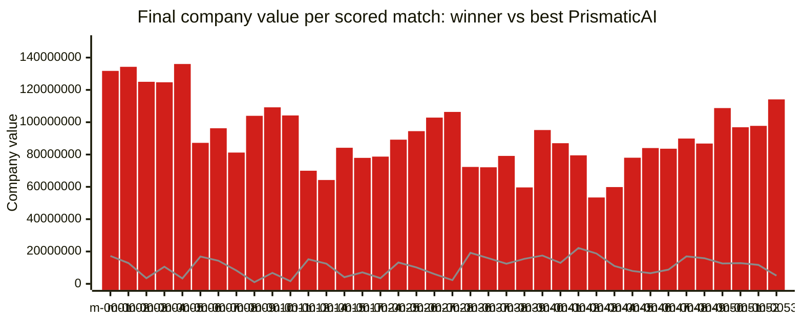
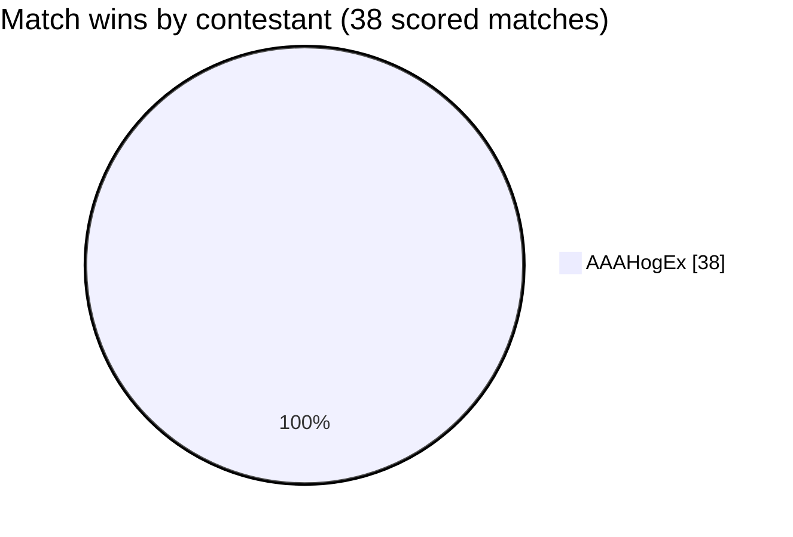
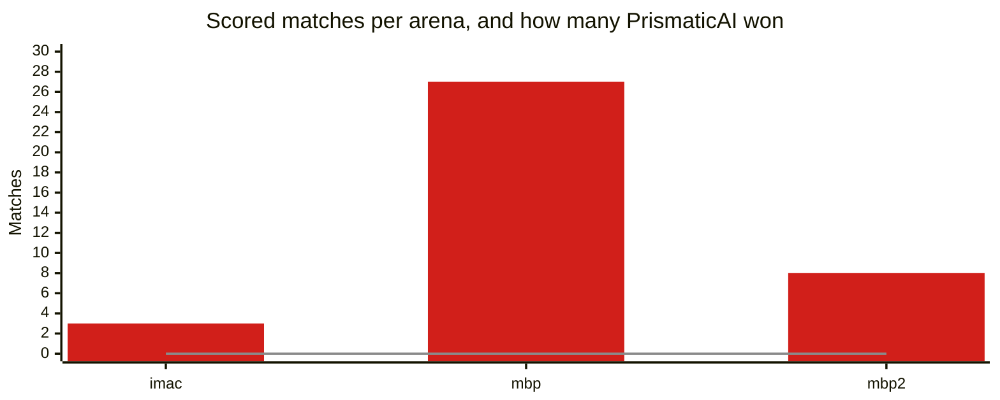

# battle-20261121T164022-20a48c81

Derived from `battle-20261121T164022-20a48c81.json` by `tools/research/ai-battle/battle.py report`; do not edit.

- Edition `20a48c818e0f6dac`: PrismaticAI and referee at `c3e8a705e21596bbdc0536482373eb176e5e9d8b`, base set `opengfx-8.0.tar`
- 20-year free-for-all from 1960, map 256x256 temperate, breakdowns 1
- 38 scored match(es) on `imac` (20261119-master-gdf1e05e7d8), `mbp` (20261120-master-m17653b726e), `mbp2` (20261119-master-gdf1e05e7d8)
- Replays: 0 of 0 identical to their original on another arena

| # | Contestant | Played | Wins | Points | Points/match | Avg rank | Avg final value | Squirrel errors | Matches with anomalies |
|---|---|---|---|---|---|---|---|---|---|
| 1 | AAAHogEx | 38 | 38 | 152 | 4.0 | 1.0 | 92.1 M | 0 | 0 |
| 2 | PrismaticAI pre-g150 | 6 | 0 | 18 | 3.0 | 2.0 | 15.9 M | 0 | 0 |
| 3 | PrismaticAI GA g288.0 | 7 | 0 | 21 | 3.0 | 2.0 | 11.4 M | 0 | 0 |
| 4 | PrismaticAI | 6 | 0 | 17 | 2.833 | 2.17 | 15.7 M | 0 | 0 |
| 5 | PrismaticAI GA g288.brainExplore | 6 | 0 | 16 | 2.667 | 2.33 | 9.2 M | 0 | 0 |
| 6 | AdmiralAI | 38 | 0 | 84 | 2.211 | 2.79 | 6.9 M | 0 | 1 |
| 7 | PrismaticAI GA g288.3 | 6 | 0 | 13 | 2.167 | 2.83 | 6.5 M | 0 | 0 |
| 8 | PrismaticAI GA g288.brainSafe | 7 | 0 | 15 | 2.143 | 2.86 | 7.3 M | 0 | 0 |
| 9 | LuDiAI AfterFix | 38 | 0 | 36 | 0.947 | 4.05 | 1.8 M | 0 | 3 |
| 10 | CivilAI | 38 | 0 | 8 | 0.211 | 4.79 | 882.1 k | 0 | 5 |

<!-- battle-charts:begin -->
<!-- derived from battle-20261121T164022-20a48c81.json by `battle.py render`; `battle.py check` fails when it is stale -->

<!-- battle-charts:end -->

| Match | Arena | Seed | Winner | Value | Last | Anomalies |
|---|---|---|---|---|---|---|
| m-0001 | mbp | 124949731 | AAAHogEx | 131.8 M | CivilAI | - |
| m-0002 | mbp | 124949731 | AAAHogEx | 134.3 M | CivilAI | LuDiAI AfterFix: fleet_drop:44->23 |
| m-0003 | mbp | 124949731 | AAAHogEx | 125.0 M | CivilAI | CivilAI: fleet_drop:53->24 |
| m-0004 | mbp | 124949731 | AAAHogEx | 124.7 M | CivilAI | CivilAI: fleet_drop:21->13 |
| m-0005 | mbp | 124949731 | AAAHogEx | 136.0 M | CivilAI | - |
| m-0006 | mbp | 112802368 | AAAHogEx | 87.2 M | CivilAI | - |
| m-0007 | mbp | 112802368 | AAAHogEx | 96.3 M | CivilAI | - |
| m-0008 | mbp | 112802368 | AAAHogEx | 81.2 M | CivilAI | CivilAI: fleet_drop:54->32 |
| m-0009 | mbp | 112802368 | AAAHogEx | 104.0 M | PrismaticAI GA g288.brainSafe | - |
| m-0010 | imac | 112802368 | AAAHogEx | 109.2 M | CivilAI | - |
| m-0011 | imac | 112802368 | AAAHogEx | 104.2 M | CivilAI | AdmiralAI: fleet_drop:278->176 |
| m-0012 | imac | 1510054542 | AAAHogEx | 70.0 M | CivilAI | - |
| m-0014 | mbp2 | 1510054542 | AAAHogEx | 64.2 M | LuDiAI AfterFix | - |
| m-0015 | mbp2 | 1510054542 | AAAHogEx | 84.2 M | CivilAI | - |
| m-0017 | mbp2 | 1510054542 | AAAHogEx | 77.9 M | CivilAI | - |
| m-0024 | mbp2 | 1430907785 | AAAHogEx | 78.7 M | CivilAI | - |
| m-0025 | mbp2 | 1430907785 | AAAHogEx | 89.2 M | CivilAI | CivilAI: fleet_drop:39->22 |
| m-0026 | mbp2 | 1430907785 | AAAHogEx | 94.5 M | CivilAI | - |
| m-0027 | mbp2 | 1430907785 | AAAHogEx | 102.9 M | CivilAI | - |
| m-0028 | mbp2 | 1430907785 | AAAHogEx | 106.4 M | CivilAI | - |
| m-0036 | mbp | 1984665478 | AAAHogEx | 72.3 M | CivilAI | - |
| m-0037 | mbp | 1984665478 | AAAHogEx | 72.1 M | CivilAI | - |
| m-0038 | mbp | 1984665478 | AAAHogEx | 79.2 M | CivilAI | - |
| m-0039 | mbp | 1984665478 | AAAHogEx | 59.7 M | CivilAI | - |
| m-0040 | mbp | 1984665478 | AAAHogEx | 95.2 M | CivilAI | LuDiAI AfterFix: fleet_drop:105->67 |
| m-0041 | mbp | 1984665478 | AAAHogEx | 87.0 M | LuDiAI AfterFix | LuDiAI AfterFix: fleet_drop:89->56 |
| m-0042 | mbp | 1821634297 | AAAHogEx | 79.5 M | CivilAI | - |
| m-0043 | mbp | 1821634297 | AAAHogEx | 53.4 M | CivilAI | - |
| m-0044 | mbp | 1821634297 | AAAHogEx | 59.9 M | CivilAI | - |
| m-0045 | mbp | 1821634297 | AAAHogEx | 78.0 M | CivilAI | - |
| m-0046 | mbp | 1821634297 | AAAHogEx | 84.0 M | LuDiAI AfterFix | - |
| m-0047 | mbp | 1821634297 | AAAHogEx | 83.6 M | CivilAI | - |
| m-0048 | mbp | 1643570812 | AAAHogEx | 89.9 M | LuDiAI AfterFix | CivilAI: fleet_drop:124->74 |
| m-0049 | mbp | 1643570812 | AAAHogEx | 86.8 M | CivilAI | - |
| m-0050 | mbp | 1643570812 | AAAHogEx | 108.8 M | LuDiAI AfterFix | - |
| m-0051 | mbp | 1643570812 | AAAHogEx | 96.9 M | CivilAI | - |
| m-0052 | mbp | 1643570812 | AAAHogEx | 97.7 M | LuDiAI AfterFix | - |
| m-0053 | mbp | 1643570812 | AAAHogEx | 114.1 M | LuDiAI AfterFix | - |
