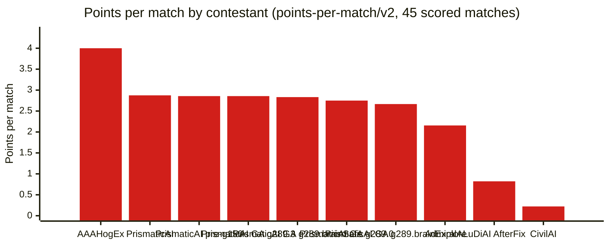
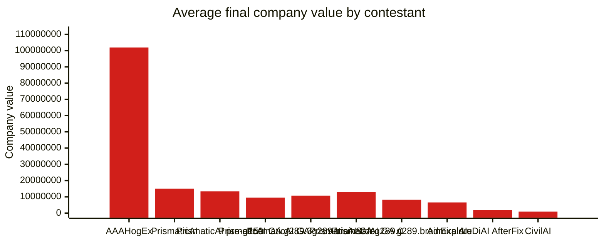
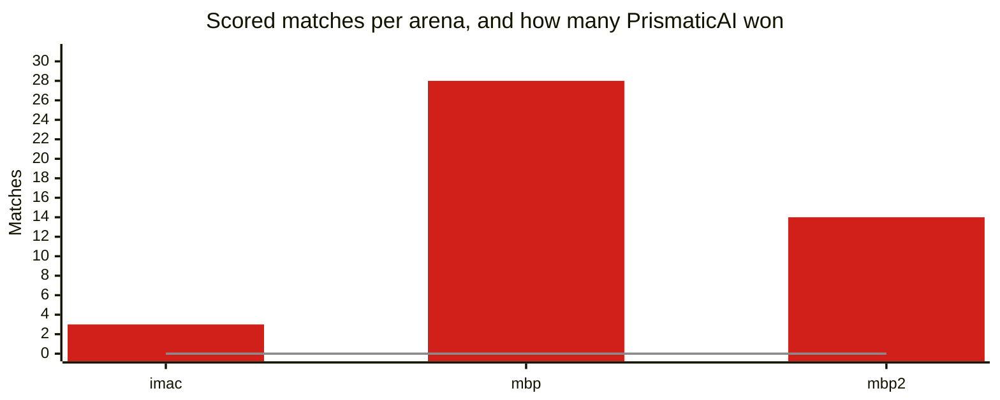

# battle-20261121T165234-98431db4

Derived from `battle-20261121T165234-98431db4.json` by `tools/research/ai-battle/battle.py report`; do not edit.

- Edition `98431db4a9275abc`: PrismaticAI and referee at `c3e8a705e21596bbdc0536482373eb176e5e9d8b`, base set `opengfx-8.0.tar`
- 20-year free-for-all from 1960, map 256x256 temperate, breakdowns 1
- 45 scored match(es) on `imac` (20261119-master-gdf1e05e7d8), `mbp` (20261120-master-m17653b726e), `mbp2` (20261119-master-gdf1e05e7d8)
- Replays: 0 of 0 identical to their original on another arena

| # | Contestant | Played | Wins | Points | Points/match | Avg rank | Avg final value | Squirrel errors | Matches with anomalies |
|---|---|---|---|---|---|---|---|---|---|
| 1 | AAAHogEx | 45 | 45 | 180 | 4.0 | 1.0 | 101.9 M | 0 | 0 |
| 2 | PrismaticAI | 8 | 0 | 23 | 2.875 | 2.12 | 15.0 M | 0 | 0 |
| 3 | PrismaticAI pre-g150 | 7 | 0 | 20 | 2.857 | 2.14 | 13.4 M | 0 | 0 |
| 4 | PrismaticAI GA g289.3 | 7 | 0 | 20 | 2.857 | 2.14 | 9.5 M | 0 | 0 |
| 5 | PrismaticAI GA g289.brainSafe | 6 | 0 | 17 | 2.833 | 2.17 | 10.7 M | 0 | 0 |
| 6 | PrismaticAI GA g289.0 | 8 | 0 | 22 | 2.75 | 2.25 | 13.0 M | 0 | 0 |
| 7 | PrismaticAI GA g289.brainExplore | 9 | 0 | 24 | 2.667 | 2.33 | 8.2 M | 0 | 0 |
| 8 | AdmiralAI | 45 | 0 | 97 | 2.156 | 2.84 | 6.5 M | 0 | 1 |
| 9 | LuDiAI AfterFix | 45 | 0 | 37 | 0.822 | 4.18 | 1.8 M | 0 | 0 |
| 10 | CivilAI | 45 | 0 | 10 | 0.222 | 4.78 | 895.7 k | 3660 | 10 |

```mermaid
---
config:
  xyChart:
    width: 900
    height: 360
  themeVariables:
    xyChart:
      plotColorPalette: "#d11f1a, #8a8a8a, #0b0b0b, #ece4d6"
---
xychart-beta
    title "Final company value per scored match: winner vs best PrismaticAI"
    x-axis ["m-0001", "m-0002", "m-0003", "m-0004", "m-0005", "m-0006", "m-0007", "m-0008", "m-0009", "m-0010", "m-0011", "m-0012", "m-0013", "m-0014", "m-0015", "m-0016", "m-0017", "m-0018", "m-0020", "m-0022", "m-0023", "m-0024", "m-0025", "m-0026", "m-0027", "m-0028", "m-0036", "m-0037", "m-0038", "m-0039", "m-0040", "m-0041", "m-0042", "m-0043", "m-0044", "m-0045", "m-0046", "m-0047", "m-0048", "m-0049", "m-0050", "m-0052", "m-0053", "m-0054", "m-0058"]
    %% series: Winner | Best PrismaticAI
    %% links: battle-20261121T165234-98431db4.md?col=Match&filter=m-0001 | battle-20261121T165234-98431db4.md?col=Match&filter=m-0002 | battle-20261121T165234-98431db4.md?col=Match&filter=m-0003 | battle-20261121T165234-98431db4.md?col=Match&filter=m-0004 | battle-20261121T165234-98431db4.md?col=Match&filter=m-0005 | battle-20261121T165234-98431db4.md?col=Match&filter=m-0006 | battle-20261121T165234-98431db4.md?col=Match&filter=m-0007 | battle-20261121T165234-98431db4.md?col=Match&filter=m-0008 | battle-20261121T165234-98431db4.md?col=Match&filter=m-0009 | battle-20261121T165234-98431db4.md?col=Match&filter=m-0010 | battle-20261121T165234-98431db4.md?col=Match&filter=m-0011 | battle-20261121T165234-98431db4.md?col=Match&filter=m-0012 | battle-20261121T165234-98431db4.md?col=Match&filter=m-0013 | battle-20261121T165234-98431db4.md?col=Match&filter=m-0014 | battle-20261121T165234-98431db4.md?col=Match&filter=m-0015 | battle-20261121T165234-98431db4.md?col=Match&filter=m-0016 | battle-20261121T165234-98431db4.md?col=Match&filter=m-0017 | battle-20261121T165234-98431db4.md?col=Match&filter=m-0018 | battle-20261121T165234-98431db4.md?col=Match&filter=m-0020 | battle-20261121T165234-98431db4.md?col=Match&filter=m-0022 | battle-20261121T165234-98431db4.md?col=Match&filter=m-0023 | battle-20261121T165234-98431db4.md?col=Match&filter=m-0024 | battle-20261121T165234-98431db4.md?col=Match&filter=m-0025 | battle-20261121T165234-98431db4.md?col=Match&filter=m-0026 | battle-20261121T165234-98431db4.md?col=Match&filter=m-0027 | battle-20261121T165234-98431db4.md?col=Match&filter=m-0028 | battle-20261121T165234-98431db4.md?col=Match&filter=m-0036 | battle-20261121T165234-98431db4.md?col=Match&filter=m-0037 | battle-20261121T165234-98431db4.md?col=Match&filter=m-0038 | battle-20261121T165234-98431db4.md?col=Match&filter=m-0039 | battle-20261121T165234-98431db4.md?col=Match&filter=m-0040 | battle-20261121T165234-98431db4.md?col=Match&filter=m-0041 | battle-20261121T165234-98431db4.md?col=Match&filter=m-0042 | battle-20261121T165234-98431db4.md?col=Match&filter=m-0043 | battle-20261121T165234-98431db4.md?col=Match&filter=m-0044 | battle-20261121T165234-98431db4.md?col=Match&filter=m-0045 | battle-20261121T165234-98431db4.md?col=Match&filter=m-0046 | battle-20261121T165234-98431db4.md?col=Match&filter=m-0047 | battle-20261121T165234-98431db4.md?col=Match&filter=m-0048 | battle-20261121T165234-98431db4.md?col=Match&filter=m-0049 | battle-20261121T165234-98431db4.md?col=Match&filter=m-0050 | battle-20261121T165234-98431db4.md?col=Match&filter=m-0052 | battle-20261121T165234-98431db4.md?col=Match&filter=m-0053 | battle-20261121T165234-98431db4.md?col=Match&filter=m-0054 | battle-20261121T165234-98431db4.md?col=Match&filter=m-0058
    y-axis "Company value" 0 --> 173000000
    bar [119066714, 96484805, 120685632, 101514506, 96284626, 127518984, 143649499, 106981720, 97400081, 109986815, 124604257, 84724797, 57552670, 72454859, 88883531, 62348073, 59518227, 100931306, 111779458, 97416812, 117960580, 76416008, 93142900, 101594067, 113523437, 92110696, 92578620, 104338632, 88742071, 86536928, 74739536, 113261924, 148627534, 152117069, 152784913, 135920366, 157414774, 152390010, 83999730, 74712826, 77446437, 68958560, 73710959, 87211594, 86685653]
    line [6173781, 9711118, 10647581, 4121685, 6140474, 12517973, 14022570, 19167299, 15253445, 11234477, 10044394, 5058409, 5962753, 7050295, 6445887, 12554171, 6418158, 18283751, 18566782, 11406832, 12697998, 17455882, 15664781, 12496102, 11044183, 7202036, 21462550, 15050639, 16555198, 8986078, 10062542, 9003888, 20337140, 20694880, 12000106, 12071598, 6747108, 13462233, 10498347, 16208900, 8155390, 3370039, 9076196, 14496095, 7017782]
```

<!-- battle-charts:begin -->
<!-- derived from battle-20261121T165234-98431db4.json by `battle.py render`; `battle.py check` fails when it is stale -->

<!-- battle-charts:end -->

| Match | Arena | Seed | Winner | Value | Last | Anomalies |
|---|---|---|---|---|---|---|
| m-0001 | mbp | 1051023990 | AAAHogEx | 119.1 M | CivilAI | - |
| m-0002 | mbp | 1051023990 | AAAHogEx | 96.5 M | CivilAI | CivilAI: fleet_drop:29->17 |
| m-0003 | mbp | 1051023990 | AAAHogEx | 120.7 M | CivilAI | - |
| m-0004 | mbp | 1051023990 | AAAHogEx | 101.5 M | CivilAI | - |
| m-0005 | mbp | 1051023990 | AAAHogEx | 96.3 M | LuDiAI AfterFix | - |
| m-0006 | mbp | 1016802330 | AAAHogEx | 127.5 M | CivilAI | - |
| m-0007 | mbp | 1016802330 | AAAHogEx | 143.6 M | CivilAI | - |
| m-0008 | mbp | 1016802330 | AAAHogEx | 107.0 M | CivilAI | - |
| m-0009 | mbp | 1016802330 | AAAHogEx | 97.4 M | CivilAI | - |
| m-0010 | imac | 1016802330 | AAAHogEx | 110.0 M | CivilAI | - |
| m-0011 | imac | 1016802330 | AAAHogEx | 124.6 M | CivilAI | - |
| m-0012 | imac | 419194861 | AAAHogEx | 84.7 M | LuDiAI AfterFix | - |
| m-0013 | mbp2 | 419194861 | AAAHogEx | 57.6 M | LuDiAI AfterFix | - |
| m-0014 | mbp2 | 419194861 | AAAHogEx | 72.5 M | CivilAI | CivilAI: fleet_drop:44->27 |
| m-0015 | mbp2 | 419194861 | AAAHogEx | 88.9 M | CivilAI | CivilAI: fleet_drop:32->21 |
| m-0016 | mbp2 | 419194861 | AAAHogEx | 62.3 M | CivilAI | CivilAI: fleet_drop:42->14 |
| m-0017 | mbp2 | 419194861 | AAAHogEx | 59.5 M | CivilAI | CivilAI: fleet_drop:25->11 |
| m-0018 | mbp2 | 224265304 | AAAHogEx | 100.9 M | CivilAI | CivilAI: fleet_drop:60->38 |
| m-0020 | mbp2 | 224265304 | AAAHogEx | 111.8 M | CivilAI | - |
| m-0022 | mbp2 | 224265304 | AAAHogEx | 97.4 M | LuDiAI AfterFix | - |
| m-0023 | mbp2 | 224265304 | AAAHogEx | 118.0 M | CivilAI | CivilAI: fleet_drop:59->32 |
| m-0024 | mbp2 | 1890013566 | AAAHogEx | 76.4 M | CivilAI | - |
| m-0025 | mbp2 | 1890013566 | AAAHogEx | 93.1 M | LuDiAI AfterFix | - |
| m-0026 | mbp2 | 1890013566 | AAAHogEx | 101.6 M | LuDiAI AfterFix | - |
| m-0027 | mbp2 | 1890013566 | AAAHogEx | 113.5 M | CivilAI | - |
| m-0028 | mbp2 | 1890013566 | AAAHogEx | 92.1 M | LuDiAI AfterFix | - |
| m-0036 | mbp | 974438099 | AAAHogEx | 92.6 M | AdmiralAI | - |
| m-0037 | mbp | 974438099 | AAAHogEx | 104.3 M | LuDiAI AfterFix | - |
| m-0038 | mbp | 974438099 | AAAHogEx | 88.7 M | CivilAI | - |
| m-0039 | mbp | 974438099 | AAAHogEx | 86.5 M | CivilAI | - |
| m-0040 | mbp | 974438099 | AAAHogEx | 74.7 M | CivilAI | - |
| m-0041 | mbp | 974438099 | AAAHogEx | 113.3 M | CivilAI | - |
| m-0042 | mbp | 224129689 | AAAHogEx | 148.6 M | CivilAI | - |
| m-0043 | mbp | 224129689 | AAAHogEx | 152.1 M | CivilAI | - |
| m-0044 | mbp | 224129689 | AAAHogEx | 152.8 M | CivilAI | AdmiralAI: fleet_drop:304->189 |
| m-0045 | mbp | 224129689 | AAAHogEx | 135.9 M | CivilAI | CivilAI: fleet_drop:13->5 |
| m-0046 | mbp | 224129689 | AAAHogEx | 157.4 M | CivilAI | - |
| m-0047 | mbp | 224129689 | AAAHogEx | 152.4 M | CivilAI | - |
| m-0048 | mbp | 112325101 | AAAHogEx | 84.0 M | CivilAI | CivilAI: fleet_drop:72->44 |
| m-0049 | mbp | 112325101 | AAAHogEx | 74.7 M | LuDiAI AfterFix | - |
| m-0050 | mbp | 112325101 | AAAHogEx | 77.4 M | CivilAI | - |
| m-0052 | mbp | 112325101 | AAAHogEx | 69.0 M | CivilAI | - |
| m-0053 | mbp | 112325101 | AAAHogEx | 73.7 M | CivilAI | - |
| m-0054 | mbp | 702994403 | AAAHogEx | 87.2 M | CivilAI | CivilAI: squirrel_errors:3660 |
| m-0058 | mbp | 702994403 | AAAHogEx | 86.7 M | CivilAI | - |
