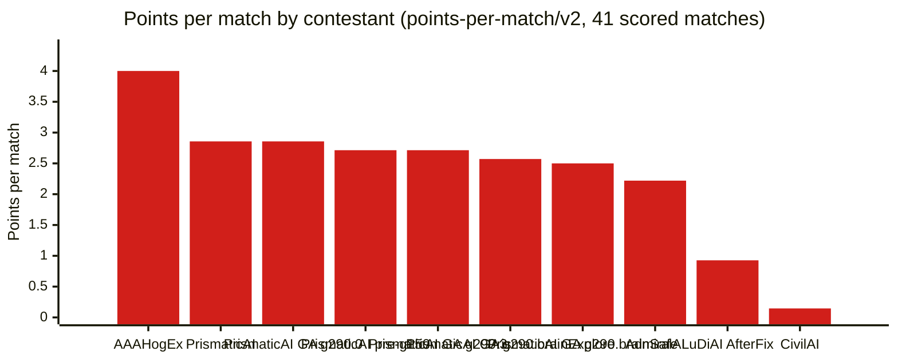
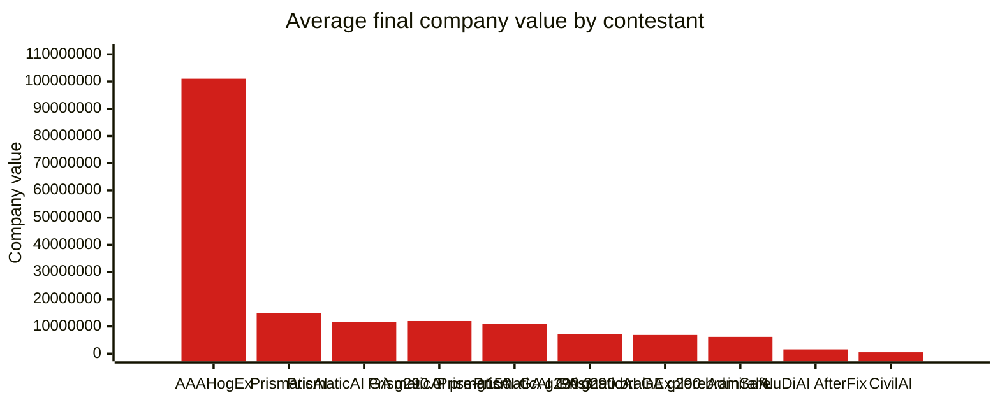
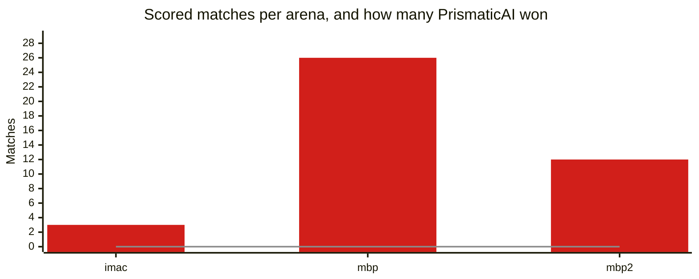

# battle-20261121T170416-6d43c459

Derived from `battle-20261121T170416-6d43c459.json` by `tools/research/ai-battle/battle.py report`; do not edit.

- Edition `6d43c4597541e8ab`: PrismaticAI and referee at `c3e8a705e21596bbdc0536482373eb176e5e9d8b`, base set `opengfx-8.0.tar`
- 20-year free-for-all from 1960, map 256x256 temperate, breakdowns 1
- 41 scored match(es) on `imac` (20261119-master-gdf1e05e7d8), `mbp` (20261120-master-m17653b726e), `mbp2` (20261119-master-gdf1e05e7d8)
- Replays: 0 of 0 identical to their original on another arena

| # | Contestant | Played | Wins | Points | Points/match | Avg rank | Avg final value | Squirrel errors | Matches with anomalies |
|---|---|---|---|---|---|---|---|---|---|
| 1 | AAAHogEx | 41 | 41 | 164 | 4.0 | 1.0 | 101.0 M | 0 | 0 |
| 2 | PrismaticAI | 7 | 0 | 20 | 2.857 | 2.14 | 14.9 M | 0 | 0 |
| 3 | PrismaticAI GA g290.0 | 7 | 0 | 20 | 2.857 | 2.14 | 11.6 M | 0 | 0 |
| 4 | PrismaticAI pre-g150 | 7 | 0 | 19 | 2.714 | 2.29 | 12.0 M | 0 | 0 |
| 5 | PrismaticAI GA g290.3 | 7 | 0 | 19 | 2.714 | 2.29 | 10.9 M | 0 | 0 |
| 6 | PrismaticAI GA g290.brainExplore | 7 | 0 | 18 | 2.571 | 2.43 | 7.2 M | 0 | 0 |
| 7 | PrismaticAI GA g290.brainSafe | 6 | 0 | 15 | 2.5 | 2.5 | 6.9 M | 0 | 0 |
| 8 | AdmiralAI | 41 | 0 | 91 | 2.22 | 2.78 | 6.2 M | 0 | 2 |
| 9 | LuDiAI AfterFix | 41 | 0 | 38 | 0.927 | 4.07 | 1.6 M | 0 | 4 |
| 10 | CivilAI | 41 | 0 | 6 | 0.146 | 4.85 | 514.8 k | 3680 | 5 |

```mermaid
---
config:
  xyChart:
    width: 900
    height: 360
  themeVariables:
    xyChart:
      plotColorPalette: "#d11f1a, #8a8a8a, #0b0b0b, #ece4d6"
---
xychart-beta
    title "Final company value per scored match: winner vs best PrismaticAI"
    x-axis ["m-0001", "m-0002", "m-0003", "m-0004", "m-0005", "m-0006", "m-0007", "m-0008", "m-0009", "m-0010", "m-0011", "m-0012", "m-0013", "m-0015", "m-0016", "m-0017", "m-0018", "m-0019", "m-0020", "m-0021", "m-0023", "m-0024", "m-0026", "m-0028", "m-0036", "m-0037", "m-0038", "m-0039", "m-0040", "m-0041", "m-0042", "m-0043", "m-0044", "m-0045", "m-0046", "m-0047", "m-0048", "m-0049", "m-0050", "m-0052", "m-0053"]
    %% series: Winner | Best PrismaticAI
    %% links: battle-20261121T170416-6d43c459.md?col=Match&filter=m-0001 | battle-20261121T170416-6d43c459.md?col=Match&filter=m-0002 | battle-20261121T170416-6d43c459.md?col=Match&filter=m-0003 | battle-20261121T170416-6d43c459.md?col=Match&filter=m-0004 | battle-20261121T170416-6d43c459.md?col=Match&filter=m-0005 | battle-20261121T170416-6d43c459.md?col=Match&filter=m-0006 | battle-20261121T170416-6d43c459.md?col=Match&filter=m-0007 | battle-20261121T170416-6d43c459.md?col=Match&filter=m-0008 | battle-20261121T170416-6d43c459.md?col=Match&filter=m-0009 | battle-20261121T170416-6d43c459.md?col=Match&filter=m-0010 | battle-20261121T170416-6d43c459.md?col=Match&filter=m-0011 | battle-20261121T170416-6d43c459.md?col=Match&filter=m-0012 | battle-20261121T170416-6d43c459.md?col=Match&filter=m-0013 | battle-20261121T170416-6d43c459.md?col=Match&filter=m-0015 | battle-20261121T170416-6d43c459.md?col=Match&filter=m-0016 | battle-20261121T170416-6d43c459.md?col=Match&filter=m-0017 | battle-20261121T170416-6d43c459.md?col=Match&filter=m-0018 | battle-20261121T170416-6d43c459.md?col=Match&filter=m-0019 | battle-20261121T170416-6d43c459.md?col=Match&filter=m-0020 | battle-20261121T170416-6d43c459.md?col=Match&filter=m-0021 | battle-20261121T170416-6d43c459.md?col=Match&filter=m-0023 | battle-20261121T170416-6d43c459.md?col=Match&filter=m-0024 | battle-20261121T170416-6d43c459.md?col=Match&filter=m-0026 | battle-20261121T170416-6d43c459.md?col=Match&filter=m-0028 | battle-20261121T170416-6d43c459.md?col=Match&filter=m-0036 | battle-20261121T170416-6d43c459.md?col=Match&filter=m-0037 | battle-20261121T170416-6d43c459.md?col=Match&filter=m-0038 | battle-20261121T170416-6d43c459.md?col=Match&filter=m-0039 | battle-20261121T170416-6d43c459.md?col=Match&filter=m-0040 | battle-20261121T170416-6d43c459.md?col=Match&filter=m-0041 | battle-20261121T170416-6d43c459.md?col=Match&filter=m-0042 | battle-20261121T170416-6d43c459.md?col=Match&filter=m-0043 | battle-20261121T170416-6d43c459.md?col=Match&filter=m-0044 | battle-20261121T170416-6d43c459.md?col=Match&filter=m-0045 | battle-20261121T170416-6d43c459.md?col=Match&filter=m-0046 | battle-20261121T170416-6d43c459.md?col=Match&filter=m-0047 | battle-20261121T170416-6d43c459.md?col=Match&filter=m-0048 | battle-20261121T170416-6d43c459.md?col=Match&filter=m-0049 | battle-20261121T170416-6d43c459.md?col=Match&filter=m-0050 | battle-20261121T170416-6d43c459.md?col=Match&filter=m-0052 | battle-20261121T170416-6d43c459.md?col=Match&filter=m-0053
    y-axis "Company value" 0 --> 145000000
    bar [111152828, 102648173, 110142312, 102191961, 115121927, 105496327, 95860601, 84800544, 105157832, 114100231, 127974192, 75056553, 93621334, 86745024, 95383210, 101320826, 71119858, 75945315, 71640539, 67428161, 75639996, 100077977, 114953699, 125963519, 131961245, 104009704, 110877411, 97737061, 113620919, 122687080, 117481301, 112286972, 107373622, 116821901, 108059597, 112378649, 99723420, 85411747, 78096963, 96534192, 97958829]
    line [16488090, 9912278, 9769048, 9180852, 15510245, 16653454, 15770107, 16921370, 10120489, 5196649, 19525257, 9607015, 8837307, 4566351, 4167868, 5666740, 9985382, 7144913, 11683805, 7991680, 8408183, 22209115, 16907992, 8797763, 21594514, 13751099, 9012373, 7040800, 9357660, 13661962, 3561241, 2367449, 3232749, 1794258, 5488524, 4207723, 20934075, 19644754, 13418977, 8299152, 9510465]
```

<!-- battle-charts:begin -->
<!-- derived from battle-20261121T170416-6d43c459.json by `battle.py render`; `battle.py check` fails when it is stale -->

<!-- battle-charts:end -->

| Match | Arena | Seed | Winner | Value | Last | Anomalies |
|---|---|---|---|---|---|---|
| m-0001 | mbp | 1287061099 | AAAHogEx | 111.2 M | CivilAI | - |
| m-0002 | mbp | 1287061099 | AAAHogEx | 102.6 M | CivilAI | - |
| m-0003 | mbp | 1287061099 | AAAHogEx | 110.1 M | CivilAI | - |
| m-0004 | mbp | 1287061099 | AAAHogEx | 102.2 M | CivilAI | LuDiAI AfterFix: fleet_drop:96->57 |
| m-0005 | mbp | 1287061099 | AAAHogEx | 115.1 M | CivilAI | - |
| m-0006 | mbp | 1494574194 | AAAHogEx | 105.5 M | LuDiAI AfterFix | - |
| m-0007 | mbp | 1494574194 | AAAHogEx | 95.9 M | LuDiAI AfterFix | LuDiAI AfterFix: fleet_drop:158->81 |
| m-0008 | mbp | 1494574194 | AAAHogEx | 84.8 M | CivilAI | - |
| m-0009 | mbp | 1494574194 | AAAHogEx | 105.2 M | CivilAI | - |
| m-0010 | imac | 1494574194 | AAAHogEx | 114.1 M | CivilAI | - |
| m-0011 | imac | 1494574194 | AAAHogEx | 128.0 M | CivilAI | - |
| m-0012 | imac | 375287241 | AAAHogEx | 75.1 M | CivilAI | - |
| m-0013 | mbp2 | 375287241 | AAAHogEx | 93.6 M | CivilAI | - |
| m-0015 | mbp2 | 375287241 | AAAHogEx | 86.7 M | CivilAI | - |
| m-0016 | mbp2 | 375287241 | AAAHogEx | 95.4 M | CivilAI | - |
| m-0017 | mbp2 | 375287241 | AAAHogEx | 101.3 M | CivilAI | - |
| m-0018 | mbp2 | 55341510 | AAAHogEx | 71.1 M | LuDiAI AfterFix | - |
| m-0019 | mbp2 | 55341510 | AAAHogEx | 75.9 M | CivilAI | CivilAI: fleet_drop:35->17 |
| m-0020 | mbp2 | 55341510 | AAAHogEx | 71.6 M | CivilAI | - |
| m-0021 | mbp2 | 55341510 | AAAHogEx | 67.4 M | CivilAI | - |
| m-0023 | mbp2 | 55341510 | AAAHogEx | 75.6 M | CivilAI | CivilAI: fleet_drop:18->10 |
| m-0024 | mbp2 | 1925240215 | AAAHogEx | 100.1 M | CivilAI | - |
| m-0026 | mbp2 | 1925240215 | AAAHogEx | 115.0 M | LuDiAI AfterFix | - |
| m-0028 | mbp2 | 1925240215 | AAAHogEx | 126.0 M | CivilAI | AdmiralAI: fleet_drop:110->70 |
| m-0036 | mbp | 622772316 | AAAHogEx | 132.0 M | LuDiAI AfterFix | - |
| m-0037 | mbp | 622772316 | AAAHogEx | 104.0 M | CivilAI | - |
| m-0038 | mbp | 622772316 | AAAHogEx | 110.9 M | CivilAI | - |
| m-0039 | mbp | 622772316 | AAAHogEx | 97.7 M | CivilAI | - |
| m-0040 | mbp | 622772316 | AAAHogEx | 113.6 M | CivilAI | - |
| m-0041 | mbp | 622772316 | AAAHogEx | 122.7 M | CivilAI | LuDiAI AfterFix: fleet_drop:119->80 |
| m-0042 | mbp | 967662543 | AAAHogEx | 117.5 M | CivilAI | - |
| m-0043 | mbp | 967662543 | AAAHogEx | 112.3 M | CivilAI | - |
| m-0044 | mbp | 967662543 | AAAHogEx | 107.4 M | CivilAI | LuDiAI AfterFix: fleet_drop:28->11 |
| m-0045 | mbp | 967662543 | AAAHogEx | 116.8 M | CivilAI | - |
| m-0046 | mbp | 967662543 | AAAHogEx | 108.1 M | CivilAI | - |
| m-0047 | mbp | 967662543 | AAAHogEx | 112.4 M | CivilAI | CivilAI: fleet_drop:14->9 |
| m-0048 | mbp | 1557617271 | AAAHogEx | 99.7 M | CivilAI | - |
| m-0049 | mbp | 1557617271 | AAAHogEx | 85.4 M | CivilAI | AdmiralAI: fleet_drop:355->208 |
| m-0050 | mbp | 1557617271 | AAAHogEx | 78.1 M | CivilAI | CivilAI: fleet_drop:31->11 |
| m-0052 | mbp | 1557617271 | AAAHogEx | 96.5 M | CivilAI | CivilAI: squirrel_errors:3680 |
| m-0053 | mbp | 1557617271 | AAAHogEx | 98.0 M | CivilAI | - |
