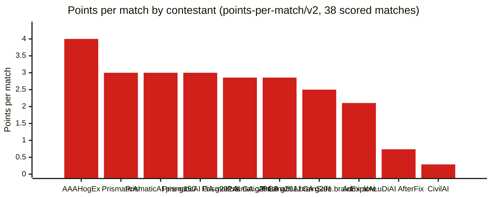
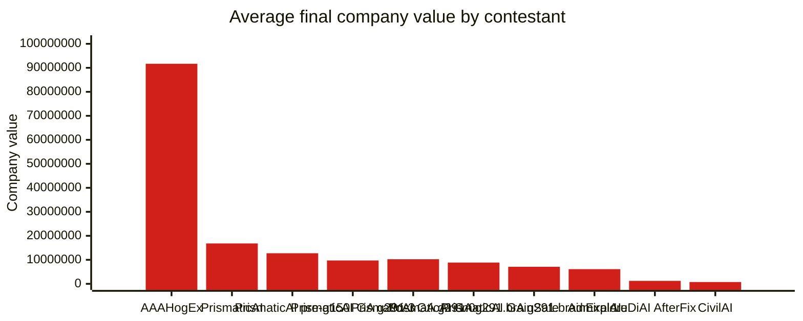
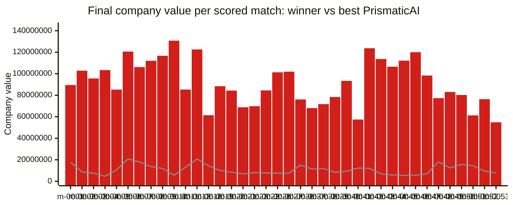
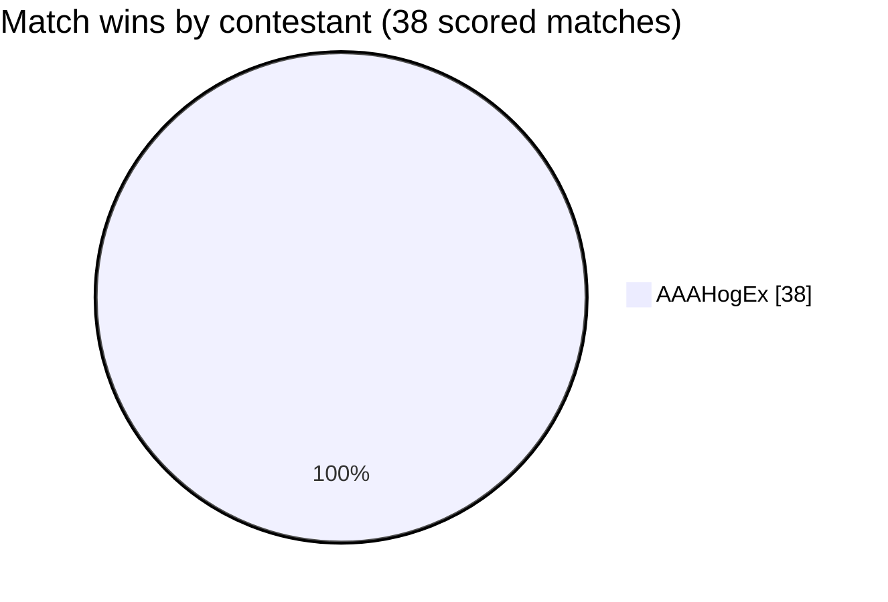
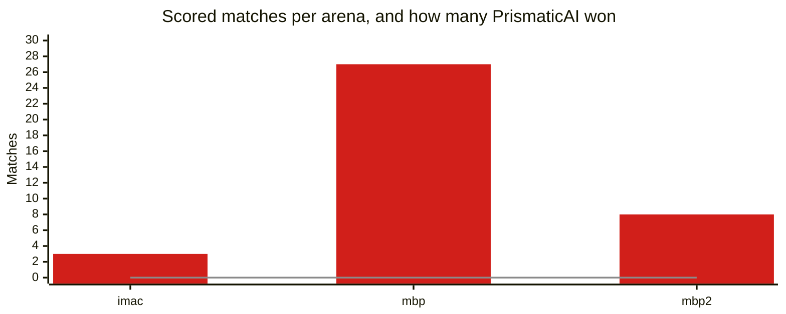

# battle-20261121T171536-ad3c8b8e

Derived from `battle-20261121T171536-ad3c8b8e.json` by `tools/research/ai-battle/battle.py report`; do not edit.

- Edition `ad3c8b8e941925a3`: PrismaticAI and referee at `c3e8a705e21596bbdc0536482373eb176e5e9d8b`, base set `opengfx-8.0.tar`
- 20-year free-for-all from 1960, map 256x256 temperate, breakdowns 1
- 38 scored match(es) on `imac` (20261119-master-gdf1e05e7d8), `mbp` (20261120-master-m17653b726e), `mbp2` (20261119-master-gdf1e05e7d8)
- Replays: 0 of 0 identical to their original on another arena

| # | Contestant | Played | Wins | Points | Points/match | Avg rank | Avg final value | Squirrel errors | Matches with anomalies |
|---|---|---|---|---|---|---|---|---|---|
| 1 | AAAHogEx | 38 | 38 | 152 | 4.0 | 1.0 | 91.7 M | 0 | 0 |
| 2 | PrismaticAI | 6 | 0 | 18 | 3.0 | 2.0 | 16.8 M | 0 | 0 |
| 3 | PrismaticAI pre-g150 | 6 | 0 | 18 | 3.0 | 2.0 | 12.7 M | 0 | 0 |
| 4 | PrismaticAI GA g291.3 | 6 | 0 | 18 | 3.0 | 2.0 | 9.7 M | 0 | 0 |
| 5 | PrismaticAI GA g291.0 | 7 | 0 | 20 | 2.857 | 2.14 | 10.2 M | 0 | 0 |
| 6 | PrismaticAI GA g291.brainSafe | 7 | 0 | 20 | 2.857 | 2.14 | 8.9 M | 0 | 2 |
| 7 | PrismaticAI GA g291.brainExplore | 6 | 0 | 15 | 2.5 | 2.5 | 7.1 M | 0 | 0 |
| 8 | AdmiralAI | 38 | 0 | 80 | 2.105 | 2.89 | 6.1 M | 70 | 4 |
| 9 | LuDiAI AfterFix | 38 | 0 | 28 | 0.737 | 4.26 | 1.2 M | 0 | 3 |
| 10 | CivilAI | 38 | 0 | 11 | 0.289 | 4.71 | 747.4 k | 0 | 8 |

<!-- battle-charts:begin -->
<!-- derived from battle-20261121T171536-ad3c8b8e.json by `battle.py render`; `battle.py check` fails when it is stale -->

<!-- battle-charts:end -->

| Match | Arena | Seed | Winner | Value | Last | Anomalies |
|---|---|---|---|---|---|---|
| m-0001 | mbp | 728567970 | AAAHogEx | 89.5 M | CivilAI | - |
| m-0002 | mbp | 728567970 | AAAHogEx | 102.9 M | CivilAI | - |
| m-0003 | mbp | 728567970 | AAAHogEx | 95.6 M | CivilAI | - |
| m-0004 | mbp | 728567970 | AAAHogEx | 103.4 M | CivilAI | - |
| m-0005 | mbp | 728567970 | AAAHogEx | 85.3 M | LuDiAI AfterFix | LuDiAI AfterFix: fleet_drop:35->14 |
| m-0006 | mbp | 1550619084 | AAAHogEx | 120.6 M | LuDiAI AfterFix | CivilAI: fleet_drop:58->31 |
| m-0007 | mbp | 1550619084 | AAAHogEx | 106.2 M | CivilAI | - |
| m-0008 | mbp | 1550619084 | AAAHogEx | 112.1 M | LuDiAI AfterFix | - |
| m-0009 | mbp | 1550619084 | AAAHogEx | 116.7 M | LuDiAI AfterFix | - |
| m-0010 | imac | 1550619084 | AAAHogEx | 130.8 M | LuDiAI AfterFix | CivilAI: fleet_drop:81->48 |
| m-0011 | imac | 1550619084 | AAAHogEx | 85.3 M | LuDiAI AfterFix | CivilAI: fleet_drop:63->44 |
| m-0012 | imac | 1657260030 | AAAHogEx | 122.6 M | CivilAI | AdmiralAI: fleet_drop:374->243 |
| m-0018 | mbp2 | 779126910 | AAAHogEx | 61.4 M | CivilAI | - |
| m-0019 | mbp2 | 779126910 | AAAHogEx | 88.4 M | CivilAI | - |
| m-0020 | mbp2 | 779126910 | AAAHogEx | 84.3 M | CivilAI | - |
| m-0021 | mbp2 | 779126910 | AAAHogEx | 68.8 M | CivilAI | AdmiralAI: squirrel_errors:70; PrismaticAI GA g291.brainSafe: fleet_drop:42->28 |
| m-0022 | mbp2 | 779126910 | AAAHogEx | 69.8 M | CivilAI | - |
| m-0023 | mbp2 | 779126910 | AAAHogEx | 84.5 M | CivilAI | - |
| m-0026 | mbp2 | 34328806 | AAAHogEx | 101.3 M | LuDiAI AfterFix | - |
| m-0027 | mbp2 | 34328806 | AAAHogEx | 101.9 M | CivilAI | PrismaticAI GA g291.brainSafe: fleet_drop:62->42 |
| m-0036 | mbp | 61146095 | AAAHogEx | 76.1 M | CivilAI | - |
| m-0037 | mbp | 61146095 | AAAHogEx | 68.1 M | LuDiAI AfterFix | - |
| m-0038 | mbp | 61146095 | AAAHogEx | 71.7 M | CivilAI | LuDiAI AfterFix: fleet_drop:60->40 |
| m-0039 | mbp | 61146095 | AAAHogEx | 78.3 M | CivilAI | AdmiralAI: fleet_drop:98->62; CivilAI: fleet_drop:60->30 |
| m-0040 | mbp | 61146095 | AAAHogEx | 93.4 M | CivilAI | - |
| m-0041 | mbp | 61146095 | AAAHogEx | 57.4 M | CivilAI | - |
| m-0042 | mbp | 988887960 | AAAHogEx | 123.7 M | CivilAI | - |
| m-0043 | mbp | 988887960 | AAAHogEx | 113.7 M | CivilAI | - |
| m-0044 | mbp | 988887960 | AAAHogEx | 106.6 M | LuDiAI AfterFix | - |
| m-0045 | mbp | 988887960 | AAAHogEx | 112.2 M | CivilAI | CivilAI: fleet_drop:59->39 |
| m-0046 | mbp | 988887960 | AAAHogEx | 120.1 M | CivilAI | CivilAI: fleet_drop:32->15 |
| m-0047 | mbp | 988887960 | AAAHogEx | 98.3 M | CivilAI | - |
| m-0048 | mbp | 1190639805 | AAAHogEx | 77.3 M | LuDiAI AfterFix | LuDiAI AfterFix: fleet_drop:41->14 |
| m-0049 | mbp | 1190639805 | AAAHogEx | 83.0 M | CivilAI | - |
| m-0050 | mbp | 1190639805 | AAAHogEx | 80.2 M | CivilAI | CivilAI: fleet_drop:72->41 |
| m-0051 | mbp | 1190639805 | AAAHogEx | 61.3 M | CivilAI | AdmiralAI: fleet_drop:237->164 |
| m-0052 | mbp | 1190639805 | AAAHogEx | 76.3 M | LuDiAI AfterFix | - |
| m-0053 | mbp | 1190639805 | AAAHogEx | 54.8 M | CivilAI | CivilAI: fleet_drop:102->69 |
