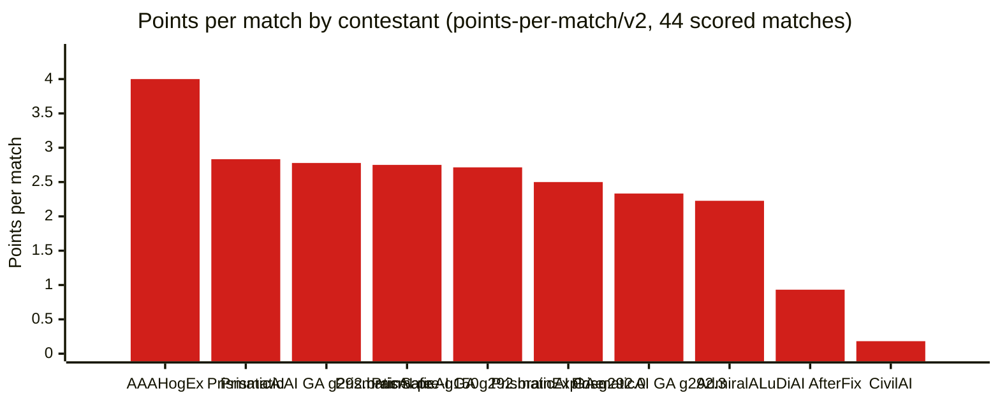
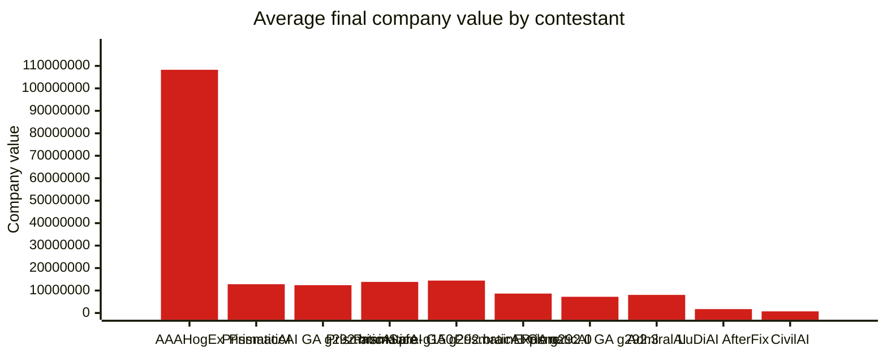
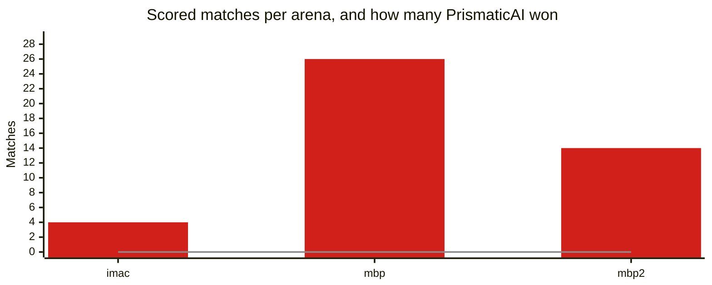

# battle-20261121T172940-d3412c1e

Derived from `battle-20261121T172940-d3412c1e.json` by `tools/research/ai-battle/battle.py report`; do not edit.

- Edition `d3412c1ec723d9fa`: PrismaticAI and referee at `c3e8a705e21596bbdc0536482373eb176e5e9d8b`, base set `opengfx-8.0.tar`
- 20-year free-for-all from 1960, map 256x256 temperate, breakdowns 1
- 44 scored match(es) on `imac` (20261119-master-gdf1e05e7d8), `mbp` (20261120-master-m17653b726e), `mbp2` (20261119-master-gdf1e05e7d8)
- Replays: 0 of 2 identical to their original on another arena

| # | Contestant | Played | Wins | Points | Points/match | Avg rank | Avg final value | Squirrel errors | Matches with anomalies |
|---|---|---|---|---|---|---|---|---|---|
| 1 | AAAHogEx | 44 | 44 | 176 | 4.0 | 1.0 | 108.3 M | 0 | 0 |
| 2 | PrismaticAI | 6 | 0 | 17 | 2.833 | 2.17 | 12.8 M | 0 | 0 |
| 3 | PrismaticAI GA g292.brainSafe | 9 | 0 | 25 | 2.778 | 2.22 | 12.4 M | 0 | 0 |
| 4 | PrismaticAI pre-g150 | 8 | 0 | 22 | 2.75 | 2.25 | 13.8 M | 0 | 0 |
| 5 | PrismaticAI GA g292.brainExplore | 7 | 0 | 19 | 2.714 | 2.29 | 14.4 M | 0 | 0 |
| 6 | PrismaticAI GA g292.0 | 8 | 0 | 20 | 2.5 | 2.5 | 8.6 M | 0 | 0 |
| 7 | PrismaticAI GA g292.3 | 6 | 0 | 14 | 2.333 | 2.67 | 7.2 M | 0 | 0 |
| 8 | AdmiralAI | 44 | 0 | 98 | 2.227 | 2.77 | 8.1 M | 116 | 2 |
| 9 | LuDiAI AfterFix | 44 | 0 | 41 | 0.932 | 4.07 | 1.7 M | 0 | 1 |
| 10 | CivilAI | 44 | 0 | 8 | 0.182 | 4.82 | 731.4 k | 0 | 11 |

```mermaid
---
config:
  xyChart:
    width: 900
    height: 360
  themeVariables:
    xyChart:
      plotColorPalette: "#d11f1a, #8a8a8a, #0b0b0b, #ece4d6"
---
xychart-beta
    title "Final company value per scored match: winner vs best PrismaticAI"
    x-axis ["m-0001", "m-0002", "m-0003", "m-0004", "m-0005", "m-0006", "m-0007", "m-0008", "m-0009", "m-0010", "m-0011", "m-0012", "m-0013", "m-0014", "m-0015", "m-0016", "m-0017", "m-0018", "m-0020", "m-0021", "m-0022", "m-0023", "m-0024", "m-0025", "m-0026", "m-0027", "m-0036", "m-0037", "m-0038", "m-0039", "m-0040", "m-0041", "m-0042", "m-0043", "m-0044", "m-0045", "m-0046", "m-0047", "m-0049", "m-0050", "m-0051", "m-0052", "m-0055", "m-0057"]
    %% series: Winner | Best PrismaticAI
    %% links: battle-20261121T172940-d3412c1e.md?col=Match&filter=m-0001 | battle-20261121T172940-d3412c1e.md?col=Match&filter=m-0002 | battle-20261121T172940-d3412c1e.md?col=Match&filter=m-0003 | battle-20261121T172940-d3412c1e.md?col=Match&filter=m-0004 | battle-20261121T172940-d3412c1e.md?col=Match&filter=m-0005 | battle-20261121T172940-d3412c1e.md?col=Match&filter=m-0006 | battle-20261121T172940-d3412c1e.md?col=Match&filter=m-0007 | battle-20261121T172940-d3412c1e.md?col=Match&filter=m-0008 | battle-20261121T172940-d3412c1e.md?col=Match&filter=m-0009 | battle-20261121T172940-d3412c1e.md?col=Match&filter=m-0010 | battle-20261121T172940-d3412c1e.md?col=Match&filter=m-0011 | battle-20261121T172940-d3412c1e.md?col=Match&filter=m-0012 | battle-20261121T172940-d3412c1e.md?col=Match&filter=m-0013 | battle-20261121T172940-d3412c1e.md?col=Match&filter=m-0014 | battle-20261121T172940-d3412c1e.md?col=Match&filter=m-0015 | battle-20261121T172940-d3412c1e.md?col=Match&filter=m-0016 | battle-20261121T172940-d3412c1e.md?col=Match&filter=m-0017 | battle-20261121T172940-d3412c1e.md?col=Match&filter=m-0018 | battle-20261121T172940-d3412c1e.md?col=Match&filter=m-0020 | battle-20261121T172940-d3412c1e.md?col=Match&filter=m-0021 | battle-20261121T172940-d3412c1e.md?col=Match&filter=m-0022 | battle-20261121T172940-d3412c1e.md?col=Match&filter=m-0023 | battle-20261121T172940-d3412c1e.md?col=Match&filter=m-0024 | battle-20261121T172940-d3412c1e.md?col=Match&filter=m-0025 | battle-20261121T172940-d3412c1e.md?col=Match&filter=m-0026 | battle-20261121T172940-d3412c1e.md?col=Match&filter=m-0027 | battle-20261121T172940-d3412c1e.md?col=Match&filter=m-0036 | battle-20261121T172940-d3412c1e.md?col=Match&filter=m-0037 | battle-20261121T172940-d3412c1e.md?col=Match&filter=m-0038 | battle-20261121T172940-d3412c1e.md?col=Match&filter=m-0039 | battle-20261121T172940-d3412c1e.md?col=Match&filter=m-0040 | battle-20261121T172940-d3412c1e.md?col=Match&filter=m-0041 | battle-20261121T172940-d3412c1e.md?col=Match&filter=m-0042 | battle-20261121T172940-d3412c1e.md?col=Match&filter=m-0043 | battle-20261121T172940-d3412c1e.md?col=Match&filter=m-0044 | battle-20261121T172940-d3412c1e.md?col=Match&filter=m-0045 | battle-20261121T172940-d3412c1e.md?col=Match&filter=m-0046 | battle-20261121T172940-d3412c1e.md?col=Match&filter=m-0047 | battle-20261121T172940-d3412c1e.md?col=Match&filter=m-0049 | battle-20261121T172940-d3412c1e.md?col=Match&filter=m-0050 | battle-20261121T172940-d3412c1e.md?col=Match&filter=m-0051 | battle-20261121T172940-d3412c1e.md?col=Match&filter=m-0052 | battle-20261121T172940-d3412c1e.md?col=Match&filter=m-0055 | battle-20261121T172940-d3412c1e.md?col=Match&filter=m-0057
    y-axis "Company value" 0 --> 164000000
    bar [82415781, 77962930, 79803968, 83406642, 73701776, 115976910, 126521998, 125603235, 101088599, 117106101, 117377222, 104086653, 101688504, 71754138, 61681643, 59748066, 92245047, 109203848, 126856023, 103008232, 108447575, 124784604, 104398081, 105338737, 126769982, 149479654, 98767236, 104667706, 101507559, 130798785, 122596369, 126884263, 127347767, 108201573, 133445366, 137294029, 125824876, 112062687, 131872000, 135856217, 126384272, 114574498, 78614159, 96603096]
    line [12296492, 9727053, 8571060, 9972353, 8018281, 13210366, 11011473, 8878943, 12034695, 14707552, 9442373, 11367413, 16065351, 6733503, 11407621, 9707001, 5384028, 15464992, 13600863, 7528573, 10862054, 5126297, 9471239, 11322881, 4813173, 8307654, 17730603, 19847459, 5026088, 11918011, 15104838, 5623292, 9656463, 7603255, 12230402, 22154112, 23141056, 9670936, 15220846, 8152495, 20014930, 17555055, 17274245, 9486444]
```

<!-- battle-charts:begin -->
<!-- derived from battle-20261121T172940-d3412c1e.json by `battle.py render`; `battle.py check` fails when it is stale -->

<!-- battle-charts:end -->

| Seed | Original | Replay | Arenas | Identical |
|---|---|---|---|---|
| 1781229913 | m-0012 | m-0048 | imac / mbp | NO |
| 34679420 | m-0010 | m-0056 | imac / mbp | NO |

| Match | Arena | Seed | Winner | Value | Last | Anomalies |
|---|---|---|---|---|---|---|
| m-0001 | mbp | 1965184795 | AAAHogEx | 82.4 M | LuDiAI AfterFix | AdmiralAI: squirrel_errors:59 |
| m-0002 | mbp | 1965184795 | AAAHogEx | 78.0 M | AdmiralAI | - |
| m-0003 | mbp | 1965184795 | AAAHogEx | 79.8 M | CivilAI | - |
| m-0004 | mbp | 1965184795 | AAAHogEx | 83.4 M | CivilAI | CivilAI: fleet_drop:79->42 |
| m-0005 | mbp | 1965184795 | AAAHogEx | 73.7 M | CivilAI | CivilAI: fleet_drop:85->43 |
| m-0006 | mbp | 34679420 | AAAHogEx | 116.0 M | CivilAI | - |
| m-0007 | mbp | 34679420 | AAAHogEx | 126.5 M | CivilAI | CivilAI: fleet_drop:16->11 |
| m-0008 | mbp | 34679420 | AAAHogEx | 125.6 M | CivilAI | - |
| m-0009 | mbp | 34679420 | AAAHogEx | 101.1 M | CivilAI | - |
| m-0010 | imac | 34679420 | AAAHogEx | 117.1 M | CivilAI | CivilAI: no_vehicles |
| m-0011 | imac | 34679420 | AAAHogEx | 117.4 M | CivilAI | - |
| m-0012 | imac | 1781229913 | AAAHogEx | 104.1 M | CivilAI | CivilAI: no_vehicles |
| m-0013 | mbp2 | 1781229913 | AAAHogEx | 101.7 M | CivilAI | - |
| m-0014 | mbp2 | 1781229913 | AAAHogEx | 71.8 M | CivilAI | - |
| m-0015 | mbp2 | 1781229913 | AAAHogEx | 61.7 M | CivilAI | CivilAI: fleet_drop:118->67 |
| m-0016 | mbp2 | 1781229913 | AAAHogEx | 59.7 M | LuDiAI AfterFix | CivilAI: fleet_drop:94->61 |
| m-0017 | mbp2 | 1781229913 | AAAHogEx | 92.2 M | LuDiAI AfterFix | - |
| m-0018 | mbp2 | 29370960 | AAAHogEx | 109.2 M | CivilAI | - |
| m-0020 | mbp2 | 29370960 | AAAHogEx | 126.9 M | CivilAI | CivilAI: fleet_drop:42->21 |
| m-0021 | mbp2 | 29370960 | AAAHogEx | 103.0 M | CivilAI | - |
| m-0022 | mbp2 | 29370960 | AAAHogEx | 108.4 M | CivilAI | - |
| m-0023 | mbp2 | 29370960 | AAAHogEx | 124.8 M | CivilAI | - |
| m-0024 | mbp2 | 705055892 | AAAHogEx | 104.4 M | CivilAI | - |
| m-0025 | mbp2 | 705055892 | AAAHogEx | 105.3 M | CivilAI | - |
| m-0026 | mbp2 | 705055892 | AAAHogEx | 126.8 M | CivilAI | - |
| m-0027 | mbp2 | 705055892 | AAAHogEx | 149.5 M | CivilAI | LuDiAI AfterFix: fleet_drop:42->24 |
| m-0036 | mbp | 192132718 | AAAHogEx | 98.8 M | CivilAI | - |
| m-0037 | mbp | 192132718 | AAAHogEx | 104.7 M | CivilAI | - |
| m-0038 | mbp | 192132718 | AAAHogEx | 101.5 M | CivilAI | AdmiralAI: squirrel_errors:57 |
| m-0039 | mbp | 192132718 | AAAHogEx | 130.8 M | CivilAI | CivilAI: fleet_drop:61->27 |
| m-0040 | mbp | 192132718 | AAAHogEx | 122.6 M | CivilAI | - |
| m-0041 | mbp | 192132718 | AAAHogEx | 126.9 M | CivilAI | CivilAI: fleet_drop:53->12 |
| m-0042 | mbp | 1160884098 | AAAHogEx | 127.3 M | LuDiAI AfterFix | - |
| m-0043 | mbp | 1160884098 | AAAHogEx | 108.2 M | CivilAI | - |
| m-0044 | mbp | 1160884098 | AAAHogEx | 133.4 M | CivilAI | - |
| m-0045 | mbp | 1160884098 | AAAHogEx | 137.3 M | CivilAI | - |
| m-0046 | imac | 1160884098 | AAAHogEx | 125.8 M | LuDiAI AfterFix | - |
| m-0047 | mbp | 1160884098 | AAAHogEx | 112.1 M | LuDiAI AfterFix | CivilAI: fleet_drop:32->16 |
| m-0048 (replay) | mbp | 1781229913 | AAAHogEx | 106.1 M | CivilAI | CivilAI: no_vehicles |
| m-0049 | mbp | 943625800 | AAAHogEx | 131.9 M | LuDiAI AfterFix | - |
| m-0050 | mbp | 943625800 | AAAHogEx | 135.9 M | CivilAI | - |
| m-0051 | mbp | 943625800 | AAAHogEx | 126.4 M | CivilAI | - |
| m-0052 | mbp | 943625800 | AAAHogEx | 114.6 M | CivilAI | - |
| m-0055 | mbp | 1948687370 | AAAHogEx | 78.6 M | CivilAI | - |
| m-0056 (replay) | mbp | 34679420 | AAAHogEx | 116.7 M | CivilAI | - |
| m-0057 | mbp | 1948687370 | AAAHogEx | 96.6 M | CivilAI | - |
