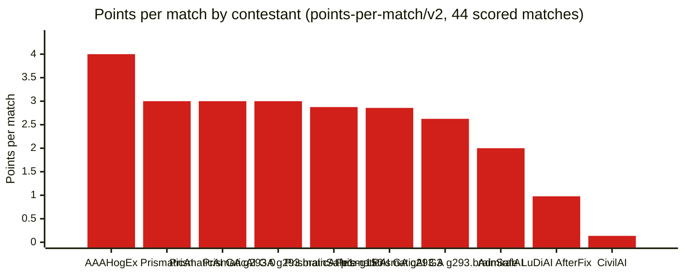
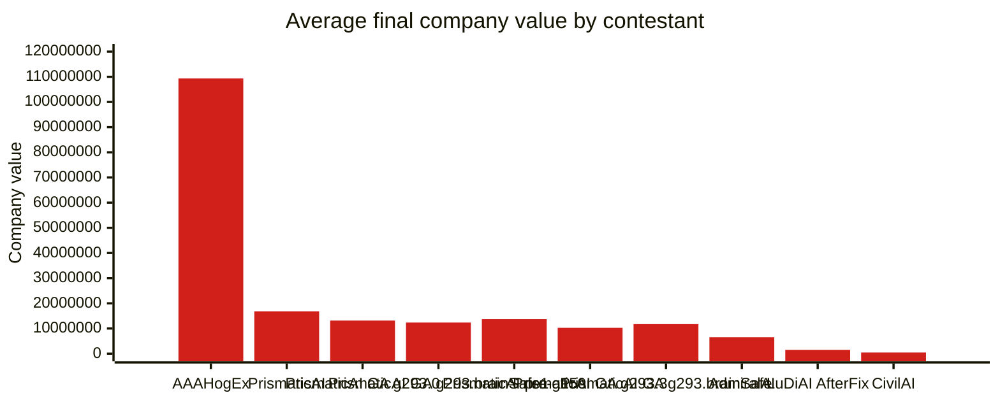
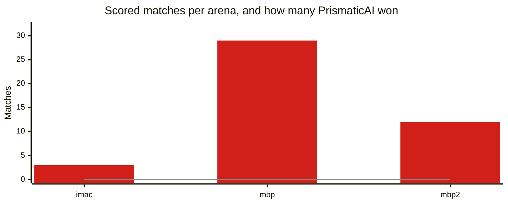

# battle-20261121T174309-f8f61706

Derived from `battle-20261121T174309-f8f61706.json` by `tools/research/ai-battle/battle.py report`; do not edit.

- Edition `f8f6170678962fc5`: PrismaticAI and referee at `c3e8a705e21596bbdc0536482373eb176e5e9d8b`, base set `opengfx-8.0.tar`
- 20-year free-for-all from 1960, map 256x256 temperate, breakdowns 1
- 44 scored match(es) on `imac` (20261119-master-gdf1e05e7d8), `mbp` (20261120-master-m17653b726e), `mbp2` (20261119-master-gdf1e05e7d8)
- Replays: 0 of 2 identical to their original on another arena

| # | Contestant | Played | Wins | Points | Points/match | Avg rank | Avg final value | Squirrel errors | Matches with anomalies |
|---|---|---|---|---|---|---|---|---|---|
| 1 | AAAHogEx | 44 | 44 | 176 | 4.0 | 1.0 | 109.3 M | 0 | 0 |
| 2 | PrismaticAI | 8 | 0 | 24 | 3.0 | 2.0 | 16.8 M | 0 | 0 |
| 3 | PrismaticAI GA g293.0 | 6 | 0 | 18 | 3.0 | 2.0 | 13.2 M | 0 | 0 |
| 4 | PrismaticAI GA g293.brainSafe1 | 7 | 0 | 21 | 3.0 | 2.0 | 12.4 M | 0 | 0 |
| 5 | PrismaticAI pre-g150 | 8 | 0 | 23 | 2.875 | 2.12 | 13.7 M | 0 | 0 |
| 6 | PrismaticAI GA g293.3 | 7 | 0 | 20 | 2.857 | 2.14 | 10.3 M | 0 | 0 |
| 7 | PrismaticAI GA g293.brainSafe | 8 | 0 | 21 | 2.625 | 2.38 | 11.7 M | 0 | 0 |
| 8 | AdmiralAI | 44 | 0 | 88 | 2.0 | 3.0 | 6.6 M | 0 | 0 |
| 9 | LuDiAI AfterFix | 44 | 0 | 43 | 0.977 | 4.02 | 1.5 M | 0 | 0 |
| 10 | CivilAI | 44 | 0 | 6 | 0.136 | 4.86 | 459.2 k | 0 | 14 |

```mermaid
---
config:
  xyChart:
    width: 900
    height: 360
  themeVariables:
    xyChart:
      plotColorPalette: "#d11f1a, #8a8a8a, #0b0b0b, #ece4d6"
---
xychart-beta
    title "Final company value per scored match: winner vs best PrismaticAI"
    x-axis ["m-0001", "m-0002", "m-0003", "m-0004", "m-0005", "m-0006", "m-0007", "m-0008", "m-0009", "m-0010", "m-0011", "m-0012", "m-0014", "m-0015", "m-0016", "m-0017", "m-0018", "m-0019", "m-0020", "m-0021", "m-0022", "m-0023", "m-0024", "m-0025", "m-0036", "m-0037", "m-0038", "m-0039", "m-0040", "m-0041", "m-0042", "m-0043", "m-0044", "m-0045", "m-0046", "m-0047", "m-0051", "m-0052", "m-0053", "m-0054", "m-0055", "m-0057", "m-0060", "m-0061"]
    %% series: Winner | Best PrismaticAI
    %% links: battle-20261121T174309-f8f61706.md?col=Match&filter=m-0001 | battle-20261121T174309-f8f61706.md?col=Match&filter=m-0002 | battle-20261121T174309-f8f61706.md?col=Match&filter=m-0003 | battle-20261121T174309-f8f61706.md?col=Match&filter=m-0004 | battle-20261121T174309-f8f61706.md?col=Match&filter=m-0005 | battle-20261121T174309-f8f61706.md?col=Match&filter=m-0006 | battle-20261121T174309-f8f61706.md?col=Match&filter=m-0007 | battle-20261121T174309-f8f61706.md?col=Match&filter=m-0008 | battle-20261121T174309-f8f61706.md?col=Match&filter=m-0009 | battle-20261121T174309-f8f61706.md?col=Match&filter=m-0010 | battle-20261121T174309-f8f61706.md?col=Match&filter=m-0011 | battle-20261121T174309-f8f61706.md?col=Match&filter=m-0012 | battle-20261121T174309-f8f61706.md?col=Match&filter=m-0014 | battle-20261121T174309-f8f61706.md?col=Match&filter=m-0015 | battle-20261121T174309-f8f61706.md?col=Match&filter=m-0016 | battle-20261121T174309-f8f61706.md?col=Match&filter=m-0017 | battle-20261121T174309-f8f61706.md?col=Match&filter=m-0018 | battle-20261121T174309-f8f61706.md?col=Match&filter=m-0019 | battle-20261121T174309-f8f61706.md?col=Match&filter=m-0020 | battle-20261121T174309-f8f61706.md?col=Match&filter=m-0021 | battle-20261121T174309-f8f61706.md?col=Match&filter=m-0022 | battle-20261121T174309-f8f61706.md?col=Match&filter=m-0023 | battle-20261121T174309-f8f61706.md?col=Match&filter=m-0024 | battle-20261121T174309-f8f61706.md?col=Match&filter=m-0025 | battle-20261121T174309-f8f61706.md?col=Match&filter=m-0036 | battle-20261121T174309-f8f61706.md?col=Match&filter=m-0037 | battle-20261121T174309-f8f61706.md?col=Match&filter=m-0038 | battle-20261121T174309-f8f61706.md?col=Match&filter=m-0039 | battle-20261121T174309-f8f61706.md?col=Match&filter=m-0040 | battle-20261121T174309-f8f61706.md?col=Match&filter=m-0041 | battle-20261121T174309-f8f61706.md?col=Match&filter=m-0042 | battle-20261121T174309-f8f61706.md?col=Match&filter=m-0043 | battle-20261121T174309-f8f61706.md?col=Match&filter=m-0044 | battle-20261121T174309-f8f61706.md?col=Match&filter=m-0045 | battle-20261121T174309-f8f61706.md?col=Match&filter=m-0046 | battle-20261121T174309-f8f61706.md?col=Match&filter=m-0047 | battle-20261121T174309-f8f61706.md?col=Match&filter=m-0051 | battle-20261121T174309-f8f61706.md?col=Match&filter=m-0052 | battle-20261121T174309-f8f61706.md?col=Match&filter=m-0053 | battle-20261121T174309-f8f61706.md?col=Match&filter=m-0054 | battle-20261121T174309-f8f61706.md?col=Match&filter=m-0055 | battle-20261121T174309-f8f61706.md?col=Match&filter=m-0057 | battle-20261121T174309-f8f61706.md?col=Match&filter=m-0060 | battle-20261121T174309-f8f61706.md?col=Match&filter=m-0061
    y-axis "Company value" 0 --> 192000000
    bar [136669062, 135866825, 123317589, 148511238, 126986083, 110105854, 100789294, 96654029, 84458275, 88932768, 108894249, 81831632, 101653322, 102508106, 125163819, 114239961, 79539229, 86492607, 76483106, 94591536, 82799616, 49855156, 97368448, 72250084, 143938526, 150557773, 149369592, 174781067, 133487298, 145761547, 103960979, 115026354, 109630904, 102171802, 125869717, 101166859, 115861760, 119001459, 102849712, 99733861, 99776728, 100732062, 83817211, 107282976]
    line [12699218, 10242409, 8694392, 7704163, 9597797, 13753190, 9491165, 7350588, 12546668, 8361978, 2049127, 21084744, 13875916, 14519664, 15068101, 11927902, 14277783, 15336984, 13356975, 8602009, 13620369, 9221497, 15887251, 16228862, 21368469, 17049520, 18425309, 9254409, 15082490, 10998084, 19397397, 15926410, 15654188, 13935292, 16472737, 14675347, 10069043, 10251301, 13442444, 11596157, 14422957, 16288360, 17180621, 8572269]
```

<!-- battle-charts:begin -->
<!-- derived from battle-20261121T174309-f8f61706.json by `battle.py render`; `battle.py check` fails when it is stale -->

<!-- battle-charts:end -->

| Seed | Original | Replay | Arenas | Identical |
|---|---|---|---|---|
| 725670195 | m-0010 | m-0048 | imac / mbp | NO |
| 725670195 | m-0011 | m-0056 | imac / mbp | NO |

| Match | Arena | Seed | Winner | Value | Last | Anomalies |
|---|---|---|---|---|---|---|
| m-0001 | mbp | 1463632506 | AAAHogEx | 136.7 M | CivilAI | - |
| m-0002 | mbp | 1463632506 | AAAHogEx | 135.9 M | CivilAI | - |
| m-0003 | mbp | 1463632506 | AAAHogEx | 123.3 M | CivilAI | - |
| m-0004 | mbp | 1463632506 | AAAHogEx | 148.5 M | LuDiAI AfterFix | - |
| m-0005 | mbp | 1463632506 | AAAHogEx | 127.0 M | CivilAI | - |
| m-0006 | mbp | 725670195 | AAAHogEx | 110.1 M | CivilAI | CivilAI: fleet_drop:31->19 |
| m-0007 | mbp | 725670195 | AAAHogEx | 100.8 M | CivilAI | CivilAI: fleet_drop:14->9 |
| m-0008 | mbp | 725670195 | AAAHogEx | 96.7 M | CivilAI | - |
| m-0009 | mbp | 725670195 | AAAHogEx | 84.5 M | LuDiAI AfterFix | - |
| m-0010 | imac | 725670195 | AAAHogEx | 88.9 M | CivilAI | CivilAI: fleet_drop:31->10 |
| m-0011 | imac | 725670195 | AAAHogEx | 108.9 M | CivilAI | - |
| m-0012 | imac | 572678493 | AAAHogEx | 81.8 M | CivilAI | - |
| m-0014 | mbp2 | 572678493 | AAAHogEx | 101.7 M | CivilAI | - |
| m-0015 | mbp2 | 572678493 | AAAHogEx | 102.5 M | CivilAI | - |
| m-0016 | mbp2 | 572678493 | AAAHogEx | 125.2 M | CivilAI | CivilAI: fleet_drop:23->16 |
| m-0017 | mbp2 | 572678493 | AAAHogEx | 114.2 M | CivilAI | CivilAI: fleet_drop:43->21 |
| m-0018 | mbp2 | 127833289 | AAAHogEx | 79.5 M | CivilAI | CivilAI: fleet_drop:87->46 |
| m-0019 | mbp2 | 127833289 | AAAHogEx | 86.5 M | CivilAI | - |
| m-0020 | mbp2 | 127833289 | AAAHogEx | 76.5 M | CivilAI | CivilAI: no_vehicles |
| m-0021 | mbp2 | 127833289 | AAAHogEx | 94.6 M | CivilAI | - |
| m-0022 | mbp2 | 127833289 | AAAHogEx | 82.8 M | CivilAI | CivilAI: no_vehicles |
| m-0023 | mbp2 | 127833289 | AAAHogEx | 49.9 M | CivilAI | CivilAI: no_vehicles |
| m-0024 | mbp2 | 385368374 | AAAHogEx | 97.4 M | LuDiAI AfterFix | - |
| m-0025 | mbp2 | 385368374 | AAAHogEx | 72.3 M | CivilAI | - |
| m-0036 | mbp | 1953855029 | AAAHogEx | 143.9 M | CivilAI | CivilAI: fleet_drop:48->32 |
| m-0037 | mbp | 1953855029 | AAAHogEx | 150.6 M | LuDiAI AfterFix | - |
| m-0038 | mbp | 1953855029 | AAAHogEx | 149.4 M | CivilAI | - |
| m-0039 | mbp | 1953855029 | AAAHogEx | 174.8 M | CivilAI | - |
| m-0040 | mbp | 1953855029 | AAAHogEx | 133.5 M | CivilAI | CivilAI: fleet_drop:45->27 |
| m-0041 | mbp | 1953855029 | AAAHogEx | 145.8 M | CivilAI | CivilAI: fleet_drop:49->29 |
| m-0042 | mbp | 1239822318 | AAAHogEx | 104.0 M | CivilAI | - |
| m-0043 | mbp | 1239822318 | AAAHogEx | 115.0 M | CivilAI | CivilAI: no_vehicles |
| m-0044 | mbp | 1239822318 | AAAHogEx | 109.6 M | AdmiralAI | - |
| m-0045 | mbp | 1239822318 | AAAHogEx | 102.2 M | LuDiAI AfterFix | - |
| m-0046 | mbp | 1239822318 | AAAHogEx | 125.9 M | CivilAI | - |
| m-0047 | mbp | 1239822318 | AAAHogEx | 101.2 M | CivilAI | - |
| m-0048 (replay) | mbp | 725670195 | AAAHogEx | 87.4 M | CivilAI | CivilAI: fleet_drop:28->16 |
| m-0051 | mbp | 615463118 | AAAHogEx | 115.9 M | CivilAI | - |
| m-0052 | mbp | 615463118 | AAAHogEx | 119.0 M | CivilAI | - |
| m-0053 | mbp | 615463118 | AAAHogEx | 102.8 M | CivilAI | - |
| m-0054 | mbp | 229762971 | AAAHogEx | 99.7 M | CivilAI | - |
| m-0055 | mbp | 229762971 | AAAHogEx | 99.8 M | CivilAI | - |
| m-0056 (replay) | mbp | 725670195 | AAAHogEx | 108.3 M | CivilAI | - |
| m-0057 | mbp | 229762971 | AAAHogEx | 100.7 M | CivilAI | - |
| m-0060 | mbp | 1375140563 | AAAHogEx | 83.8 M | CivilAI | CivilAI: no_vehicles |
| m-0061 | mbp | 1375140563 | AAAHogEx | 107.3 M | CivilAI | - |
