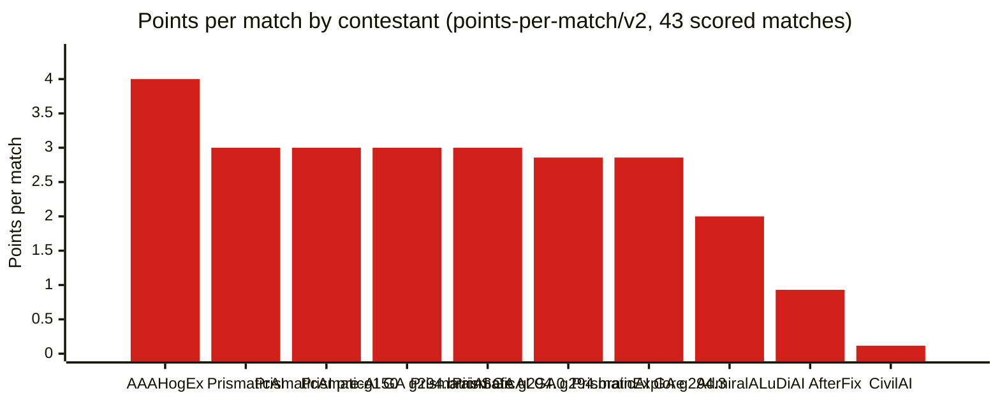
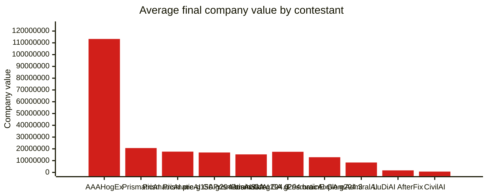
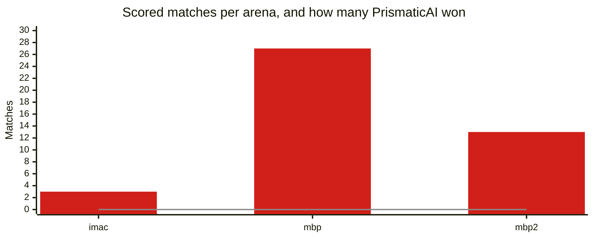

# battle-20261121T180455-5e5b9f93

Derived from `battle-20261121T180455-5e5b9f93.json` by `tools/research/ai-battle/battle.py report`; do not edit.

- Edition `5e5b9f934f7f7216`: PrismaticAI and referee at `05aa9a18c30f55c72b8d5101385cbfdce4fa3ba4`, base set `opengfx-8.0.tar`
- 20-year free-for-all from 1960, map 256x256 temperate, breakdowns 1
- 43 scored match(es) on `imac` (20261119-master-gdf1e05e7d8), `mbp` (20261120-master-m17653b726e), `mbp2` (20261119-master-gdf1e05e7d8)
- Replays: 0 of 0 identical to their original on another arena

| # | Contestant | Played | Wins | Points | Points/match | Avg rank | Avg final value | Squirrel errors | Matches with anomalies |
|---|---|---|---|---|---|---|---|---|---|
| 1 | AAAHogEx | 43 | 43 | 172 | 4.0 | 1.0 | 113.3 M | 0 | 0 |
| 2 | PrismaticAI | 7 | 0 | 21 | 3.0 | 2.0 | 20.7 M | 0 | 0 |
| 3 | PrismaticAI pre-g150 | 8 | 0 | 24 | 3.0 | 2.0 | 17.6 M | 0 | 0 |
| 4 | PrismaticAI GA g294.brainSafe | 7 | 0 | 21 | 3.0 | 2.0 | 16.9 M | 0 | 0 |
| 5 | PrismaticAI GA g294.0 | 7 | 0 | 21 | 3.0 | 2.0 | 15.3 M | 0 | 0 |
| 6 | PrismaticAI GA g294.brainExplore | 7 | 0 | 20 | 2.857 | 2.14 | 17.5 M | 0 | 0 |
| 7 | PrismaticAI GA g294.3 | 7 | 0 | 20 | 2.857 | 2.14 | 12.9 M | 0 | 0 |
| 8 | AdmiralAI | 43 | 0 | 86 | 2.0 | 3.0 | 8.4 M | 59 | 1 |
| 9 | LuDiAI AfterFix | 43 | 0 | 40 | 0.93 | 4.07 | 1.7 M | 0 | 0 |
| 10 | CivilAI | 43 | 0 | 5 | 0.116 | 4.88 | 703.2 k | 10955 | 10 |

```mermaid
---
config:
  xyChart:
    width: 900
    height: 360
  themeVariables:
    xyChart:
      plotColorPalette: "#d11f1a, #8a8a8a, #0b0b0b, #ece4d6"
---
xychart-beta
    title "Final company value per scored match: winner vs best PrismaticAI"
    x-axis ["m-0001", "m-0002", "m-0003", "m-0004", "m-0005", "m-0006", "m-0007", "m-0008", "m-0009", "m-0010", "m-0011", "m-0012", "m-0013", "m-0014", "m-0015", "m-0016", "m-0017", "m-0018", "m-0019", "m-0020", "m-0021", "m-0022", "m-0023", "m-0024", "m-0025", "m-0036", "m-0037", "m-0038", "m-0039", "m-0040", "m-0041", "m-0042", "m-0043", "m-0044", "m-0045", "m-0046", "m-0047", "m-0048", "m-0049", "m-0050", "m-0051", "m-0052", "m-0053"]
    %% series: Winner | Best PrismaticAI
    %% links: battle-20261121T180455-5e5b9f93.md?col=Match&filter=m-0001 | battle-20261121T180455-5e5b9f93.md?col=Match&filter=m-0002 | battle-20261121T180455-5e5b9f93.md?col=Match&filter=m-0003 | battle-20261121T180455-5e5b9f93.md?col=Match&filter=m-0004 | battle-20261121T180455-5e5b9f93.md?col=Match&filter=m-0005 | battle-20261121T180455-5e5b9f93.md?col=Match&filter=m-0006 | battle-20261121T180455-5e5b9f93.md?col=Match&filter=m-0007 | battle-20261121T180455-5e5b9f93.md?col=Match&filter=m-0008 | battle-20261121T180455-5e5b9f93.md?col=Match&filter=m-0009 | battle-20261121T180455-5e5b9f93.md?col=Match&filter=m-0010 | battle-20261121T180455-5e5b9f93.md?col=Match&filter=m-0011 | battle-20261121T180455-5e5b9f93.md?col=Match&filter=m-0012 | battle-20261121T180455-5e5b9f93.md?col=Match&filter=m-0013 | battle-20261121T180455-5e5b9f93.md?col=Match&filter=m-0014 | battle-20261121T180455-5e5b9f93.md?col=Match&filter=m-0015 | battle-20261121T180455-5e5b9f93.md?col=Match&filter=m-0016 | battle-20261121T180455-5e5b9f93.md?col=Match&filter=m-0017 | battle-20261121T180455-5e5b9f93.md?col=Match&filter=m-0018 | battle-20261121T180455-5e5b9f93.md?col=Match&filter=m-0019 | battle-20261121T180455-5e5b9f93.md?col=Match&filter=m-0020 | battle-20261121T180455-5e5b9f93.md?col=Match&filter=m-0021 | battle-20261121T180455-5e5b9f93.md?col=Match&filter=m-0022 | battle-20261121T180455-5e5b9f93.md?col=Match&filter=m-0023 | battle-20261121T180455-5e5b9f93.md?col=Match&filter=m-0024 | battle-20261121T180455-5e5b9f93.md?col=Match&filter=m-0025 | battle-20261121T180455-5e5b9f93.md?col=Match&filter=m-0036 | battle-20261121T180455-5e5b9f93.md?col=Match&filter=m-0037 | battle-20261121T180455-5e5b9f93.md?col=Match&filter=m-0038 | battle-20261121T180455-5e5b9f93.md?col=Match&filter=m-0039 | battle-20261121T180455-5e5b9f93.md?col=Match&filter=m-0040 | battle-20261121T180455-5e5b9f93.md?col=Match&filter=m-0041 | battle-20261121T180455-5e5b9f93.md?col=Match&filter=m-0042 | battle-20261121T180455-5e5b9f93.md?col=Match&filter=m-0043 | battle-20261121T180455-5e5b9f93.md?col=Match&filter=m-0044 | battle-20261121T180455-5e5b9f93.md?col=Match&filter=m-0045 | battle-20261121T180455-5e5b9f93.md?col=Match&filter=m-0046 | battle-20261121T180455-5e5b9f93.md?col=Match&filter=m-0047 | battle-20261121T180455-5e5b9f93.md?col=Match&filter=m-0048 | battle-20261121T180455-5e5b9f93.md?col=Match&filter=m-0049 | battle-20261121T180455-5e5b9f93.md?col=Match&filter=m-0050 | battle-20261121T180455-5e5b9f93.md?col=Match&filter=m-0051 | battle-20261121T180455-5e5b9f93.md?col=Match&filter=m-0052 | battle-20261121T180455-5e5b9f93.md?col=Match&filter=m-0053
    y-axis "Company value" 0 --> 177000000
    bar [94274990, 89386184, 77433264, 78088789, 85797147, 115369251, 127388973, 118673692, 121788900, 115503013, 147706518, 93893279, 93289626, 101801942, 98050222, 92880894, 109332978, 108944375, 106455071, 141996856, 106876020, 119786926, 123302564, 118159382, 116371491, 128244119, 149387388, 160524262, 119340633, 131879947, 127644610, 112849883, 114037870, 120266381, 109872155, 125695891, 111913367, 135113485, 118895852, 89963657, 120545844, 88546842, 104306166]
    line [18230062, 14496186, 11835601, 16023042, 10415844, 23163660, 15620735, 17785391, 16570824, 23943462, 14177272, 20739468, 17497798, 13213059, 17828716, 18345786, 19143648, 18721393, 13793188, 17661998, 15263954, 13034125, 12279413, 14096549, 13911313, 33786490, 25632095, 15914729, 25070390, 26435390, 13444207, 15329674, 14804073, 13363522, 13843569, 13869696, 8481621, 18931045, 21672832, 14715392, 17991191, 10974372, 12377008]
```

<!-- battle-charts:begin -->
<!-- derived from battle-20261121T180455-5e5b9f93.json by `battle.py render`; `battle.py check` fails when it is stale -->

<!-- battle-charts:end -->

| Match | Arena | Seed | Winner | Value | Last | Anomalies |
|---|---|---|---|---|---|---|
| m-0001 | mbp | 180878320 | AAAHogEx | 94.3 M | CivilAI | CivilAI: fleet_drop:81->54 |
| m-0002 | mbp | 180878320 | AAAHogEx | 89.4 M | CivilAI | - |
| m-0003 | mbp | 180878320 | AAAHogEx | 77.4 M | LuDiAI AfterFix | - |
| m-0004 | mbp | 180878320 | AAAHogEx | 78.1 M | CivilAI | - |
| m-0005 | mbp | 180878320 | AAAHogEx | 85.8 M | CivilAI | CivilAI: fleet_drop:43->24 |
| m-0006 | mbp | 57633748 | AAAHogEx | 115.4 M | CivilAI | - |
| m-0007 | mbp | 57633748 | AAAHogEx | 127.4 M | CivilAI | AdmiralAI: squirrel_errors:59; CivilAI: fleet_drop:56->35 |
| m-0008 | mbp | 57633748 | AAAHogEx | 118.7 M | CivilAI | - |
| m-0009 | mbp | 57633748 | AAAHogEx | 121.8 M | CivilAI | CivilAI: fleet_drop:25->5 |
| m-0010 | imac | 57633748 | AAAHogEx | 115.5 M | CivilAI | - |
| m-0011 | imac | 57633748 | AAAHogEx | 147.7 M | CivilAI | - |
| m-0012 | imac | 40820041 | AAAHogEx | 93.9 M | CivilAI | - |
| m-0013 | mbp2 | 40820041 | AAAHogEx | 93.3 M | CivilAI | CivilAI: fleet_drop:43->11 |
| m-0014 | mbp2 | 40820041 | AAAHogEx | 101.8 M | CivilAI | - |
| m-0015 | mbp2 | 40820041 | AAAHogEx | 98.1 M | CivilAI | - |
| m-0016 | mbp2 | 40820041 | AAAHogEx | 92.9 M | CivilAI | - |
| m-0017 | mbp2 | 40820041 | AAAHogEx | 109.3 M | CivilAI | - |
| m-0018 | mbp2 | 875788071 | AAAHogEx | 108.9 M | CivilAI | - |
| m-0019 | mbp2 | 875788071 | AAAHogEx | 106.5 M | CivilAI | - |
| m-0020 | mbp2 | 875788071 | AAAHogEx | 142.0 M | CivilAI | - |
| m-0021 | mbp2 | 875788071 | AAAHogEx | 106.9 M | CivilAI | - |
| m-0022 | mbp2 | 875788071 | AAAHogEx | 119.8 M | CivilAI | - |
| m-0023 | mbp2 | 875788071 | AAAHogEx | 123.3 M | CivilAI | CivilAI: squirrel_errors:3705 |
| m-0024 | mbp2 | 1219487520 | AAAHogEx | 118.2 M | CivilAI | CivilAI: squirrel_errors:3625 |
| m-0025 | mbp2 | 1219487520 | AAAHogEx | 116.4 M | CivilAI | CivilAI: squirrel_errors:3625 |
| m-0036 | mbp | 882919990 | AAAHogEx | 128.2 M | CivilAI | - |
| m-0037 | mbp | 882919990 | AAAHogEx | 149.4 M | CivilAI | - |
| m-0038 | mbp | 882919990 | AAAHogEx | 160.5 M | CivilAI | CivilAI: fleet_drop:35->17 |
| m-0039 | mbp | 882919990 | AAAHogEx | 119.3 M | CivilAI | - |
| m-0040 | mbp | 882919990 | AAAHogEx | 131.9 M | CivilAI | - |
| m-0041 | mbp | 882919990 | AAAHogEx | 127.6 M | CivilAI | - |
| m-0042 | mbp | 1704789431 | AAAHogEx | 112.8 M | CivilAI | CivilAI: fleet_drop:121->48 |
| m-0043 | mbp | 1704789431 | AAAHogEx | 114.0 M | CivilAI | - |
| m-0044 | mbp | 1704789431 | AAAHogEx | 120.3 M | LuDiAI AfterFix | - |
| m-0045 | mbp | 1704789431 | AAAHogEx | 109.9 M | CivilAI | - |
| m-0046 | mbp | 1704789431 | AAAHogEx | 125.7 M | LuDiAI AfterFix | - |
| m-0047 | mbp | 1704789431 | AAAHogEx | 111.9 M | LuDiAI AfterFix | - |
| m-0048 | mbp | 876745016 | AAAHogEx | 135.1 M | CivilAI | - |
| m-0049 | mbp | 876745016 | AAAHogEx | 118.9 M | CivilAI | - |
| m-0050 | mbp | 876745016 | AAAHogEx | 90.0 M | CivilAI | - |
| m-0051 | mbp | 876745016 | AAAHogEx | 120.5 M | CivilAI | - |
| m-0052 | mbp | 876745016 | AAAHogEx | 88.5 M | CivilAI | - |
| m-0053 | mbp | 876745016 | AAAHogEx | 104.3 M | LuDiAI AfterFix | - |
