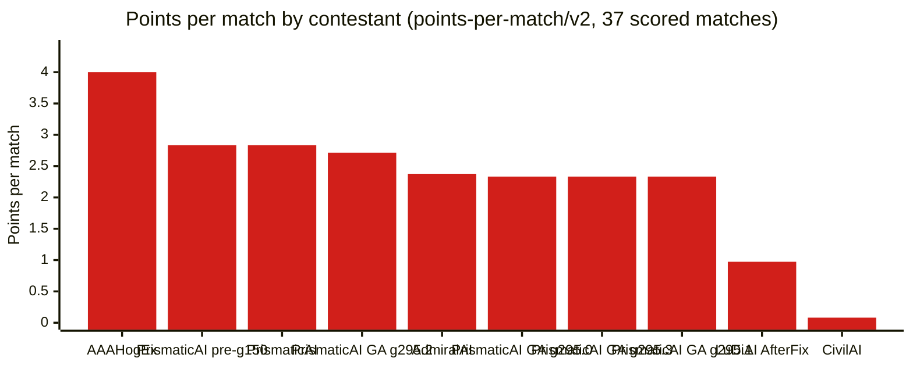
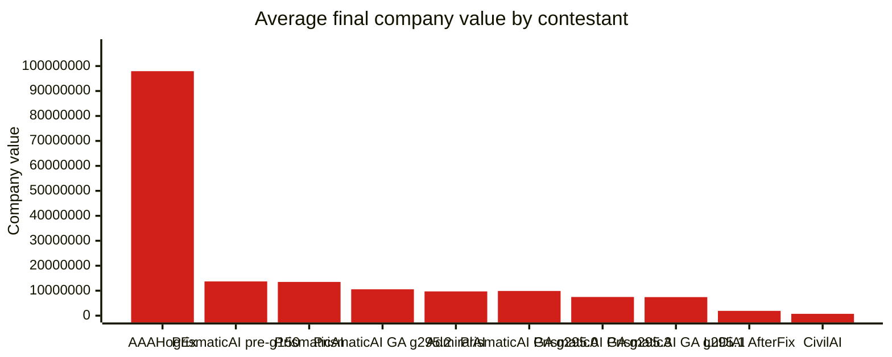
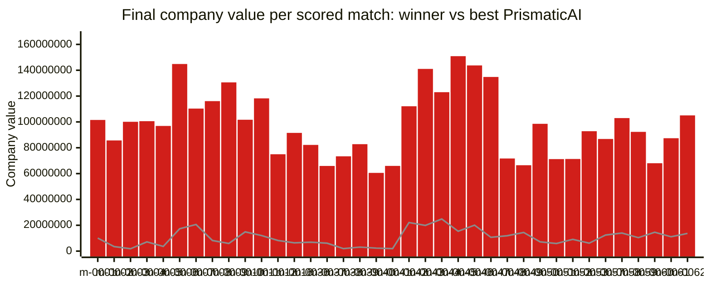
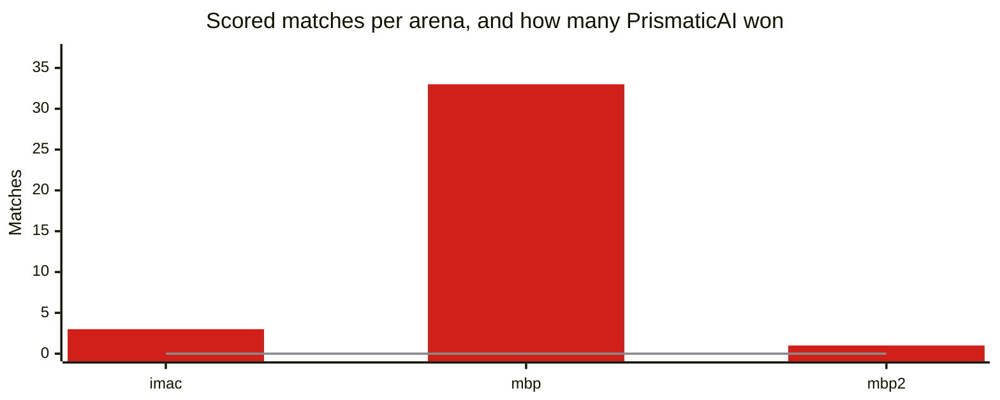

# battle-20261121T181825-55c0564d

Derived from `battle-20261121T181825-55c0564d.json` by `tools/research/ai-battle/battle.py report`; do not edit.

- Edition `55c0564de2bc7419`: PrismaticAI and referee at `05aa9a18c30f55c72b8d5101385cbfdce4fa3ba4`, base set `opengfx-8.0.tar`
- 20-year free-for-all from 1960, map 256x256 temperate, breakdowns 1
- 37 scored match(es) on `imac` (20261119-master-gdf1e05e7d8), `mbp` (20261120-master-m17653b726e), `mbp2` (20261119-master-gdf1e05e7d8)
- Replays: 0 of 1 identical to their original on another arena

| # | Contestant | Played | Wins | Points | Points/match | Avg rank | Avg final value | Squirrel errors | Matches with anomalies |
|---|---|---|---|---|---|---|---|---|---|
| 1 | AAAHogEx | 37 | 37 | 148 | 4.0 | 1.0 | 97.9 M | 68 | 1 |
| 2 | PrismaticAI pre-g150 | 6 | 0 | 17 | 2.833 | 2.17 | 13.7 M | 0 | 0 |
| 3 | PrismaticAI | 6 | 0 | 17 | 2.833 | 2.17 | 13.5 M | 0 | 0 |
| 4 | PrismaticAI GA g295.2 | 7 | 0 | 19 | 2.714 | 2.29 | 10.6 M | 0 | 0 |
| 5 | AdmiralAI | 37 | 0 | 88 | 2.378 | 2.62 | 9.7 M | 0 | 0 |
| 6 | PrismaticAI GA g295.0 | 6 | 0 | 14 | 2.333 | 2.67 | 9.9 M | 0 | 0 |
| 7 | PrismaticAI GA g295.3 | 6 | 0 | 14 | 2.333 | 2.67 | 7.5 M | 0 | 1 |
| 8 | PrismaticAI GA g295.1 | 6 | 0 | 14 | 2.333 | 2.67 | 7.4 M | 0 | 0 |
| 9 | LuDiAI AfterFix | 37 | 0 | 36 | 0.973 | 4.03 | 1.9 M | 0 | 2 |
| 10 | CivilAI | 37 | 0 | 3 | 0.081 | 4.92 | 725.2 k | 32 | 9 |

<!-- battle-charts:begin -->
<!-- derived from battle-20261121T181825-55c0564d.json by `battle.py render`; `battle.py check` fails when it is stale -->

<!-- battle-charts:end -->

| Seed | Original | Replay | Arenas | Identical |
|---|---|---|---|---|
| 1266277396 | m-0010 | m-0064 | imac / mbp | NO |

| Match | Arena | Seed | Winner | Value | Last | Anomalies |
|---|---|---|---|---|---|---|
| m-0001 | mbp | 1498164852 | AAAHogEx | 101.5 M | CivilAI | - |
| m-0002 | mbp | 1498164852 | AAAHogEx | 85.7 M | CivilAI | - |
| m-0003 | mbp | 1498164852 | AAAHogEx | 100.1 M | CivilAI | - |
| m-0004 | mbp | 1498164852 | AAAHogEx | 100.6 M | CivilAI | - |
| m-0005 | mbp | 1498164852 | AAAHogEx | 96.9 M | CivilAI | - |
| m-0006 | mbp | 1266277396 | AAAHogEx | 144.8 M | CivilAI | LuDiAI AfterFix: fleet_drop:93->64 |
| m-0007 | mbp | 1266277396 | AAAHogEx | 110.3 M | CivilAI | - |
| m-0008 | mbp | 1266277396 | AAAHogEx | 116.1 M | CivilAI | - |
| m-0009 | mbp | 1266277396 | AAAHogEx | 130.6 M | LuDiAI AfterFix | - |
| m-0010 | imac | 1266277396 | AAAHogEx | 101.7 M | CivilAI | LuDiAI AfterFix: fleet_drop:80->55 |
| m-0011 | imac | 1266277396 | AAAHogEx | 118.2 M | CivilAI | - |
| m-0012 | imac | 502411170 | AAAHogEx | 75.0 M | CivilAI | CivilAI: fleet_drop:49->33 |
| m-0016 | mbp2 | 502411170 | AAAHogEx | 91.5 M | CivilAI | AAAHogEx: squirrel_errors:68 |
| m-0036 | mbp | 400168884 | AAAHogEx | 82.2 M | CivilAI | - |
| m-0037 | mbp | 400168884 | AAAHogEx | 65.9 M | CivilAI | - |
| m-0038 | mbp | 400168884 | AAAHogEx | 73.4 M | CivilAI | CivilAI: fleet_drop:29->15 |
| m-0039 | mbp | 400168884 | AAAHogEx | 82.8 M | CivilAI | CivilAI: fleet_drop:18->12 |
| m-0040 | mbp | 400168884 | AAAHogEx | 60.5 M | CivilAI | - |
| m-0041 | mbp | 400168884 | AAAHogEx | 66.0 M | CivilAI | PrismaticAI GA g295.3: fleet_drop:21->14; CivilAI: fleet_drop:19->10 |
| m-0042 | mbp | 259256200 | AAAHogEx | 112.1 M | CivilAI | - |
| m-0043 | mbp | 259256200 | AAAHogEx | 141.0 M | CivilAI | - |
| m-0044 | mbp | 259256200 | AAAHogEx | 123.0 M | CivilAI | - |
| m-0045 | mbp | 259256200 | AAAHogEx | 150.9 M | CivilAI | - |
| m-0046 | mbp | 259256200 | AAAHogEx | 143.7 M | CivilAI | CivilAI: fleet_drop:55->27 |
| m-0047 | mbp | 259256200 | AAAHogEx | 134.8 M | CivilAI | - |
| m-0048 | mbp | 1158399133 | AAAHogEx | 71.7 M | CivilAI | - |
| m-0049 | mbp | 1158399133 | AAAHogEx | 66.5 M | CivilAI | - |
| m-0050 | mbp | 1158399133 | AAAHogEx | 98.5 M | CivilAI | CivilAI: fleet_drop:74->49 |
| m-0051 | mbp | 1158399133 | AAAHogEx | 71.2 M | CivilAI | CivilAI: squirrel_errors:32 |
| m-0052 | mbp | 1158399133 | AAAHogEx | 71.3 M | CivilAI | - |
| m-0053 | mbp | 1158399133 | AAAHogEx | 92.8 M | CivilAI | - |
| m-0057 | mbp | 541421308 | AAAHogEx | 86.8 M | CivilAI | - |
| m-0058 | mbp | 541421308 | AAAHogEx | 103.0 M | CivilAI | - |
| m-0059 | mbp | 541421308 | AAAHogEx | 92.3 M | CivilAI | CivilAI: fleet_drop:65->40 |
| m-0060 | mbp | 906983622 | AAAHogEx | 68.0 M | CivilAI | CivilAI: fleet_drop:35->24 |
| m-0061 | mbp | 906983622 | AAAHogEx | 87.4 M | LuDiAI AfterFix | - |
| m-0062 | mbp | 906983622 | AAAHogEx | 105.0 M | LuDiAI AfterFix | - |
| m-0064 (replay) | mbp | 1266277396 | AAAHogEx | 106.5 M | CivilAI | - |
