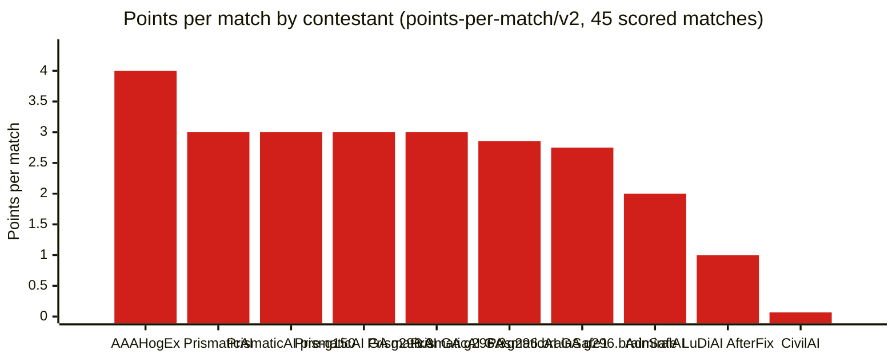
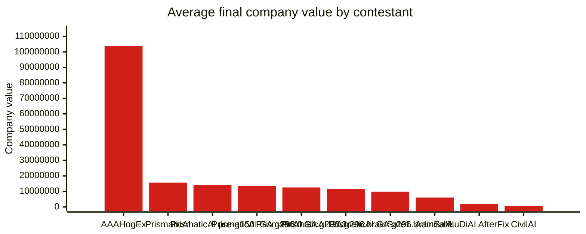
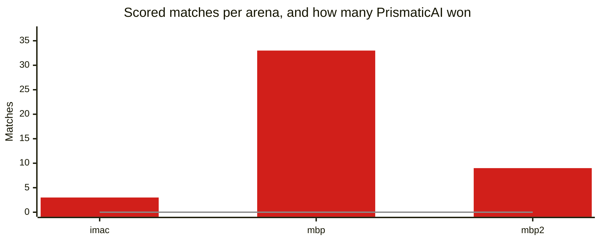

# battle-20261121T183120-99fb93f6

Derived from `battle-20261121T183120-99fb93f6.json` by `tools/research/ai-battle/battle.py report`; do not edit.

- Edition `99fb93f66377091c`: PrismaticAI and referee at `05aa9a18c30f55c72b8d5101385cbfdce4fa3ba4`, base set `opengfx-8.0.tar`
- 20-year free-for-all from 1960, map 256x256 temperate, breakdowns 1
- 45 scored match(es) on `imac` (20261119-master-gdf1e05e7d8), `mbp` (20261120-master-m17653b726e), `mbp2` (20261119-master-gdf1e05e7d8)
- Replays: 0 of 0 identical to their original on another arena

| # | Contestant | Played | Wins | Points | Points/match | Avg rank | Avg final value | Squirrel errors | Matches with anomalies |
|---|---|---|---|---|---|---|---|---|---|
| 1 | AAAHogEx | 45 | 45 | 180 | 4.0 | 1.0 | 103.8 M | 0 | 0 |
| 2 | PrismaticAI | 8 | 0 | 24 | 3.0 | 2.0 | 15.7 M | 0 | 0 |
| 3 | PrismaticAI pre-g150 | 8 | 0 | 24 | 3.0 | 2.0 | 14.1 M | 0 | 0 |
| 4 | PrismaticAI GA g296.0 | 6 | 0 | 18 | 3.0 | 2.0 | 13.5 M | 0 | 0 |
| 5 | PrismaticAI GA g296.3 | 8 | 0 | 24 | 3.0 | 2.0 | 12.5 M | 0 | 0 |
| 6 | PrismaticAI GA g296.brainSafe1 | 7 | 0 | 20 | 2.857 | 2.14 | 11.4 M | 0 | 0 |
| 7 | PrismaticAI GA g296.brainSafe | 8 | 0 | 22 | 2.75 | 2.25 | 9.8 M | 0 | 0 |
| 8 | AdmiralAI | 45 | 0 | 90 | 2.0 | 3.0 | 6.0 M | 0 | 5 |
| 9 | LuDiAI AfterFix | 45 | 0 | 45 | 1.0 | 4.0 | 1.9 M | 0 | 1 |
| 10 | CivilAI | 45 | 0 | 3 | 0.067 | 4.93 | 719.4 k | 0 | 8 |

```mermaid
---
config:
  xyChart:
    width: 900
    height: 360
  themeVariables:
    xyChart:
      plotColorPalette: "#d11f1a, #8a8a8a, #0b0b0b, #ece4d6"
---
xychart-beta
    title "Final company value per scored match: winner vs best PrismaticAI"
    x-axis ["m-0001", "m-0002", "m-0003", "m-0004", "m-0005", "m-0006", "m-0007", "m-0008", "m-0009", "m-0010", "m-0011", "m-0012", "m-0013", "m-0014", "m-0015", "m-0016", "m-0018", "m-0019", "m-0021", "m-0023", "m-0024", "m-0036", "m-0037", "m-0038", "m-0039", "m-0040", "m-0041", "m-0042", "m-0043", "m-0044", "m-0045", "m-0046", "m-0047", "m-0048", "m-0049", "m-0050", "m-0051", "m-0052", "m-0053", "m-0057", "m-0058", "m-0059", "m-0060", "m-0061", "m-0065"]
    %% series: Winner | Best PrismaticAI
    %% links: battle-20261121T183120-99fb93f6.md?col=Match&filter=m-0001 | battle-20261121T183120-99fb93f6.md?col=Match&filter=m-0002 | battle-20261121T183120-99fb93f6.md?col=Match&filter=m-0003 | battle-20261121T183120-99fb93f6.md?col=Match&filter=m-0004 | battle-20261121T183120-99fb93f6.md?col=Match&filter=m-0005 | battle-20261121T183120-99fb93f6.md?col=Match&filter=m-0006 | battle-20261121T183120-99fb93f6.md?col=Match&filter=m-0007 | battle-20261121T183120-99fb93f6.md?col=Match&filter=m-0008 | battle-20261121T183120-99fb93f6.md?col=Match&filter=m-0009 | battle-20261121T183120-99fb93f6.md?col=Match&filter=m-0010 | battle-20261121T183120-99fb93f6.md?col=Match&filter=m-0011 | battle-20261121T183120-99fb93f6.md?col=Match&filter=m-0012 | battle-20261121T183120-99fb93f6.md?col=Match&filter=m-0013 | battle-20261121T183120-99fb93f6.md?col=Match&filter=m-0014 | battle-20261121T183120-99fb93f6.md?col=Match&filter=m-0015 | battle-20261121T183120-99fb93f6.md?col=Match&filter=m-0016 | battle-20261121T183120-99fb93f6.md?col=Match&filter=m-0018 | battle-20261121T183120-99fb93f6.md?col=Match&filter=m-0019 | battle-20261121T183120-99fb93f6.md?col=Match&filter=m-0021 | battle-20261121T183120-99fb93f6.md?col=Match&filter=m-0023 | battle-20261121T183120-99fb93f6.md?col=Match&filter=m-0024 | battle-20261121T183120-99fb93f6.md?col=Match&filter=m-0036 | battle-20261121T183120-99fb93f6.md?col=Match&filter=m-0037 | battle-20261121T183120-99fb93f6.md?col=Match&filter=m-0038 | battle-20261121T183120-99fb93f6.md?col=Match&filter=m-0039 | battle-20261121T183120-99fb93f6.md?col=Match&filter=m-0040 | battle-20261121T183120-99fb93f6.md?col=Match&filter=m-0041 | battle-20261121T183120-99fb93f6.md?col=Match&filter=m-0042 | battle-20261121T183120-99fb93f6.md?col=Match&filter=m-0043 | battle-20261121T183120-99fb93f6.md?col=Match&filter=m-0044 | battle-20261121T183120-99fb93f6.md?col=Match&filter=m-0045 | battle-20261121T183120-99fb93f6.md?col=Match&filter=m-0046 | battle-20261121T183120-99fb93f6.md?col=Match&filter=m-0047 | battle-20261121T183120-99fb93f6.md?col=Match&filter=m-0048 | battle-20261121T183120-99fb93f6.md?col=Match&filter=m-0049 | battle-20261121T183120-99fb93f6.md?col=Match&filter=m-0050 | battle-20261121T183120-99fb93f6.md?col=Match&filter=m-0051 | battle-20261121T183120-99fb93f6.md?col=Match&filter=m-0052 | battle-20261121T183120-99fb93f6.md?col=Match&filter=m-0053 | battle-20261121T183120-99fb93f6.md?col=Match&filter=m-0057 | battle-20261121T183120-99fb93f6.md?col=Match&filter=m-0058 | battle-20261121T183120-99fb93f6.md?col=Match&filter=m-0059 | battle-20261121T183120-99fb93f6.md?col=Match&filter=m-0060 | battle-20261121T183120-99fb93f6.md?col=Match&filter=m-0061 | battle-20261121T183120-99fb93f6.md?col=Match&filter=m-0065
    y-axis "Company value" 0 --> 166000000
    bar [122447359, 151128167, 126769684, 141816247, 136720345, 74672501, 76500472, 81148984, 96288220, 106226283, 81077699, 88976941, 62125917, 68224140, 89403476, 81018187, 102021795, 107343446, 123079395, 114532204, 130430018, 111492735, 109525241, 137945055, 141432325, 125992172, 138978718, 79232333, 78056594, 76611169, 74125386, 77184976, 74102435, 128246875, 101381175, 92166106, 126611289, 126952463, 93575002, 91548470, 103004993, 102332390, 94078512, 102008940, 124388123]
    line [16057554, 14848175, 10317580, 14458451, 14029157, 9426177, 9088862, 11204272, 8856754, 9694404, 9516364, 15326349, 16261580, 13383684, 9395826, 13123482, 18758560, 18886287, 16453237, 12698585, 15669378, 21163609, 16700567, 17804455, 14172517, 14926412, 18945435, 18523436, 13824934, 11295944, 4764296, 8349313, 10077144, 11338505, 9057955, 12223232, 8362335, 9685783, 12727458, 5785750, 9755260, 11497714, 15367017, 12796947, 10659171]
```

<!-- battle-charts:begin -->
<!-- derived from battle-20261121T183120-99fb93f6.json by `battle.py render`; `battle.py check` fails when it is stale -->

<!-- battle-charts:end -->

| Match | Arena | Seed | Winner | Value | Last | Anomalies |
|---|---|---|---|---|---|---|
| m-0001 | mbp | 168313204 | AAAHogEx | 122.4 M | CivilAI | - |
| m-0002 | mbp | 168313204 | AAAHogEx | 151.1 M | CivilAI | CivilAI: fleet_drop:87->60 |
| m-0003 | mbp | 168313204 | AAAHogEx | 126.8 M | CivilAI | CivilAI: fleet_drop:53->30 |
| m-0004 | mbp | 168313204 | AAAHogEx | 141.8 M | CivilAI | CivilAI: fleet_drop:49->34 |
| m-0005 | mbp | 168313204 | AAAHogEx | 136.7 M | CivilAI | - |
| m-0006 | mbp | 604292702 | AAAHogEx | 74.7 M | CivilAI | - |
| m-0007 | mbp | 604292702 | AAAHogEx | 76.5 M | CivilAI | AdmiralAI: fleet_drop:329->178; LuDiAI AfterFix: fleet_drop:175->115 |
| m-0008 | mbp | 604292702 | AAAHogEx | 81.1 M | CivilAI | - |
| m-0009 | mbp | 604292702 | AAAHogEx | 96.3 M | LuDiAI AfterFix | - |
| m-0010 | imac | 604292702 | AAAHogEx | 106.2 M | LuDiAI AfterFix | CivilAI: fleet_drop:45->22 |
| m-0011 | imac | 604292702 | AAAHogEx | 81.1 M | CivilAI | - |
| m-0012 | imac | 1637881066 | AAAHogEx | 89.0 M | CivilAI | - |
| m-0013 | mbp2 | 1637881066 | AAAHogEx | 62.1 M | CivilAI | - |
| m-0014 | mbp2 | 1637881066 | AAAHogEx | 68.2 M | LuDiAI AfterFix | - |
| m-0015 | mbp2 | 1637881066 | AAAHogEx | 89.4 M | CivilAI | - |
| m-0016 | mbp2 | 1637881066 | AAAHogEx | 81.0 M | CivilAI | - |
| m-0018 | mbp2 | 1326692554 | AAAHogEx | 102.0 M | CivilAI | - |
| m-0019 | mbp2 | 1326692554 | AAAHogEx | 107.3 M | CivilAI | - |
| m-0021 | mbp2 | 1326692554 | AAAHogEx | 123.1 M | CivilAI | - |
| m-0023 | mbp2 | 1326692554 | AAAHogEx | 114.5 M | CivilAI | - |
| m-0024 | mbp2 | 348062859 | AAAHogEx | 130.4 M | CivilAI | AdmiralAI: fleet_drop:188->119 |
| m-0036 | mbp | 941171882 | AAAHogEx | 111.5 M | CivilAI | - |
| m-0037 | mbp | 941171882 | AAAHogEx | 109.5 M | CivilAI | CivilAI: fleet_drop:10->6 |
| m-0038 | mbp | 941171882 | AAAHogEx | 137.9 M | CivilAI | - |
| m-0039 | mbp | 941171882 | AAAHogEx | 141.4 M | CivilAI | AdmiralAI: fleet_drop:242->156 |
| m-0040 | mbp | 941171882 | AAAHogEx | 126.0 M | CivilAI | - |
| m-0041 | mbp | 941171882 | AAAHogEx | 139.0 M | CivilAI | - |
| m-0042 | mbp | 1976851115 | AAAHogEx | 79.2 M | CivilAI | CivilAI: fleet_drop:110->53 |
| m-0043 | mbp | 1976851115 | AAAHogEx | 78.1 M | CivilAI | CivilAI: fleet_drop:71->29 |
| m-0044 | mbp | 1976851115 | AAAHogEx | 76.6 M | CivilAI | - |
| m-0045 | mbp | 1976851115 | AAAHogEx | 74.1 M | CivilAI | - |
| m-0046 | mbp | 1976851115 | AAAHogEx | 77.2 M | CivilAI | CivilAI: fleet_drop:80->46 |
| m-0047 | mbp | 1976851115 | AAAHogEx | 74.1 M | CivilAI | - |
| m-0048 | mbp | 68502458 | AAAHogEx | 128.2 M | CivilAI | - |
| m-0049 | mbp | 68502458 | AAAHogEx | 101.4 M | CivilAI | - |
| m-0050 | mbp | 68502458 | AAAHogEx | 92.2 M | CivilAI | - |
| m-0051 | mbp | 68502458 | AAAHogEx | 126.6 M | CivilAI | - |
| m-0052 | mbp | 68502458 | AAAHogEx | 127.0 M | CivilAI | AdmiralAI: fleet_drop:248->149 |
| m-0053 | mbp | 68502458 | AAAHogEx | 93.6 M | CivilAI | AdmiralAI: fleet_drop:348->203 |
| m-0057 | mbp | 1704488657 | AAAHogEx | 91.5 M | CivilAI | - |
| m-0058 | mbp | 1704488657 | AAAHogEx | 103.0 M | CivilAI | - |
| m-0059 | mbp | 1704488657 | AAAHogEx | 102.3 M | CivilAI | - |
| m-0060 | mbp | 1563027656 | AAAHogEx | 94.1 M | CivilAI | - |
| m-0061 | mbp | 1563027656 | AAAHogEx | 102.0 M | CivilAI | - |
| m-0065 | mbp | 1563027656 | AAAHogEx | 124.4 M | CivilAI | - |
