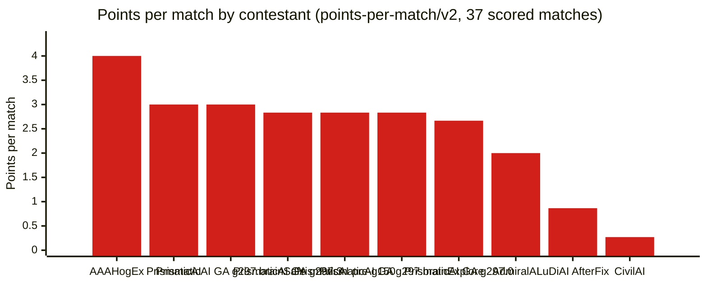
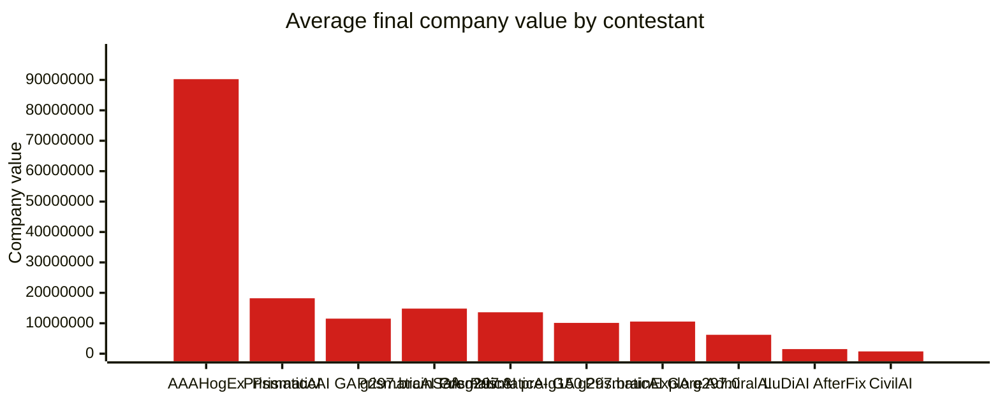
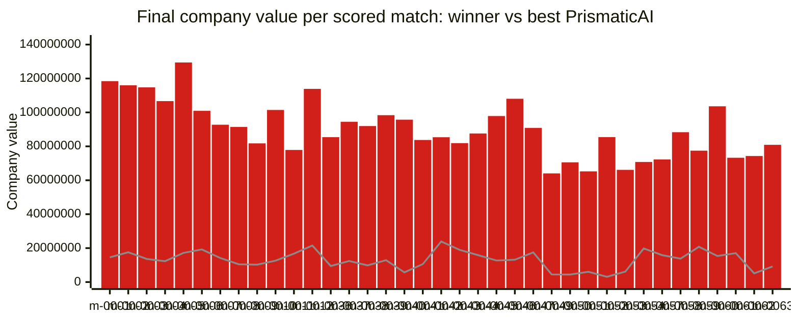
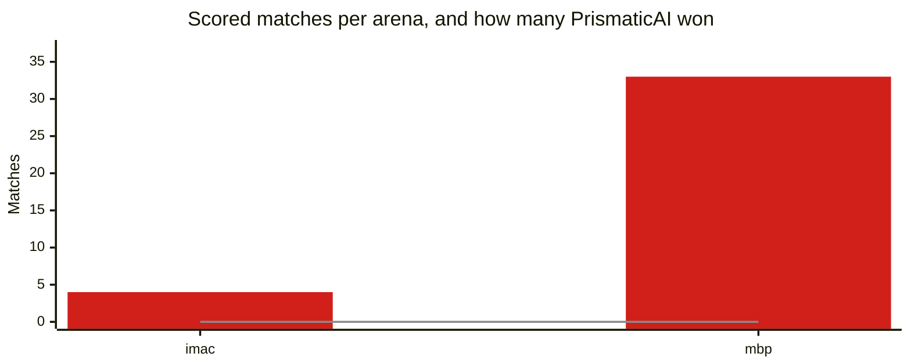

# battle-20261121T184605-799899b1

Derived from `battle-20261121T184605-799899b1.json` by `tools/research/ai-battle/battle.py report`; do not edit.

- Edition `799899b1aea419ea`: PrismaticAI and referee at `05aa9a18c30f55c72b8d5101385cbfdce4fa3ba4`, base set `opengfx-8.0.tar`
- 20-year free-for-all from 1960, map 256x256 temperate, breakdowns 1
- 37 scored match(es) on `imac` (20261119-master-gdf1e05e7d8), `mbp` (20261120-master-m17653b726e)
- Replays: 0 of 2 identical to their original on another arena

| # | Contestant | Played | Wins | Points | Points/match | Avg rank | Avg final value | Squirrel errors | Matches with anomalies |
|---|---|---|---|---|---|---|---|---|---|
| 1 | AAAHogEx | 37 | 37 | 148 | 4.0 | 1.0 | 90.2 M | 0 | 0 |
| 2 | PrismaticAI | 6 | 0 | 18 | 3.0 | 2.0 | 18.2 M | 0 | 0 |
| 3 | PrismaticAI GA g297.brainSafe | 7 | 0 | 21 | 3.0 | 2.0 | 11.5 M | 0 | 0 |
| 4 | PrismaticAI GA g297.3 | 6 | 0 | 17 | 2.833 | 2.17 | 14.8 M | 0 | 0 |
| 5 | PrismaticAI pre-g150 | 6 | 0 | 17 | 2.833 | 2.17 | 13.6 M | 0 | 0 |
| 6 | PrismaticAI GA g297.brainExplore | 6 | 0 | 17 | 2.833 | 2.17 | 10.1 M | 0 | 0 |
| 7 | PrismaticAI GA g297.0 | 6 | 0 | 16 | 2.667 | 2.33 | 10.6 M | 0 | 0 |
| 8 | AdmiralAI | 37 | 0 | 74 | 2.0 | 3.0 | 6.2 M | 0 | 0 |
| 9 | LuDiAI AfterFix | 37 | 0 | 32 | 0.865 | 4.14 | 1.5 M | 0 | 3 |
| 10 | CivilAI | 37 | 0 | 10 | 0.27 | 4.73 | 740.1 k | 3965 | 5 |

<!-- battle-charts:begin -->
<!-- derived from battle-20261121T184605-799899b1.json by `battle.py render`; `battle.py check` fails when it is stale -->

<!-- battle-charts:end -->

| Seed | Original | Replay | Arenas | Identical |
|---|---|---|---|---|
| 1930266242 | m-0011 | m-0048 | imac / mbp | NO |
| 1930266242 | m-0010 | m-0064 | imac / mbp | NO |

| Match | Arena | Seed | Winner | Value | Last | Anomalies |
|---|---|---|---|---|---|---|
| m-0001 | mbp | 657682729 | AAAHogEx | 118.4 M | CivilAI | - |
| m-0002 | mbp | 657682729 | AAAHogEx | 116.0 M | CivilAI | LuDiAI AfterFix: fleet_drop:90->50 |
| m-0003 | mbp | 657682729 | AAAHogEx | 114.8 M | CivilAI | - |
| m-0004 | mbp | 657682729 | AAAHogEx | 106.7 M | LuDiAI AfterFix | - |
| m-0005 | mbp | 657682729 | AAAHogEx | 129.4 M | LuDiAI AfterFix | - |
| m-0006 | mbp | 1930266242 | AAAHogEx | 100.9 M | LuDiAI AfterFix | - |
| m-0007 | mbp | 1930266242 | AAAHogEx | 92.7 M | CivilAI | - |
| m-0008 | mbp | 1930266242 | AAAHogEx | 91.5 M | CivilAI | - |
| m-0009 | mbp | 1930266242 | AAAHogEx | 81.8 M | CivilAI | CivilAI: fleet_drop:44->17 |
| m-0010 | imac | 1930266242 | AAAHogEx | 101.4 M | LuDiAI AfterFix | - |
| m-0011 | imac | 1930266242 | AAAHogEx | 77.9 M | CivilAI | - |
| m-0012 | imac | 81585195 | AAAHogEx | 113.9 M | CivilAI | - |
| m-0036 | mbp | 1010299412 | AAAHogEx | 85.4 M | LuDiAI AfterFix | - |
| m-0037 | mbp | 1010299412 | AAAHogEx | 94.5 M | CivilAI | - |
| m-0038 | mbp | 1010299412 | AAAHogEx | 92.0 M | LuDiAI AfterFix | - |
| m-0039 | mbp | 1010299412 | AAAHogEx | 98.4 M | LuDiAI AfterFix | - |
| m-0040 | mbp | 1010299412 | AAAHogEx | 95.7 M | LuDiAI AfterFix | - |
| m-0041 | mbp | 1010299412 | AAAHogEx | 83.8 M | LuDiAI AfterFix | - |
| m-0042 | mbp | 914847685 | AAAHogEx | 85.4 M | CivilAI | - |
| m-0043 | mbp | 914847685 | AAAHogEx | 81.9 M | CivilAI | LuDiAI AfterFix: fleet_drop:47->31 |
| m-0044 | mbp | 914847685 | AAAHogEx | 87.6 M | CivilAI | - |
| m-0045 | mbp | 914847685 | AAAHogEx | 97.9 M | CivilAI | - |
| m-0046 | mbp | 914847685 | AAAHogEx | 108.0 M | CivilAI | LuDiAI AfterFix: fleet_drop:43->9 |
| m-0047 | mbp | 914847685 | AAAHogEx | 90.9 M | CivilAI | - |
| m-0048 (replay) | mbp | 1930266242 | AAAHogEx | 87.3 M | LuDiAI AfterFix | CivilAI: fleet_drop:46->22; LuDiAI AfterFix: fleet_drop:44->30 |
| m-0049 | mbp | 1963656420 | AAAHogEx | 64.0 M | CivilAI | - |
| m-0050 | mbp | 1963656420 | AAAHogEx | 70.6 M | CivilAI | CivilAI: fleet_drop:12->6 |
| m-0051 | mbp | 1963656420 | AAAHogEx | 65.2 M | CivilAI | CivilAI: fleet_drop:13->5 |
| m-0052 | mbp | 1963656420 | AAAHogEx | 85.5 M | AdmiralAI | - |
| m-0053 | imac | 1963656420 | AAAHogEx | 66.1 M | CivilAI | CivilAI: fleet_drop:12->5 |
| m-0054 | mbp | 1737033009 | AAAHogEx | 70.8 M | CivilAI | - |
| m-0057 | mbp | 1737033009 | AAAHogEx | 72.3 M | CivilAI | CivilAI: squirrel_errors:3965 |
| m-0058 | mbp | 1737033009 | AAAHogEx | 88.3 M | CivilAI | - |
| m-0059 | mbp | 1737033009 | AAAHogEx | 77.4 M | CivilAI | - |
| m-0060 | mbp | 137651082 | AAAHogEx | 103.6 M | CivilAI | - |
| m-0061 | mbp | 137651082 | AAAHogEx | 73.3 M | CivilAI | - |
| m-0062 | mbp | 137651082 | AAAHogEx | 74.3 M | CivilAI | - |
| m-0063 | mbp | 137651082 | AAAHogEx | 80.9 M | CivilAI | - |
| m-0064 (replay) | mbp | 1930266242 | AAAHogEx | 97.4 M | LuDiAI AfterFix | - |
