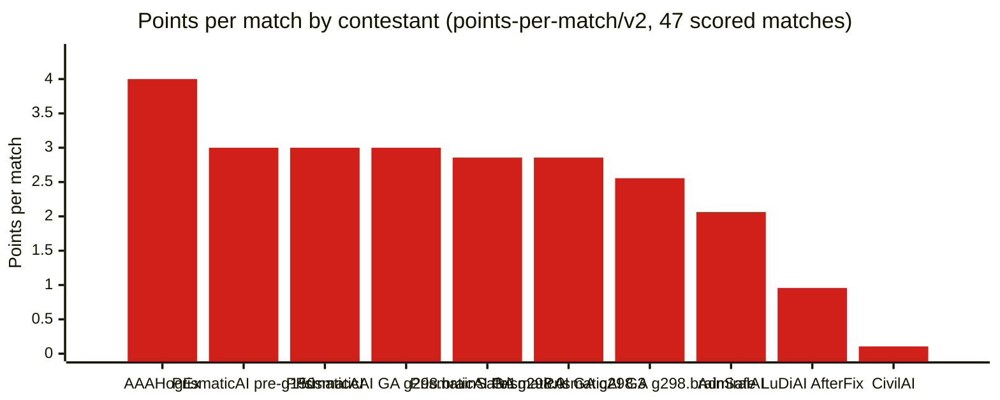
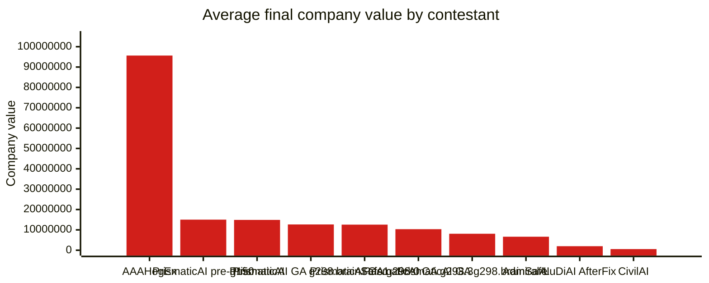
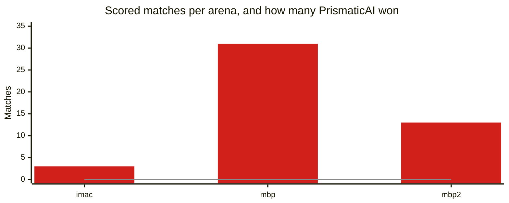

# battle-20261121T185934-dc322cc4

Derived from `battle-20261121T185934-dc322cc4.json` by `tools/research/ai-battle/battle.py report`; do not edit.

- Edition `dc322cc4238ecca4`: PrismaticAI and referee at `05aa9a18c30f55c72b8d5101385cbfdce4fa3ba4`, base set `opengfx-8.0.tar`
- 20-year free-for-all from 1960, map 256x256 temperate, breakdowns 1
- 47 scored match(es) on `imac` (20261119-master-gdf1e05e7d8), `mbp` (20261120-master-m17653b726e), `mbp2` (20261119-master-gdf1e05e7d8)
- Replays: 0 of 0 identical to their original on another arena

| # | Contestant | Played | Wins | Points | Points/match | Avg rank | Avg final value | Squirrel errors | Matches with anomalies |
|---|---|---|---|---|---|---|---|---|---|
| 1 | AAAHogEx | 47 | 47 | 188 | 4.0 | 1.0 | 95.7 M | 0 | 0 |
| 2 | PrismaticAI pre-g150 | 7 | 0 | 21 | 3.0 | 2.0 | 15.0 M | 0 | 1 |
| 3 | PrismaticAI | 8 | 0 | 24 | 3.0 | 2.0 | 14.9 M | 0 | 0 |
| 4 | PrismaticAI GA g298.brainSafe1 | 9 | 0 | 27 | 3.0 | 2.0 | 12.7 M | 0 | 0 |
| 5 | PrismaticAI GA g298.0 | 7 | 0 | 20 | 2.857 | 2.14 | 12.6 M | 0 | 0 |
| 6 | PrismaticAI GA g298.3 | 7 | 0 | 20 | 2.857 | 2.14 | 10.3 M | 0 | 2 |
| 7 | PrismaticAI GA g298.brainSafe | 9 | 0 | 23 | 2.556 | 2.44 | 8.1 M | 0 | 0 |
| 8 | AdmiralAI | 47 | 0 | 97 | 2.064 | 2.94 | 6.6 M | 44 | 5 |
| 9 | LuDiAI AfterFix | 47 | 0 | 45 | 0.957 | 4.04 | 2.0 M | 0 | 0 |
| 10 | CivilAI | 47 | 0 | 5 | 0.106 | 4.89 | 553.1 k | 3655 | 6 |

```mermaid
---
config:
  xyChart:
    width: 900
    height: 360
  themeVariables:
    xyChart:
      plotColorPalette: "#d11f1a, #8a8a8a, #0b0b0b, #ece4d6"
---
xychart-beta
    title "Final company value per scored match: winner vs best PrismaticAI"
    x-axis ["m-0001", "m-0002", "m-0003", "m-0004", "m-0005", "m-0006", "m-0007", "m-0008", "m-0009", "m-0010", "m-0011", "m-0012", "m-0015", "m-0016", "m-0018", "m-0019", "m-0020", "m-0021", "m-0022", "m-0023", "m-0024", "m-0025", "m-0026", "m-0027", "m-0028", "m-0036", "m-0037", "m-0038", "m-0039", "m-0040", "m-0041", "m-0042", "m-0043", "m-0044", "m-0045", "m-0046", "m-0047", "m-0048", "m-0049", "m-0050", "m-0051", "m-0052", "m-0053", "m-0057", "m-0058", "m-0059", "m-0060"]
    %% series: Winner | Best PrismaticAI
    %% links: battle-20261121T185934-dc322cc4.md?col=Match&filter=m-0001 | battle-20261121T185934-dc322cc4.md?col=Match&filter=m-0002 | battle-20261121T185934-dc322cc4.md?col=Match&filter=m-0003 | battle-20261121T185934-dc322cc4.md?col=Match&filter=m-0004 | battle-20261121T185934-dc322cc4.md?col=Match&filter=m-0005 | battle-20261121T185934-dc322cc4.md?col=Match&filter=m-0006 | battle-20261121T185934-dc322cc4.md?col=Match&filter=m-0007 | battle-20261121T185934-dc322cc4.md?col=Match&filter=m-0008 | battle-20261121T185934-dc322cc4.md?col=Match&filter=m-0009 | battle-20261121T185934-dc322cc4.md?col=Match&filter=m-0010 | battle-20261121T185934-dc322cc4.md?col=Match&filter=m-0011 | battle-20261121T185934-dc322cc4.md?col=Match&filter=m-0012 | battle-20261121T185934-dc322cc4.md?col=Match&filter=m-0015 | battle-20261121T185934-dc322cc4.md?col=Match&filter=m-0016 | battle-20261121T185934-dc322cc4.md?col=Match&filter=m-0018 | battle-20261121T185934-dc322cc4.md?col=Match&filter=m-0019 | battle-20261121T185934-dc322cc4.md?col=Match&filter=m-0020 | battle-20261121T185934-dc322cc4.md?col=Match&filter=m-0021 | battle-20261121T185934-dc322cc4.md?col=Match&filter=m-0022 | battle-20261121T185934-dc322cc4.md?col=Match&filter=m-0023 | battle-20261121T185934-dc322cc4.md?col=Match&filter=m-0024 | battle-20261121T185934-dc322cc4.md?col=Match&filter=m-0025 | battle-20261121T185934-dc322cc4.md?col=Match&filter=m-0026 | battle-20261121T185934-dc322cc4.md?col=Match&filter=m-0027 | battle-20261121T185934-dc322cc4.md?col=Match&filter=m-0028 | battle-20261121T185934-dc322cc4.md?col=Match&filter=m-0036 | battle-20261121T185934-dc322cc4.md?col=Match&filter=m-0037 | battle-20261121T185934-dc322cc4.md?col=Match&filter=m-0038 | battle-20261121T185934-dc322cc4.md?col=Match&filter=m-0039 | battle-20261121T185934-dc322cc4.md?col=Match&filter=m-0040 | battle-20261121T185934-dc322cc4.md?col=Match&filter=m-0041 | battle-20261121T185934-dc322cc4.md?col=Match&filter=m-0042 | battle-20261121T185934-dc322cc4.md?col=Match&filter=m-0043 | battle-20261121T185934-dc322cc4.md?col=Match&filter=m-0044 | battle-20261121T185934-dc322cc4.md?col=Match&filter=m-0045 | battle-20261121T185934-dc322cc4.md?col=Match&filter=m-0046 | battle-20261121T185934-dc322cc4.md?col=Match&filter=m-0047 | battle-20261121T185934-dc322cc4.md?col=Match&filter=m-0048 | battle-20261121T185934-dc322cc4.md?col=Match&filter=m-0049 | battle-20261121T185934-dc322cc4.md?col=Match&filter=m-0050 | battle-20261121T185934-dc322cc4.md?col=Match&filter=m-0051 | battle-20261121T185934-dc322cc4.md?col=Match&filter=m-0052 | battle-20261121T185934-dc322cc4.md?col=Match&filter=m-0053 | battle-20261121T185934-dc322cc4.md?col=Match&filter=m-0057 | battle-20261121T185934-dc322cc4.md?col=Match&filter=m-0058 | battle-20261121T185934-dc322cc4.md?col=Match&filter=m-0059 | battle-20261121T185934-dc322cc4.md?col=Match&filter=m-0060
    y-axis "Company value" 0 --> 149000000
    bar [61835194, 58240802, 69534714, 68609374, 74404567, 131287877, 106910287, 129466913, 129035738, 119725289, 123570294, 135257470, 116139053, 115355369, 72925087, 65750892, 70590086, 61297816, 64811496, 62080592, 69309628, 58841685, 57391898, 73552252, 52888471, 76743678, 91885941, 107874677, 93688411, 103133038, 102070474, 104976183, 120754873, 107460830, 123800725, 106658619, 131788510, 112302131, 116822045, 105145998, 113964496, 117755088, 130011507, 103704033, 96495687, 81953421, 97885246]
    line [8085528, 7829769, 9617049, 7306545, 2462625, 19828252, 21216128, 18954731, 6660327, 8341675, 13536749, 19544214, 8326321, 13059608, 14723127, 11746789, 10228060, 4716720, 10367824, 7716817, 14442726, 15592459, 12805880, 6676910, 16361309, 15877717, 10544833, 12616864, 6416853, 17800647, 14521612, 14185822, 19327945, 15981645, 4615384, 13798862, 13211679, 9589315, 18663021, 9606234, 15529394, 17021772, 10609125, 10287122, 9892603, 10344133, 10993339]
```

<!-- battle-charts:begin -->
<!-- derived from battle-20261121T185934-dc322cc4.json by `battle.py render`; `battle.py check` fails when it is stale -->

<!-- battle-charts:end -->

| Match | Arena | Seed | Winner | Value | Last | Anomalies |
|---|---|---|---|---|---|---|
| m-0001 | mbp | 137822836 | AAAHogEx | 61.8 M | CivilAI | PrismaticAI pre-g150: fleet_drop:56->38; CivilAI: no_vehicles |
| m-0002 | mbp | 137822836 | AAAHogEx | 58.2 M | LuDiAI AfterFix | - |
| m-0003 | mbp | 137822836 | AAAHogEx | 69.5 M | CivilAI | CivilAI: fleet_drop:36->14 |
| m-0004 | mbp | 137822836 | AAAHogEx | 68.6 M | CivilAI | - |
| m-0005 | mbp | 137822836 | AAAHogEx | 74.4 M | CivilAI | AdmiralAI: squirrel_errors:44; PrismaticAI GA g298.3: fleet_drop:25->13 |
| m-0006 | mbp | 1922386404 | AAAHogEx | 131.3 M | CivilAI | CivilAI: squirrel_errors:3655 |
| m-0007 | mbp | 1922386404 | AAAHogEx | 106.9 M | CivilAI | CivilAI: fleet_drop:40->6 |
| m-0008 | mbp | 1922386404 | AAAHogEx | 129.5 M | CivilAI | - |
| m-0009 | mbp | 1922386404 | AAAHogEx | 129.0 M | CivilAI | - |
| m-0010 | imac | 1922386404 | AAAHogEx | 119.7 M | CivilAI | - |
| m-0011 | imac | 1922386404 | AAAHogEx | 123.6 M | CivilAI | AdmiralAI: fleet_drop:85->58 |
| m-0012 | imac | 373468955 | AAAHogEx | 135.3 M | CivilAI | - |
| m-0015 | mbp2 | 373468955 | AAAHogEx | 116.1 M | CivilAI | - |
| m-0016 | mbp2 | 373468955 | AAAHogEx | 115.4 M | CivilAI | AdmiralAI: fleet_drop:347->213 |
| m-0018 | mbp2 | 313541715 | AAAHogEx | 72.9 M | CivilAI | - |
| m-0019 | mbp2 | 313541715 | AAAHogEx | 65.8 M | CivilAI | - |
| m-0020 | mbp2 | 313541715 | AAAHogEx | 70.6 M | CivilAI | - |
| m-0021 | mbp2 | 313541715 | AAAHogEx | 61.3 M | CivilAI | - |
| m-0022 | mbp2 | 313541715 | AAAHogEx | 64.8 M | CivilAI | - |
| m-0023 | mbp2 | 313541715 | AAAHogEx | 62.1 M | CivilAI | PrismaticAI GA g298.3: fleet_drop:40->23 |
| m-0024 | mbp2 | 1671629577 | AAAHogEx | 69.3 M | CivilAI | - |
| m-0025 | mbp2 | 1671629577 | AAAHogEx | 58.8 M | LuDiAI AfterFix | - |
| m-0026 | mbp2 | 1671629577 | AAAHogEx | 57.4 M | CivilAI | - |
| m-0027 | mbp2 | 1671629577 | AAAHogEx | 73.6 M | CivilAI | - |
| m-0028 | mbp2 | 1671629577 | AAAHogEx | 52.9 M | CivilAI | - |
| m-0036 | mbp | 451672654 | AAAHogEx | 76.7 M | CivilAI | - |
| m-0037 | mbp | 451672654 | AAAHogEx | 91.9 M | CivilAI | - |
| m-0038 | mbp | 451672654 | AAAHogEx | 107.9 M | CivilAI | - |
| m-0039 | mbp | 451672654 | AAAHogEx | 93.7 M | CivilAI | - |
| m-0040 | mbp | 451672654 | AAAHogEx | 103.1 M | LuDiAI AfterFix | - |
| m-0041 | mbp | 451672654 | AAAHogEx | 102.1 M | CivilAI | - |
| m-0042 | mbp | 77726328 | AAAHogEx | 105.0 M | CivilAI | - |
| m-0043 | mbp | 77726328 | AAAHogEx | 120.8 M | CivilAI | CivilAI: fleet_drop:67->41 |
| m-0044 | mbp | 77726328 | AAAHogEx | 107.5 M | CivilAI | - |
| m-0045 | mbp | 77726328 | AAAHogEx | 123.8 M | CivilAI | - |
| m-0046 | mbp | 77726328 | AAAHogEx | 106.7 M | CivilAI | - |
| m-0047 | mbp | 77726328 | AAAHogEx | 131.8 M | CivilAI | - |
| m-0048 | mbp | 1790694360 | AAAHogEx | 112.3 M | CivilAI | - |
| m-0049 | mbp | 1790694360 | AAAHogEx | 116.8 M | CivilAI | - |
| m-0050 | mbp | 1790694360 | AAAHogEx | 105.1 M | LuDiAI AfterFix | - |
| m-0051 | mbp | 1790694360 | AAAHogEx | 114.0 M | CivilAI | - |
| m-0052 | mbp | 1790694360 | AAAHogEx | 117.8 M | CivilAI | - |
| m-0053 | mbp | 1790694360 | AAAHogEx | 130.0 M | LuDiAI AfterFix | - |
| m-0057 | mbp | 161358025 | AAAHogEx | 103.7 M | CivilAI | AdmiralAI: fleet_drop:213->140 |
| m-0058 | mbp | 161358025 | AAAHogEx | 96.5 M | CivilAI | - |
| m-0059 | mbp | 161358025 | AAAHogEx | 82.0 M | CivilAI | - |
| m-0060 | mbp | 577518965 | AAAHogEx | 97.9 M | CivilAI | AdmiralAI: fleet_drop:302->183; CivilAI: fleet_drop:24->13 |
