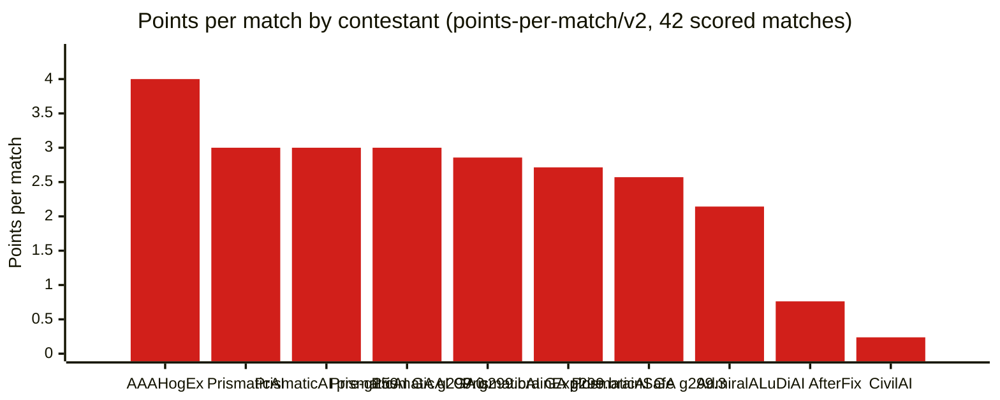
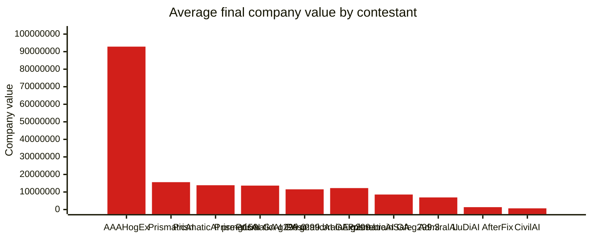
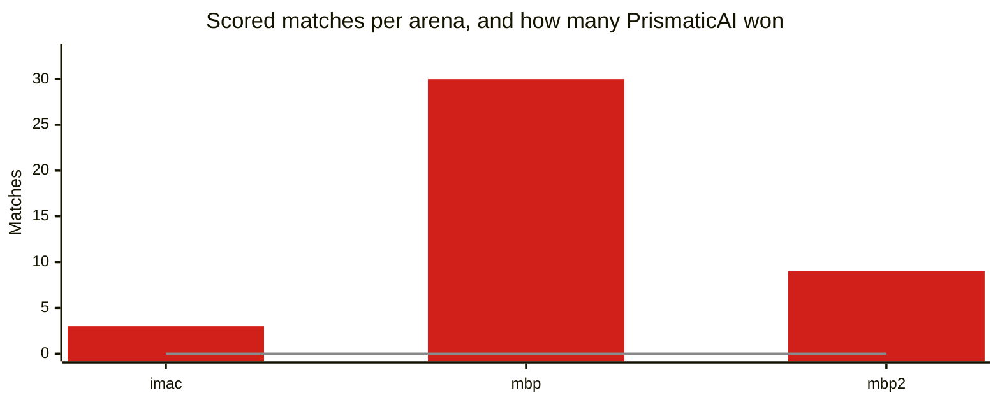

# battle-20261121T191154-ec551237

Derived from `battle-20261121T191154-ec551237.json` by `tools/research/ai-battle/battle.py report`; do not edit.

- Edition `ec5512372c326da5`: PrismaticAI and referee at `05aa9a18c30f55c72b8d5101385cbfdce4fa3ba4`, base set `opengfx-8.0.tar`
- 20-year free-for-all from 1960, map 256x256 temperate, breakdowns 1
- 42 scored match(es) on `imac` (20261119-master-gdf1e05e7d8), `mbp` (20261120-master-m17653b726e), `mbp2` (20261119-master-gdf1e05e7d8)
- Replays: 0 of 0 identical to their original on another arena

| # | Contestant | Played | Wins | Points | Points/match | Avg rank | Avg final value | Squirrel errors | Matches with anomalies |
|---|---|---|---|---|---|---|---|---|---|
| 1 | AAAHogEx | 42 | 42 | 168 | 4.0 | 1.0 | 92.9 M | 0 | 0 |
| 2 | PrismaticAI | 8 | 0 | 24 | 3.0 | 2.0 | 15.6 M | 0 | 0 |
| 3 | PrismaticAI pre-g150 | 7 | 0 | 21 | 3.0 | 2.0 | 13.9 M | 0 | 0 |
| 4 | PrismaticAI GA g299.0 | 6 | 0 | 18 | 3.0 | 2.0 | 13.6 M | 0 | 0 |
| 5 | PrismaticAI GA g299.brainExplore | 7 | 0 | 20 | 2.857 | 2.14 | 11.5 M | 0 | 0 |
| 6 | PrismaticAI GA g299.brainSafe | 7 | 0 | 19 | 2.714 | 2.29 | 12.2 M | 0 | 0 |
| 7 | PrismaticAI GA g299.3 | 7 | 0 | 18 | 2.571 | 2.43 | 8.6 M | 0 | 0 |
| 8 | AdmiralAI | 42 | 0 | 90 | 2.143 | 2.86 | 6.9 M | 0 | 1 |
| 9 | LuDiAI AfterFix | 42 | 0 | 32 | 0.762 | 4.24 | 1.4 M | 0 | 5 |
| 10 | CivilAI | 42 | 0 | 10 | 0.238 | 4.76 | 679.2 k | 0 | 8 |

```mermaid
---
config:
  xyChart:
    width: 900
    height: 360
  themeVariables:
    xyChart:
      plotColorPalette: "#d11f1a, #8a8a8a, #0b0b0b, #ece4d6"
---
xychart-beta
    title "Final company value per scored match: winner vs best PrismaticAI"
    x-axis ["m-0001", "m-0002", "m-0003", "m-0004", "m-0005", "m-0006", "m-0007", "m-0008", "m-0009", "m-0010", "m-0011", "m-0012", "m-0017", "m-0018", "m-0019", "m-0020", "m-0021", "m-0023", "m-0024", "m-0025", "m-0028", "m-0036", "m-0037", "m-0038", "m-0039", "m-0040", "m-0041", "m-0042", "m-0043", "m-0044", "m-0045", "m-0046", "m-0047", "m-0048", "m-0049", "m-0050", "m-0051", "m-0052", "m-0054", "m-0057", "m-0058", "m-0059"]
    %% series: Winner | Best PrismaticAI
    %% links: battle-20261121T191154-ec551237.md?col=Match&filter=m-0001 | battle-20261121T191154-ec551237.md?col=Match&filter=m-0002 | battle-20261121T191154-ec551237.md?col=Match&filter=m-0003 | battle-20261121T191154-ec551237.md?col=Match&filter=m-0004 | battle-20261121T191154-ec551237.md?col=Match&filter=m-0005 | battle-20261121T191154-ec551237.md?col=Match&filter=m-0006 | battle-20261121T191154-ec551237.md?col=Match&filter=m-0007 | battle-20261121T191154-ec551237.md?col=Match&filter=m-0008 | battle-20261121T191154-ec551237.md?col=Match&filter=m-0009 | battle-20261121T191154-ec551237.md?col=Match&filter=m-0010 | battle-20261121T191154-ec551237.md?col=Match&filter=m-0011 | battle-20261121T191154-ec551237.md?col=Match&filter=m-0012 | battle-20261121T191154-ec551237.md?col=Match&filter=m-0017 | battle-20261121T191154-ec551237.md?col=Match&filter=m-0018 | battle-20261121T191154-ec551237.md?col=Match&filter=m-0019 | battle-20261121T191154-ec551237.md?col=Match&filter=m-0020 | battle-20261121T191154-ec551237.md?col=Match&filter=m-0021 | battle-20261121T191154-ec551237.md?col=Match&filter=m-0023 | battle-20261121T191154-ec551237.md?col=Match&filter=m-0024 | battle-20261121T191154-ec551237.md?col=Match&filter=m-0025 | battle-20261121T191154-ec551237.md?col=Match&filter=m-0028 | battle-20261121T191154-ec551237.md?col=Match&filter=m-0036 | battle-20261121T191154-ec551237.md?col=Match&filter=m-0037 | battle-20261121T191154-ec551237.md?col=Match&filter=m-0038 | battle-20261121T191154-ec551237.md?col=Match&filter=m-0039 | battle-20261121T191154-ec551237.md?col=Match&filter=m-0040 | battle-20261121T191154-ec551237.md?col=Match&filter=m-0041 | battle-20261121T191154-ec551237.md?col=Match&filter=m-0042 | battle-20261121T191154-ec551237.md?col=Match&filter=m-0043 | battle-20261121T191154-ec551237.md?col=Match&filter=m-0044 | battle-20261121T191154-ec551237.md?col=Match&filter=m-0045 | battle-20261121T191154-ec551237.md?col=Match&filter=m-0046 | battle-20261121T191154-ec551237.md?col=Match&filter=m-0047 | battle-20261121T191154-ec551237.md?col=Match&filter=m-0048 | battle-20261121T191154-ec551237.md?col=Match&filter=m-0049 | battle-20261121T191154-ec551237.md?col=Match&filter=m-0050 | battle-20261121T191154-ec551237.md?col=Match&filter=m-0051 | battle-20261121T191154-ec551237.md?col=Match&filter=m-0052 | battle-20261121T191154-ec551237.md?col=Match&filter=m-0054 | battle-20261121T191154-ec551237.md?col=Match&filter=m-0057 | battle-20261121T191154-ec551237.md?col=Match&filter=m-0058 | battle-20261121T191154-ec551237.md?col=Match&filter=m-0059
    y-axis "Company value" 0 --> 145000000
    bar [71155208, 39819761, 41489239, 56551379, 57194904, 88726247, 62460413, 87047177, 66230389, 95469534, 93482282, 92079982, 94947216, 96454548, 103374624, 109528642, 101630069, 110320679, 124258278, 132090194, 123355557, 101212755, 108100926, 93776453, 87356457, 100229995, 96484233, 101472554, 87284562, 117218762, 103774940, 79769727, 99038383, 125316655, 123598335, 101374092, 107939972, 105432383, 63545879, 81771174, 78500867, 89095136]
    line [11714746, 15046731, 13767493, 9476670, 6920509, 10373725, 9219781, 8677077, 11381567, 8020552, 3881740, 16836917, 3478814, 20647944, 21620818, 16933463, 19922875, 16372432, 19057678, 10887859, 12556290, 11524275, 14209496, 12575422, 12036901, 11465831, 7507870, 19305728, 18951099, 12590960, 8703126, 15643954, 14217569, 8906767, 10407427, 16052354, 7047650, 8320500, 18223862, 12784981, 15209083, 7551759]
```

<!-- battle-charts:begin -->
<!-- derived from battle-20261121T191154-ec551237.json by `battle.py render`; `battle.py check` fails when it is stale -->

<!-- battle-charts:end -->

| Match | Arena | Seed | Winner | Value | Last | Anomalies |
|---|---|---|---|---|---|---|
| m-0001 | mbp | 1461169626 | AAAHogEx | 71.2 M | CivilAI | - |
| m-0002 | mbp | 1461169626 | AAAHogEx | 39.8 M | CivilAI | - |
| m-0003 | mbp | 1461169626 | AAAHogEx | 41.5 M | LuDiAI AfterFix | - |
| m-0004 | mbp | 1461169626 | AAAHogEx | 56.6 M | CivilAI | CivilAI: fleet_drop:30->20 |
| m-0005 | mbp | 1461169626 | AAAHogEx | 57.2 M | LuDiAI AfterFix | - |
| m-0006 | mbp | 748017232 | AAAHogEx | 88.7 M | CivilAI | - |
| m-0007 | mbp | 748017232 | AAAHogEx | 62.5 M | LuDiAI AfterFix | - |
| m-0008 | mbp | 748017232 | AAAHogEx | 87.0 M | CivilAI | - |
| m-0009 | mbp | 748017232 | AAAHogEx | 66.2 M | CivilAI | - |
| m-0010 | imac | 748017232 | AAAHogEx | 95.5 M | LuDiAI AfterFix | LuDiAI AfterFix: fleet_drop:61->34 |
| m-0011 | imac | 748017232 | AAAHogEx | 93.5 M | CivilAI | CivilAI: fleet_drop:28->15 |
| m-0012 | imac | 521428984 | AAAHogEx | 92.1 M | LuDiAI AfterFix | CivilAI: fleet_drop:45->17 |
| m-0017 | mbp2 | 521428984 | AAAHogEx | 94.9 M | LuDiAI AfterFix | - |
| m-0018 | mbp2 | 1586751096 | AAAHogEx | 96.5 M | CivilAI | LuDiAI AfterFix: fleet_drop:155->107 |
| m-0019 | mbp2 | 1586751096 | AAAHogEx | 103.4 M | CivilAI | - |
| m-0020 | mbp2 | 1586751096 | AAAHogEx | 109.5 M | LuDiAI AfterFix | - |
| m-0021 | mbp2 | 1586751096 | AAAHogEx | 101.6 M | LuDiAI AfterFix | AdmiralAI: fleet_drop:109->68 |
| m-0023 | mbp2 | 1586751096 | AAAHogEx | 110.3 M | LuDiAI AfterFix | CivilAI: fleet_drop:75->39 |
| m-0024 | mbp2 | 114482961 | AAAHogEx | 124.3 M | CivilAI | - |
| m-0025 | mbp2 | 114482961 | AAAHogEx | 132.1 M | CivilAI | - |
| m-0028 | mbp2 | 114482961 | AAAHogEx | 123.4 M | LuDiAI AfterFix | - |
| m-0036 | mbp | 679306384 | AAAHogEx | 101.2 M | CivilAI | - |
| m-0037 | mbp | 679306384 | AAAHogEx | 108.1 M | CivilAI | - |
| m-0038 | mbp | 679306384 | AAAHogEx | 93.8 M | CivilAI | LuDiAI AfterFix: fleet_drop:63->43 |
| m-0039 | mbp | 679306384 | AAAHogEx | 87.4 M | CivilAI | - |
| m-0040 | mbp | 679306384 | AAAHogEx | 100.2 M | CivilAI | LuDiAI AfterFix: fleet_drop:102->62 |
| m-0041 | mbp | 679306384 | AAAHogEx | 96.5 M | CivilAI | LuDiAI AfterFix: fleet_drop:37->21 |
| m-0042 | mbp | 1048735414 | AAAHogEx | 101.5 M | CivilAI | CivilAI: fleet_drop:29->16 |
| m-0043 | mbp | 1048735414 | AAAHogEx | 87.3 M | CivilAI | - |
| m-0044 | mbp | 1048735414 | AAAHogEx | 117.2 M | CivilAI | - |
| m-0045 | mbp | 1048735414 | AAAHogEx | 103.8 M | CivilAI | CivilAI: fleet_drop:37->15 |
| m-0046 | mbp | 1048735414 | AAAHogEx | 79.8 M | CivilAI | - |
| m-0047 | mbp | 1048735414 | AAAHogEx | 99.0 M | CivilAI | - |
| m-0048 | mbp | 1748258807 | AAAHogEx | 125.3 M | CivilAI | - |
| m-0049 | mbp | 1748258807 | AAAHogEx | 123.6 M | CivilAI | - |
| m-0050 | mbp | 1748258807 | AAAHogEx | 101.4 M | CivilAI | - |
| m-0051 | mbp | 1748258807 | AAAHogEx | 107.9 M | CivilAI | - |
| m-0052 | mbp | 1748258807 | AAAHogEx | 105.4 M | CivilAI | CivilAI: fleet_drop:58->25 |
| m-0054 | mbp | 956538418 | AAAHogEx | 63.5 M | CivilAI | - |
| m-0057 | mbp | 956538418 | AAAHogEx | 81.8 M | CivilAI | CivilAI: no_vehicles |
| m-0058 | mbp | 956538418 | AAAHogEx | 78.5 M | CivilAI | - |
| m-0059 | mbp | 956538418 | AAAHogEx | 89.1 M | CivilAI | - |
