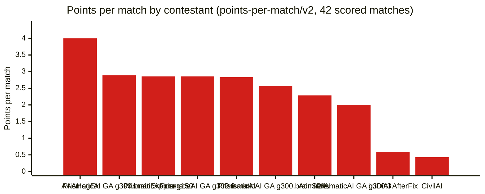
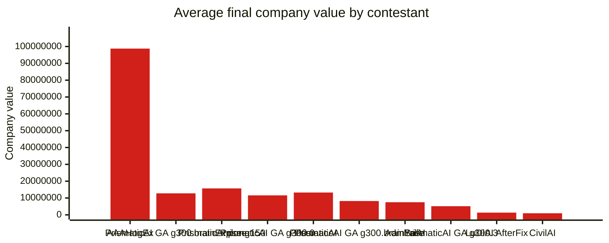
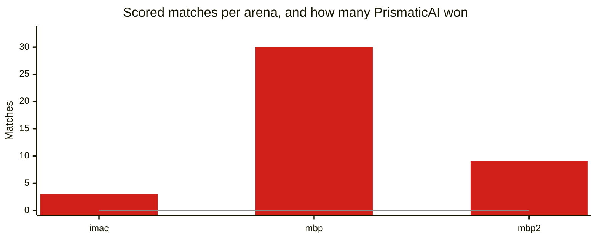

# battle-20261121T192445-949e3ba2

Derived from `battle-20261121T192445-949e3ba2.json` by `tools/research/ai-battle/battle.py report`; do not edit.

- Edition `949e3ba282c291f4`: PrismaticAI and referee at `05aa9a18c30f55c72b8d5101385cbfdce4fa3ba4`, base set `opengfx-8.0.tar`
- 20-year free-for-all from 1960, map 256x256 temperate, breakdowns 1
- 42 scored match(es) on `imac` (20261119-master-gdf1e05e7d8), `mbp` (20261120-master-m17653b726e), `mbp2` (20261119-master-gdf1e05e7d8)
- Replays: 0 of 0 identical to their original on another arena

| # | Contestant | Played | Wins | Points | Points/match | Avg rank | Avg final value | Squirrel errors | Matches with anomalies |
|---|---|---|---|---|---|---|---|---|---|
| 1 | AAAHogEx | 42 | 42 | 168 | 4.0 | 1.0 | 98.8 M | 0 | 0 |
| 2 | PrismaticAI GA g300.brainExplore | 9 | 0 | 26 | 2.889 | 2.11 | 12.8 M | 0 | 0 |
| 3 | PrismaticAI pre-g150 | 7 | 0 | 20 | 2.857 | 2.14 | 15.7 M | 0 | 0 |
| 4 | PrismaticAI GA g300.0 | 7 | 0 | 20 | 2.857 | 2.14 | 11.6 M | 0 | 0 |
| 5 | PrismaticAI | 6 | 0 | 17 | 2.833 | 2.17 | 13.3 M | 0 | 0 |
| 6 | PrismaticAI GA g300.brainSafe | 7 | 0 | 18 | 2.571 | 2.43 | 8.2 M | 0 | 0 |
| 7 | AdmiralAI | 42 | 0 | 96 | 2.286 | 2.71 | 7.5 M | 0 | 1 |
| 8 | PrismaticAI GA g300.3 | 6 | 0 | 12 | 2.0 | 3.0 | 5.1 M | 0 | 0 |
| 9 | LuDiAI AfterFix | 42 | 0 | 25 | 0.595 | 4.4 | 1.3 M | 0 | 1 |
| 10 | CivilAI | 42 | 0 | 18 | 0.429 | 4.57 | 940.5 k | 0 | 11 |

```mermaid
---
config:
  xyChart:
    width: 900
    height: 360
  themeVariables:
    xyChart:
      plotColorPalette: "#d11f1a, #8a8a8a, #0b0b0b, #ece4d6"
---
xychart-beta
    title "Final company value per scored match: winner vs best PrismaticAI"
    x-axis ["m-0001", "m-0002", "m-0003", "m-0004", "m-0005", "m-0006", "m-0007", "m-0008", "m-0009", "m-0010", "m-0011", "m-0012", "m-0014", "m-0016", "m-0019", "m-0022", "m-0024", "m-0025", "m-0026", "m-0027", "m-0028", "m-0036", "m-0037", "m-0038", "m-0039", "m-0040", "m-0041", "m-0042", "m-0043", "m-0044", "m-0045", "m-0046", "m-0047", "m-0048", "m-0049", "m-0050", "m-0051", "m-0052", "m-0053", "m-0057", "m-0058", "m-0059"]
    %% series: Winner | Best PrismaticAI
    %% links: battle-20261121T192445-949e3ba2.md?col=Match&filter=m-0001 | battle-20261121T192445-949e3ba2.md?col=Match&filter=m-0002 | battle-20261121T192445-949e3ba2.md?col=Match&filter=m-0003 | battle-20261121T192445-949e3ba2.md?col=Match&filter=m-0004 | battle-20261121T192445-949e3ba2.md?col=Match&filter=m-0005 | battle-20261121T192445-949e3ba2.md?col=Match&filter=m-0006 | battle-20261121T192445-949e3ba2.md?col=Match&filter=m-0007 | battle-20261121T192445-949e3ba2.md?col=Match&filter=m-0008 | battle-20261121T192445-949e3ba2.md?col=Match&filter=m-0009 | battle-20261121T192445-949e3ba2.md?col=Match&filter=m-0010 | battle-20261121T192445-949e3ba2.md?col=Match&filter=m-0011 | battle-20261121T192445-949e3ba2.md?col=Match&filter=m-0012 | battle-20261121T192445-949e3ba2.md?col=Match&filter=m-0014 | battle-20261121T192445-949e3ba2.md?col=Match&filter=m-0016 | battle-20261121T192445-949e3ba2.md?col=Match&filter=m-0019 | battle-20261121T192445-949e3ba2.md?col=Match&filter=m-0022 | battle-20261121T192445-949e3ba2.md?col=Match&filter=m-0024 | battle-20261121T192445-949e3ba2.md?col=Match&filter=m-0025 | battle-20261121T192445-949e3ba2.md?col=Match&filter=m-0026 | battle-20261121T192445-949e3ba2.md?col=Match&filter=m-0027 | battle-20261121T192445-949e3ba2.md?col=Match&filter=m-0028 | battle-20261121T192445-949e3ba2.md?col=Match&filter=m-0036 | battle-20261121T192445-949e3ba2.md?col=Match&filter=m-0037 | battle-20261121T192445-949e3ba2.md?col=Match&filter=m-0038 | battle-20261121T192445-949e3ba2.md?col=Match&filter=m-0039 | battle-20261121T192445-949e3ba2.md?col=Match&filter=m-0040 | battle-20261121T192445-949e3ba2.md?col=Match&filter=m-0041 | battle-20261121T192445-949e3ba2.md?col=Match&filter=m-0042 | battle-20261121T192445-949e3ba2.md?col=Match&filter=m-0043 | battle-20261121T192445-949e3ba2.md?col=Match&filter=m-0044 | battle-20261121T192445-949e3ba2.md?col=Match&filter=m-0045 | battle-20261121T192445-949e3ba2.md?col=Match&filter=m-0046 | battle-20261121T192445-949e3ba2.md?col=Match&filter=m-0047 | battle-20261121T192445-949e3ba2.md?col=Match&filter=m-0048 | battle-20261121T192445-949e3ba2.md?col=Match&filter=m-0049 | battle-20261121T192445-949e3ba2.md?col=Match&filter=m-0050 | battle-20261121T192445-949e3ba2.md?col=Match&filter=m-0051 | battle-20261121T192445-949e3ba2.md?col=Match&filter=m-0052 | battle-20261121T192445-949e3ba2.md?col=Match&filter=m-0053 | battle-20261121T192445-949e3ba2.md?col=Match&filter=m-0057 | battle-20261121T192445-949e3ba2.md?col=Match&filter=m-0058 | battle-20261121T192445-949e3ba2.md?col=Match&filter=m-0059
    y-axis "Company value" 0 --> 171000000
    bar [63984373, 80992604, 63022937, 77293297, 80306582, 143750029, 113391785, 136454827, 118635762, 129251617, 110423718, 83256629, 67276835, 64240306, 89686454, 139300013, 105079346, 111365104, 112570241, 88666112, 113469908, 70360183, 75197129, 58870732, 50264688, 64295592, 51230338, 155208549, 123885784, 142480215, 116393590, 110730975, 121489127, 107821299, 90197706, 91150801, 90553491, 95074013, 77415826, 113401340, 127697249, 121792485]
    line [11952808, 9410762, 10529391, 19223548, 7752532, 15043322, 25995745, 17009500, 13802293, 10913717, 4670817, 14862135, 11199657, 13654899, 20773531, 16054135, 2473275, 2515079, 3592894, 1952647, 3424121, 11209666, 10695108, 11382180, 5978239, 10253039, 2021858, 18602512, 22450799, 15452336, 14336296, 18390471, 4772155, 17374604, 15533473, 12926682, 5860584, 12609207, 6716970, 4996432, 10465715, 4894416]
```

<!-- battle-charts:begin -->
<!-- derived from battle-20261121T192445-949e3ba2.json by `battle.py render`; `battle.py check` fails when it is stale -->

<!-- battle-charts:end -->

| Match | Arena | Seed | Winner | Value | Last | Anomalies |
|---|---|---|---|---|---|---|
| m-0001 | mbp | 1941844598 | AAAHogEx | 64.0 M | LuDiAI AfterFix | - |
| m-0002 | mbp | 1941844598 | AAAHogEx | 81.0 M | LuDiAI AfterFix | CivilAI: fleet_drop:61->19 |
| m-0003 | mbp | 1941844598 | AAAHogEx | 63.0 M | LuDiAI AfterFix | CivilAI: fleet_drop:79->45 |
| m-0004 | mbp | 1941844598 | AAAHogEx | 77.3 M | CivilAI | CivilAI: fleet_drop:73->36 |
| m-0005 | mbp | 1941844598 | AAAHogEx | 80.3 M | CivilAI | CivilAI: fleet_drop:58->39 |
| m-0006 | mbp | 1375014311 | AAAHogEx | 143.8 M | CivilAI | AdmiralAI: fleet_drop:190->94 |
| m-0007 | mbp | 1375014311 | AAAHogEx | 113.4 M | CivilAI | - |
| m-0008 | mbp | 1375014311 | AAAHogEx | 136.5 M | CivilAI | - |
| m-0009 | mbp | 1375014311 | AAAHogEx | 118.6 M | CivilAI | CivilAI: fleet_drop:70->42 |
| m-0010 | imac | 1375014311 | AAAHogEx | 129.3 M | CivilAI | - |
| m-0011 | imac | 1375014311 | AAAHogEx | 110.4 M | CivilAI | - |
| m-0012 | imac | 1910201257 | AAAHogEx | 83.3 M | CivilAI | - |
| m-0014 | mbp2 | 1910201257 | AAAHogEx | 67.3 M | CivilAI | CivilAI: fleet_drop:48->12 |
| m-0016 | mbp2 | 1910201257 | AAAHogEx | 64.2 M | CivilAI | CivilAI: fleet_drop:66->37 |
| m-0019 | mbp2 | 1378582542 | AAAHogEx | 89.7 M | CivilAI | - |
| m-0022 | mbp2 | 1378582542 | AAAHogEx | 139.3 M | LuDiAI AfterFix | - |
| m-0024 | mbp2 | 54632274 | AAAHogEx | 105.1 M | LuDiAI AfterFix | CivilAI: fleet_drop:37->25 |
| m-0025 | mbp2 | 54632274 | AAAHogEx | 111.4 M | LuDiAI AfterFix | - |
| m-0026 | mbp2 | 54632274 | AAAHogEx | 112.6 M | LuDiAI AfterFix | - |
| m-0027 | mbp2 | 54632274 | AAAHogEx | 88.7 M | LuDiAI AfterFix | - |
| m-0028 | mbp2 | 54632274 | AAAHogEx | 113.5 M | LuDiAI AfterFix | - |
| m-0036 | mbp | 1942115602 | AAAHogEx | 70.4 M | LuDiAI AfterFix | - |
| m-0037 | mbp | 1942115602 | AAAHogEx | 75.2 M | LuDiAI AfterFix | CivilAI: fleet_drop:38->26; LuDiAI AfterFix: fleet_drop:51->22 |
| m-0038 | mbp | 1942115602 | AAAHogEx | 58.9 M | CivilAI | - |
| m-0039 | mbp | 1942115602 | AAAHogEx | 50.3 M | LuDiAI AfterFix | - |
| m-0040 | mbp | 1942115602 | AAAHogEx | 64.3 M | LuDiAI AfterFix | - |
| m-0041 | mbp | 1942115602 | AAAHogEx | 51.2 M | LuDiAI AfterFix | - |
| m-0042 | mbp | 236492668 | AAAHogEx | 155.2 M | CivilAI | - |
| m-0043 | mbp | 236492668 | AAAHogEx | 123.9 M | CivilAI | - |
| m-0044 | mbp | 236492668 | AAAHogEx | 142.5 M | CivilAI | - |
| m-0045 | mbp | 236492668 | AAAHogEx | 116.4 M | CivilAI | - |
| m-0046 | mbp | 236492668 | AAAHogEx | 110.7 M | LuDiAI AfterFix | - |
| m-0047 | mbp | 236492668 | AAAHogEx | 121.5 M | CivilAI | - |
| m-0048 | mbp | 1358872369 | AAAHogEx | 107.8 M | CivilAI | CivilAI: fleet_drop:53->24 |
| m-0049 | mbp | 1358872369 | AAAHogEx | 90.2 M | CivilAI | - |
| m-0050 | mbp | 1358872369 | AAAHogEx | 91.2 M | CivilAI | - |
| m-0051 | mbp | 1358872369 | AAAHogEx | 90.6 M | CivilAI | - |
| m-0052 | mbp | 1358872369 | AAAHogEx | 95.1 M | CivilAI | - |
| m-0053 | mbp | 1358872369 | AAAHogEx | 77.4 M | CivilAI | CivilAI: fleet_drop:55->25 |
| m-0057 | mbp | 162646800 | AAAHogEx | 113.4 M | LuDiAI AfterFix | - |
| m-0058 | mbp | 162646800 | AAAHogEx | 127.7 M | LuDiAI AfterFix | - |
| m-0059 | mbp | 162646800 | AAAHogEx | 121.8 M | CivilAI | - |
