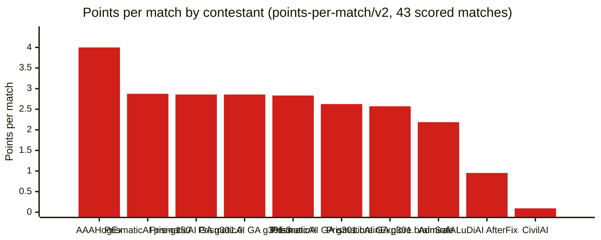
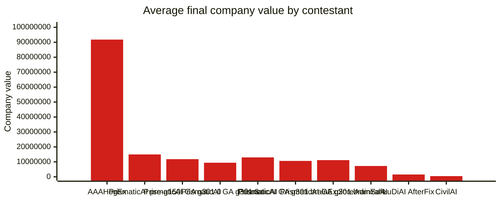
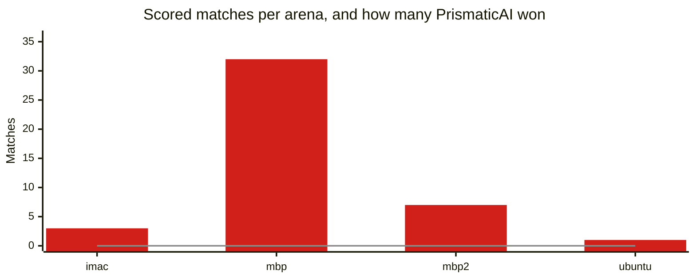

# battle-20261121T193828-50877fda

Derived from `battle-20261121T193828-50877fda.json` by `tools/research/ai-battle/battle.py report`; do not edit.

- Edition `50877fdaa68836ad`: PrismaticAI and referee at `05aa9a18c30f55c72b8d5101385cbfdce4fa3ba4`, base set `opengfx-8.0.tar`
- 20-year free-for-all from 1960, map 256x256 temperate, breakdowns 1
- 43 scored match(es) on `imac` (20261119-master-gdf1e05e7d8), `mbp` (20261120-master-m17653b726e), `mbp2` (20261119-master-gdf1e05e7d8), `ubuntu` (20261119-master-gdf1e05e7d8)
- Replays: 0 of 0 identical to their original on another arena

| # | Contestant | Played | Wins | Points | Points/match | Avg rank | Avg final value | Squirrel errors | Matches with anomalies |
|---|---|---|---|---|---|---|---|---|---|
| 1 | AAAHogEx | 43 | 43 | 172 | 4.0 | 1.0 | 91.8 M | 0 | 0 |
| 2 | PrismaticAI pre-g150 | 8 | 0 | 23 | 2.875 | 2.12 | 15.0 M | 0 | 0 |
| 3 | PrismaticAI GA g301.0 | 7 | 0 | 20 | 2.857 | 2.14 | 11.8 M | 0 | 0 |
| 4 | PrismaticAI GA g301.3 | 7 | 0 | 20 | 2.857 | 2.14 | 9.4 M | 0 | 0 |
| 5 | PrismaticAI | 6 | 0 | 17 | 2.833 | 2.17 | 13.0 M | 0 | 0 |
| 6 | PrismaticAI GA g301.brainExplore | 8 | 0 | 21 | 2.625 | 2.38 | 10.6 M | 0 | 0 |
| 7 | PrismaticAI GA g301.brainSafe | 7 | 0 | 18 | 2.571 | 2.43 | 11.2 M | 0 | 0 |
| 8 | AdmiralAI | 43 | 0 | 94 | 2.186 | 2.81 | 7.2 M | 59 | 1 |
| 9 | LuDiAI AfterFix | 43 | 0 | 41 | 0.953 | 4.05 | 1.6 M | 0 | 4 |
| 10 | CivilAI | 43 | 0 | 4 | 0.093 | 4.91 | 477.8 k | 0 | 8 |

```mermaid
---
config:
  xyChart:
    width: 900
    height: 360
  themeVariables:
    xyChart:
      plotColorPalette: "#d11f1a, #8a8a8a, #0b0b0b, #ece4d6"
---
xychart-beta
    title "Final company value per scored match: winner vs best PrismaticAI"
    x-axis ["m-0001", "m-0002", "m-0003", "m-0004", "m-0005", "m-0006", "m-0007", "m-0008", "m-0009", "m-0010", "m-0011", "m-0012", "m-0013", "m-0014", "m-0015", "m-0016", "m-0017", "m-0022", "m-0027", "m-0030", "m-0036", "m-0037", "m-0038", "m-0039", "m-0040", "m-0041", "m-0042", "m-0043", "m-0044", "m-0045", "m-0046", "m-0047", "m-0048", "m-0049", "m-0050", "m-0052", "m-0053", "m-0055", "m-0057", "m-0058", "m-0059", "m-0061", "m-0062"]
    %% series: Winner | Best PrismaticAI
    %% links: battle-20261121T193828-50877fda.md?col=Match&filter=m-0001 | battle-20261121T193828-50877fda.md?col=Match&filter=m-0002 | battle-20261121T193828-50877fda.md?col=Match&filter=m-0003 | battle-20261121T193828-50877fda.md?col=Match&filter=m-0004 | battle-20261121T193828-50877fda.md?col=Match&filter=m-0005 | battle-20261121T193828-50877fda.md?col=Match&filter=m-0006 | battle-20261121T193828-50877fda.md?col=Match&filter=m-0007 | battle-20261121T193828-50877fda.md?col=Match&filter=m-0008 | battle-20261121T193828-50877fda.md?col=Match&filter=m-0009 | battle-20261121T193828-50877fda.md?col=Match&filter=m-0010 | battle-20261121T193828-50877fda.md?col=Match&filter=m-0011 | battle-20261121T193828-50877fda.md?col=Match&filter=m-0012 | battle-20261121T193828-50877fda.md?col=Match&filter=m-0013 | battle-20261121T193828-50877fda.md?col=Match&filter=m-0014 | battle-20261121T193828-50877fda.md?col=Match&filter=m-0015 | battle-20261121T193828-50877fda.md?col=Match&filter=m-0016 | battle-20261121T193828-50877fda.md?col=Match&filter=m-0017 | battle-20261121T193828-50877fda.md?col=Match&filter=m-0022 | battle-20261121T193828-50877fda.md?col=Match&filter=m-0027 | battle-20261121T193828-50877fda.md?col=Match&filter=m-0030 | battle-20261121T193828-50877fda.md?col=Match&filter=m-0036 | battle-20261121T193828-50877fda.md?col=Match&filter=m-0037 | battle-20261121T193828-50877fda.md?col=Match&filter=m-0038 | battle-20261121T193828-50877fda.md?col=Match&filter=m-0039 | battle-20261121T193828-50877fda.md?col=Match&filter=m-0040 | battle-20261121T193828-50877fda.md?col=Match&filter=m-0041 | battle-20261121T193828-50877fda.md?col=Match&filter=m-0042 | battle-20261121T193828-50877fda.md?col=Match&filter=m-0043 | battle-20261121T193828-50877fda.md?col=Match&filter=m-0044 | battle-20261121T193828-50877fda.md?col=Match&filter=m-0045 | battle-20261121T193828-50877fda.md?col=Match&filter=m-0046 | battle-20261121T193828-50877fda.md?col=Match&filter=m-0047 | battle-20261121T193828-50877fda.md?col=Match&filter=m-0048 | battle-20261121T193828-50877fda.md?col=Match&filter=m-0049 | battle-20261121T193828-50877fda.md?col=Match&filter=m-0050 | battle-20261121T193828-50877fda.md?col=Match&filter=m-0052 | battle-20261121T193828-50877fda.md?col=Match&filter=m-0053 | battle-20261121T193828-50877fda.md?col=Match&filter=m-0055 | battle-20261121T193828-50877fda.md?col=Match&filter=m-0057 | battle-20261121T193828-50877fda.md?col=Match&filter=m-0058 | battle-20261121T193828-50877fda.md?col=Match&filter=m-0059 | battle-20261121T193828-50877fda.md?col=Match&filter=m-0061 | battle-20261121T193828-50877fda.md?col=Match&filter=m-0062
    y-axis "Company value" 0 --> 162000000
    bar [78202671, 84745996, 93075870, 85975707, 89860413, 78434765, 90721689, 88276857, 84881943, 83685480, 100331789, 93538913, 105446754, 112970336, 112693670, 112044339, 128776052, 146963049, 131239983, 97259941, 82069147, 80425969, 76415752, 77055617, 88611999, 79271793, 60476677, 76055743, 73922880, 88586784, 76618763, 73823497, 92755415, 81752823, 102402179, 94258391, 92178594, 104767383, 107768021, 82365238, 103749456, 66834818, 85171086]
    line [14050183, 13786278, 6975795, 10961179, 10291097, 15874885, 16431617, 13161489, 15206178, 8000323, 8741842, 10901620, 7144584, 5680521, 4031568, 3130191, 5160758, 14060525, 10084070, 14863687, 14508381, 20148713, 13439834, 14345429, 11339759, 11113911, 13360875, 14834563, 16472374, 13291325, 13471122, 7450174, 8446376, 8152928, 9090154, 6900057, 8763452, 20302681, 14279824, 17260947, 14558932, 18829352, 11128102]
```

<!-- battle-charts:begin -->
<!-- derived from battle-20261121T193828-50877fda.json by `battle.py render`; `battle.py check` fails when it is stale -->

<!-- battle-charts:end -->

| Match | Arena | Seed | Winner | Value | Last | Anomalies |
|---|---|---|---|---|---|---|
| m-0001 | mbp | 1078317444 | AAAHogEx | 78.2 M | CivilAI | - |
| m-0002 | mbp | 1078317444 | AAAHogEx | 84.7 M | LuDiAI AfterFix | - |
| m-0003 | mbp | 1078317444 | AAAHogEx | 93.1 M | CivilAI | - |
| m-0004 | mbp | 1078317444 | AAAHogEx | 86.0 M | CivilAI | CivilAI: fleet_drop:18->12 |
| m-0005 | mbp | 1078317444 | AAAHogEx | 89.9 M | CivilAI | - |
| m-0006 | mbp | 1587704415 | AAAHogEx | 78.4 M | CivilAI | - |
| m-0007 | mbp | 1587704415 | AAAHogEx | 90.7 M | LuDiAI AfterFix | LuDiAI AfterFix: fleet_drop:35->22 |
| m-0008 | mbp | 1587704415 | AAAHogEx | 88.3 M | CivilAI | - |
| m-0009 | mbp | 1587704415 | AAAHogEx | 84.9 M | CivilAI | - |
| m-0010 | imac | 1587704415 | AAAHogEx | 83.7 M | CivilAI | - |
| m-0011 | imac | 1587704415 | AAAHogEx | 100.3 M | CivilAI | - |
| m-0012 | imac | 184267291 | AAAHogEx | 93.5 M | CivilAI | LuDiAI AfterFix: fleet_drop:123->63; CivilAI: no_vehicles |
| m-0013 | mbp2 | 184267291 | AAAHogEx | 105.4 M | CivilAI | LuDiAI AfterFix: fleet_drop:39->18 |
| m-0014 | mbp2 | 184267291 | AAAHogEx | 113.0 M | CivilAI | - |
| m-0015 | mbp2 | 184267291 | AAAHogEx | 112.7 M | CivilAI | - |
| m-0016 | mbp2 | 184267291 | AAAHogEx | 112.0 M | CivilAI | - |
| m-0017 | mbp2 | 184267291 | AAAHogEx | 128.8 M | CivilAI | - |
| m-0022 | mbp2 | 1604552986 | AAAHogEx | 147.0 M | CivilAI | CivilAI: fleet_drop:23->15 |
| m-0027 | mbp2 | 5868883 | AAAHogEx | 131.2 M | CivilAI | CivilAI: fleet_drop:19->13 |
| m-0030 | ubuntu | 258268871 | AAAHogEx | 97.3 M | AdmiralAI | - |
| m-0036 | mbp | 1291993282 | AAAHogEx | 82.1 M | CivilAI | - |
| m-0037 | mbp | 1291993282 | AAAHogEx | 80.4 M | CivilAI | CivilAI: fleet_drop:40->19 |
| m-0038 | mbp | 1291993282 | AAAHogEx | 76.4 M | CivilAI | - |
| m-0039 | mbp | 1291993282 | AAAHogEx | 77.1 M | CivilAI | - |
| m-0040 | mbp | 1291993282 | AAAHogEx | 88.6 M | CivilAI | - |
| m-0041 | mbp | 1291993282 | AAAHogEx | 79.3 M | CivilAI | - |
| m-0042 | mbp | 487825539 | AAAHogEx | 60.5 M | CivilAI | - |
| m-0043 | mbp | 487825539 | AAAHogEx | 76.1 M | CivilAI | - |
| m-0044 | mbp | 487825539 | AAAHogEx | 73.9 M | CivilAI | CivilAI: fleet_drop:68->47 |
| m-0045 | mbp | 487825539 | AAAHogEx | 88.6 M | CivilAI | - |
| m-0046 | mbp | 487825539 | AAAHogEx | 76.6 M | CivilAI | - |
| m-0047 | mbp | 487825539 | AAAHogEx | 73.8 M | CivilAI | CivilAI: fleet_drop:43->29 |
| m-0048 | mbp | 166575346 | AAAHogEx | 92.8 M | CivilAI | - |
| m-0049 | mbp | 166575346 | AAAHogEx | 81.8 M | CivilAI | - |
| m-0050 | mbp | 166575346 | AAAHogEx | 102.4 M | CivilAI | - |
| m-0052 | mbp | 166575346 | AAAHogEx | 94.3 M | CivilAI | - |
| m-0053 | mbp | 166575346 | AAAHogEx | 92.2 M | CivilAI | - |
| m-0055 | mbp | 841247037 | AAAHogEx | 104.8 M | LuDiAI AfterFix | LuDiAI AfterFix: fleet_drop:65->34 |
| m-0057 | mbp | 841247037 | AAAHogEx | 107.8 M | CivilAI | - |
| m-0058 | mbp | 841247037 | AAAHogEx | 82.4 M | CivilAI | AdmiralAI: squirrel_errors:59 |
| m-0059 | mbp | 841247037 | AAAHogEx | 103.7 M | CivilAI | - |
| m-0061 | mbp | 1515406408 | AAAHogEx | 66.8 M | CivilAI | - |
| m-0062 | mbp | 1515406408 | AAAHogEx | 85.2 M | CivilAI | CivilAI: fleet_drop:29->12 |
