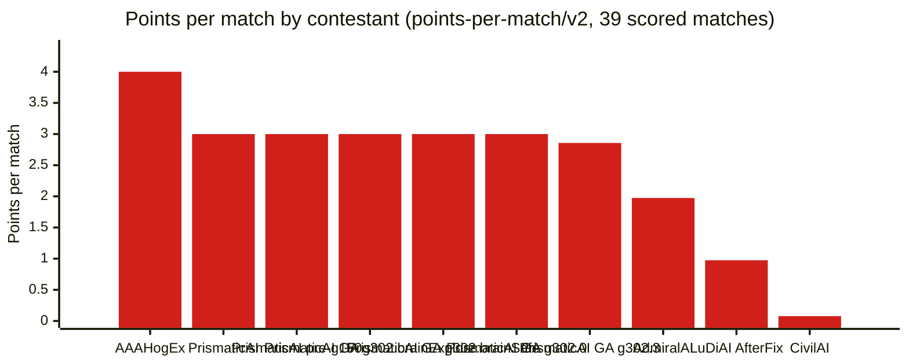
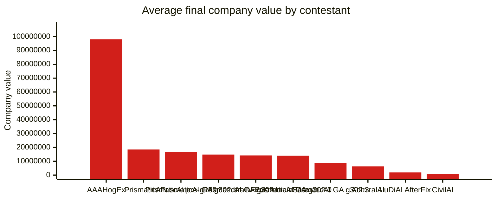
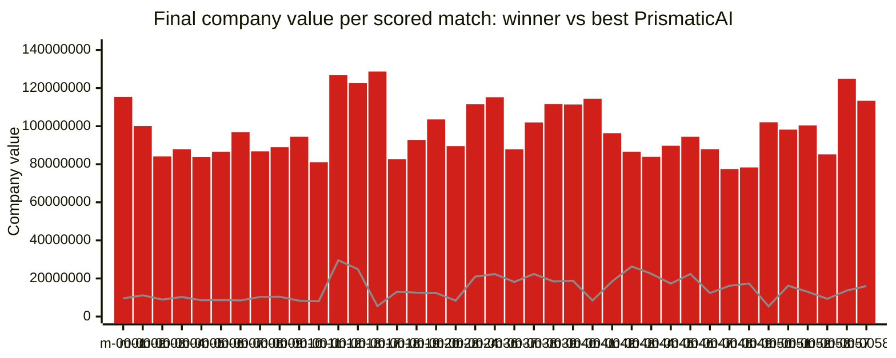
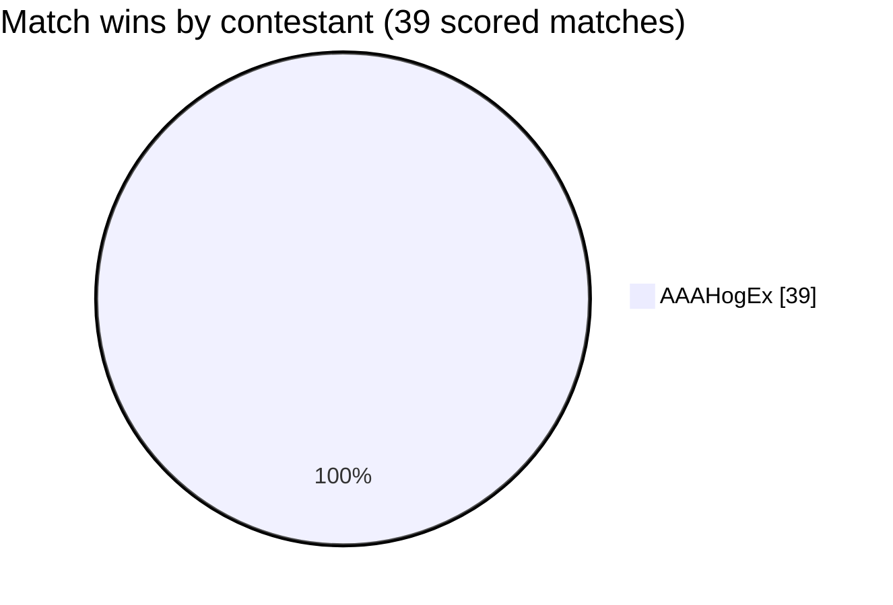
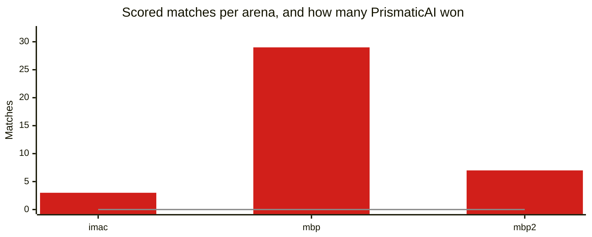

# battle-20261121T195450-000b3198

Derived from `battle-20261121T195450-000b3198.json` by `tools/research/ai-battle/battle.py report`; do not edit.

- Edition `000b3198d9e14685`: PrismaticAI and referee at `531922be7d7544c6f7d5beecd51ca7906763f532`, base set `opengfx-8.0.tar`
- 20-year free-for-all from 1960, map 256x256 temperate, breakdowns 1
- 39 scored match(es) on `imac` (20261119-master-gdf1e05e7d8), `mbp` (20261120-master-m17653b726e), `mbp2` (20261119-master-gdf1e05e7d8)
- Replays: 0 of 0 identical to their original on another arena

| # | Contestant | Played | Wins | Points | Points/match | Avg rank | Avg final value | Squirrel errors | Matches with anomalies |
|---|---|---|---|---|---|---|---|---|---|
| 1 | AAAHogEx | 39 | 39 | 156 | 4.0 | 1.0 | 98.1 M | 0 | 0 |
| 2 | PrismaticAI | 7 | 0 | 21 | 3.0 | 2.0 | 18.5 M | 0 | 0 |
| 3 | PrismaticAI pre-g150 | 7 | 0 | 21 | 3.0 | 2.0 | 16.7 M | 0 | 0 |
| 4 | PrismaticAI GA g302.brainExplore | 6 | 0 | 18 | 3.0 | 2.0 | 14.8 M | 0 | 0 |
| 5 | PrismaticAI GA g302.brainSafe | 6 | 0 | 18 | 3.0 | 2.0 | 14.1 M | 0 | 0 |
| 6 | PrismaticAI GA g302.0 | 6 | 0 | 18 | 3.0 | 2.0 | 14.0 M | 0 | 0 |
| 7 | PrismaticAI GA g302.3 | 7 | 0 | 20 | 2.857 | 2.14 | 8.6 M | 0 | 0 |
| 8 | AdmiralAI | 39 | 0 | 77 | 1.974 | 3.03 | 6.3 M | 0 | 2 |
| 9 | LuDiAI AfterFix | 39 | 0 | 38 | 0.974 | 4.03 | 1.9 M | 0 | 1 |
| 10 | CivilAI | 39 | 0 | 3 | 0.077 | 4.92 | 728.7 k | 0 | 5 |

<!-- battle-charts:begin -->
<!-- derived from battle-20261121T195450-000b3198.json by `battle.py render`; `battle.py check` fails when it is stale -->

<!-- battle-charts:end -->

| Match | Arena | Seed | Winner | Value | Last | Anomalies |
|---|---|---|---|---|---|---|
| m-0001 | mbp | 1525041537 | AAAHogEx | 115.4 M | CivilAI | - |
| m-0002 | mbp | 1525041537 | AAAHogEx | 100.1 M | CivilAI | - |
| m-0003 | mbp | 1525041537 | AAAHogEx | 84.1 M | CivilAI | - |
| m-0004 | mbp | 1525041537 | AAAHogEx | 87.8 M | CivilAI | AdmiralAI: fleet_drop:292->197 |
| m-0005 | mbp | 1525041537 | AAAHogEx | 83.9 M | CivilAI | - |
| m-0006 | mbp | 217403318 | AAAHogEx | 86.5 M | CivilAI | - |
| m-0007 | mbp | 217403318 | AAAHogEx | 96.8 M | AdmiralAI | - |
| m-0008 | mbp | 217403318 | AAAHogEx | 86.8 M | CivilAI | - |
| m-0009 | mbp | 217403318 | AAAHogEx | 89.0 M | CivilAI | - |
| m-0010 | imac | 217403318 | AAAHogEx | 94.5 M | CivilAI | - |
| m-0011 | imac | 217403318 | AAAHogEx | 81.1 M | CivilAI | - |
| m-0012 | imac | 520839831 | AAAHogEx | 126.8 M | CivilAI | - |
| m-0013 | mbp2 | 520839831 | AAAHogEx | 122.6 M | CivilAI | - |
| m-0017 | mbp2 | 520839831 | AAAHogEx | 128.7 M | LuDiAI AfterFix | - |
| m-0018 | mbp2 | 231326555 | AAAHogEx | 82.7 M | CivilAI | - |
| m-0019 | mbp2 | 231326555 | AAAHogEx | 92.6 M | CivilAI | - |
| m-0020 | mbp2 | 231326555 | AAAHogEx | 103.6 M | CivilAI | LuDiAI AfterFix: fleet_drop:138->92; CivilAI: fleet_drop:32->13 |
| m-0023 | mbp2 | 231326555 | AAAHogEx | 89.5 M | CivilAI | CivilAI: fleet_drop:74->32 |
| m-0024 | mbp2 | 408807629 | AAAHogEx | 111.5 M | CivilAI | - |
| m-0036 | mbp | 1540021150 | AAAHogEx | 115.2 M | CivilAI | - |
| m-0037 | mbp | 1540021150 | AAAHogEx | 87.8 M | CivilAI | - |
| m-0038 | mbp | 1540021150 | AAAHogEx | 102.0 M | CivilAI | CivilAI: fleet_drop:29->19 |
| m-0039 | mbp | 1540021150 | AAAHogEx | 111.6 M | CivilAI | - |
| m-0040 | mbp | 1540021150 | AAAHogEx | 111.4 M | CivilAI | CivilAI: fleet_drop:45->23 |
| m-0041 | mbp | 1540021150 | AAAHogEx | 114.4 M | CivilAI | - |
| m-0042 | mbp | 923781868 | AAAHogEx | 96.3 M | CivilAI | - |
| m-0043 | mbp | 923781868 | AAAHogEx | 86.5 M | CivilAI | - |
| m-0044 | mbp | 923781868 | AAAHogEx | 84.0 M | CivilAI | - |
| m-0045 | mbp | 923781868 | AAAHogEx | 89.7 M | CivilAI | - |
| m-0046 | mbp | 923781868 | AAAHogEx | 94.5 M | CivilAI | - |
| m-0047 | mbp | 923781868 | AAAHogEx | 87.9 M | LuDiAI AfterFix | - |
| m-0048 | mbp | 1939151789 | AAAHogEx | 77.4 M | CivilAI | - |
| m-0049 | mbp | 1939151789 | AAAHogEx | 78.3 M | CivilAI | AdmiralAI: fleet_drop:219->153 |
| m-0050 | mbp | 1939151789 | AAAHogEx | 102.0 M | CivilAI | - |
| m-0051 | mbp | 1939151789 | AAAHogEx | 98.2 M | CivilAI | - |
| m-0052 | mbp | 1939151789 | AAAHogEx | 100.3 M | CivilAI | - |
| m-0053 | mbp | 1939151789 | AAAHogEx | 85.2 M | CivilAI | - |
| m-0057 | mbp | 1927917790 | AAAHogEx | 124.8 M | CivilAI | CivilAI: fleet_drop:31->14 |
| m-0058 | mbp | 1927917790 | AAAHogEx | 113.4 M | CivilAI | - |
