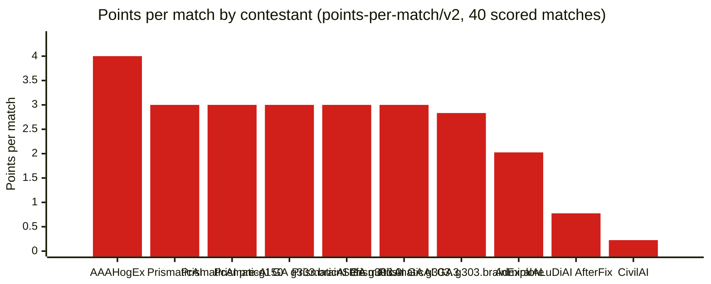
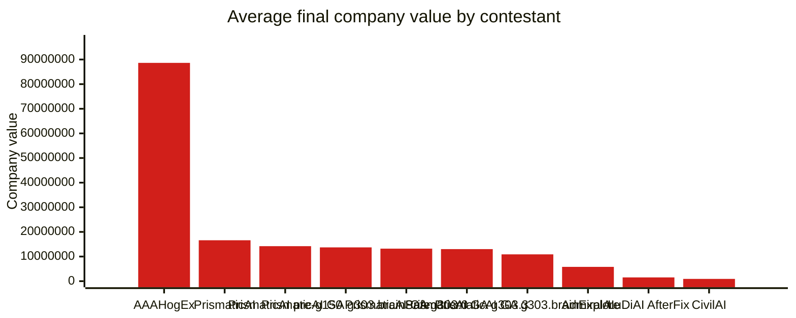
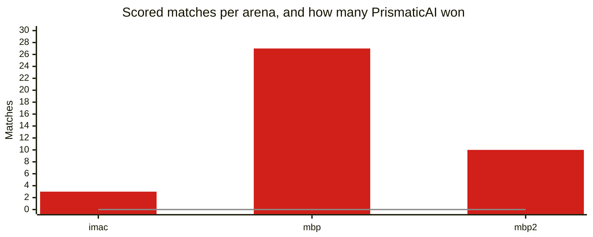

# battle-20261121T200629-24701968

Derived from `battle-20261121T200629-24701968.json` by `tools/research/ai-battle/battle.py report`; do not edit.

- Edition `24701968bd325c45`: PrismaticAI and referee at `531922be7d7544c6f7d5beecd51ca7906763f532`, base set `opengfx-8.0.tar`
- 20-year free-for-all from 1960, map 256x256 temperate, breakdowns 1
- 40 scored match(es) on `imac` (20261119-master-gdf1e05e7d8), `mbp` (20261120-master-m17653b726e), `mbp2` (20261119-master-gdf1e05e7d8)
- Replays: 0 of 1 identical to their original on another arena

| # | Contestant | Played | Wins | Points | Points/match | Avg rank | Avg final value | Squirrel errors | Matches with anomalies |
|---|---|---|---|---|---|---|---|---|---|
| 1 | AAAHogEx | 40 | 40 | 160 | 4.0 | 1.0 | 88.6 M | 0 | 0 |
| 2 | PrismaticAI | 7 | 0 | 21 | 3.0 | 2.0 | 16.6 M | 0 | 0 |
| 3 | PrismaticAI pre-g150 | 6 | 0 | 18 | 3.0 | 2.0 | 14.2 M | 0 | 0 |
| 4 | PrismaticAI GA g303.brainSafe | 7 | 0 | 21 | 3.0 | 2.0 | 13.7 M | 0 | 0 |
| 5 | PrismaticAI GA g303.0 | 8 | 0 | 24 | 3.0 | 2.0 | 13.2 M | 0 | 0 |
| 6 | PrismaticAI GA g303.3 | 6 | 0 | 18 | 3.0 | 2.0 | 13.0 M | 0 | 0 |
| 7 | PrismaticAI GA g303.brainExplore | 6 | 0 | 17 | 2.833 | 2.17 | 10.9 M | 0 | 0 |
| 8 | AdmiralAI | 40 | 0 | 81 | 2.025 | 2.98 | 5.8 M | 0 | 4 |
| 9 | LuDiAI AfterFix | 40 | 0 | 31 | 0.775 | 4.22 | 1.5 M | 0 | 0 |
| 10 | CivilAI | 40 | 0 | 9 | 0.225 | 4.78 | 919.2 k | 7540 | 7 |

```mermaid
---
config:
  xyChart:
    width: 900
    height: 360
  themeVariables:
    xyChart:
      plotColorPalette: "#d11f1a, #8a8a8a, #0b0b0b, #ece4d6"
---
xychart-beta
    title "Final company value per scored match: winner vs best PrismaticAI"
    x-axis ["m-0001", "m-0002", "m-0003", "m-0004", "m-0005", "m-0006", "m-0007", "m-0008", "m-0009", "m-0010", "m-0011", "m-0012", "m-0014", "m-0016", "m-0018", "m-0020", "m-0021", "m-0023", "m-0025", "m-0026", "m-0027", "m-0028", "m-0036", "m-0037", "m-0038", "m-0039", "m-0040", "m-0041", "m-0042", "m-0043", "m-0044", "m-0045", "m-0046", "m-0047", "m-0048", "m-0049", "m-0050", "m-0051", "m-0053", "m-0054"]
    %% series: Winner | Best PrismaticAI
    %% links: battle-20261121T200629-24701968.md?col=Match&filter=m-0001 | battle-20261121T200629-24701968.md?col=Match&filter=m-0002 | battle-20261121T200629-24701968.md?col=Match&filter=m-0003 | battle-20261121T200629-24701968.md?col=Match&filter=m-0004 | battle-20261121T200629-24701968.md?col=Match&filter=m-0005 | battle-20261121T200629-24701968.md?col=Match&filter=m-0006 | battle-20261121T200629-24701968.md?col=Match&filter=m-0007 | battle-20261121T200629-24701968.md?col=Match&filter=m-0008 | battle-20261121T200629-24701968.md?col=Match&filter=m-0009 | battle-20261121T200629-24701968.md?col=Match&filter=m-0010 | battle-20261121T200629-24701968.md?col=Match&filter=m-0011 | battle-20261121T200629-24701968.md?col=Match&filter=m-0012 | battle-20261121T200629-24701968.md?col=Match&filter=m-0014 | battle-20261121T200629-24701968.md?col=Match&filter=m-0016 | battle-20261121T200629-24701968.md?col=Match&filter=m-0018 | battle-20261121T200629-24701968.md?col=Match&filter=m-0020 | battle-20261121T200629-24701968.md?col=Match&filter=m-0021 | battle-20261121T200629-24701968.md?col=Match&filter=m-0023 | battle-20261121T200629-24701968.md?col=Match&filter=m-0025 | battle-20261121T200629-24701968.md?col=Match&filter=m-0026 | battle-20261121T200629-24701968.md?col=Match&filter=m-0027 | battle-20261121T200629-24701968.md?col=Match&filter=m-0028 | battle-20261121T200629-24701968.md?col=Match&filter=m-0036 | battle-20261121T200629-24701968.md?col=Match&filter=m-0037 | battle-20261121T200629-24701968.md?col=Match&filter=m-0038 | battle-20261121T200629-24701968.md?col=Match&filter=m-0039 | battle-20261121T200629-24701968.md?col=Match&filter=m-0040 | battle-20261121T200629-24701968.md?col=Match&filter=m-0041 | battle-20261121T200629-24701968.md?col=Match&filter=m-0042 | battle-20261121T200629-24701968.md?col=Match&filter=m-0043 | battle-20261121T200629-24701968.md?col=Match&filter=m-0044 | battle-20261121T200629-24701968.md?col=Match&filter=m-0045 | battle-20261121T200629-24701968.md?col=Match&filter=m-0046 | battle-20261121T200629-24701968.md?col=Match&filter=m-0047 | battle-20261121T200629-24701968.md?col=Match&filter=m-0048 | battle-20261121T200629-24701968.md?col=Match&filter=m-0049 | battle-20261121T200629-24701968.md?col=Match&filter=m-0050 | battle-20261121T200629-24701968.md?col=Match&filter=m-0051 | battle-20261121T200629-24701968.md?col=Match&filter=m-0053 | battle-20261121T200629-24701968.md?col=Match&filter=m-0054
    y-axis "Company value" 0 --> 127000000
    bar [97834844, 81927458, 80078927, 97427594, 108280343, 79099674, 79718343, 96941255, 92619937, 71033551, 97557269, 96763775, 63821498, 99994049, 111600380, 87411963, 93909159, 91253164, 72042385, 52159517, 67781411, 70616702, 93548834, 103610427, 107349363, 105130315, 89486742, 95208177, 108372696, 111868552, 96304051, 93075352, 115367207, 114512778, 75207575, 61824883, 64528820, 53839331, 69389484, 96756524]
    line [14624738, 8178316, 13796069, 5489780, 9081847, 18275689, 16603030, 14671177, 13686588, 12015256, 11765513, 7151672, 13340354, 10514557, 15643021, 13115103, 17507087, 16153666, 12200852, 10751787, 7790527, 6582222, 22869784, 15827196, 14131991, 18497106, 11955728, 14533206, 17419671, 9548083, 15888540, 8188039, 18773379, 12986176, 13285087, 16446086, 15529524, 16549523, 13583404, 21612498]
```

<!-- battle-charts:begin -->
<!-- derived from battle-20261121T200629-24701968.json by `battle.py render`; `battle.py check` fails when it is stale -->

<!-- battle-charts:end -->

| Seed | Original | Replay | Arenas | Identical |
|---|---|---|---|---|
| 944853533 | m-0010 | m-0056 | imac / mbp | NO |

| Match | Arena | Seed | Winner | Value | Last | Anomalies |
|---|---|---|---|---|---|---|
| m-0001 | mbp | 18181830 | AAAHogEx | 97.8 M | CivilAI | - |
| m-0002 | mbp | 18181830 | AAAHogEx | 81.9 M | CivilAI | AdmiralAI: fleet_drop:109->76; CivilAI: fleet_drop:33->19 |
| m-0003 | mbp | 18181830 | AAAHogEx | 80.1 M | CivilAI | - |
| m-0004 | mbp | 18181830 | AAAHogEx | 97.4 M | CivilAI | - |
| m-0005 | mbp | 18181830 | AAAHogEx | 108.3 M | CivilAI | - |
| m-0006 | mbp | 944853533 | AAAHogEx | 79.1 M | LuDiAI AfterFix | CivilAI: fleet_drop:61->38 |
| m-0007 | mbp | 944853533 | AAAHogEx | 79.7 M | LuDiAI AfterFix | - |
| m-0008 | mbp | 944853533 | AAAHogEx | 96.9 M | CivilAI | - |
| m-0009 | mbp | 944853533 | AAAHogEx | 92.6 M | CivilAI | - |
| m-0010 | imac | 944853533 | AAAHogEx | 71.0 M | CivilAI | CivilAI: squirrel_errors:3790 |
| m-0011 | imac | 944853533 | AAAHogEx | 97.6 M | CivilAI | - |
| m-0012 | imac | 1379494891 | AAAHogEx | 96.8 M | LuDiAI AfterFix | - |
| m-0014 | mbp2 | 1379494891 | AAAHogEx | 63.8 M | CivilAI | - |
| m-0016 | mbp2 | 1379494891 | AAAHogEx | 100.0 M | LuDiAI AfterFix | - |
| m-0018 | mbp2 | 627896546 | AAAHogEx | 111.6 M | CivilAI | - |
| m-0020 | mbp2 | 627896546 | AAAHogEx | 87.4 M | CivilAI | CivilAI: fleet_drop:31->20 |
| m-0021 | mbp2 | 627896546 | AAAHogEx | 93.9 M | LuDiAI AfterFix | - |
| m-0023 | mbp2 | 627896546 | AAAHogEx | 91.3 M | CivilAI | - |
| m-0025 | mbp2 | 1275127356 | AAAHogEx | 72.0 M | CivilAI | AdmiralAI: fleet_drop:133->84 |
| m-0026 | mbp2 | 1275127356 | AAAHogEx | 52.2 M | CivilAI | - |
| m-0027 | mbp2 | 1275127356 | AAAHogEx | 67.8 M | LuDiAI AfterFix | - |
| m-0028 | mbp2 | 1275127356 | AAAHogEx | 70.6 M | CivilAI | - |
| m-0036 | mbp | 289118327 | AAAHogEx | 93.5 M | CivilAI | - |
| m-0037 | mbp | 289118327 | AAAHogEx | 103.6 M | CivilAI | - |
| m-0038 | mbp | 289118327 | AAAHogEx | 107.3 M | CivilAI | - |
| m-0039 | mbp | 289118327 | AAAHogEx | 105.1 M | CivilAI | AdmiralAI: fleet_drop:163->95 |
| m-0040 | mbp | 289118327 | AAAHogEx | 89.5 M | CivilAI | - |
| m-0041 | mbp | 289118327 | AAAHogEx | 95.2 M | LuDiAI AfterFix | - |
| m-0042 | mbp | 309582256 | AAAHogEx | 108.4 M | LuDiAI AfterFix | - |
| m-0043 | mbp | 309582256 | AAAHogEx | 111.9 M | LuDiAI AfterFix | - |
| m-0044 | mbp | 309582256 | AAAHogEx | 96.3 M | CivilAI | - |
| m-0045 | mbp | 309582256 | AAAHogEx | 93.1 M | CivilAI | - |
| m-0046 | mbp | 309582256 | AAAHogEx | 115.4 M | CivilAI | - |
| m-0047 | mbp | 309582256 | AAAHogEx | 114.5 M | CivilAI | CivilAI: fleet_drop:35->21 |
| m-0048 | mbp | 798396928 | AAAHogEx | 75.2 M | CivilAI | CivilAI: squirrel_errors:3750 |
| m-0049 | mbp | 798396928 | AAAHogEx | 61.8 M | CivilAI | - |
| m-0050 | mbp | 798396928 | AAAHogEx | 64.5 M | CivilAI | - |
| m-0051 | mbp | 798396928 | AAAHogEx | 53.8 M | CivilAI | AdmiralAI: fleet_drop:72->49 |
| m-0053 | mbp | 798396928 | AAAHogEx | 69.4 M | CivilAI | CivilAI: fleet_drop:28->17 |
| m-0054 | mbp | 114525708 | AAAHogEx | 96.8 M | CivilAI | - |
| m-0056 (replay) | mbp | 944853533 | AAAHogEx | 70.4 M | CivilAI | CivilAI: squirrel_errors:3790 |
