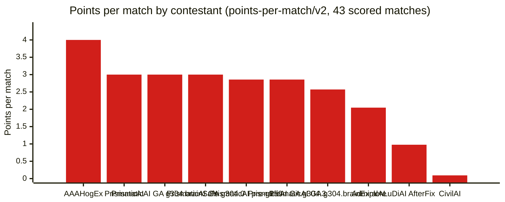
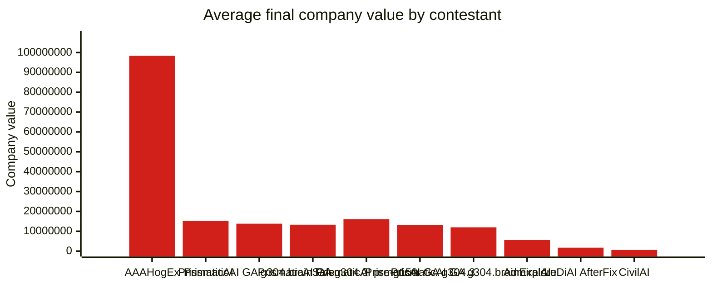
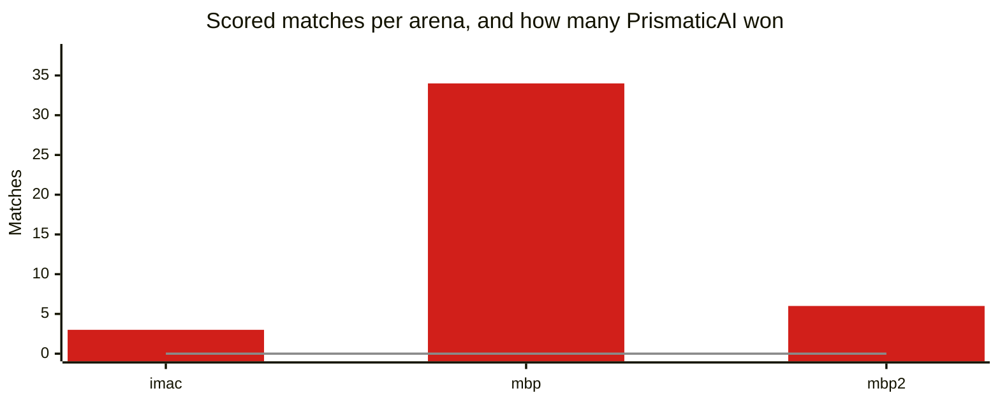

# battle-20261121T201921-512c95be

Derived from `battle-20261121T201921-512c95be.json` by `tools/research/ai-battle/battle.py report`; do not edit.

- Edition `512c95be27cb6940`: PrismaticAI and referee at `531922be7d7544c6f7d5beecd51ca7906763f532`, base set `opengfx-8.0.tar`
- 20-year free-for-all from 1960, map 256x256 temperate, breakdowns 1
- 43 scored match(es) on `imac` (20261119-master-gdf1e05e7d8), `mbp` (20261120-master-m17653b726e), `mbp2` (20261119-master-gdf1e05e7d8)
- Replays: 0 of 0 identical to their original on another arena

| # | Contestant | Played | Wins | Points | Points/match | Avg rank | Avg final value | Squirrel errors | Matches with anomalies |
|---|---|---|---|---|---|---|---|---|---|
| 1 | AAAHogEx | 43 | 43 | 172 | 4.0 | 1.0 | 98.4 M | 0 | 0 |
| 2 | PrismaticAI | 8 | 0 | 24 | 3.0 | 2.0 | 15.2 M | 0 | 0 |
| 3 | PrismaticAI GA g304.brainSafe | 7 | 0 | 21 | 3.0 | 2.0 | 13.8 M | 0 | 0 |
| 4 | PrismaticAI GA g304.0 | 7 | 0 | 21 | 3.0 | 2.0 | 13.3 M | 0 | 0 |
| 5 | PrismaticAI pre-g150 | 7 | 0 | 20 | 2.857 | 2.14 | 16.1 M | 0 | 0 |
| 6 | PrismaticAI GA g304.3 | 7 | 0 | 20 | 2.857 | 2.14 | 13.2 M | 0 | 0 |
| 7 | PrismaticAI GA g304.brainExplore | 7 | 0 | 18 | 2.571 | 2.43 | 12.0 M | 0 | 0 |
| 8 | AdmiralAI | 43 | 0 | 88 | 2.047 | 2.95 | 5.5 M | 57 | 2 |
| 9 | LuDiAI AfterFix | 43 | 0 | 42 | 0.977 | 4.02 | 1.7 M | 0 | 0 |
| 10 | CivilAI | 43 | 0 | 4 | 0.093 | 4.91 | 556.3 k | 0 | 5 |

```mermaid
---
config:
  xyChart:
    width: 900
    height: 360
  themeVariables:
    xyChart:
      plotColorPalette: "#d11f1a, #8a8a8a, #0b0b0b, #ece4d6"
---
xychart-beta
    title "Final company value per scored match: winner vs best PrismaticAI"
    x-axis ["m-0001", "m-0002", "m-0003", "m-0004", "m-0005", "m-0006", "m-0007", "m-0008", "m-0009", "m-0010", "m-0011", "m-0012", "m-0016", "m-0018", "m-0019", "m-0020", "m-0023", "m-0024", "m-0036", "m-0037", "m-0038", "m-0039", "m-0040", "m-0041", "m-0042", "m-0043", "m-0044", "m-0045", "m-0046", "m-0047", "m-0048", "m-0049", "m-0050", "m-0051", "m-0052", "m-0053", "m-0057", "m-0058", "m-0059", "m-0060", "m-0061", "m-0062", "m-0063"]
    %% series: Winner | Best PrismaticAI
    %% links: battle-20261121T201921-512c95be.md?col=Match&filter=m-0001 | battle-20261121T201921-512c95be.md?col=Match&filter=m-0002 | battle-20261121T201921-512c95be.md?col=Match&filter=m-0003 | battle-20261121T201921-512c95be.md?col=Match&filter=m-0004 | battle-20261121T201921-512c95be.md?col=Match&filter=m-0005 | battle-20261121T201921-512c95be.md?col=Match&filter=m-0006 | battle-20261121T201921-512c95be.md?col=Match&filter=m-0007 | battle-20261121T201921-512c95be.md?col=Match&filter=m-0008 | battle-20261121T201921-512c95be.md?col=Match&filter=m-0009 | battle-20261121T201921-512c95be.md?col=Match&filter=m-0010 | battle-20261121T201921-512c95be.md?col=Match&filter=m-0011 | battle-20261121T201921-512c95be.md?col=Match&filter=m-0012 | battle-20261121T201921-512c95be.md?col=Match&filter=m-0016 | battle-20261121T201921-512c95be.md?col=Match&filter=m-0018 | battle-20261121T201921-512c95be.md?col=Match&filter=m-0019 | battle-20261121T201921-512c95be.md?col=Match&filter=m-0020 | battle-20261121T201921-512c95be.md?col=Match&filter=m-0023 | battle-20261121T201921-512c95be.md?col=Match&filter=m-0024 | battle-20261121T201921-512c95be.md?col=Match&filter=m-0036 | battle-20261121T201921-512c95be.md?col=Match&filter=m-0037 | battle-20261121T201921-512c95be.md?col=Match&filter=m-0038 | battle-20261121T201921-512c95be.md?col=Match&filter=m-0039 | battle-20261121T201921-512c95be.md?col=Match&filter=m-0040 | battle-20261121T201921-512c95be.md?col=Match&filter=m-0041 | battle-20261121T201921-512c95be.md?col=Match&filter=m-0042 | battle-20261121T201921-512c95be.md?col=Match&filter=m-0043 | battle-20261121T201921-512c95be.md?col=Match&filter=m-0044 | battle-20261121T201921-512c95be.md?col=Match&filter=m-0045 | battle-20261121T201921-512c95be.md?col=Match&filter=m-0046 | battle-20261121T201921-512c95be.md?col=Match&filter=m-0047 | battle-20261121T201921-512c95be.md?col=Match&filter=m-0048 | battle-20261121T201921-512c95be.md?col=Match&filter=m-0049 | battle-20261121T201921-512c95be.md?col=Match&filter=m-0050 | battle-20261121T201921-512c95be.md?col=Match&filter=m-0051 | battle-20261121T201921-512c95be.md?col=Match&filter=m-0052 | battle-20261121T201921-512c95be.md?col=Match&filter=m-0053 | battle-20261121T201921-512c95be.md?col=Match&filter=m-0057 | battle-20261121T201921-512c95be.md?col=Match&filter=m-0058 | battle-20261121T201921-512c95be.md?col=Match&filter=m-0059 | battle-20261121T201921-512c95be.md?col=Match&filter=m-0060 | battle-20261121T201921-512c95be.md?col=Match&filter=m-0061 | battle-20261121T201921-512c95be.md?col=Match&filter=m-0062 | battle-20261121T201921-512c95be.md?col=Match&filter=m-0063
    y-axis "Company value" 0 --> 171000000
    bar [103939948, 124535011, 102190546, 122369666, 110097795, 64435906, 74297653, 85052850, 77823357, 73853552, 78896587, 155189156, 118310711, 89826162, 97278700, 85178887, 81273935, 97562772, 143220677, 115557818, 151291143, 137145667, 118292092, 126029278, 133918043, 148242276, 143446071, 130528050, 136006247, 123377692, 70917870, 64419341, 65200568, 63692928, 77986186, 71386398, 81298854, 96999428, 58946623, 67129890, 57783258, 45435945, 58790428]
    line [23836907, 15554006, 16406200, 14940477, 18012275, 21114579, 13761882, 10422503, 13943530, 16354533, 11898116, 14538194, 17447201, 13911734, 12771233, 11518832, 10669293, 11020041, 22253881, 22588368, 19480131, 18533404, 15321708, 20097760, 15803091, 16404477, 9610759, 12777460, 10587210, 12509584, 9131199, 6415523, 10530297, 11989343, 1, 8743038, 12695653, 9169877, 10672720, 13685333, 16606252, 16031028, 10330010]
```

<!-- battle-charts:begin -->
<!-- derived from battle-20261121T201921-512c95be.json by `battle.py render`; `battle.py check` fails when it is stale -->

<!-- battle-charts:end -->

| Match | Arena | Seed | Winner | Value | Last | Anomalies |
|---|---|---|---|---|---|---|
| m-0001 | mbp | 1950227352 | AAAHogEx | 103.9 M | CivilAI | - |
| m-0002 | mbp | 1950227352 | AAAHogEx | 124.5 M | CivilAI | - |
| m-0003 | mbp | 1950227352 | AAAHogEx | 102.2 M | CivilAI | - |
| m-0004 | mbp | 1950227352 | AAAHogEx | 122.4 M | CivilAI | - |
| m-0005 | mbp | 1950227352 | AAAHogEx | 110.1 M | CivilAI | - |
| m-0006 | mbp | 1335339744 | AAAHogEx | 64.4 M | CivilAI | - |
| m-0007 | mbp | 1335339744 | AAAHogEx | 74.3 M | CivilAI | CivilAI: fleet_drop:34->21 |
| m-0008 | mbp | 1335339744 | AAAHogEx | 85.1 M | CivilAI | - |
| m-0009 | mbp | 1335339744 | AAAHogEx | 77.8 M | CivilAI | AdmiralAI: fleet_drop:495->313 |
| m-0010 | imac | 1335339744 | AAAHogEx | 73.9 M | CivilAI | - |
| m-0011 | imac | 1335339744 | AAAHogEx | 78.9 M | LuDiAI AfterFix | - |
| m-0012 | imac | 1504668303 | AAAHogEx | 155.2 M | LuDiAI AfterFix | - |
| m-0016 | mbp2 | 1504668303 | AAAHogEx | 118.3 M | CivilAI | CivilAI: fleet_drop:93->46 |
| m-0018 | mbp2 | 309262321 | AAAHogEx | 89.8 M | CivilAI | - |
| m-0019 | mbp2 | 309262321 | AAAHogEx | 97.3 M | CivilAI | - |
| m-0020 | mbp2 | 309262321 | AAAHogEx | 85.2 M | CivilAI | - |
| m-0023 | mbp2 | 309262321 | AAAHogEx | 81.3 M | CivilAI | - |
| m-0024 | mbp2 | 211949640 | AAAHogEx | 97.6 M | CivilAI | - |
| m-0036 | mbp | 747780282 | AAAHogEx | 143.2 M | CivilAI | - |
| m-0037 | mbp | 747780282 | AAAHogEx | 115.6 M | CivilAI | - |
| m-0038 | mbp | 747780282 | AAAHogEx | 151.3 M | CivilAI | - |
| m-0039 | mbp | 747780282 | AAAHogEx | 137.1 M | CivilAI | - |
| m-0040 | mbp | 747780282 | AAAHogEx | 118.3 M | CivilAI | - |
| m-0041 | mbp | 747780282 | AAAHogEx | 126.0 M | CivilAI | - |
| m-0042 | mbp | 589526630 | AAAHogEx | 133.9 M | CivilAI | - |
| m-0043 | mbp | 589526630 | AAAHogEx | 148.2 M | CivilAI | - |
| m-0044 | mbp | 589526630 | AAAHogEx | 143.4 M | CivilAI | - |
| m-0045 | mbp | 589526630 | AAAHogEx | 130.5 M | CivilAI | - |
| m-0046 | mbp | 589526630 | AAAHogEx | 136.0 M | CivilAI | - |
| m-0047 | mbp | 589526630 | AAAHogEx | 123.4 M | CivilAI | - |
| m-0048 | mbp | 1383023900 | AAAHogEx | 70.9 M | CivilAI | - |
| m-0049 | mbp | 1383023900 | AAAHogEx | 64.4 M | CivilAI | - |
| m-0050 | mbp | 1383023900 | AAAHogEx | 65.2 M | CivilAI | - |
| m-0051 | mbp | 1383023900 | AAAHogEx | 63.7 M | CivilAI | - |
| m-0052 | mbp | 1383023900 | AAAHogEx | 78.0 M | PrismaticAI GA g304.brainExplore | - |
| m-0053 | mbp | 1383023900 | AAAHogEx | 71.4 M | CivilAI | - |
| m-0057 | mbp | 1095397791 | AAAHogEx | 81.3 M | CivilAI | - |
| m-0058 | mbp | 1095397791 | AAAHogEx | 97.0 M | CivilAI | CivilAI: fleet_drop:62->42 |
| m-0059 | mbp | 1095397791 | AAAHogEx | 58.9 M | LuDiAI AfterFix | CivilAI: fleet_drop:125->61 |
| m-0060 | mbp | 756141305 | AAAHogEx | 67.1 M | CivilAI | - |
| m-0061 | mbp | 756141305 | AAAHogEx | 57.8 M | CivilAI | - |
| m-0062 | mbp | 756141305 | AAAHogEx | 45.4 M | CivilAI | CivilAI: fleet_drop:32->21 |
| m-0063 | mbp | 756141305 | AAAHogEx | 58.8 M | CivilAI | AdmiralAI: squirrel_errors:57 |
