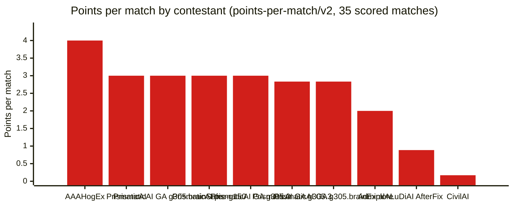
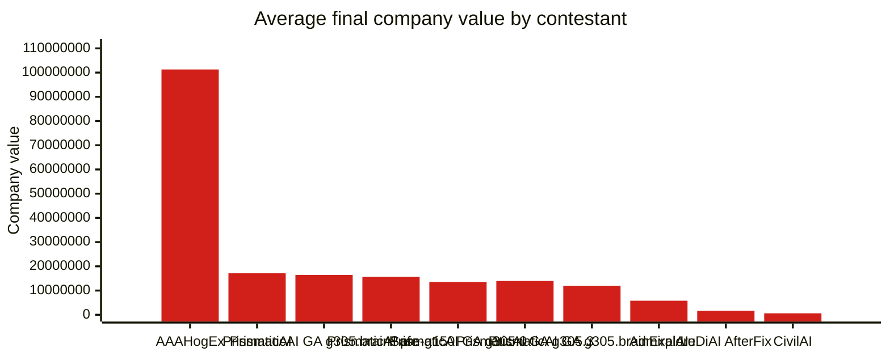
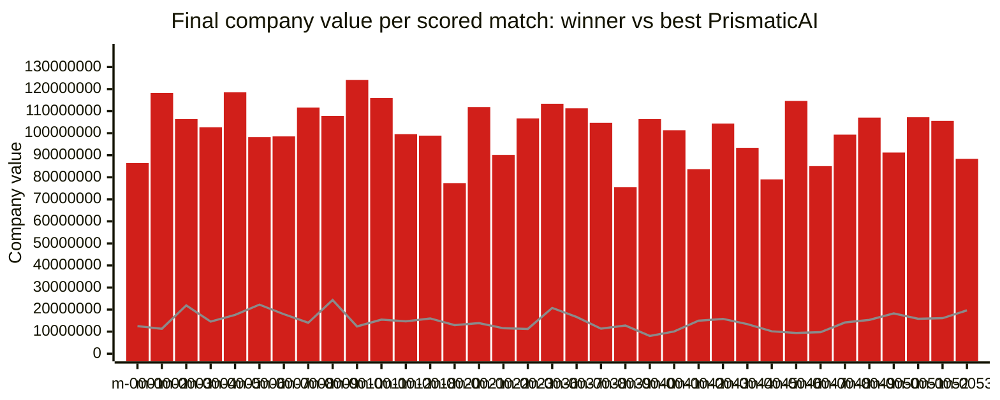
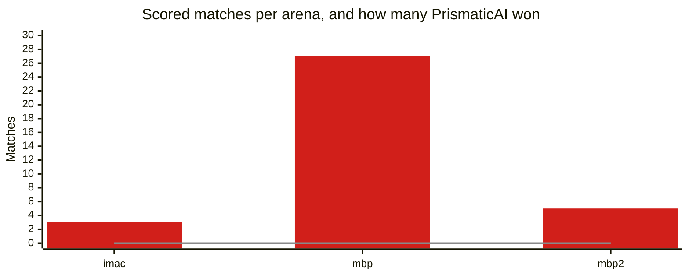

# battle-20261121T203045-6fd8a125

Derived from `battle-20261121T203045-6fd8a125.json` by `tools/research/ai-battle/battle.py report`; do not edit.

- Edition `6fd8a1254fc96ac2`: PrismaticAI and referee at `531922be7d7544c6f7d5beecd51ca7906763f532`, base set `opengfx-8.0.tar`
- 20-year free-for-all from 1960, map 256x256 temperate, breakdowns 1
- 35 scored match(es) on `imac` (20261119-master-gdf1e05e7d8), `mbp` (20261120-master-m17653b726e), `mbp2` (20261119-master-gdf1e05e7d8)
- Replays: 0 of 0 identical to their original on another arena

| # | Contestant | Played | Wins | Points | Points/match | Avg rank | Avg final value | Squirrel errors | Matches with anomalies |
|---|---|---|---|---|---|---|---|---|---|
| 1 | AAAHogEx | 35 | 35 | 140 | 4.0 | 1.0 | 101.3 M | 0 | 0 |
| 2 | PrismaticAI | 6 | 0 | 18 | 3.0 | 2.0 | 17.1 M | 0 | 0 |
| 3 | PrismaticAI GA g305.brainSafe | 6 | 0 | 18 | 3.0 | 2.0 | 16.5 M | 0 | 0 |
| 4 | PrismaticAI pre-g150 | 5 | 0 | 15 | 3.0 | 2.0 | 15.6 M | 0 | 0 |
| 5 | PrismaticAI GA g305.0 | 6 | 0 | 18 | 3.0 | 2.0 | 13.5 M | 0 | 0 |
| 6 | PrismaticAI GA g305.3 | 6 | 0 | 17 | 2.833 | 2.17 | 14.0 M | 0 | 0 |
| 7 | PrismaticAI GA g305.brainExplore | 6 | 0 | 17 | 2.833 | 2.17 | 12.0 M | 0 | 0 |
| 8 | AdmiralAI | 35 | 0 | 70 | 2.0 | 3.0 | 5.8 M | 0 | 2 |
| 9 | LuDiAI AfterFix | 35 | 0 | 31 | 0.886 | 4.11 | 1.6 M | 0 | 2 |
| 10 | CivilAI | 35 | 0 | 6 | 0.171 | 4.83 | 593.6 k | 0 | 6 |

<!-- battle-charts:begin -->
<!-- derived from battle-20261121T203045-6fd8a125.json by `battle.py render`; `battle.py check` fails when it is stale -->

<!-- battle-charts:end -->

| Match | Arena | Seed | Winner | Value | Last | Anomalies |
|---|---|---|---|---|---|---|
| m-0001 | mbp | 1977931434 | AAAHogEx | 86.5 M | CivilAI | - |
| m-0002 | mbp | 1977931434 | AAAHogEx | 118.2 M | CivilAI | - |
| m-0003 | mbp | 1977931434 | AAAHogEx | 106.4 M | CivilAI | CivilAI: fleet_drop:11->7 |
| m-0004 | mbp | 1977931434 | AAAHogEx | 102.7 M | CivilAI | - |
| m-0005 | mbp | 1977931434 | AAAHogEx | 118.5 M | CivilAI | LuDiAI AfterFix: fleet_drop:102->59 |
| m-0006 | mbp | 1980155083 | AAAHogEx | 98.2 M | LuDiAI AfterFix | - |
| m-0007 | mbp | 1980155083 | AAAHogEx | 98.5 M | LuDiAI AfterFix | - |
| m-0008 | mbp | 1980155083 | AAAHogEx | 111.7 M | LuDiAI AfterFix | CivilAI: fleet_drop:29->11 |
| m-0009 | mbp | 1980155083 | AAAHogEx | 107.9 M | CivilAI | - |
| m-0010 | imac | 1980155083 | AAAHogEx | 124.1 M | CivilAI | - |
| m-0011 | imac | 1980155083 | AAAHogEx | 115.9 M | CivilAI | - |
| m-0012 | imac | 1782807036 | AAAHogEx | 99.6 M | CivilAI | - |
| m-0018 | mbp2 | 1585167545 | AAAHogEx | 98.9 M | LuDiAI AfterFix | CivilAI: fleet_drop:37->22 |
| m-0020 | mbp2 | 1585167545 | AAAHogEx | 77.4 M | CivilAI | LuDiAI AfterFix: fleet_drop:14->4 |
| m-0021 | mbp2 | 1585167545 | AAAHogEx | 111.8 M | CivilAI | - |
| m-0022 | mbp2 | 1585167545 | AAAHogEx | 90.2 M | LuDiAI AfterFix | - |
| m-0023 | mbp2 | 1585167545 | AAAHogEx | 106.7 M | CivilAI | - |
| m-0036 | mbp | 269153344 | AAAHogEx | 113.4 M | CivilAI | CivilAI: fleet_drop:71->36 |
| m-0037 | mbp | 269153344 | AAAHogEx | 111.3 M | CivilAI | - |
| m-0038 | mbp | 269153344 | AAAHogEx | 104.7 M | CivilAI | AdmiralAI: fleet_drop:304->204; CivilAI: fleet_drop:15->10 |
| m-0039 | mbp | 269153344 | AAAHogEx | 75.5 M | CivilAI | AdmiralAI: fleet_drop:320->202 |
| m-0040 | mbp | 269153344 | AAAHogEx | 106.4 M | CivilAI | - |
| m-0041 | mbp | 269153344 | AAAHogEx | 101.3 M | CivilAI | - |
| m-0042 | mbp | 670238007 | AAAHogEx | 83.7 M | CivilAI | - |
| m-0043 | mbp | 670238007 | AAAHogEx | 104.4 M | CivilAI | - |
| m-0044 | mbp | 670238007 | AAAHogEx | 93.4 M | CivilAI | - |
| m-0045 | mbp | 670238007 | AAAHogEx | 79.1 M | CivilAI | - |
| m-0046 | mbp | 670238007 | AAAHogEx | 114.6 M | CivilAI | - |
| m-0047 | mbp | 670238007 | AAAHogEx | 85.1 M | CivilAI | - |
| m-0048 | mbp | 568679387 | AAAHogEx | 99.3 M | CivilAI | - |
| m-0049 | mbp | 568679387 | AAAHogEx | 107.1 M | CivilAI | - |
| m-0050 | mbp | 568679387 | AAAHogEx | 91.2 M | CivilAI | - |
| m-0051 | mbp | 568679387 | AAAHogEx | 107.2 M | CivilAI | CivilAI: fleet_drop:26->5 |
| m-0052 | mbp | 568679387 | AAAHogEx | 105.6 M | CivilAI | - |
| m-0053 | mbp | 568679387 | AAAHogEx | 88.3 M | LuDiAI AfterFix | - |
