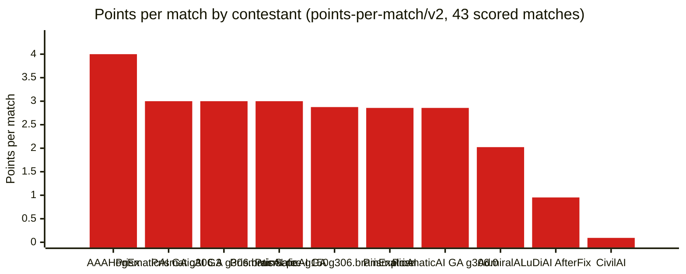
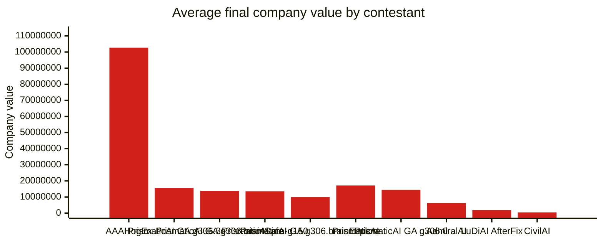
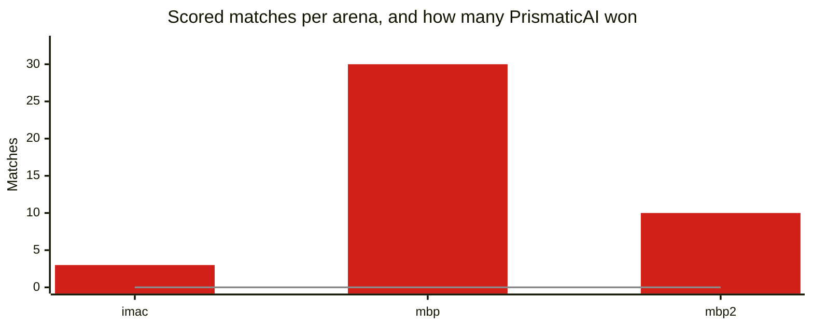

# battle-20261121T204426-4871c0a5

Derived from `battle-20261121T204426-4871c0a5.json` by `tools/research/ai-battle/battle.py report`; do not edit.

- Edition `4871c0a5ad8cb918`: PrismaticAI and referee at `531922be7d7544c6f7d5beecd51ca7906763f532`, base set `opengfx-8.0.tar`
- 20-year free-for-all from 1960, map 256x256 temperate, breakdowns 1
- 43 scored match(es) on `imac` (20261119-master-gdf1e05e7d8), `mbp` (20261120-master-m17653b726e), `mbp2` (20261119-master-gdf1e05e7d8)
- Replays: 0 of 0 identical to their original on another arena

| # | Contestant | Played | Wins | Points | Points/match | Avg rank | Avg final value | Squirrel errors | Matches with anomalies |
|---|---|---|---|---|---|---|---|---|---|
| 1 | AAAHogEx | 43 | 43 | 172 | 4.0 | 1.0 | 102.7 M | 0 | 0 |
| 2 | PrismaticAI GA g306.3 | 6 | 0 | 18 | 3.0 | 2.0 | 15.5 M | 0 | 0 |
| 3 | PrismaticAI GA g306.brainSafe | 8 | 0 | 24 | 3.0 | 2.0 | 13.8 M | 0 | 0 |
| 4 | PrismaticAI pre-g150 | 7 | 0 | 21 | 3.0 | 2.0 | 13.5 M | 0 | 0 |
| 5 | PrismaticAI GA g306.brainExplore | 8 | 0 | 23 | 2.875 | 2.12 | 10.0 M | 0 | 0 |
| 6 | PrismaticAI | 7 | 0 | 20 | 2.857 | 2.14 | 17.1 M | 0 | 0 |
| 7 | PrismaticAI GA g306.0 | 7 | 0 | 20 | 2.857 | 2.14 | 14.4 M | 0 | 0 |
| 8 | AdmiralAI | 43 | 0 | 87 | 2.023 | 2.98 | 6.3 M | 0 | 1 |
| 9 | LuDiAI AfterFix | 43 | 0 | 41 | 0.953 | 4.05 | 1.8 M | 0 | 3 |
| 10 | CivilAI | 43 | 0 | 4 | 0.093 | 4.91 | 421.6 k | 3670 | 10 |

```mermaid
---
config:
  xyChart:
    width: 900
    height: 360
  themeVariables:
    xyChart:
      plotColorPalette: "#d11f1a, #8a8a8a, #0b0b0b, #ece4d6"
---
xychart-beta
    title "Final company value per scored match: winner vs best PrismaticAI"
    x-axis ["m-0001", "m-0002", "m-0003", "m-0004", "m-0005", "m-0006", "m-0007", "m-0008", "m-0009", "m-0010", "m-0011", "m-0012", "m-0013", "m-0014", "m-0015", "m-0016", "m-0017", "m-0024", "m-0025", "m-0026", "m-0027", "m-0028", "m-0036", "m-0037", "m-0038", "m-0039", "m-0040", "m-0041", "m-0042", "m-0043", "m-0044", "m-0045", "m-0046", "m-0047", "m-0048", "m-0049", "m-0050", "m-0051", "m-0052", "m-0054", "m-0057", "m-0058", "m-0059"]
    %% series: Winner | Best PrismaticAI
    %% links: battle-20261121T204426-4871c0a5.md?col=Match&filter=m-0001 | battle-20261121T204426-4871c0a5.md?col=Match&filter=m-0002 | battle-20261121T204426-4871c0a5.md?col=Match&filter=m-0003 | battle-20261121T204426-4871c0a5.md?col=Match&filter=m-0004 | battle-20261121T204426-4871c0a5.md?col=Match&filter=m-0005 | battle-20261121T204426-4871c0a5.md?col=Match&filter=m-0006 | battle-20261121T204426-4871c0a5.md?col=Match&filter=m-0007 | battle-20261121T204426-4871c0a5.md?col=Match&filter=m-0008 | battle-20261121T204426-4871c0a5.md?col=Match&filter=m-0009 | battle-20261121T204426-4871c0a5.md?col=Match&filter=m-0010 | battle-20261121T204426-4871c0a5.md?col=Match&filter=m-0011 | battle-20261121T204426-4871c0a5.md?col=Match&filter=m-0012 | battle-20261121T204426-4871c0a5.md?col=Match&filter=m-0013 | battle-20261121T204426-4871c0a5.md?col=Match&filter=m-0014 | battle-20261121T204426-4871c0a5.md?col=Match&filter=m-0015 | battle-20261121T204426-4871c0a5.md?col=Match&filter=m-0016 | battle-20261121T204426-4871c0a5.md?col=Match&filter=m-0017 | battle-20261121T204426-4871c0a5.md?col=Match&filter=m-0024 | battle-20261121T204426-4871c0a5.md?col=Match&filter=m-0025 | battle-20261121T204426-4871c0a5.md?col=Match&filter=m-0026 | battle-20261121T204426-4871c0a5.md?col=Match&filter=m-0027 | battle-20261121T204426-4871c0a5.md?col=Match&filter=m-0028 | battle-20261121T204426-4871c0a5.md?col=Match&filter=m-0036 | battle-20261121T204426-4871c0a5.md?col=Match&filter=m-0037 | battle-20261121T204426-4871c0a5.md?col=Match&filter=m-0038 | battle-20261121T204426-4871c0a5.md?col=Match&filter=m-0039 | battle-20261121T204426-4871c0a5.md?col=Match&filter=m-0040 | battle-20261121T204426-4871c0a5.md?col=Match&filter=m-0041 | battle-20261121T204426-4871c0a5.md?col=Match&filter=m-0042 | battle-20261121T204426-4871c0a5.md?col=Match&filter=m-0043 | battle-20261121T204426-4871c0a5.md?col=Match&filter=m-0044 | battle-20261121T204426-4871c0a5.md?col=Match&filter=m-0045 | battle-20261121T204426-4871c0a5.md?col=Match&filter=m-0046 | battle-20261121T204426-4871c0a5.md?col=Match&filter=m-0047 | battle-20261121T204426-4871c0a5.md?col=Match&filter=m-0048 | battle-20261121T204426-4871c0a5.md?col=Match&filter=m-0049 | battle-20261121T204426-4871c0a5.md?col=Match&filter=m-0050 | battle-20261121T204426-4871c0a5.md?col=Match&filter=m-0051 | battle-20261121T204426-4871c0a5.md?col=Match&filter=m-0052 | battle-20261121T204426-4871c0a5.md?col=Match&filter=m-0054 | battle-20261121T204426-4871c0a5.md?col=Match&filter=m-0057 | battle-20261121T204426-4871c0a5.md?col=Match&filter=m-0058 | battle-20261121T204426-4871c0a5.md?col=Match&filter=m-0059
    y-axis "Company value" 0 --> 172000000
    bar [95380395, 89833325, 69649781, 77613879, 69250483, 103905543, 91584649, 80734319, 99834018, 120404359, 92991249, 130488297, 156348404, 132426089, 141131211, 109262934, 118260493, 93420434, 125654362, 97312892, 79740611, 69587146, 71514922, 124350654, 97570816, 139131622, 96998102, 98113895, 127362631, 94098123, 115984056, 130545916, 120503267, 89633942, 87509973, 92573929, 88033396, 107312040, 96065498, 91395228, 81305140, 116307148, 105256172]
    line [10958530, 19444213, 14804461, 12987802, 22488999, 7820447, 11027023, 13865983, 11096623, 9646875, 10636542, 17341320, 14370081, 15877247, 14199034, 7101293, 16669517, 24872653, 15173288, 6538174, 10809289, 11315668, 14949396, 11305225, 8208140, 15473017, 6141127, 12201613, 20517039, 16727957, 17330528, 13749879, 10368202, 15162580, 17779652, 15192754, 19693109, 15956273, 11579175, 16648074, 14373463, 10556236, 16054545]
```

<!-- battle-charts:begin -->
<!-- derived from battle-20261121T204426-4871c0a5.json by `battle.py render`; `battle.py check` fails when it is stale -->

<!-- battle-charts:end -->

| Match | Arena | Seed | Winner | Value | Last | Anomalies |
|---|---|---|---|---|---|---|
| m-0001 | mbp | 1298845169 | AAAHogEx | 95.4 M | CivilAI | - |
| m-0002 | mbp | 1298845169 | AAAHogEx | 89.8 M | CivilAI | - |
| m-0003 | mbp | 1298845169 | AAAHogEx | 69.6 M | CivilAI | - |
| m-0004 | mbp | 1298845169 | AAAHogEx | 77.6 M | CivilAI | - |
| m-0005 | mbp | 1298845169 | AAAHogEx | 69.3 M | CivilAI | - |
| m-0006 | mbp | 746554510 | AAAHogEx | 103.9 M | CivilAI | CivilAI: fleet_drop:73->38 |
| m-0007 | mbp | 746554510 | AAAHogEx | 91.6 M | CivilAI | CivilAI: fleet_drop:45->15 |
| m-0008 | mbp | 746554510 | AAAHogEx | 80.7 M | LuDiAI AfterFix | - |
| m-0009 | mbp | 746554510 | AAAHogEx | 99.8 M | CivilAI | CivilAI: squirrel_errors:3670 |
| m-0010 | imac | 746554510 | AAAHogEx | 120.4 M | CivilAI | AdmiralAI: fleet_drop:201->138; CivilAI: fleet_drop:44->27 |
| m-0011 | imac | 746554510 | AAAHogEx | 93.0 M | LuDiAI AfterFix | LuDiAI AfterFix: fleet_drop:16->8 |
| m-0012 | imac | 756940522 | AAAHogEx | 130.5 M | LuDiAI AfterFix | LuDiAI AfterFix: fleet_drop:41->16 |
| m-0013 | mbp2 | 756940522 | AAAHogEx | 156.3 M | CivilAI | - |
| m-0014 | mbp2 | 756940522 | AAAHogEx | 132.4 M | CivilAI | CivilAI: fleet_drop:13->4 |
| m-0015 | mbp2 | 756940522 | AAAHogEx | 141.1 M | CivilAI | CivilAI: fleet_drop:21->13 |
| m-0016 | mbp2 | 756940522 | AAAHogEx | 109.3 M | CivilAI | - |
| m-0017 | mbp2 | 756940522 | AAAHogEx | 118.3 M | CivilAI | - |
| m-0024 | mbp2 | 180797059 | AAAHogEx | 93.4 M | AdmiralAI | - |
| m-0025 | mbp2 | 180797059 | AAAHogEx | 125.7 M | CivilAI | - |
| m-0026 | mbp2 | 180797059 | AAAHogEx | 97.3 M | CivilAI | - |
| m-0027 | mbp2 | 180797059 | AAAHogEx | 79.7 M | CivilAI | CivilAI: fleet_drop:50->19 |
| m-0028 | mbp2 | 180797059 | AAAHogEx | 69.6 M | CivilAI | CivilAI: fleet_drop:35->7 |
| m-0036 | mbp | 891608596 | AAAHogEx | 71.5 M | CivilAI | - |
| m-0037 | mbp | 891608596 | AAAHogEx | 124.4 M | CivilAI | LuDiAI AfterFix: fleet_drop:34->18 |
| m-0038 | mbp | 891608596 | AAAHogEx | 97.6 M | CivilAI | - |
| m-0039 | mbp | 891608596 | AAAHogEx | 139.1 M | CivilAI | - |
| m-0040 | mbp | 891608596 | AAAHogEx | 97.0 M | CivilAI | - |
| m-0041 | mbp | 891608596 | AAAHogEx | 98.1 M | CivilAI | - |
| m-0042 | mbp | 1619622622 | AAAHogEx | 127.4 M | CivilAI | - |
| m-0043 | mbp | 1619622622 | AAAHogEx | 94.1 M | CivilAI | - |
| m-0044 | mbp | 1619622622 | AAAHogEx | 116.0 M | CivilAI | - |
| m-0045 | mbp | 1619622622 | AAAHogEx | 130.5 M | CivilAI | - |
| m-0046 | mbp | 1619622622 | AAAHogEx | 120.5 M | CivilAI | CivilAI: fleet_drop:75->50 |
| m-0047 | mbp | 1619622622 | AAAHogEx | 89.6 M | CivilAI | - |
| m-0048 | mbp | 637031372 | AAAHogEx | 87.5 M | CivilAI | - |
| m-0049 | mbp | 637031372 | AAAHogEx | 92.6 M | CivilAI | - |
| m-0050 | mbp | 637031372 | AAAHogEx | 88.0 M | CivilAI | - |
| m-0051 | mbp | 637031372 | AAAHogEx | 107.3 M | CivilAI | - |
| m-0052 | mbp | 637031372 | AAAHogEx | 96.1 M | CivilAI | - |
| m-0054 | mbp | 580807824 | AAAHogEx | 91.4 M | CivilAI | - |
| m-0057 | mbp | 580807824 | AAAHogEx | 81.3 M | CivilAI | - |
| m-0058 | mbp | 580807824 | AAAHogEx | 116.3 M | CivilAI | - |
| m-0059 | mbp | 580807824 | AAAHogEx | 105.3 M | CivilAI | CivilAI: fleet_drop:61->37 |
