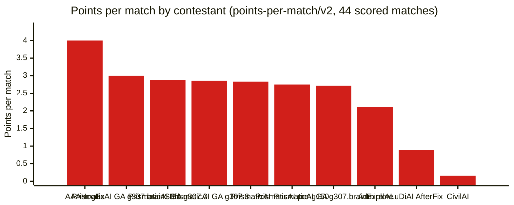
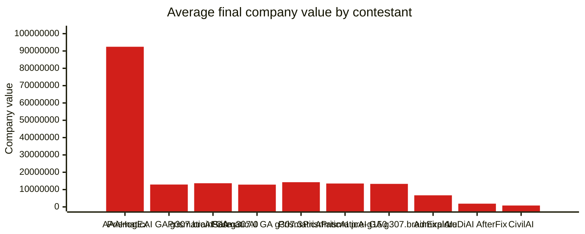
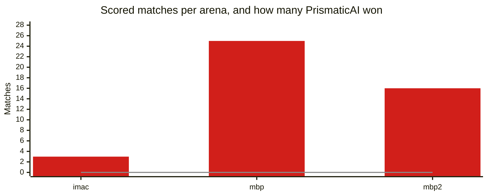

# battle-20261121T205616-7fd43cdc

Derived from `battle-20261121T205616-7fd43cdc.json` by `tools/research/ai-battle/battle.py report`; do not edit.

- Edition `7fd43cdc8f6189c0`: PrismaticAI and referee at `531922be7d7544c6f7d5beecd51ca7906763f532`, base set `opengfx-8.0.tar`
- 20-year free-for-all from 1960, map 256x256 temperate, breakdowns 1
- 44 scored match(es) on `imac` (20261119-master-gdf1e05e7d8), `mbp` (20261120-master-m17653b726e), `mbp2` (20261119-master-gdf1e05e7d8)
- Replays: 0 of 1 identical to their original on another arena

| # | Contestant | Played | Wins | Points | Points/match | Avg rank | Avg final value | Squirrel errors | Matches with anomalies |
|---|---|---|---|---|---|---|---|---|---|
| 1 | AAAHogEx | 44 | 44 | 176 | 4.0 | 1.0 | 92.4 M | 35 | 1 |
| 2 | PrismaticAI GA g307.brainSafe | 8 | 0 | 24 | 3.0 | 2.0 | 12.9 M | 0 | 0 |
| 3 | PrismaticAI GA g307.0 | 8 | 0 | 23 | 2.875 | 2.12 | 13.7 M | 0 | 0 |
| 4 | PrismaticAI GA g307.3 | 7 | 0 | 20 | 2.857 | 2.14 | 12.9 M | 0 | 0 |
| 5 | PrismaticAI | 6 | 0 | 17 | 2.833 | 2.17 | 14.2 M | 0 | 0 |
| 6 | PrismaticAI pre-g150 | 8 | 0 | 22 | 2.75 | 2.25 | 13.5 M | 0 | 0 |
| 7 | PrismaticAI GA g307.brainExplore | 7 | 0 | 19 | 2.714 | 2.29 | 13.3 M | 0 | 0 |
| 8 | AdmiralAI | 44 | 0 | 93 | 2.114 | 2.89 | 6.7 M | 0 | 1 |
| 9 | LuDiAI AfterFix | 44 | 0 | 39 | 0.886 | 4.11 | 1.9 M | 0 | 2 |
| 10 | CivilAI | 44 | 0 | 7 | 0.159 | 4.84 | 798.9 k | 7400 | 16 |

```mermaid
---
config:
  xyChart:
    width: 900
    height: 360
  themeVariables:
    xyChart:
      plotColorPalette: "#d11f1a, #8a8a8a, #0b0b0b, #ece4d6"
---
xychart-beta
    title "Final company value per scored match: winner vs best PrismaticAI"
    x-axis ["m-0001", "m-0002", "m-0003", "m-0004", "m-0005", "m-0006", "m-0007", "m-0008", "m-0009", "m-0010", "m-0011", "m-0012", "m-0013", "m-0014", "m-0015", "m-0016", "m-0017", "m-0018", "m-0019", "m-0020", "m-0021", "m-0022", "m-0023", "m-0024", "m-0025", "m-0026", "m-0027", "m-0028", "m-0036", "m-0037", "m-0038", "m-0039", "m-0040", "m-0041", "m-0042", "m-0043", "m-0044", "m-0045", "m-0047", "m-0049", "m-0050", "m-0051", "m-0052", "m-0053"]
    %% series: Winner | Best PrismaticAI
    %% links: battle-20261121T205616-7fd43cdc.md?col=Match&filter=m-0001 | battle-20261121T205616-7fd43cdc.md?col=Match&filter=m-0002 | battle-20261121T205616-7fd43cdc.md?col=Match&filter=m-0003 | battle-20261121T205616-7fd43cdc.md?col=Match&filter=m-0004 | battle-20261121T205616-7fd43cdc.md?col=Match&filter=m-0005 | battle-20261121T205616-7fd43cdc.md?col=Match&filter=m-0006 | battle-20261121T205616-7fd43cdc.md?col=Match&filter=m-0007 | battle-20261121T205616-7fd43cdc.md?col=Match&filter=m-0008 | battle-20261121T205616-7fd43cdc.md?col=Match&filter=m-0009 | battle-20261121T205616-7fd43cdc.md?col=Match&filter=m-0010 | battle-20261121T205616-7fd43cdc.md?col=Match&filter=m-0011 | battle-20261121T205616-7fd43cdc.md?col=Match&filter=m-0012 | battle-20261121T205616-7fd43cdc.md?col=Match&filter=m-0013 | battle-20261121T205616-7fd43cdc.md?col=Match&filter=m-0014 | battle-20261121T205616-7fd43cdc.md?col=Match&filter=m-0015 | battle-20261121T205616-7fd43cdc.md?col=Match&filter=m-0016 | battle-20261121T205616-7fd43cdc.md?col=Match&filter=m-0017 | battle-20261121T205616-7fd43cdc.md?col=Match&filter=m-0018 | battle-20261121T205616-7fd43cdc.md?col=Match&filter=m-0019 | battle-20261121T205616-7fd43cdc.md?col=Match&filter=m-0020 | battle-20261121T205616-7fd43cdc.md?col=Match&filter=m-0021 | battle-20261121T205616-7fd43cdc.md?col=Match&filter=m-0022 | battle-20261121T205616-7fd43cdc.md?col=Match&filter=m-0023 | battle-20261121T205616-7fd43cdc.md?col=Match&filter=m-0024 | battle-20261121T205616-7fd43cdc.md?col=Match&filter=m-0025 | battle-20261121T205616-7fd43cdc.md?col=Match&filter=m-0026 | battle-20261121T205616-7fd43cdc.md?col=Match&filter=m-0027 | battle-20261121T205616-7fd43cdc.md?col=Match&filter=m-0028 | battle-20261121T205616-7fd43cdc.md?col=Match&filter=m-0036 | battle-20261121T205616-7fd43cdc.md?col=Match&filter=m-0037 | battle-20261121T205616-7fd43cdc.md?col=Match&filter=m-0038 | battle-20261121T205616-7fd43cdc.md?col=Match&filter=m-0039 | battle-20261121T205616-7fd43cdc.md?col=Match&filter=m-0040 | battle-20261121T205616-7fd43cdc.md?col=Match&filter=m-0041 | battle-20261121T205616-7fd43cdc.md?col=Match&filter=m-0042 | battle-20261121T205616-7fd43cdc.md?col=Match&filter=m-0043 | battle-20261121T205616-7fd43cdc.md?col=Match&filter=m-0044 | battle-20261121T205616-7fd43cdc.md?col=Match&filter=m-0045 | battle-20261121T205616-7fd43cdc.md?col=Match&filter=m-0047 | battle-20261121T205616-7fd43cdc.md?col=Match&filter=m-0049 | battle-20261121T205616-7fd43cdc.md?col=Match&filter=m-0050 | battle-20261121T205616-7fd43cdc.md?col=Match&filter=m-0051 | battle-20261121T205616-7fd43cdc.md?col=Match&filter=m-0052 | battle-20261121T205616-7fd43cdc.md?col=Match&filter=m-0053
    y-axis "Company value" 0 --> 168000000
    bar [124689094, 96610620, 116702960, 100133381, 152443389, 85853015, 73093886, 92173461, 70136048, 78230363, 62907083, 58041817, 67502454, 63954160, 73580575, 72805705, 69320549, 103932151, 74416835, 108799069, 101735564, 97414827, 125524794, 90904737, 90068208, 74175661, 83043534, 75943566, 127682171, 118743588, 104233597, 110870967, 109435931, 108901110, 107869889, 100691941, 97027586, 107408425, 113344583, 77382722, 70624077, 77307145, 76989822, 74841477]
    line [17316808, 10432262, 10083557, 10481467, 11727024, 23049314, 26452712, 17915992, 18421144, 16688406, 17075960, 15324045, 7670396, 17621411, 11795257, 14420737, 12360154, 14822475, 15237357, 19692510, 21757339, 19941689, 15335107, 14099297, 10323759, 18126300, 11198663, 18636848, 5917226, 2030043, 7174129, 10015897, 4285032, 8548264, 12282206, 10724903, 11103540, 9873633, 11101168, 18236350, 7202391, 10091214, 8541387, 13829341]
```

<!-- battle-charts:begin -->
<!-- derived from battle-20261121T205616-7fd43cdc.json by `battle.py render`; `battle.py check` fails when it is stale -->

<!-- battle-charts:end -->

| Seed | Original | Replay | Arenas | Identical |
|---|---|---|---|---|
| 693820646 | m-0012 | m-0048 | imac / mbp | NO |

| Match | Arena | Seed | Winner | Value | Last | Anomalies |
|---|---|---|---|---|---|---|
| m-0001 | mbp | 1337450992 | AAAHogEx | 124.7 M | CivilAI | - |
| m-0002 | mbp | 1337450992 | AAAHogEx | 96.6 M | CivilAI | CivilAI: fleet_drop:54->34 |
| m-0003 | mbp | 1337450992 | AAAHogEx | 116.7 M | LuDiAI AfterFix | - |
| m-0004 | mbp | 1337450992 | AAAHogEx | 100.1 M | CivilAI | - |
| m-0005 | mbp | 1337450992 | AAAHogEx | 152.4 M | CivilAI | - |
| m-0006 | mbp | 1022759569 | AAAHogEx | 85.9 M | CivilAI | - |
| m-0007 | mbp | 1022759569 | AAAHogEx | 73.1 M | LuDiAI AfterFix | - |
| m-0008 | mbp | 1022759569 | AAAHogEx | 92.2 M | CivilAI | CivilAI: fleet_drop:69->40 |
| m-0009 | mbp | 1022759569 | AAAHogEx | 70.1 M | CivilAI | - |
| m-0010 | imac | 1022759569 | AAAHogEx | 78.2 M | CivilAI | - |
| m-0011 | imac | 1022759569 | AAAHogEx | 62.9 M | CivilAI | - |
| m-0012 | imac | 693820646 | AAAHogEx | 58.0 M | CivilAI | - |
| m-0013 | mbp2 | 693820646 | AAAHogEx | 67.5 M | CivilAI | - |
| m-0014 | mbp2 | 693820646 | AAAHogEx | 64.0 M | CivilAI | - |
| m-0015 | mbp2 | 693820646 | AAAHogEx | 73.6 M | CivilAI | - |
| m-0016 | mbp2 | 693820646 | AAAHogEx | 72.8 M | LuDiAI AfterFix | - |
| m-0017 | mbp2 | 693820646 | AAAHogEx | 69.3 M | CivilAI | CivilAI: fleet_drop:24->8 |
| m-0018 | mbp2 | 335786971 | AAAHogEx | 103.9 M | CivilAI | - |
| m-0019 | mbp2 | 335786971 | AAAHogEx | 74.4 M | CivilAI | CivilAI: squirrel_errors:3750 |
| m-0020 | mbp2 | 335786971 | AAAHogEx | 108.8 M | CivilAI | CivilAI: fleet_drop:12->8 |
| m-0021 | mbp2 | 335786971 | AAAHogEx | 101.7 M | CivilAI | - |
| m-0022 | mbp2 | 335786971 | AAAHogEx | 97.4 M | CivilAI | CivilAI: fleet_drop:11->7 |
| m-0023 | mbp2 | 335786971 | AAAHogEx | 125.5 M | CivilAI | - |
| m-0024 | mbp2 | 1893842622 | AAAHogEx | 90.9 M | CivilAI | LuDiAI AfterFix: fleet_drop:63->34; CivilAI: squirrel_errors:3650 |
| m-0025 | mbp2 | 1893842622 | AAAHogEx | 90.1 M | CivilAI | - |
| m-0026 | mbp2 | 1893842622 | AAAHogEx | 74.2 M | CivilAI | CivilAI: fleet_drop:121->76 |
| m-0027 | mbp2 | 1893842622 | AAAHogEx | 83.0 M | CivilAI | CivilAI: fleet_drop:92->59 |
| m-0028 | mbp2 | 1893842622 | AAAHogEx | 75.9 M | LuDiAI AfterFix | CivilAI: fleet_drop:87->58 |
| m-0036 | mbp | 1563781386 | AAAHogEx | 127.7 M | CivilAI | - |
| m-0037 | mbp | 1563781386 | AAAHogEx | 118.7 M | CivilAI | - |
| m-0038 | mbp | 1563781386 | AAAHogEx | 104.2 M | CivilAI | - |
| m-0039 | mbp | 1563781386 | AAAHogEx | 110.9 M | CivilAI | AdmiralAI: fleet_drop:451->277; CivilAI: fleet_drop:22->13 |
| m-0040 | mbp | 1563781386 | AAAHogEx | 109.4 M | LuDiAI AfterFix | - |
| m-0041 | mbp | 1563781386 | AAAHogEx | 108.9 M | CivilAI | - |
| m-0042 | mbp | 664576596 | AAAHogEx | 107.9 M | CivilAI | CivilAI: fleet_drop:49->26 |
| m-0043 | mbp | 664576596 | AAAHogEx | 100.7 M | LuDiAI AfterFix | CivilAI: fleet_drop:72->48 |
| m-0044 | mbp | 664576596 | AAAHogEx | 97.0 M | CivilAI | - |
| m-0045 | mbp | 664576596 | AAAHogEx | 107.4 M | CivilAI | LuDiAI AfterFix: fleet_drop:153->88 |
| m-0047 | mbp | 664576596 | AAAHogEx | 113.3 M | CivilAI | - |
| m-0048 (replay) | mbp | 693820646 | AAAHogEx | 52.0 M | CivilAI | - |
| m-0049 | mbp | 749659269 | AAAHogEx | 77.4 M | CivilAI | CivilAI: fleet_drop:52->36 |
| m-0050 | mbp | 749659269 | AAAHogEx | 70.6 M | LuDiAI AfterFix | CivilAI: fleet_drop:72->32 |
| m-0051 | mbp | 749659269 | AAAHogEx | 77.3 M | CivilAI | AAAHogEx: squirrel_errors:35 |
| m-0052 | mbp | 749659269 | AAAHogEx | 77.0 M | CivilAI | CivilAI: fleet_drop:53->34 |
| m-0053 | mbp | 749659269 | AAAHogEx | 74.8 M | CivilAI | - |
