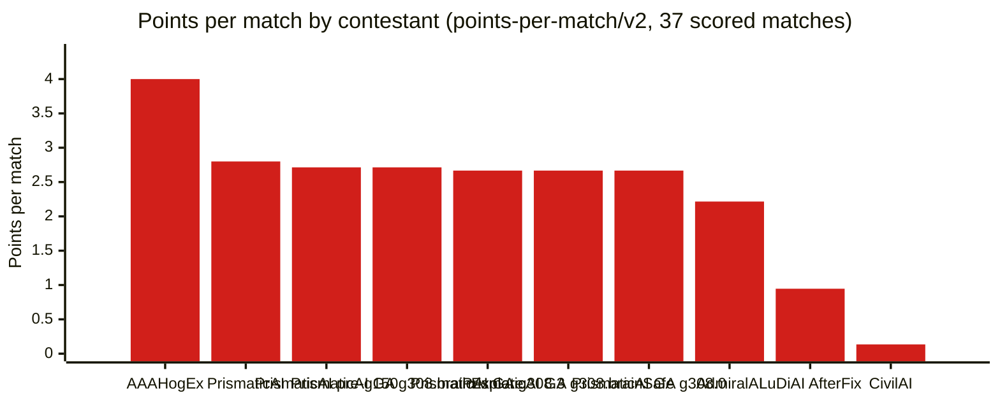
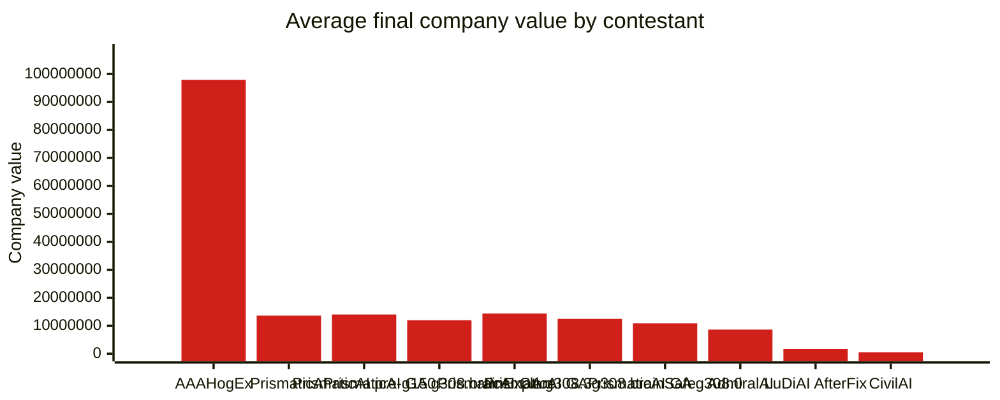
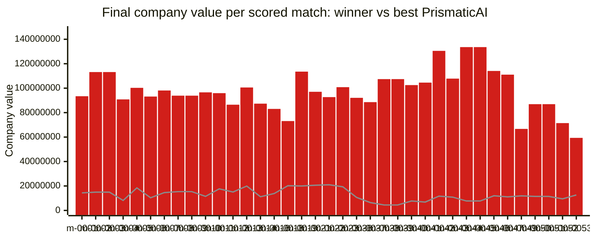
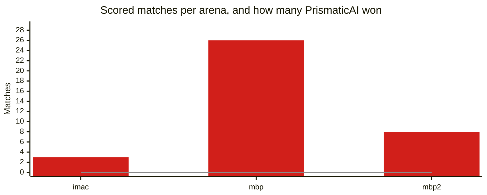

# battle-20261121T210732-8451654e

Derived from `battle-20261121T210732-8451654e.json` by `tools/research/ai-battle/battle.py report`; do not edit.

- Edition `8451654e19f64694`: PrismaticAI and referee at `531922be7d7544c6f7d5beecd51ca7906763f532`, base set `opengfx-8.0.tar`
- 20-year free-for-all from 1960, map 256x256 temperate, breakdowns 1
- 37 scored match(es) on `imac` (20261119-master-gdf1e05e7d8), `mbp` (20261120-master-m17653b726e), `mbp2` (20261119-master-gdf1e05e7d8)
- Replays: 0 of 1 identical to their original on another arena

| # | Contestant | Played | Wins | Points | Points/match | Avg rank | Avg final value | Squirrel errors | Matches with anomalies |
|---|---|---|---|---|---|---|---|---|---|
| 1 | AAAHogEx | 37 | 37 | 148 | 4.0 | 1.0 | 97.9 M | 0 | 0 |
| 2 | PrismaticAI | 5 | 0 | 14 | 2.8 | 2.2 | 13.6 M | 0 | 0 |
| 3 | PrismaticAI pre-g150 | 7 | 0 | 19 | 2.714 | 2.29 | 14.0 M | 0 | 0 |
| 4 | PrismaticAI GA g308.brainExplore | 7 | 0 | 19 | 2.714 | 2.29 | 11.9 M | 0 | 0 |
| 5 | PrismaticAI GA g308.3 | 6 | 0 | 16 | 2.667 | 2.33 | 14.3 M | 0 | 0 |
| 6 | PrismaticAI GA g308.brainSafe | 6 | 0 | 16 | 2.667 | 2.33 | 12.4 M | 0 | 0 |
| 7 | PrismaticAI GA g308.0 | 6 | 0 | 16 | 2.667 | 2.33 | 10.9 M | 0 | 0 |
| 8 | AdmiralAI | 37 | 0 | 82 | 2.216 | 2.78 | 8.6 M | 0 | 1 |
| 9 | LuDiAI AfterFix | 37 | 0 | 35 | 0.946 | 4.05 | 1.7 M | 0 | 0 |
| 10 | CivilAI | 37 | 0 | 5 | 0.135 | 4.86 | 459.3 k | 0 | 7 |

<!-- battle-charts:begin -->
<!-- derived from battle-20261121T210732-8451654e.json by `battle.py render`; `battle.py check` fails when it is stale -->

<!-- battle-charts:end -->

| Seed | Original | Replay | Arenas | Identical |
|---|---|---|---|---|
| 1327628671 | m-0010 | m-0048 | imac / mbp | NO |

| Match | Arena | Seed | Winner | Value | Last | Anomalies |
|---|---|---|---|---|---|---|
| m-0001 | mbp | 1024751842 | AAAHogEx | 93.4 M | CivilAI | - |
| m-0002 | mbp | 1024751842 | AAAHogEx | 113.2 M | CivilAI | - |
| m-0003 | mbp | 1024751842 | AAAHogEx | 113.2 M | CivilAI | - |
| m-0004 | mbp | 1024751842 | AAAHogEx | 90.8 M | CivilAI | - |
| m-0005 | mbp | 1024751842 | AAAHogEx | 100.3 M | CivilAI | CivilAI: fleet_drop:38->16 |
| m-0006 | mbp | 1327628671 | AAAHogEx | 93.2 M | LuDiAI AfterFix | CivilAI: fleet_drop:44->28 |
| m-0007 | mbp | 1327628671 | AAAHogEx | 98.1 M | LuDiAI AfterFix | CivilAI: fleet_drop:64->34 |
| m-0008 | mbp | 1327628671 | AAAHogEx | 93.9 M | CivilAI | - |
| m-0009 | mbp | 1327628671 | AAAHogEx | 93.9 M | CivilAI | - |
| m-0010 | imac | 1327628671 | AAAHogEx | 96.6 M | CivilAI | CivilAI: fleet_drop:12->7 |
| m-0011 | imac | 1327628671 | AAAHogEx | 95.9 M | CivilAI | - |
| m-0012 | imac | 1462960663 | AAAHogEx | 86.5 M | CivilAI | - |
| m-0013 | mbp2 | 1462960663 | AAAHogEx | 100.6 M | CivilAI | - |
| m-0014 | mbp2 | 1462960663 | AAAHogEx | 87.3 M | CivilAI | CivilAI: fleet_drop:55->34 |
| m-0016 | mbp2 | 1462960663 | AAAHogEx | 83.0 M | CivilAI | AdmiralAI: fleet_drop:182->100 |
| m-0018 | mbp2 | 1772784395 | AAAHogEx | 73.1 M | CivilAI | CivilAI: no_vehicles |
| m-0019 | mbp2 | 1772784395 | AAAHogEx | 113.5 M | AdmiralAI | - |
| m-0021 | mbp2 | 1772784395 | AAAHogEx | 97.0 M | LuDiAI AfterFix | - |
| m-0022 | mbp2 | 1772784395 | AAAHogEx | 92.7 M | LuDiAI AfterFix | - |
| m-0023 | mbp2 | 1772784395 | AAAHogEx | 100.8 M | CivilAI | - |
| m-0036 | mbp | 665329439 | AAAHogEx | 92.1 M | CivilAI | - |
| m-0037 | mbp | 665329439 | AAAHogEx | 88.6 M | CivilAI | CivilAI: fleet_drop:39->8 |
| m-0038 | mbp | 665329439 | AAAHogEx | 107.4 M | CivilAI | - |
| m-0039 | mbp | 665329439 | AAAHogEx | 107.4 M | CivilAI | - |
| m-0040 | mbp | 665329439 | AAAHogEx | 102.5 M | CivilAI | - |
| m-0041 | mbp | 665329439 | AAAHogEx | 104.6 M | CivilAI | - |
| m-0042 | mbp | 246130032 | AAAHogEx | 130.5 M | CivilAI | - |
| m-0043 | mbp | 246130032 | AAAHogEx | 107.8 M | CivilAI | - |
| m-0044 | mbp | 246130032 | AAAHogEx | 133.6 M | CivilAI | - |
| m-0045 | mbp | 246130032 | AAAHogEx | 133.6 M | CivilAI | - |
| m-0046 | mbp | 246130032 | AAAHogEx | 114.1 M | CivilAI | - |
| m-0047 | mbp | 246130032 | AAAHogEx | 111.1 M | CivilAI | - |
| m-0048 (replay) | mbp | 1327628671 | AAAHogEx | 106.0 M | CivilAI | - |
| m-0049 | mbp | 229598609 | AAAHogEx | 66.7 M | CivilAI | - |
| m-0050 | mbp | 229598609 | AAAHogEx | 86.9 M | CivilAI | - |
| m-0051 | mbp | 229598609 | AAAHogEx | 86.9 M | CivilAI | - |
| m-0052 | mbp | 229598609 | AAAHogEx | 71.4 M | CivilAI | - |
| m-0053 | mbp | 229598609 | AAAHogEx | 59.4 M | CivilAI | - |
