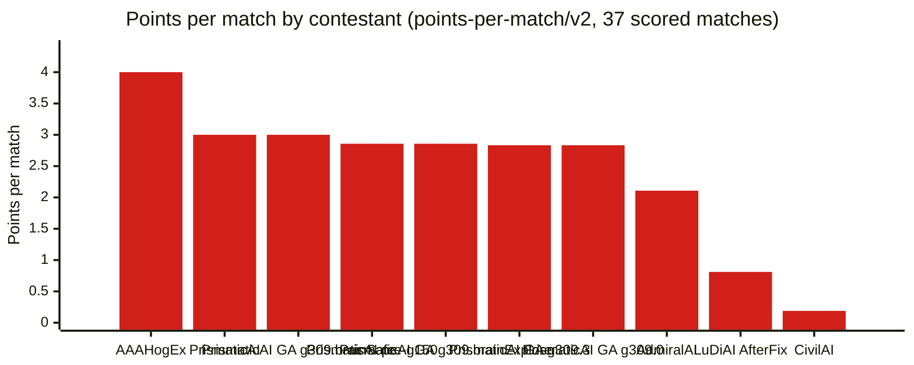
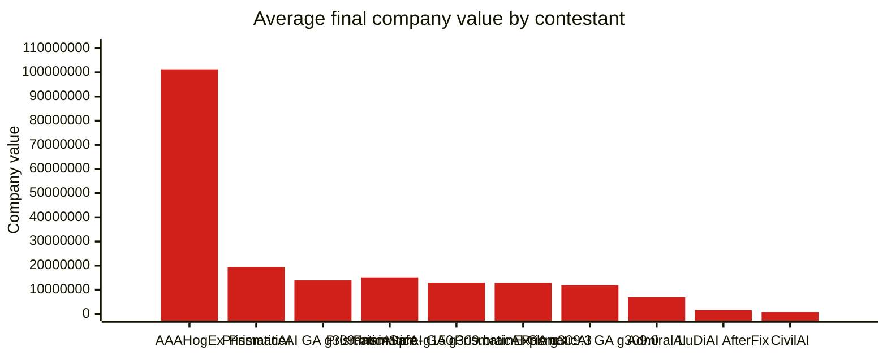
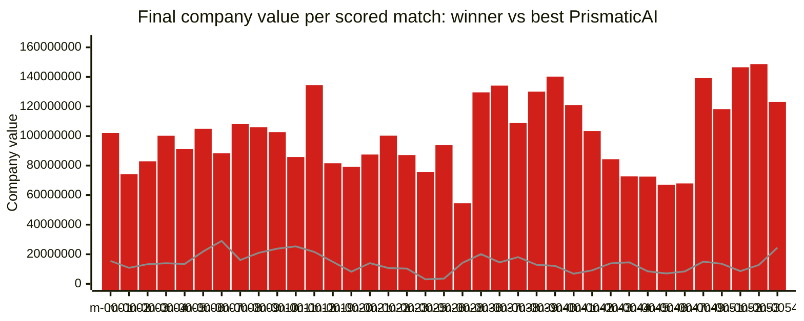
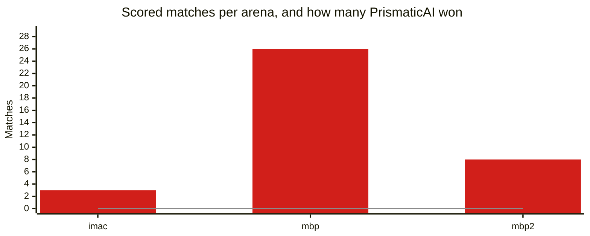

# battle-20261121T212008-5f958d60

Derived from `battle-20261121T212008-5f958d60.json` by `tools/research/ai-battle/battle.py report`; do not edit.

- Edition `5f958d60c2fe3176`: PrismaticAI and referee at `531922be7d7544c6f7d5beecd51ca7906763f532`, base set `opengfx-8.0.tar`
- 20-year free-for-all from 1960, map 256x256 temperate, breakdowns 1
- 37 scored match(es) on `imac` (20261119-master-gdf1e05e7d8), `mbp` (20261120-master-m17653b726e), `mbp2` (20261119-master-gdf1e05e7d8)
- Replays: 0 of 2 identical to their original on another arena

| # | Contestant | Played | Wins | Points | Points/match | Avg rank | Avg final value | Squirrel errors | Matches with anomalies |
|---|---|---|---|---|---|---|---|---|---|
| 1 | AAAHogEx | 37 | 37 | 148 | 4.0 | 1.0 | 101.3 M | 0 | 0 |
| 2 | PrismaticAI | 5 | 0 | 15 | 3.0 | 2.0 | 19.4 M | 0 | 0 |
| 3 | PrismaticAI GA g309.brainSafe | 6 | 0 | 18 | 3.0 | 2.0 | 13.9 M | 0 | 0 |
| 4 | PrismaticAI pre-g150 | 7 | 0 | 20 | 2.857 | 2.14 | 15.1 M | 0 | 0 |
| 5 | PrismaticAI GA g309.brainExplore | 7 | 0 | 20 | 2.857 | 2.14 | 12.9 M | 0 | 0 |
| 6 | PrismaticAI GA g309.3 | 6 | 0 | 17 | 2.833 | 2.17 | 12.8 M | 0 | 0 |
| 7 | PrismaticAI GA g309.0 | 6 | 0 | 17 | 2.833 | 2.17 | 11.9 M | 0 | 0 |
| 8 | AdmiralAI | 37 | 0 | 78 | 2.108 | 2.89 | 6.9 M | 0 | 0 |
| 9 | LuDiAI AfterFix | 37 | 0 | 30 | 0.811 | 4.19 | 1.5 M | 0 | 1 |
| 10 | CivilAI | 37 | 0 | 7 | 0.189 | 4.81 | 751.0 k | 0 | 11 |

<!-- battle-charts:begin -->
<!-- derived from battle-20261121T212008-5f958d60.json by `battle.py render`; `battle.py check` fails when it is stale -->

<!-- battle-charts:end -->

| Seed | Original | Replay | Arenas | Identical |
|---|---|---|---|---|
| 773398705 | m-0010 | m-0048 | imac / mbp | NO |
| 773398705 | m-0011 | m-0056 | imac / mbp | NO |

| Match | Arena | Seed | Winner | Value | Last | Anomalies |
|---|---|---|---|---|---|---|
| m-0001 | mbp | 723829632 | AAAHogEx | 102.1 M | CivilAI | - |
| m-0002 | mbp | 723829632 | AAAHogEx | 74.1 M | LuDiAI AfterFix | - |
| m-0003 | mbp | 723829632 | AAAHogEx | 82.9 M | CivilAI | - |
| m-0004 | mbp | 723829632 | AAAHogEx | 100.2 M | CivilAI | CivilAI: fleet_drop:84->56 |
| m-0005 | mbp | 723829632 | AAAHogEx | 91.3 M | CivilAI | - |
| m-0006 | mbp | 773398705 | AAAHogEx | 104.9 M | CivilAI | CivilAI: no_vehicles |
| m-0007 | mbp | 773398705 | AAAHogEx | 88.3 M | CivilAI | CivilAI: fleet_drop:38->22 |
| m-0008 | mbp | 773398705 | AAAHogEx | 108.0 M | CivilAI | CivilAI: fleet_drop:66->26 |
| m-0009 | mbp | 773398705 | AAAHogEx | 105.9 M | CivilAI | - |
| m-0010 | imac | 773398705 | AAAHogEx | 102.7 M | CivilAI | - |
| m-0011 | imac | 773398705 | AAAHogEx | 85.8 M | CivilAI | - |
| m-0012 | imac | 1262351979 | AAAHogEx | 134.5 M | CivilAI | - |
| m-0019 | mbp2 | 202153041 | AAAHogEx | 81.6 M | CivilAI | CivilAI: fleet_drop:65->19 |
| m-0020 | mbp2 | 202153041 | AAAHogEx | 79.1 M | LuDiAI AfterFix | - |
| m-0021 | mbp2 | 202153041 | AAAHogEx | 87.5 M | CivilAI | - |
| m-0022 | mbp2 | 202153041 | AAAHogEx | 100.2 M | CivilAI | - |
| m-0023 | mbp2 | 202153041 | AAAHogEx | 87.1 M | LuDiAI AfterFix | CivilAI: fleet_drop:60->30 |
| m-0025 | mbp2 | 11922407 | AAAHogEx | 75.5 M | CivilAI | - |
| m-0026 | mbp2 | 11922407 | AAAHogEx | 93.8 M | LuDiAI AfterFix | - |
| m-0028 | mbp2 | 11922407 | AAAHogEx | 54.6 M | CivilAI | - |
| m-0036 | mbp | 488574322 | AAAHogEx | 129.5 M | CivilAI | CivilAI: fleet_drop:34->21 |
| m-0037 | mbp | 488574322 | AAAHogEx | 134.1 M | LuDiAI AfterFix | - |
| m-0038 | mbp | 488574322 | AAAHogEx | 108.8 M | LuDiAI AfterFix | CivilAI: fleet_drop:68->35 |
| m-0039 | mbp | 488574322 | AAAHogEx | 130.0 M | CivilAI | LuDiAI AfterFix: fleet_drop:162->107 |
| m-0040 | mbp | 488574322 | AAAHogEx | 140.2 M | CivilAI | - |
| m-0041 | mbp | 488574322 | AAAHogEx | 120.9 M | CivilAI | CivilAI: fleet_drop:49->32 |
| m-0042 | mbp | 877670711 | AAAHogEx | 103.4 M | CivilAI | - |
| m-0043 | mbp | 877670711 | AAAHogEx | 84.3 M | CivilAI | CivilAI: no_vehicles |
| m-0044 | mbp | 877670711 | AAAHogEx | 72.7 M | CivilAI | CivilAI: no_vehicles |
| m-0045 | mbp | 877670711 | AAAHogEx | 72.5 M | CivilAI | - |
| m-0046 | mbp | 877670711 | AAAHogEx | 66.9 M | LuDiAI AfterFix | - |
| m-0047 | mbp | 877670711 | AAAHogEx | 67.9 M | CivilAI | - |
| m-0048 (replay) | mbp | 773398705 | AAAHogEx | 104.3 M | CivilAI | - |
| m-0049 | mbp | 1330934259 | AAAHogEx | 139.2 M | CivilAI | - |
| m-0051 | mbp | 1330934259 | AAAHogEx | 118.2 M | CivilAI | - |
| m-0052 | mbp | 1330934259 | AAAHogEx | 146.5 M | CivilAI | - |
| m-0053 | mbp | 1330934259 | AAAHogEx | 148.7 M | CivilAI | - |
| m-0054 | mbp | 271194114 | AAAHogEx | 123.0 M | CivilAI | - |
| m-0056 (replay) | mbp | 773398705 | AAAHogEx | 90.7 M | CivilAI | - |
