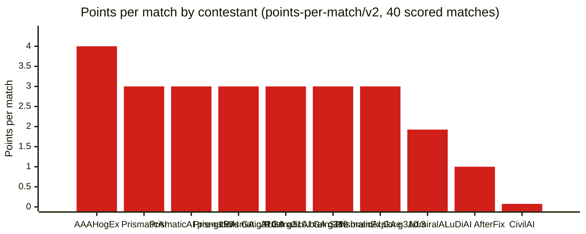
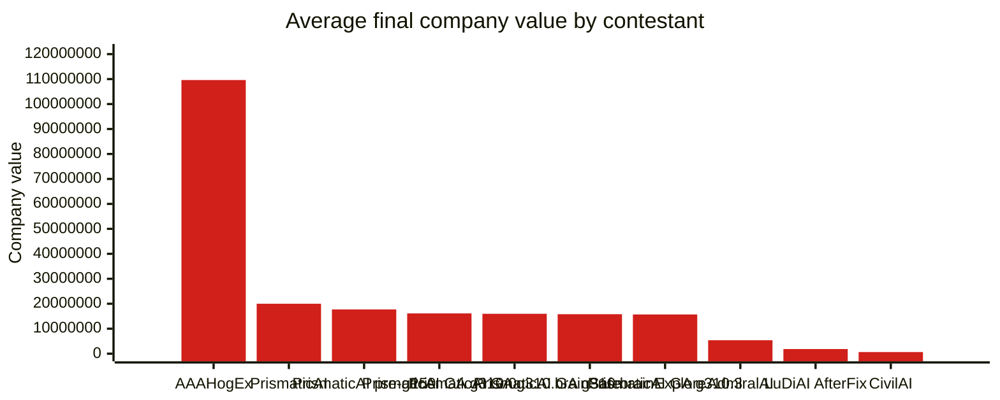
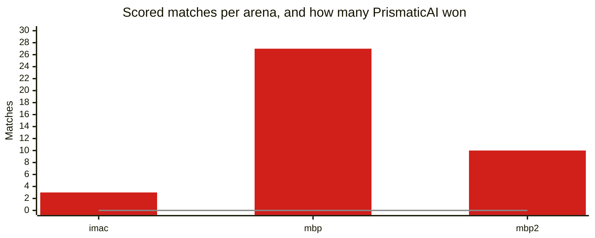

# battle-20261121T213221-d4a99081

Derived from `battle-20261121T213221-d4a99081.json` by `tools/research/ai-battle/battle.py report`; do not edit.

- Edition `d4a99081b6140fb4`: PrismaticAI and referee at `531922be7d7544c6f7d5beecd51ca7906763f532`, base set `opengfx-8.0.tar`
- 20-year free-for-all from 1960, map 256x256 temperate, breakdowns 1
- 40 scored match(es) on `imac` (20261119-master-gdf1e05e7d8), `mbp` (20261120-master-m17653b726e), `mbp2` (20261119-master-gdf1e05e7d8)
- Replays: 0 of 0 identical to their original on another arena

| # | Contestant | Played | Wins | Points | Points/match | Avg rank | Avg final value | Squirrel errors | Matches with anomalies |
|---|---|---|---|---|---|---|---|---|---|
| 1 | AAAHogEx | 40 | 40 | 160 | 4.0 | 1.0 | 109.6 M | 0 | 0 |
| 2 | PrismaticAI | 7 | 0 | 21 | 3.0 | 2.0 | 20.0 M | 0 | 0 |
| 3 | PrismaticAI pre-g150 | 6 | 0 | 18 | 3.0 | 2.0 | 17.7 M | 0 | 0 |
| 4 | PrismaticAI GA g310.0 | 7 | 0 | 21 | 3.0 | 2.0 | 16.1 M | 0 | 0 |
| 5 | PrismaticAI GA g310.brainSafe | 7 | 0 | 21 | 3.0 | 2.0 | 16.0 M | 0 | 0 |
| 6 | PrismaticAI GA g310.brainExplore | 7 | 0 | 21 | 3.0 | 2.0 | 15.8 M | 0 | 0 |
| 7 | PrismaticAI GA g310.3 | 6 | 0 | 18 | 3.0 | 2.0 | 15.7 M | 0 | 0 |
| 8 | AdmiralAI | 40 | 0 | 77 | 1.925 | 3.08 | 5.4 M | 47 | 2 |
| 9 | LuDiAI AfterFix | 40 | 0 | 40 | 1.0 | 4.0 | 1.8 M | 0 | 1 |
| 10 | CivilAI | 40 | 0 | 3 | 0.075 | 4.92 | 650.1 k | 3750 | 6 |

```mermaid
---
config:
  xyChart:
    width: 900
    height: 360
  themeVariables:
    xyChart:
      plotColorPalette: "#d11f1a, #8a8a8a, #0b0b0b, #ece4d6"
---
xychart-beta
    title "Final company value per scored match: winner vs best PrismaticAI"
    x-axis ["m-0001", "m-0002", "m-0003", "m-0004", "m-0005", "m-0006", "m-0007", "m-0008", "m-0009", "m-0010", "m-0011", "m-0012", "m-0014", "m-0015", "m-0016", "m-0017", "m-0018", "m-0024", "m-0025", "m-0026", "m-0027", "m-0028", "m-0036", "m-0037", "m-0038", "m-0039", "m-0040", "m-0041", "m-0042", "m-0043", "m-0044", "m-0045", "m-0046", "m-0047", "m-0048", "m-0049", "m-0050", "m-0051", "m-0052", "m-0053"]
    %% series: Winner | Best PrismaticAI
    %% links: battle-20261121T213221-d4a99081.md?col=Match&filter=m-0001 | battle-20261121T213221-d4a99081.md?col=Match&filter=m-0002 | battle-20261121T213221-d4a99081.md?col=Match&filter=m-0003 | battle-20261121T213221-d4a99081.md?col=Match&filter=m-0004 | battle-20261121T213221-d4a99081.md?col=Match&filter=m-0005 | battle-20261121T213221-d4a99081.md?col=Match&filter=m-0006 | battle-20261121T213221-d4a99081.md?col=Match&filter=m-0007 | battle-20261121T213221-d4a99081.md?col=Match&filter=m-0008 | battle-20261121T213221-d4a99081.md?col=Match&filter=m-0009 | battle-20261121T213221-d4a99081.md?col=Match&filter=m-0010 | battle-20261121T213221-d4a99081.md?col=Match&filter=m-0011 | battle-20261121T213221-d4a99081.md?col=Match&filter=m-0012 | battle-20261121T213221-d4a99081.md?col=Match&filter=m-0014 | battle-20261121T213221-d4a99081.md?col=Match&filter=m-0015 | battle-20261121T213221-d4a99081.md?col=Match&filter=m-0016 | battle-20261121T213221-d4a99081.md?col=Match&filter=m-0017 | battle-20261121T213221-d4a99081.md?col=Match&filter=m-0018 | battle-20261121T213221-d4a99081.md?col=Match&filter=m-0024 | battle-20261121T213221-d4a99081.md?col=Match&filter=m-0025 | battle-20261121T213221-d4a99081.md?col=Match&filter=m-0026 | battle-20261121T213221-d4a99081.md?col=Match&filter=m-0027 | battle-20261121T213221-d4a99081.md?col=Match&filter=m-0028 | battle-20261121T213221-d4a99081.md?col=Match&filter=m-0036 | battle-20261121T213221-d4a99081.md?col=Match&filter=m-0037 | battle-20261121T213221-d4a99081.md?col=Match&filter=m-0038 | battle-20261121T213221-d4a99081.md?col=Match&filter=m-0039 | battle-20261121T213221-d4a99081.md?col=Match&filter=m-0040 | battle-20261121T213221-d4a99081.md?col=Match&filter=m-0041 | battle-20261121T213221-d4a99081.md?col=Match&filter=m-0042 | battle-20261121T213221-d4a99081.md?col=Match&filter=m-0043 | battle-20261121T213221-d4a99081.md?col=Match&filter=m-0044 | battle-20261121T213221-d4a99081.md?col=Match&filter=m-0045 | battle-20261121T213221-d4a99081.md?col=Match&filter=m-0046 | battle-20261121T213221-d4a99081.md?col=Match&filter=m-0047 | battle-20261121T213221-d4a99081.md?col=Match&filter=m-0048 | battle-20261121T213221-d4a99081.md?col=Match&filter=m-0049 | battle-20261121T213221-d4a99081.md?col=Match&filter=m-0050 | battle-20261121T213221-d4a99081.md?col=Match&filter=m-0051 | battle-20261121T213221-d4a99081.md?col=Match&filter=m-0052 | battle-20261121T213221-d4a99081.md?col=Match&filter=m-0053
    y-axis "Company value" 0 --> 192000000
    bar [136804938, 134254328, 116579999, 131318609, 100313019, 134077855, 119399191, 139296483, 174100115, 157486686, 147856476, 84138502, 87108713, 91710930, 99844609, 100288583, 105594912, 88434462, 85631772, 84301032, 91354785, 101536118, 118535253, 111874735, 126300220, 156700231, 151155534, 138334439, 56108326, 69725215, 77261499, 74529403, 98040731, 73616265, 82959089, 114207998, 108706810, 116221381, 102312362, 96656174]
    line [19606227, 19576791, 17359792, 16158555, 20377357, 25728620, 24618308, 17140007, 20161815, 15919001, 15780613, 16276891, 11327600, 11008357, 15490555, 15861191, 24355744, 17273493, 13114975, 14109718, 14657542, 14095536, 21710286, 14889004, 19730676, 21288849, 15334566, 17389198, 15874749, 15488844, 19591096, 16541105, 21145277, 11489010, 18822483, 18617175, 11393650, 10812376, 12519023, 13330480]
```

<!-- battle-charts:begin -->
<!-- derived from battle-20261121T213221-d4a99081.json by `battle.py render`; `battle.py check` fails when it is stale -->

<!-- battle-charts:end -->

| Match | Arena | Seed | Winner | Value | Last | Anomalies |
|---|---|---|---|---|---|---|
| m-0001 | mbp | 1341674807 | AAAHogEx | 136.8 M | CivilAI | - |
| m-0002 | mbp | 1341674807 | AAAHogEx | 134.3 M | CivilAI | - |
| m-0003 | mbp | 1341674807 | AAAHogEx | 116.6 M | CivilAI | - |
| m-0004 | mbp | 1341674807 | AAAHogEx | 131.3 M | CivilAI | - |
| m-0005 | mbp | 1341674807 | AAAHogEx | 100.3 M | CivilAI | - |
| m-0006 | mbp | 865727724 | AAAHogEx | 134.1 M | CivilAI | - |
| m-0007 | mbp | 865727724 | AAAHogEx | 119.4 M | CivilAI | - |
| m-0008 | mbp | 865727724 | AAAHogEx | 139.3 M | LuDiAI AfterFix | - |
| m-0009 | mbp | 865727724 | AAAHogEx | 174.1 M | CivilAI | - |
| m-0010 | imac | 865727724 | AAAHogEx | 157.5 M | CivilAI | - |
| m-0011 | imac | 865727724 | AAAHogEx | 147.9 M | LuDiAI AfterFix | - |
| m-0012 | imac | 839301871 | AAAHogEx | 84.1 M | CivilAI | - |
| m-0014 | mbp2 | 839301871 | AAAHogEx | 87.1 M | CivilAI | - |
| m-0015 | mbp2 | 839301871 | AAAHogEx | 91.7 M | CivilAI | - |
| m-0016 | mbp2 | 839301871 | AAAHogEx | 99.8 M | CivilAI | - |
| m-0017 | mbp2 | 839301871 | AAAHogEx | 100.3 M | CivilAI | - |
| m-0018 | mbp2 | 1092328200 | AAAHogEx | 105.6 M | CivilAI | AdmiralAI: squirrel_errors:47 |
| m-0024 | mbp2 | 668683076 | AAAHogEx | 88.4 M | CivilAI | - |
| m-0025 | mbp2 | 668683076 | AAAHogEx | 85.6 M | CivilAI | - |
| m-0026 | mbp2 | 668683076 | AAAHogEx | 84.3 M | CivilAI | - |
| m-0027 | mbp2 | 668683076 | AAAHogEx | 91.4 M | CivilAI | - |
| m-0028 | mbp2 | 668683076 | AAAHogEx | 101.5 M | CivilAI | - |
| m-0036 | mbp | 1877307872 | AAAHogEx | 118.5 M | CivilAI | - |
| m-0037 | mbp | 1877307872 | AAAHogEx | 111.9 M | CivilAI | - |
| m-0038 | mbp | 1877307872 | AAAHogEx | 126.3 M | CivilAI | - |
| m-0039 | mbp | 1877307872 | AAAHogEx | 156.7 M | CivilAI | - |
| m-0040 | mbp | 1877307872 | AAAHogEx | 151.2 M | CivilAI | - |
| m-0041 | mbp | 1877307872 | AAAHogEx | 138.3 M | CivilAI | CivilAI: fleet_drop:50->31 |
| m-0042 | mbp | 1848969650 | AAAHogEx | 56.1 M | CivilAI | - |
| m-0043 | mbp | 1848969650 | AAAHogEx | 69.7 M | CivilAI | - |
| m-0044 | mbp | 1848969650 | AAAHogEx | 77.3 M | CivilAI | - |
| m-0045 | mbp | 1848969650 | AAAHogEx | 74.5 M | CivilAI | - |
| m-0046 | mbp | 1848969650 | AAAHogEx | 98.0 M | CivilAI | CivilAI: fleet_drop:40->25 |
| m-0047 | mbp | 1848969650 | AAAHogEx | 73.6 M | CivilAI | CivilAI: fleet_drop:43->28 |
| m-0048 | mbp | 1222338653 | AAAHogEx | 83.0 M | CivilAI | CivilAI: fleet_drop:47->28 |
| m-0049 | mbp | 1222338653 | AAAHogEx | 114.2 M | CivilAI | - |
| m-0050 | mbp | 1222338653 | AAAHogEx | 108.7 M | CivilAI | CivilAI: no_vehicles |
| m-0051 | mbp | 1222338653 | AAAHogEx | 116.2 M | CivilAI | CivilAI: squirrel_errors:3750, no_vehicles |
| m-0052 | mbp | 1222338653 | AAAHogEx | 102.3 M | CivilAI | - |
| m-0053 | mbp | 1222338653 | AAAHogEx | 96.7 M | LuDiAI AfterFix | AdmiralAI: fleet_drop:164->97; LuDiAI AfterFix: fleet_drop:105->73 |
