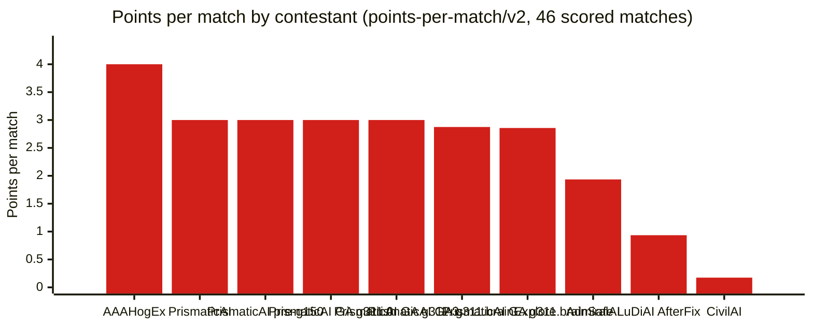
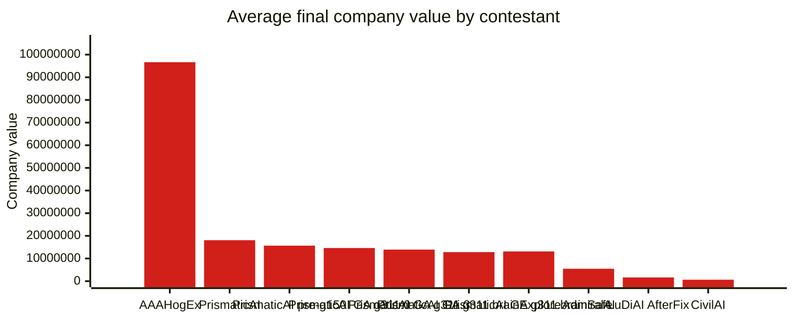
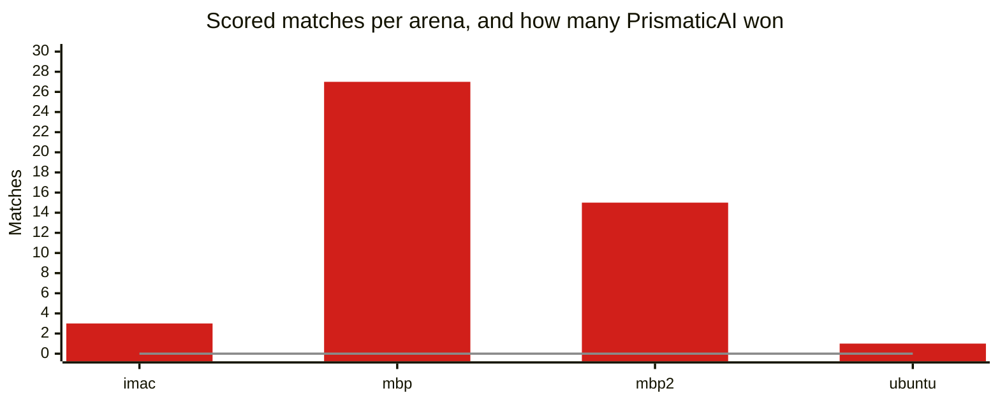

# battle-20261121T214432-3d1249dc

Derived from `battle-20261121T214432-3d1249dc.json` by `tools/research/ai-battle/battle.py report`; do not edit.

- Edition `3d1249dc93483df3`: PrismaticAI and referee at `531922be7d7544c6f7d5beecd51ca7906763f532`, base set `opengfx-8.0.tar`
- 20-year free-for-all from 1960, map 256x256 temperate, breakdowns 1
- 46 scored match(es) on `imac` (20261119-master-gdf1e05e7d8), `mbp` (20261120-master-m17653b726e), `mbp2` (20261119-master-gdf1e05e7d8), `ubuntu` (20261119-master-gdf1e05e7d8)
- Replays: 0 of 0 identical to their original on another arena

| # | Contestant | Played | Wins | Points | Points/match | Avg rank | Avg final value | Squirrel errors | Matches with anomalies |
|---|---|---|---|---|---|---|---|---|---|
| 1 | AAAHogEx | 46 | 46 | 184 | 4.0 | 1.0 | 96.7 M | 35 | 1 |
| 2 | PrismaticAI | 7 | 0 | 21 | 3.0 | 2.0 | 18.1 M | 0 | 0 |
| 3 | PrismaticAI pre-g150 | 9 | 0 | 27 | 3.0 | 2.0 | 15.7 M | 0 | 1 |
| 4 | PrismaticAI GA g311.0 | 7 | 0 | 21 | 3.0 | 2.0 | 14.6 M | 0 | 0 |
| 5 | PrismaticAI GA g311.3 | 8 | 0 | 24 | 3.0 | 2.0 | 13.9 M | 0 | 0 |
| 6 | PrismaticAI GA g311.brainExplore | 8 | 0 | 23 | 2.875 | 2.12 | 12.8 M | 0 | 0 |
| 7 | PrismaticAI GA g311.brainSafe | 7 | 0 | 20 | 2.857 | 2.14 | 13.1 M | 0 | 0 |
| 8 | AdmiralAI | 46 | 0 | 89 | 1.935 | 3.07 | 5.5 M | 0 | 1 |
| 9 | LuDiAI AfterFix | 46 | 0 | 43 | 0.935 | 4.07 | 1.6 M | 30 | 2 |
| 10 | CivilAI | 46 | 0 | 8 | 0.174 | 4.83 | 630.4 k | 11100 | 12 |

```mermaid
---
config:
  xyChart:
    width: 900
    height: 360
  themeVariables:
    xyChart:
      plotColorPalette: "#d11f1a, #8a8a8a, #0b0b0b, #ece4d6"
---
xychart-beta
    title "Final company value per scored match: winner vs best PrismaticAI"
    x-axis ["m-0001", "m-0002", "m-0003", "m-0004", "m-0005", "m-0006", "m-0007", "m-0008", "m-0009", "m-0010", "m-0011", "m-0012", "m-0013", "m-0014", "m-0015", "m-0016", "m-0017", "m-0018", "m-0019", "m-0020", "m-0021", "m-0022", "m-0023", "m-0024", "m-0025", "m-0027", "m-0028", "m-0035", "m-0036", "m-0037", "m-0038", "m-0039", "m-0040", "m-0041", "m-0042", "m-0043", "m-0044", "m-0045", "m-0046", "m-0047", "m-0049", "m-0050", "m-0052", "m-0053", "m-0054", "m-0055"]
    %% series: Winner | Best PrismaticAI
    %% links: battle-20261121T214432-3d1249dc.md?col=Match&filter=m-0001 | battle-20261121T214432-3d1249dc.md?col=Match&filter=m-0002 | battle-20261121T214432-3d1249dc.md?col=Match&filter=m-0003 | battle-20261121T214432-3d1249dc.md?col=Match&filter=m-0004 | battle-20261121T214432-3d1249dc.md?col=Match&filter=m-0005 | battle-20261121T214432-3d1249dc.md?col=Match&filter=m-0006 | battle-20261121T214432-3d1249dc.md?col=Match&filter=m-0007 | battle-20261121T214432-3d1249dc.md?col=Match&filter=m-0008 | battle-20261121T214432-3d1249dc.md?col=Match&filter=m-0009 | battle-20261121T214432-3d1249dc.md?col=Match&filter=m-0010 | battle-20261121T214432-3d1249dc.md?col=Match&filter=m-0011 | battle-20261121T214432-3d1249dc.md?col=Match&filter=m-0012 | battle-20261121T214432-3d1249dc.md?col=Match&filter=m-0013 | battle-20261121T214432-3d1249dc.md?col=Match&filter=m-0014 | battle-20261121T214432-3d1249dc.md?col=Match&filter=m-0015 | battle-20261121T214432-3d1249dc.md?col=Match&filter=m-0016 | battle-20261121T214432-3d1249dc.md?col=Match&filter=m-0017 | battle-20261121T214432-3d1249dc.md?col=Match&filter=m-0018 | battle-20261121T214432-3d1249dc.md?col=Match&filter=m-0019 | battle-20261121T214432-3d1249dc.md?col=Match&filter=m-0020 | battle-20261121T214432-3d1249dc.md?col=Match&filter=m-0021 | battle-20261121T214432-3d1249dc.md?col=Match&filter=m-0022 | battle-20261121T214432-3d1249dc.md?col=Match&filter=m-0023 | battle-20261121T214432-3d1249dc.md?col=Match&filter=m-0024 | battle-20261121T214432-3d1249dc.md?col=Match&filter=m-0025 | battle-20261121T214432-3d1249dc.md?col=Match&filter=m-0027 | battle-20261121T214432-3d1249dc.md?col=Match&filter=m-0028 | battle-20261121T214432-3d1249dc.md?col=Match&filter=m-0035 | battle-20261121T214432-3d1249dc.md?col=Match&filter=m-0036 | battle-20261121T214432-3d1249dc.md?col=Match&filter=m-0037 | battle-20261121T214432-3d1249dc.md?col=Match&filter=m-0038 | battle-20261121T214432-3d1249dc.md?col=Match&filter=m-0039 | battle-20261121T214432-3d1249dc.md?col=Match&filter=m-0040 | battle-20261121T214432-3d1249dc.md?col=Match&filter=m-0041 | battle-20261121T214432-3d1249dc.md?col=Match&filter=m-0042 | battle-20261121T214432-3d1249dc.md?col=Match&filter=m-0043 | battle-20261121T214432-3d1249dc.md?col=Match&filter=m-0044 | battle-20261121T214432-3d1249dc.md?col=Match&filter=m-0045 | battle-20261121T214432-3d1249dc.md?col=Match&filter=m-0046 | battle-20261121T214432-3d1249dc.md?col=Match&filter=m-0047 | battle-20261121T214432-3d1249dc.md?col=Match&filter=m-0049 | battle-20261121T214432-3d1249dc.md?col=Match&filter=m-0050 | battle-20261121T214432-3d1249dc.md?col=Match&filter=m-0052 | battle-20261121T214432-3d1249dc.md?col=Match&filter=m-0053 | battle-20261121T214432-3d1249dc.md?col=Match&filter=m-0054 | battle-20261121T214432-3d1249dc.md?col=Match&filter=m-0055
    y-axis "Company value" 0 --> 178000000
    bar [146072463, 126038580, 138115322, 138115322, 162137953, 76195306, 83739459, 82643038, 82950084, 87011573, 74789561, 107917093, 122601250, 125453938, 130680592, 130680592, 113849318, 95542176, 89520219, 83969379, 88640053, 85406417, 86225841, 103286331, 85005553, 105475036, 105475036, 57574556, 36841981, 85318833, 83267052, 85316325, 73463362, 108858878, 72157320, 73176982, 68966661, 58944089, 58944089, 71885311, 110344872, 98594849, 110652375, 112711318, 90761279, 131104514]
    line [18160495, 25937776, 11192601, 11192601, 21394514, 10376564, 9111857, 9821946, 13895845, 12950010, 12236648, 24616377, 22077456, 13693265, 14537034, 14537034, 21060372, 12844579, 8973888, 8624405, 5920185, 7238230, 8386615, 21982156, 19449218, 19537292, 19537292, 8728393, 23000840, 17135718, 14526448, 14338465, 14152317, 16286194, 13052292, 13693738, 14443251, 12445108, 12445108, 8996762, 12126278, 15377261, 10553972, 14349850, 20710607, 20331964]
```

<!-- battle-charts:begin -->
<!-- derived from battle-20261121T214432-3d1249dc.json by `battle.py render`; `battle.py check` fails when it is stale -->

<!-- battle-charts:end -->

| Match | Arena | Seed | Winner | Value | Last | Anomalies |
|---|---|---|---|---|---|---|
| m-0001 | mbp | 1596201796 | AAAHogEx | 146.1 M | CivilAI | CivilAI: fleet_drop:66->46 |
| m-0002 | mbp | 1596201796 | AAAHogEx | 126.0 M | CivilAI | - |
| m-0003 | mbp | 1596201796 | AAAHogEx | 138.1 M | CivilAI | - |
| m-0004 | mbp | 1596201796 | AAAHogEx | 138.1 M | CivilAI | - |
| m-0005 | mbp | 1596201796 | AAAHogEx | 162.1 M | CivilAI | - |
| m-0006 | mbp | 1991452849 | AAAHogEx | 76.2 M | LuDiAI AfterFix | CivilAI: fleet_drop:34->23 |
| m-0007 | mbp | 1991452849 | AAAHogEx | 83.7 M | LuDiAI AfterFix | PrismaticAI pre-g150: fleet_drop:41->28 |
| m-0008 | mbp | 1991452849 | AAAHogEx | 82.6 M | CivilAI | AdmiralAI: fleet_drop:185->97 |
| m-0009 | mbp | 1991452849 | AAAHogEx | 83.0 M | CivilAI | CivilAI: no_vehicles |
| m-0010 | imac | 1991452849 | AAAHogEx | 87.0 M | CivilAI | CivilAI: no_vehicles |
| m-0011 | imac | 1991452849 | AAAHogEx | 74.8 M | CivilAI | CivilAI: no_vehicles |
| m-0012 | imac | 428542693 | AAAHogEx | 107.9 M | CivilAI | - |
| m-0013 | mbp2 | 428542693 | AAAHogEx | 122.6 M | CivilAI | - |
| m-0014 | mbp2 | 428542693 | AAAHogEx | 125.5 M | CivilAI | - |
| m-0015 | mbp2 | 428542693 | AAAHogEx | 130.7 M | CivilAI | - |
| m-0016 | mbp2 | 428542693 | AAAHogEx | 130.7 M | CivilAI | - |
| m-0017 | mbp2 | 428542693 | AAAHogEx | 113.8 M | CivilAI | - |
| m-0018 | mbp2 | 1603761308 | AAAHogEx | 95.5 M | CivilAI | - |
| m-0019 | mbp2 | 1603761308 | AAAHogEx | 89.5 M | CivilAI | - |
| m-0020 | mbp2 | 1603761308 | AAAHogEx | 84.0 M | LuDiAI AfterFix | - |
| m-0021 | mbp2 | 1603761308 | AAAHogEx | 88.6 M | CivilAI | - |
| m-0022 | mbp2 | 1603761308 | AAAHogEx | 85.4 M | CivilAI | - |
| m-0023 | mbp2 | 1603761308 | AAAHogEx | 86.2 M | LuDiAI AfterFix | - |
| m-0024 | mbp2 | 1686288230 | AAAHogEx | 103.3 M | CivilAI | - |
| m-0025 | mbp2 | 1686288230 | AAAHogEx | 85.0 M | CivilAI | CivilAI: fleet_drop:43->14 |
| m-0027 | mbp2 | 1686288230 | AAAHogEx | 105.5 M | CivilAI | CivilAI: squirrel_errors:3695 |
| m-0028 | mbp2 | 1686288230 | AAAHogEx | 105.5 M | CivilAI | CivilAI: squirrel_errors:3695 |
| m-0035 | ubuntu | 911933315 | AAAHogEx | 57.6 M | CivilAI | AAAHogEx: squirrel_errors:35 |
| m-0036 | mbp | 758925665 | AAAHogEx | 36.8 M | CivilAI | - |
| m-0037 | mbp | 758925665 | AAAHogEx | 85.3 M | CivilAI | - |
| m-0038 | mbp | 758925665 | AAAHogEx | 83.3 M | CivilAI | - |
| m-0039 | mbp | 758925665 | AAAHogEx | 85.3 M | LuDiAI AfterFix | - |
| m-0040 | mbp | 758925665 | AAAHogEx | 73.5 M | LuDiAI AfterFix | - |
| m-0041 | mbp | 758925665 | AAAHogEx | 108.9 M | CivilAI | - |
| m-0042 | mbp | 402726034 | AAAHogEx | 72.2 M | CivilAI | CivilAI: squirrel_errors:3710 |
| m-0043 | mbp | 402726034 | AAAHogEx | 73.2 M | CivilAI | CivilAI: fleet_drop:51->25 |
| m-0044 | mbp | 402726034 | AAAHogEx | 69.0 M | CivilAI | - |
| m-0045 | mbp | 402726034 | AAAHogEx | 58.9 M | CivilAI | - |
| m-0046 | mbp | 402726034 | AAAHogEx | 58.9 M | CivilAI | - |
| m-0047 | mbp | 402726034 | AAAHogEx | 71.9 M | CivilAI | - |
| m-0049 | mbp | 267075266 | AAAHogEx | 110.3 M | CivilAI | - |
| m-0050 | mbp | 267075266 | AAAHogEx | 98.6 M | CivilAI | CivilAI: fleet_drop:94->37 |
| m-0052 | mbp | 267075266 | AAAHogEx | 110.7 M | LuDiAI AfterFix | LuDiAI AfterFix: squirrel_errors:30, no_vehicles |
| m-0053 | mbp | 267075266 | AAAHogEx | 112.7 M | CivilAI | - |
| m-0054 | mbp | 194693924 | AAAHogEx | 90.8 M | LuDiAI AfterFix | LuDiAI AfterFix: fleet_drop:100->69 |
| m-0055 | mbp | 194693924 | AAAHogEx | 131.1 M | CivilAI | CivilAI: fleet_drop:49->17 |
